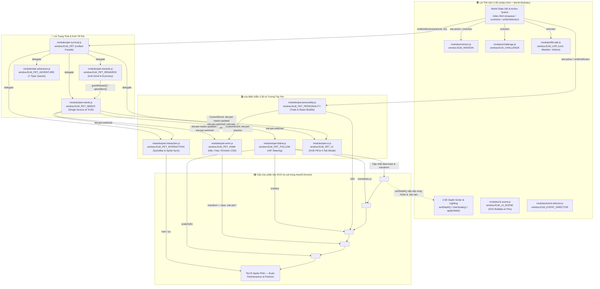
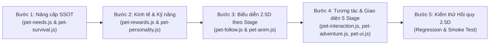

# 🏛️ BÁO CÁO KIỂM TOÁN KIẾN TRÚC & TÍCH HỢP THẾ GIỚI 2.5D — PET SYSTEM 2.0 (5 CẤP TRƯỞNG THÀNH)

> **Dự án:** English Life World (ELW)  
> **Giai đoạn:** Phase 1 — Nghiên cứu & Thiết kế Kiến trúc (Agent E: 2.5D World & Architecture Integration)  
> **Phạm vi khảo sát:** `index.html` + 9 module Pet (`modules/pet-*.js`) + 6 module Thế giới 2.5D (`mission.js`, `challenge.js`, `life-talk.js`, `event-director.js`, `ui-scene.js`, `ui-topics.js`)  
> **Trạng thái Codebase:** Read-only Audit (chưa can thiệp code)

---

## 1. SƠ ĐỒ KIẾN TRÚC HIỆN TẠI (CURRENT ARCHITECTURE MAP)

### 1.1. Tổng quan Luồng Nạp Script & Khởi tạo trong `index.html`

Trong `index.html` (dòng `651–659`), 9 module thú cưng được nạp tuần tự ngay trước script chính của Thế giới 2.5D (`dòng 661–2121`) và được khởi tạo ở khối bootstrap cuối trang (`dòng 2137–2147`):

1. `modules/pet-rewards.js` → `window.ELW_PET_REWARDS`
2. `modules/pet-needs.js` → `window.ELW_PET_NEEDS`
3. `modules/pet-interaction.js` → `window.ELW_PET_INTERACTION`
4. `modules/pet-adventure.js` → `window.ELW_PET_ADVENTURE`
5. `modules/pet-ui.js` → `window.ELW_PET_UI`
6. `modules/pet-personality.js` → `window.ELW_PET_PERSONALITY`
7. `modules/pet-follow.js` → `window.ELW_PET_FOLLOW`
8. `modules/pet-anim.js` → `window.ELW_PET_ANIM`
9. `modules/pet-survival.js` → `window.ELW_PET` (Unified Facade)

> [!IMPORTANT]
> **Lưu ý về `modules/event-director.js` và `modules/ui-topics.js`:**
> - Trong `index.html` dòng `638`, thẻ `<script>` hiện đang nạp `modules/events.js` (`window.ELW_EVENTS`). File `modules/event-director.js` (`window.ELW_EVENT_DIRECTOR`, 320 dòng) đã tồn tại hoàn chỉnh trong thư mục `modules/` với cơ chế `pickNext(ctx)` có cooldown, chống lặp 2 sự kiện gần nhất và lọc điều kiện thông minh, nhưng chưa được gắn thẻ `<script>` trong `index.html`.
> - Tương tự, `modules/ui-topics.js` (`window.ELW_UI_TOPICS`, 797 dòng) cung cấp giao diện Topic Selector 2.0 + Quick Dock `#elwTopicQuickDock` nhưng trong `index.html` dòng `2094–2120` vẫn đang chạy IIFE `window.ELW_TOPICS` nội tuyến.

---

### 1.2. Sơ đồ Kiến trúc & Luồng Sự kiện (Mermaid Architecture Diagram)



---

### 1.3. Bảng Phân Vai Chi Tiết 15 Module & Mối Quan Hệ Thực Tế

#### A. Làm rõ mối quan hệ giữa `modules/pet-needs.js` và `modules/pet-survival.js`

> [!NOTE]
> **Kết luận quan trọng từ kiểm toán code thật:**
> - **`modules/pet-survival.js` (`window.ELW_PET`, 399 dòng) KHÔNG CÒN là hệ thống đếm ngược trừ sao (legacy survival timer) độc lập.** Toàn bộ cơ chế trừ sao khi bỏ bê đã bị vô hiệu hóa hoàn toàn theo thiết kế mới (`applyPenalty()` tại dòng `271–273` là hàm no-op trả về `{ penalized: false, reason: "penalties_disabled_by_design" }`).
> - Thay vào đó, `pet-survival.js` đóng vai trò **Unified Facade (`window.ELW_PET`)** kết nối `index.html` với 5 module con (`ELW_PET_REWARDS`, `ELW_PET_NEEDS`, `ELW_PET_INTERACTION`, `ELW_PET_ADVENTURE`, `ELW_PET_UI`). Khi `index.html` gọi `ELW_PET.onWorldAction(a.id, ...)` (dòng `2012`), `pet-survival.js` tự động điều phối sang:
>   1. `ELW_PET_REWARDS.onWorldAction(id, ctx)` (thưởng thức ăn/nước/đồ chơi/XP chống cày cuốc).
>   2. `ELW_PET_ADVENTURE.onWorldAction(id, ctx)` (cập nhật tiến độ nhiệm vụ phiêu lưu).
>   3. `ELW_PET_INTERACTION.onWorldAction(id, ctx)` (hiển thị phản ứng nếu là hành động chăm sóc trực tiếp).
>   4. `ELW_PET_NEEDS.recordEnglishActivity(type, payload)` (tăng XP, Fun, Bond).
> - **`modules/pet-needs.js` (`window.ELW_PET_NEEDS`, 1100 dòng) là Single Source of Truth (SSOT)** quản lý danh sách 10 Pet (`PET_LIST`), 10 trạng thái (`STATES`), 5 chỉ số nhu cầu (`energy`, `hunger`, `thirst`, `fun`, `bond` từ `0..100`), kho vật phẩm (`inventory: { treats, water, toys }`), và thống kê cấp độ (`stats: { xp, level, stageBadge, streak, totalCareActions, totalEnglishActions }`).

#### B. Bảng Phân Vai 9 Module Pet (`modules/pet-*.js`)

| STT | Module & Global Namespace | Số dòng | `localStorage` Key | Vai trò cốt lõi, DOM sở hữu & CustomEvent |
| :--- | :--- | :---: | :--- | :--- |
| 1 | [`modules/pet-needs.js`](file:///D:/tools/Hoc%20tieng%20anh/english-life-world/modules/pet-needs.js) (`window.ELW_PET_NEEDS`) | 1100 | `elw_pet_needs_v2` (đồng bộ ngược `activePetId` về `elw_pet_v1` qua `syncLegacyV1Storage` dòng `469`) | **SSOT của Pet System:** Định nghĩa 10 pet (`milu`, `boba`, `cookie`, `mochi`, `pepper`, `oreo`, `ember`, `lumi`, `pip`, `aqua`), 10 state, 5 chỉ số nhu cầu suy giảm theo timestamp (`applyOfflineDecay` dòng `523` với trần `MAX_OFFLINE_DECAY_MS = 6h` và sàn `OFFLINE_FLOOR = 25`), hệ 5 cấp độ (`LEVEL_THRESHOLDS` dòng `202`: XP `0, 100, 250, 450, 700`). Phát sự kiện: `elw:pet-needs-updated`, `elw:pet-switched`, `elw:pet-level-up`, `elw:pet-care-action`, `elw:pet-reward-received`, `elw:pet-activity-recorded`. |
| 2 | [`modules/pet-rewards.js`](file:///D:/tools/Hoc%20tieng%20anh/english-life-world/modules/pet-rewards.js) (`window.ELW_PET_REWARDS`) | 666 | `elw_pet_rewards_v2` (cấu hình cooldown/daily), ghi xuyên qua `elw_pet_needs_v2` và `elw_pet_v1` | **Kinh tế học tập & Chống cày lặp (Anti-Grind):** Áp dụng `COOLDOWN_MS = 90000` (90s) cho cùng 1 hành động (`canRewardAction` dòng `412`), thưởng hoàn thành câu (`onSentenceComplete`), phát âm (`onPronunciationScore`), hội thoại (`onConversationComplete`), nhiệm vụ (`onMissionComplete`), thử thách (`onChallengeComplete`), chuỗi ngày (`checkDailyStreak`). Render toast nổi `#elw-pet-reward-toast-root`. |
| 3 | [`modules/pet-adventure.js`](file:///D:/tools/Hoc%20tieng%20anh/english-life-world/modules/pet-adventure.js) (`window.ELW_PET_ADVENTURE`) | 2011 | `elw_pet_adventure_v2` | **Hệ thống 14 Nhiệm vụ Phiêu lưu xuyên 7 Chủ đề:** Gồm 7 nhiệm vụ Free (`home_snack_hunt`, `park_fetch_day`, `cafe_cozy_corner`, `market_treat_run`, `restaurant_polite_guest`, `outdoor_campfire_buddy`, `school_show_and_tell`) và 7 nhiệm vụ Premium. Tự động lắng nghe hành động thế giới qua `onWorldAction(actionId, ctx)` (dòng `1416`), kiểm tra `matchesObjective` (dòng `1066`), hỗ trợ `startQuest`, `claimQuestReward`, `openSpeakPromptModal`. |
| 4 | [`modules/pet-interaction.js`](file:///D:/tools/Hoc%20tieng%20anh/english-life-world/modules/pet-interaction.js) (`window.ELW_PET_INTERACTION`) | 1659 | *(Đọc/ghi qua `ELW_PET_NEEDS`)* | **Tương tác trực tiếp & Đồng bộ Sprite trong phòng 2.5D:** Xử lý 5 hành động chăm sóc (`feed`, `water`, `play`, `pet`, `sleep_toggle` trong `CARE_CATALOG` dòng `28`), câu thoại song ngữ theo loài (`SPECIES_LINES` dòng `95`) + luyện nói Web Speech API (`startVoicePractice` dòng `1033`). **Sở hữu `#roomPetImg`:** Hàm `syncScenePet()` (dòng `1403`) ẩn `#catBody`, `#catCurl`, xóa `#ctx-dog`, tạo `<image id="roomPetImg" x="-38" y="-68" width="76" height="76">` trong `#catFlip`. Bơm thanh `#petSceneQuickBar` vào đầu `#panel` khi click `#o-cat`. |
| 5 | [`modules/pet-ui.js`](file:///D:/tools/Hoc%20tieng%20anh/english-life-world/modules/pet-ui.js) (`window.ELW_PET_UI`) | 1909 | *(Đọc qua `ELW_PET_NEEDS` & `ELW_PET_ADVENTURE`)* | **HUD Pill & Modal 4 Tab:** Render `#petHudPill` trên `.topbar` (hiển thị avatar, tên, `stageBadge`, thanh máu trung bình, badge chấm đỏ khi `hunger < 40 || thirst < 40 || energy < 35`) và Modal `#petHubModalBackdrop` gồm 4 tab: `care` (Chăm sóc), `pets` (Thú cưng - 10 pet), `quests` (Phiêu lưu), `bond` (Gắn kết). Hàm `enrichFacade()` (dòng `1812`) gắn thêm helper vào `window.ELW_PET`. |
| 6 | [`modules/pet-personality.js`](file:///D:/tools/Hoc%20tieng%20anh/english-life-world/modules/pet-personality.js) (`window.ELW_PET_PERSONALITY`) | 1260 | *(Stateless — tra cứu theo `activePetId`)* | **Cá tính 10 Pet & Bong bóng Phản ứng 2.5D:** Định nghĩa `PERSONALITIES` (dòng `36–632`) với `favoriteRoom`, `favoriteWeather`, `favoriteItems`, `dislikedItems`, `likedActions`, `dislikedActions`, `bubbleLines`. Khi `onWorldAction` xảy ra (có `COOLDOWN_MS = 3500`), hàm `evaluateReaction` tính điểm (`love`, `like`, `neutral`, `dislike`), vẽ `<g id="petReactBubble" transform="translate(30, -28)">` vào `#catScale` (dòng `921–995`), cộng chỉ số (`applyReactionBonus`) và phát `elw:pet-reaction`. |
| 7 | [`modules/pet-follow.js`](file:///D:/tools/Hoc%20tieng%20anh/english-life-world/modules/pet-follow.js) (`window.ELW_PET_FOLLOW`) | 1179 | *(Không dùng storage)* | **Di chuyển 2.5D & Depth Sorting cho Pet:** Chạy vòng lặp `requestAnimationFrame` (`tick` dòng `940`). Đọc tọa độ `#char` (`parseTransformXY`), tính vị trí đích theo cấu hình loài (`SPECIES_FOLLOW_CFG`: dog bám gần, cat điềm tĩnh tìm điểm ấm `ROOM_WARM_SPOTS`, rare lơ lửng) và kẹp trong đa giác sàn (`ROOM_POLYGONS`). **Sở hữu:** `#o-cat` (`dataset.base = Math.round(state.y + 2)`), `#catPos` (`translate(x, y)`), `#catScale` (`scale(s)` với `s = charScale(y) * 0.92`), `#catFlip` (`scaleX(dir)`). Nhường quyền (`isYieldingNow` dòng `637`) khi nhân vật chạy 6 hành động mèo (`call_cat`, `pet_cat`, `feed_cat`, `give_cat_water`, `play_with_cat`, `brush_cat`). |
| 8 | [`modules/pet-anim.js`](file:///D:/tools/Hoc%20tieng%20anh/english-life-world/modules/pet-anim.js) (`window.ELW_PET_ANIM`) | 806 | *(Không dùng storage)* | **Hoạt ảnh Biểu cảm & Vật lý Nhún nhảy trên `#catHop`:** Tuân thủ ranh giới DOM tuyệt đối (comment dòng `12–17`): **KHÔNG** chạm vào `#catPos`, `#catScale`, `#catFlip`; **CHỈ** biến đổi `#catHop` (`style.transform = translate(0px, hopY) rotate(tiltDeg) scale(scaleX, scaleY)` và các class `.elw-pet-mode-idle/walk/sleep`, `.elw-pet-emotion-love/like/excited/curious/dislike`, `.elw-pet-tired`) cùng `href`/`src` của `#roomPetImg` theo 10 trạng thái ảnh (`assets/pets/<petId>/<state>.png`). |
| 9 | [`modules/pet-survival.js`](file:///D:/tools/Hoc%20tieng%20anh/english-life-world/modules/pet-survival.js) (`window.ELW_PET`) | 399 | `elw_pet_v1` (chỉ đọc để migrate sang v2 tại `migrateLegacyStorage` dòng `30`) | **Unified Facade & Legacy Bridge:** Khởi tạo toàn bộ 5 module Pet (`init` dòng `282`), cung cấp API thống nhất cho `index.html` (`onWorldAction`, `onSpeak`, `onAction`, `feed`, `drink`, `play`, `openModal`, `switchPet`, `getState`). |

#### C. Bảng Phân Vai 6 Module Thế Giới 2.5D Liên Quan

| STT | Module & Global Namespace | Số dòng | Cơ chế hoạt động & Điểm giao cắt với Hệ thống Pet |
| :--- | :--- | :---: | :--- |
| 10 | [`modules/mission.js`](file:///D:/tools/Hoc%20tieng%20anh/english-life-world/modules/mission.js) (`window.ELW_MISSION`) | 310 | Hệ thống nhiệm vụ 3 chế độ (`play`, `hint`, `auto`). Nhận sự kiện qua `ELW_MISSION.onAction(actionId, W)` tại `index.html` dòng `2009`. Đổi xung đột trực tiếp với `ELW_CHALLENGE` (dòng `2085–2087`: bật Mission sẽ tự `pause()` Challenge và ngược lại). Dùng `ELW_UI_SCENE.bubble` và `pin` để gắn gợi ý lên đồ vật SVG. |
| 11 | [`modules/challenge.js`](file:///D:/tools/Hoc%20tieng%20anh/english-life-world/modules/challenge.js) (`window.ELW_CHALLENGE`) | 342 | Quản lý thử thách hàng ngày, thử thách chủ đề và thử thách chuỗi ngày (`STREAK`). Lưu tại `localStorage["elw_challenge_v2"]`. Nhận hook từ `index.html` dòng `2008` (`ELW_CHALLENGE.onAction(a.id, W)`), `onSpeak()`, `onRoleplay()`. Hỗ trợ `pause()` / `resume()` (dòng `167–168`). |
| 12 | [`modules/life-talk.js`](file:///D:/tools/Hoc%20tieng%20anh/english-life-world/modules/life-talk.js) (`window.ELW_LIFE`) | 852 | Quản lý bạn đồng hành **Linh** (`#elw-companion`), thời tiết (`sunny`, `rainy`, `windy`, `cold`, `hot`) và khách ghé thăm (`#elw-visitor`). Vẽ bong bóng thoại 3D trực tiếp vào `#room` (`draw3DSpeechBubble` dòng `392` tạo `<g id="elw3dSpeechBubble">`, tính vị trí neo dựa trên `anchorEl.getBBox()` của `#char`, `#o-cat`, `#elw-companion`). Gọi TTS qua `host.say(en, voice)` sau khi `speechQuiet()` hoàn tất. |
| 13 | [`modules/event-director.js`](file:///D:/tools/Hoc%20tieng%20anh/english-life-world/modules/event-director.js) (`window.ELW_EVENT_DIRECTOR`) | 320 | Bộ đạo diễn sự kiện ngẫu nhiên thông minh: lưu lịch sử cooldown trong `sessionStorage["elw_event_director_v1"]`, có hàm `pickNext({ events, room, worldState, completedIds, now })` lọc theo điều kiện phòng (`when`), trừ điểm các sự kiện vừa xuất hiện để chống lặp. Rất lý tưởng để tái sử dụng cho sự kiện Pet ngẫu nhiên. |
| 14 | [`modules/ui-scene.js`](file:///D:/tools/Hoc%20tieng%20anh/english-life-world/modules/ui-scene.js) (`window.ELW_UI_SCENE`) | 588 | Lớp overlay SVG `<g id="elwSceneUiLayer">` đặt ở cuối `#room` (trên cả `#world`). Cung cấp `bubble(anchor, opts)` (dòng `392`), `pin(objectId, opts)` (dòng `479`) và `clearAll()`. Hàm `getElementViewBoxBounds(el)` (dòng `221`) đo `getBoundingClientRect()` quy đổi sang hệ tọa độ `viewBox (1000x640)`. |
| 15 | [`modules/ui-topics.js`](file:///D:/tools/Hoc%20tieng%20anh/english-life-world/modules/ui-topics.js) (`window.ELW_UI_TOPICS`) | 797 | Quản lý chọn 7 chủ đề học (`home`, `park`, `restaurant`, `cafe`, `market`, `outdoor`, `school`) và thanh `#elwTopicQuickDock`. Đọc/ghi `localStorage["elw_topics_v1"]`. |

---

## 2. THIẾT KẾ TÍCH HỢP PET 2.0 VÀO THẾ GIỚI 2.5D (REUSE VS EXTEND)

### 2.1. Phân loại Tái sử dụng 100% (Reuse) vs Mở rộng (Extend)

#### ✅ Giữ nguyên & Tái sử dụng 100% (KHÔNG viết lại)
1. **Cơ chế phân tầng DOM trong `#o-cat` (`index.html` dòng `525–565`):**
   - Giữ nguyên cấu trúc lồng nhau: `#o-cat` → `#catPos` → `.vec` → `#catScale` → `#catHop` → `#catFlip` → `#roomPetImg`.
   - Quy tắc vàng: `pet-follow.js` độc quyền `#catPos` / `#catScale` / `#catFlip`; `pet-anim.js` độc quyền `#catHop` và `<image id="roomPetImg">`.
2. **Thuật toán 2.5D Depth Sorting (`sortDepth` tại `index.html` dòng `1790–1796`):**
   - `sortDepth()` sắp xếp mọi phần tử trực tiếp trong `#world` theo thuộc tính `data-base` tăng dần (`(+a.dataset.base||0) - (+b.dataset.base||0)`).
   - `pet-follow.js` (dòng `819–823`) đã cập nhật `catEl.dataset.base = String(Math.round(state.y + 2))` và gọi `window.sortDepth()` mỗi khi Pet dịch chuyển quá `1.5px` theo trục Y. Cơ chế này hoạt động hoàn hảo ở mọi cấp trưởng thành mà không cần sửa `index.html`.
3. **Vòng lặp Di chuyển & Nhường đường (`pet-follow.js`):**
   - Giữ nguyên đa giác giới hạn sàn `ROOM_POLYGONS` (dòng `64–91`), điểm sưởi ấm `ROOM_WARM_SPOTS` (dòng `94–112`), và hàm `isYieldingNow()` (dòng `637`) để không bao giờ phá hỏng 6 hành động tương tác mèo gốc của `index.html`.
4. **Cơ chế Anti-Grind & Cooldown (`pet-rewards.js`):**
   - Giữ nguyên bộ lọc cooldown 90 giây mỗi hành động (`COOLDOWN_MS = 90000`) và giới hạn điểm thưởng theo ngày.

#### 🔧 Cần Mở rộng (Extend) cho PET SYSTEM 2.0 (5 Cấp Trưởng Thành)
1. **`modules/pet-needs.js` (`window.ELW_PET_NEEDS`):**
   - Nâng cấp từ cấu trúc phẳng (1 bộ `needs`/`stats` dùng chung) sang cấu trúc lưu trữ đa thú cưng (`pets[petId]`) kèm hệ thống **5 Cấp Trưởng Thành (Stages 1 → 5)**:
     - `Stage 1 (Baby / Sơ sinh)` → `Stage 2 (Junior / Nhỏ nhắn)` → `Stage 3 (Teen / Năng động)` → `Stage 4 (Adult / Trưởng thành)` → `Stage 5 (Master / Huyền thoại)`.
   - Bổ sung hàm `getState()` trả về cấu trúc tương thích ngược hoàn toàn cho cả code cũ lẫn code mới.
   - Phát sự kiện mới `elw:pet-stage-up` khi Pet vượt ngưỡng tiến hóa Stage.
2. **`modules/pet-follow.js` & `modules/pet-anim.js`:**
   - Mở rộng hệ số phóng đại theo cấp trưởng thành (`STAGE_SCALE_MULTIPLIERS = { 1: 0.76, 2: 0.88, 3: 1.00, 4: 1.12, 5: 1.24 }`) kết hợp với độ sâu 2.5D (`computeScaleForY(y)`).
   - Hỗ trợ tra cứu sprite theo stage (ưu tiên `assets/pets/<petId>/stage<stage>_<state>.png` nếu có, fallback mượt về `assets/pets/<petId>/<state>.png`) và hiệu ứng hào quang/vươngiện SVG nhẹ cho Stage 4–5.
3. **`modules/pet-personality.js` & Kỹ năng Thú cưng (Pet Skills):**
   - Mở rộng `PERSONALITIES` hoặc tích hợp nhánh `skills` mở khóa theo Stage (Stage 2 mở Passive nhẹ, Stage 3 mở Active gợi ý từ vựng, Stage 5 mở Master Buff thưởng thêm XP/Vật phẩm hoặc gợi ý câu trả lời trong Mission/Adventure).
4. **`modules/pet-adventure.js` & `modules/pet-ui.js`:**
   - Hiển thị thanh tiến trình 5 Stage, huy hiệu Stage, kỹ năng mở khóa ở từng Stage trong Modal `#petHubModalBackdrop` và các mốc Quest yêu cầu hoặc thưởng điểm tiến hóa Stage.

---

### 2.2. Hợp đồng Giao diện & Sự kiện Chuẩn Hóa (API & Event Contracts)

Để các Agent ở Giai đoạn 2–3 code song song không bị lệch tên hàm hoặc thuộc tính, dưới đây là hợp đồng giao tiếp bắt buộc:

#### A. Hợp đồng State & Getter trên `window.ELW_PET_NEEDS`
```js
// 1. Hàm getState() (BẮT BUỘC bổ sung vào return của pet-needs.js và giữ trên ELW_PET)
const state = window.ELW_PET_NEEDS.getState();
/*
Trả về object tương thích kép (Flat + Nested):
{
  activePetId: "milu",
  stage: 3,                 // 1..5 (đồng bộ với stats.level)
  level: 3,                 // 1..5
  xp: 280,                  // đồng bộ với stats.xp
  hunger: 80,               // đồng bộ với needs.hunger
  thirst: 75,               // đồng bộ với needs.thirst
  energy: 85,               // đồng bộ với needs.energy
  fun: 70,                  // đồng bộ với needs.fun
  bond: 65,                 // đồng bộ với needs.bond
  moodState: "idle_happy",  // 1 trong 10 STATES
  needs: { energy: 85, hunger: 80, thirst: 75, fun: 70, bond: 65 },
  stats: {
    xp: 280,
    level: 3,
    stage: 3,
    stageBadge: "🌟 Lv.3 Tinh Anh",
    stageKey: "teen",       // "baby" | "junior" | "teen" | "adult" | "master"
    scaleMultiplier: 1.0,   // 0.76 | 0.88 | 1.00 | 1.12 | 1.24
    streak: 4
  },
  inventory: { treats: 3, water: 3, toys: 2 },
  pets: {
    milu: { unlocked: true, xp: 280, stage: 3, needs: {...}, equippedAccessory: null },
    ...
  }
}
*/
```

#### B. Hợp đồng CustomEvents trên `window`
| Tên Sự Kiện (`CustomEvent`) | Nơi Phát (Dispatcher) | Payload (`event.detail`) | Nơi Lắng Nghe (Listeners) |
| :--- | :--- | :--- | :--- |
| `elw:pet-needs-updated` | `pet-needs.js` (`emitNeedsUpdated`) | `{ activePetId, activePet, needs, inventory, stats, moodState, stage, scaleMultiplier }` | `pet-ui.js`, `pet-anim.js`, `pet-follow.js`, `pet-interaction.js` |
| `elw:pet-stage-up` *(Mới)* | `pet-needs.js` (khi `newStage > oldStage`) | `{ petId, pet, oldStage, newStage, stageTitleVi, stageTitleEn, scaleMultiplier, unlockedSkill }` | `pet-ui.js` (mở Celebration Toast/Banner), `pet-anim.js` (chạy hiệu ứng tiến hóa), `pet-follow.js` (cập nhật scale & bubble offset) |
| `elw:pet-switched` | `pet-needs.js` (`switchPet`) | `{ petId, pet, state: getSnapshot() }` | `pet-interaction.js`, `pet-anim.js`, `pet-follow.js`, `pet-ui.js` |
| `elw:pet-reaction` | `pet-personality.js` (`onWorldAction`) | `{ petId, actionId, reaction, reason, en, vi, stage }` | `pet-anim.js` (`onPetReaction`), `pet-ui.js` |
| `elw:pet-skill-triggered` *(Mới)* | `pet-personality.js` / `pet-interaction.js` | `{ petId, stage, skillId, effectType, bonus, en, vi }` | `pet-rewards.js`, `pet-ui.js`, `pet-anim.js` |

---

## 3. PHÂN TÍCH 4 RỦI RO PHÁ VỠ GAMEPLAY (REGRESSION RISKS) & GIẢI PHÁP KỸ THUẬT

### Rủi ro 1: Đứt gãy Schema `localStorage` & Lỗi gọi hàm `ELW_PET_NEEDS.getState()`

> [!WARNING]
> **Phát hiện lỗi tiềm ẩn ngay trong code hiện tại:**
> 1. Trong `modules/pet-interaction.js` (dòng `849`, `885`, `924`) và `modules/pet-anim.js` (dòng `189`), code đang viết:
>    ```js
>    if (typeof N.getState === "function") return N.getState();
>    ```
>    Tuy nhiên, `modules/pet-needs.js` (dòng `1063–1097`) hiện chỉ export `getSnapshot()`, `getNeeds()`, `getStats()`, **chưa hề export hàm `getState()`**!
> 2. Trong `modules/pet-rewards.js` (dòng `343–375`, nhánh fallback khi ghi trực tiếp vào `elw_pet_needs_v2`), code đang gán `safeState.xp`, `safeState.bond` ở cấp root thay vì `safeState.stats.xp` và `safeState.needs.bond`.
> 3. Đề bài hoặc các module cũ có thể truy cập `PetNeeds.getState().hunger`, `.xp`, `.stage` trực tiếp ở root hoặc đọc từ `elw_pet_needs_v1` / `elw_pet_needs_v2`.

**🛠️ Giải pháp kỹ thuật bắt buộc:**
- **Giữ nguyên key chính là `elw_pet_needs_v2`** và bổ sung bộ nạp di trú tự động từ cả `elw_pet_needs_v1` lẫn `elw_pet_v1` nếu phát hiện dữ liệu cũ.
- **Export hàm `getState()` trên `window.ELW_PET_NEEDS`** trả về bản sao của `getSnapshot()` nhưng có gắn các thuộc tính phẳng ở root (`hunger`, `thirst`, `energy`, `fun`, `bond`, `xp`, `level`, `stage`, `stageBadge`) đồng bộ 100% với `needs.*` và `stats.*` (hoặc dùng `Object.defineProperties` getter trên prototype snapshot).
- Khi nâng cấp lên cấu trúc đa thú cưng `state.pets[petId]`, mỗi khi gọi `switchPet(petId)` hoặc cập nhật nhu cầu của `activePetId`, `pet-needs.js` phải **đồng bộ hai chiều** giữa `state.pets[activePetId].needs/stats` và `state.needs` / `state.stats` ở cấp root của `elw_pet_needs_v2`. Nhờ đó mọi module đọc `getSnapshot().needs.hunger` hay `getState().hunger` đều nhận đúng giá trị.

---

### Rủi ro 2: Lệch Tâm Neo (Anchor Point), Chìm/Bay khỏi mặt sàn 2.5D và Bong bóng đè lên đầu Pet khi Scale theo 5 Stage

> [!CAUTION]
> **Phát hiện từ cấu trúc SVG thực tế (`index.html` dòng `525–565` & `pet-interaction.js` dòng `648`, `1446`):**
> - Trong `#o-cat`, bóng đổ dưới đất là `<ellipse cx="0" cy="0" rx="24" ry="4.5"/>` nằm trong `#catScale` (tức là mặt sàn nơi chân Pet đứng có tọa độ gốc là **`(0, 0)`**).
> - Thẻ `<image id="roomPetImg" x="-38" y="-68" width="76" height="76">` có đáy ảnh nằm tại `y = -68 + 76 = +8`.
> - Đặc biệt, trong `modules/pet-interaction.js` dòng `648`, CSS đang ép cứng:
>   ```css
>   #room #o-cat #roomPetImg { width: 76px !important; height: 76px !important; ... }
>   ```
> - Ngoài ra, `modules/pet-personality.js` (dòng `946`) gắn `<g id="petReactBubble" transform="translate(30, -28)">` trực tiếp vào `#catScale`.
> - Nếu ở Stage 1–5 ta đổi `width/height` của `#roomPetImg` hoặc scale `#catHop` với `transform-origin: center`:
>   1. Quy tắc `!important` ở `pet-interaction.js` dòng `648` sẽ chặn mọi thay đổi kích thước CSS của `#roomPetImg`.
>   2. Nếu scale quanh tâm giữa (`-30px`), ở Stage 1 (0.76x) chân Pet sẽ bị **treo lơ lửng trên không**, còn ở Stage 5 (1.24x) chân Pet sẽ **đâm xuyên xuống dưới bóng đổ `cy="0"`**.
>   3. Bong bóng `#petReactBubble` ở `translate(30, -28)` và nhãn `<text class="tag" y="-56">` sẽ đè thẳng vào mặt Pet ở Stage 4–5.

**🛠️ Giải pháp kỹ thuật bắt buộc:**
1. **Thực hiện Scale của Stage ngay trong `pet-follow.js` tại `#catScale` (hoặc nhân hệ số `stageScale` vào `computeScaleForY(y)`):**
   - Vì `#catScale` có gốc tọa độ `(0, 0)` nằm ngay tại bóng đổ dưới chân Pet (`<ellipse cx="0" cy="0">`), việc nhân `stageMultiplier` (`Stage 1: 0.78`, `Stage 2: 0.89`, `Stage 3: 1.00`, `Stage 4: 1.10`, `Stage 5: 1.20`) vào phép biến đổi `scale(s)` của `#catScale` (hoặc đặt `transform-origin: 0px 0px` trên `#catHop`) sẽ giúp **chân Pet luôn bám chặt vào mặt sàn `(0, 0)` và khớp với bóng đổ** ở mọi vị trí sâu/nông trong phòng!
2. **Nếu giữ `#petReactBubble` không bị phóng to/thu nhỏ méo mó theo `#catScale`:**
   - Gắn `#petReactBubble` vào `#catPos` (bên ngoài `#catScale`) hoặc dịch chuyển tọa độ Y của `#petReactBubble` động theo Stage: `const bubbleY = Math.round(-28 * stageMultiplier - (stage >= 4 ? 10 : 0))` để bong bóng luôn nổi phía trên đầu Pet.
3. **Với `ui-scene.js` (`getElementViewBoxBounds`) và `life-talk.js` (`draw3DSpeechBubble`):**
   - Cả hai module này đều đo kích thước thực tế qua `getBoundingClientRect()` / `getBBox()` của `#o-cat`, nên khi `#catScale` phóng to đúng tâm `(0, 0)`, bong bóng của `ui-scene.js` và `life-talk.js` sẽ tự động dời lên cao theo đỉnh hộp bao mới mà không cần sửa `ui-scene.js` hay `life-talk.js`.

---

### Rủi ro 3: Xung đột Âm thanh TTS (`speechSynthesis`) & Chồng chéo Bong bóng thoại khi `onWorldAction`

> [!WARNING]
> **Phân tích luồng thực thi `runAction` tại `index.html` dòng `1992–2023`:**
> Khi người chơi click thực hiện 1 hành động:
> - Dòng `2001`: `narrate(a)` đọc to câu tiếng Anh của hành động qua `say()` (`speechSynthesis`) và hiện bong bóng của nhân vật chính (`charSay`).
> - Dòng `2008–2010`: `ELW_CHALLENGE.onAction`, `ELW_MISSION.onAction`, `ELW_LIFE.onAction` cùng chạy. Trong đó `ELW_LIFE.onAction` (`life-talk.js` dòng `571`) đợi `220ms` rồi vẽ `#elw3dSpeechBubble` cho Linh và gọi `host.say()` (đợi `speechQuiet()`).
> - Dòng `2012`: `ELW_PET.onWorldAction` kích hoạt `ELW_PET_REWARDS`, `ELW_PET_ADVENTURE`, `ELW_PET_INTERACTION`.
> - Dòng `2018` (`emitAction` phát `elw:action`): `ELW_PET_PERSONALITY` bắt sự kiện và vẽ `#petReactBubble` + phát âm thanh WebAudio (`playReactSound`).
>
> **Nguy cơ:** Nếu ở PET 2.0, khi Pet lên cấp (`elw:pet-stage-up`) hoặc kích hoạt Kỹ năng (`elw:pet-skill-triggered`) ngay trong `onWorldAction`, mà Pet gọi `window.speechSynthesis.speak()` trực tiếp hoặc bung Modal chắn ngang khi `ELW_MISSION` / `ELW_ROLEPLAY` đang chạy, nó sẽ **ngắt lời đọc bài học tiếng Anh của nhân vật chính hoặc của bạn đồng hành Linh**.

**🛠️ Giải pháp kỹ thuật bắt buộc:**
1. **Nguyên tắc Ưu tiên Âm thanh (Audio Priority Policy):**
   - Trong lúc `onWorldAction` đang diễn ra, các phản ứng tự động của Pet (`pet-personality.js`, hiệu ứng lên Stage, hiệu ứng Skill) **CHỈ được phát hiệu ứng âm thanh ngắn bằng WebAudio (`AudioContext` oscillator như `playReactSound`)**, **TUYỆT ĐỐI KHÔNG tự động gọi `speechSynthesis.speak()`** đè lên `narrate(a)` của bài học.
   - Chỉ khi người chơi **chủ động bấm vào Pet** (`#o-cat`), bấm nút trong `#petSceneQuickBar`, hoặc bấm nút nghe/luyện nói trong `#petHubModalBackdrop`, Pet mới gọi TTS tiếng Anh.
2. **Nguyên tắc Hàng đợi Lễ Tiến Hóa (Stage-Up Celebration Queue):**
   - Khi sự kiện `elw:pet-stage-up` xảy ra giữa lúc nhân vật đang đi lại hoặc đang chạy `ELW_MISSION.active()` / `rpPlayer.isRunning()`, chỉ hiển thị **Toast/Banner nổi không chặn màn hình (non-blocking banner)** và hiệu ứng lấp lánh trên `#catHop` (`.elw-pet-emotion-excited`), không tự động bật Modal toàn màn hình làm đứt mạch Mission/Roleplay.

---

### Rủi ro 4: Xung đột Trạng thái Nhiệm vụ (`Mission` / `Challenge` / `PetAdventure`) & Xung đột File đang chỉnh sửa

> [!IMPORTANT]
> **Ranh giới an toàn với Thế giới 2.5D:**
> - Trong `index.html` dòng `2085–2087`, `ELW_MISSION` và `ELW_CHALLENGE` đang khóa lẫn nhau (chỉ chạy 1 chế độ tại 1 thời điểm).
> - Trong khi đó, `ELW_PET_ADVENTURE` (`modules/pet-adventure.js`) được thiết kế chạy **song song thụ động (passive observer)** qua `onWorldAction(actionId, ctx)` mà không chiếm quyền điều khiển nhân vật của `ELW_MISSION`.
> - **Cảnh báo:** Nếu PET 2.0 thêm tính năng "Đi tới nhiệm vụ của Pet" (`goToQuestRoom` trong `pet-ui.js` dòng `1460`), hàm này gọi `window.ELW.enqueue("go_" + topicHome)`. Nếu gọi khi `ELW_MISSION.active()` đang ở chế độ `auto`, nó sẽ chèn ngang hàng đợi `queue` của nhiệm vụ. Do đó, trước khi `goToQuestRoom` đẩy lệnh chuyển phòng vào `ELW.enqueue`, cần kiểm tra nếu `window.ELW_MISSION && window.ELW_MISSION.active()` thì hiển thị thông báo hoặc hỏi người chơi trước.

---

## 4. RANH GIỚI FILE (FILE OWNERSHIP BOUNDARIES) & THỨ TỰ TÍCH HỢP GIAI ĐOẠN 2–3

### 4.1. Bảng Phân Quyền Sở Hữu File (File Ownership Matrix)

Để đảm bảo không phá vỡ bất kỳ tính năng hiện có nào của Thế giới 2.5D và tránh xung đột khi nhiều Agent cùng triển khai ở Giai đoạn 2–3:

| Phân nhóm | Danh sách File | Quyền hạn trong Dự án PET 2.0 | Ghi chú Ràng buộc |
| :--- | :--- | :---: | :--- |
| **Nhóm 1: Core State & Economy (Agent State/Backend)** | `modules/pet-needs.js`<br>`modules/pet-rewards.js`<br>`modules/pet-survival.js` | **ĐƯỢC PHÉP SỬA** | Mở rộng 5 Stages, `pets[petId]`, export `getState()`, phát `elw:pet-stage-up`, giữ tương thích ngược `elw_pet_needs_v2` & `elw_pet_v1`. |
| **Nhóm 2: 2.5D Visuals, Follow & Personality (Agent 2.5D/Anim)** | `modules/pet-follow.js`<br>`modules/pet-anim.js`<br>`modules/pet-personality.js` | **ĐƯỢC PHÉP SỬA** | Cập nhật `stageScale` tại `#catScale`, điều chỉnh độ cao `#petReactBubble` theo Stage, thêm hiệu ứng tiến hóa trên `#catHop` và kỹ năng theo Stage. |
| **Nhóm 3: UI, Interaction & Quests (Agent UI/Quest)** | `modules/pet-ui.js`<br>`modules/pet-interaction.js`<br>`modules/pet-adventure.js` | **ĐƯỢC PHÉP SỬA** | Cập nhật HUD Pill, Modal 4 Tab hiển thị tiến trình 5 Stage, gỡ hoặc điều chỉnh `!important` cứng của `#roomPetImg` nếu cần, nâng cấp Quest theo Stage. |
| **Nhóm 4: World 2.5D Core (ĐÓNG BĂNG / READ-ONLY)** | `index.html`<br>`modules/mission.js`<br>`modules/challenge.js`<br>`modules/life-talk.js`<br>`modules/ui-scene.js`<br>`modules/ui-topics.js`<br>`modules/event-director.js` | **🚫 KHÔNG ĐƯỢC SỬA (READ-ONLY)** | Toàn bộ 9 thẻ `<script src="modules/pet-*.js">` và các hook `ELW_PET.init`, `ELW_PET.onWorldAction`, `ELW_PET_FOLLOW.init`, `ELW_PET_ANIM.init`, `ELW_PET_PERSONALITY.init` **đã được gắn sẵn đầy đủ trong `index.html` (dòng 651–659, 2012, 2140–2143)**. Không cần và không được sửa `index.html` trừ khi thật sự bắt buộc phải nạp thêm file `.js` mới. |

---

### 4.2. Thứ Tự Tích Hợp Từng Bước (Step-by-Step Integration Order) cho Giai đoạn 2–3



1. **Bước 1 — Nâng cấp Lõi Trạng Thái 5 Cấp Trưởng Thành (`modules/pet-needs.js` & `modules/pet-survival.js`):**
   - Chuẩn hóa bảng 5 Stage (`Baby`, `Junior`, `Teen`, `Adult`, `Master`) ứng với ngưỡng XP và hệ số kích thước `scaleMultiplier` (`0.78 → 1.20`).
   - Lưu trạng thái riêng cho từng thú cưng trong `state.pets[petId]` đồng thời đồng bộ ra `state.needs` và `state.stats` ở root.
   - Bổ sung hàm `getState()` vào public API của `window.ELW_PET_NEEDS` và phát sự kiện `elw:pet-stage-up` khi tăng cấp.
2. **Bước 2 — Mở rộng Cá Tính, Kỹ Năng theo Stage & Phần Thưởng (`modules/pet-personality.js` & `modules/pet-rewards.js`):**
   - Gắn kỹ năng/đặc quyền theo từng Stage (Stage 1–5) vào `pet-personality.js` và kết nối thưởng cộng thêm vào `pet-rewards.js`.
   - Sửa nhánh fallback trong `pet-rewards.js` (dòng `343–375`) để luôn ghi đúng vào `stats.xp` và `needs.bond`.
3. **Bước 3 — Tích hợp Kích thước 5 Stage & Hoạt ảnh vào Không gian 2.5D (`modules/pet-follow.js` & `modules/pet-anim.js`):**
   - Trong `pet-follow.js`: Nhân `stageScale` vào phép tính `computeScaleForY(y)` trên `#catScale` (tâm `(0,0)` dưới chân Pet) để Pet lớn dần qua 5 Stage mà chân vẫn bám khít mặt đất và bóng đổ.
   - Trong `pet-personality.js`: Điều chỉnh độ cao `translate(30, bubbleY)` của `#petReactBubble` theo Stage để không đè vào đầu Pet.
   - Trong `pet-anim.js`: Lắng nghe `elw:pet-stage-up` để kích hoạt chuỗi nhún nhảy ăn mừng và hiệu ứng huy hiệu/hào quang nhẹ trên `#catHop`.
4. **Bước 4 — Đồng bộ Giao diện Chăm sóc, Phiêu lưu & Modal 5 Stage (`modules/pet-interaction.js`, `modules/pet-adventure.js`, `modules/pet-ui.js`):**
   - Cập nhật `#petSceneQuickBar`, `#petHudPill` và Modal `#petHubModalBackdrop` hiển thị rõ lộ trình 5 Stage, chiều cao/cấp độ hiện tại, câu thoại tiến hóa theo Stage và phần thưởng nhiệm vụ.
5. **Bước 5 — Kiểm thử Hồi quy Toàn diện trên Sân khấu 2.5D (Verification):**
   - Kiểm tra 6 hành động mèo gốc (`call_cat`, `pet_cat`, `feed_cat`, `give_cat_water`, `play_with_cat`, `brush_cat`) xem `pet-follow.js` có nhường quyền mượt mà không.
   - Kiểm tra chuyển đổi qua lại giữa 7 chủ đề (`home`, `park`, `cafe`, `market`, `restaurant`, `outdoor`, `school`) và 6 phòng trong nhà xem `sortDepth()` có xếp đúng thứ tự trước/sau giữa `#char`, `#o-cat` và `#elw-companion` (Linh) ở cả 5 Stage hay không.
