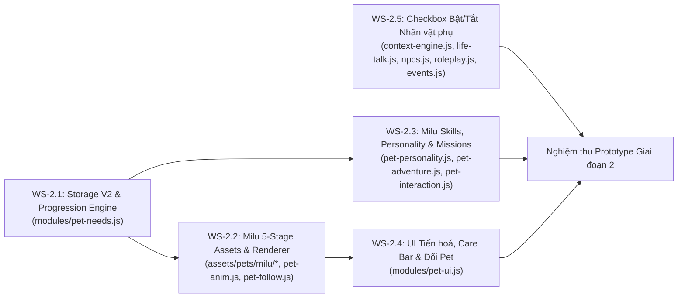

# KẾ HOẠCH TRIỂN KHAI TỔNG THỂ PET SYSTEM 2.0 (GIAI ĐOẠN 2 – 4)

> **Dự án:** English Life World (ELW) — `D:\tools\Hoc tieng anh\english-life-world`
> **Tài liệu:** `docs/PET2_PHASE_PLAN.md` (Bản tổng hợp Giai đoạn 1 & Kế hoạch thực thi Giai đoạn 2–4)
> **Trạng thái Giai đoạn 1:** Hoàn tất 100% nghiên cứu, kiểm toán kiến trúc và thiết kế chi tiết (Chỉ đọc code & viết tài liệu — 0 file code/asset bị sửa đổi).

---

## 1. TỔNG HỢP KẾT QUẢ GIAI ĐOẠN 1 & ĐỒNG BỘ HOÁ GIỮA 5 TÀI LIỆU

Bộ tài liệu thiết kế Giai đoạn 1 gồm 6 văn bản chuyên sâu, liên kết chặt chẽ với nhau:

| STT | Tài liệu | Phụ trách | Nội dung cốt lõi đã hoàn tất |
| :-: | :--- | :--- | :--- |
| 1 | [`docs/PET_GAME_RESEARCH.md`](./PET_GAME_RESEARCH.md) | **Agent A** (Game Research) | Phân tích thực tế *Tamagotchi Uni*, *Neko Atsume 2*, *Pou*, *Finch*, *Prodigy Math*, *Habitica*; bảng đối chiếu 9 cơ chế; vòng lặp Core/Meta Loop gắn với học tiếng Anh; cam kết bản quyền 100% nguyên bản. |
| 2 | [`docs/PET_ART_GUIDE.md`](./PET_ART_GUIDE.md) | **Agent B** (Art & Character) | Khảo sát 100 PNG (`320×320`, 4.46 MB) và DOM `#o-cat`; định hướng giải phẫu 5 cấp (`baby` → `elite`) cho 10 pet; ma trận 10 sprite state × 12 tư thế; cấu trúc `assets/pets/<id>/<stage>/<state>.png` + fallback; bài toán dung lượng `build.py`; Visual Brief & Prompt mẫu 5 cấp cho **Milu**. |
| 3 | [`docs/PET_GROWTH_AND_MISSIONS.md`](./PET_GROWTH_AND_MISSIONS.md) | **Agent C + D** (Growth, Skills & Missions) | Điều kiện tiến hoá đa chiều 5 cấp (`0 / 100 / 250 / 450 / 700 XP` + Care + Interaction + Stage Mission + Skill); chính sách Không trừng phạt; 50 kỹ năng (10 pet × 5 cấp) có tác dụng thật; khung nhiệm vụ tiếng Anh 5 cấp; Schema V2 `byPetId[petId]` tách khỏi `activePetId` + thuật toán Migration an toàn. |
| 4 | [`docs/PET2_ARCH_AUDIT.md`](./PET2_ARCH_AUDIT.md) | **Agent E** (2.5D & Integration) | Sơ đồ kiến trúc thực tế 9 module Pet & 6 module World; làm rõ vai trò SSOT của `pet-needs.js` và Facade `pet-survival.js`; phân lớp DOM `#o-cat > #catPos > #catScale > #catHop > #catFlip > #roomPetImg`; 4 rủi ro phá vỡ gameplay & giải pháp; ranh giới sở hữu file. |
| 5 | [`docs/PET2_SIDECHAR_AUDIT.md`](./PET2_SIDECHAR_AUDIT.md) | **Agent F** (Side-Char & QA) | Truy vết 5 nguồn tự spawn nhân vật phụ (`life-talk.js`, `npcs.js`, `roleplay.js`, `events.js`, `context-engine.js`/`index.html`); thiết kế UI Checkbox bật/tắt từng nhân vật trong cấu hình Ngữ cảnh + cổng chặn `isSideCharacterEnabled()` + `teardownSideCharacter()`; kế hoạch kiểm thử 12 mục (`PET2-QA-01`..`12`). |
| 6 | [`docs/PET2_PHASE_PLAN.md`](./PET2_PHASE_PLAN.md) | **Lead Agent** (Tổng hợp) | Chuẩn hoá quy ước xuyên suốt, lập kế hoạch Giai đoạn 2 (Prototype Milu + Core V2 + Side-char toggle) và Giai đoạn 3 (Mở rộng 9 pet), phân công agent theo file, thứ tự tích hợp, quản trị rủi ro và danh mục quyết định trình duyệt. |

### 1.1. Các Quy ước Chuẩn hoá Thống nhất (Canonical Rules)
Để tránh mọi sai lệch khi các sub-agent code ở Giai đoạn 2 và 3, các thông số sau được chốt thống nhất:
1. **10 Pet Chuẩn (`PET_LIST` trong `pet-needs.js`):**
   - **2 Pet Miễn phí (`FREE_PETS`):** `milu` (Cún Lông Xù Vàng), `mochi` (Mèo Trắng Mochi).
   - **8 Pet Premium (`PREMIUM_PETS`):** `boba` (Corgi), `cookie` (Shiba), `pepper` (Mèo Anh), `oreo` (Mèo Tuxedo), `ember` (Rồng Nhỏ), `lumi` (alias `sunny` — Kỳ Lân Cầu Vồng), `pip` (alias `nimbus` — Cáo Tuyết), `aqua` (alias `pixel` — Rái Cá Biển).
2. **Quy tắc Mở khoá Premium Duy nhất (Bất biến):**
   - Nhập mã mở khoá chủ đề trong bảng chọn chủ đề (`elw_topics_v1.unlocked === true`) mở luôn toàn bộ 8 Pet Premium. **Tuyệt đối không thêm bất kỳ đường mở khoá phụ nào khác.**
3. **Ngưỡng XP 5 Cấp Trưởng thành (`LEVEL_THRESHOLDS`):**
   - Giữ nguyên ngưỡng tích luỹ `[0, 100, 250, 450, 700]` của `pet-needs.js` hiện tại tương ứng với 5 stage:
     * **Lv.1 (`baby`):** `0 XP`
     * **Lv.2 (`young`):** `100 XP` + điều kiện chăm sóc/tương tác/nhiệm vụ Cấp 1
     * **Lv.3 (`teen`):** `250 XP` + điều kiện chăm sóc/tương tác/nhiệm vụ Cấp 2
     * **Lv.4 (`adult`):** `450 XP` + điều kiện chăm sóc/tương tác/nhiệm vụ Cấp 3
     * **Lv.5 (`elite` / `bonded`):** `700 XP` + điều kiện chăm sóc/tương tác/nhiệm vụ Cấp 4 + Signature Mission
4. **Cách lưu Tiến trình Đa Pet (`elw_pet_needs_v2`):**
   - Tách `byPetId[petId]` (cùng alias `pets[petId]`) lưu riêng `{ stage, level, xp, needs, progression, unlockedSkills, missionProgress }` cho từng pet.
   - Giữ `inventory` (`treats`, `water`, `toys`) dùng chung toàn cục.
   - Mirror 2 chiều dữ liệu của `activePetId` lên cấp root (`state.needs`, `state.stats`) và bổ sung hàm `ELW_PET_NEEDS.getState()` để tương thích ngược 100% với mọi module cũ và bộ test hiện hành.

---

## 2. KẾ HOẠCH GIAI ĐOẠN 2: PROTOTYPE MILU ĐỦ 5 CẤP + CORE ENGINE V2 + KIỂM SOÁT NHÂN VẬT PHỤ

**Mục tiêu Giai đoạn 2:** Xây dựng hoàn chỉnh bộ khung kỹ thuật (Core Progression V2, Multi-pet Storage, Stage Asset Resolver, Level-up Ceremony, Side-Character Gatekeeper) và chạy thử nghiệm trọn vẹn từ đầu đến cuối trên **1 Pet mẫu là Milu (`milu`)** đủ 5 giai đoạn (`baby`, `young`, `teen`, `adult`, `elite`), 5 kỹ năng và 5 nhiệm vụ mẫu.

### 2.1. Phạm vi Công việc Giai đoạn 2 (5 Workstreams)

#### Workstream 2.1 — Nâng cấp `modules/pet-needs.js` (Multi-Pet Schema & Multi-Gate Evolution)
- Triển khai cấu trúc `byPetId[petId]` (và alias `pets[petId]`) cho cả 10 pet; khi chọn một pet chưa từng nuôi, khởi tạo ở `stage: "baby"`, `level: 1`, `xp: 0`.
- Viết hàm `migrateToPerPetSchema()` tự động chuyển `needs` và `stats` phẳng hiện tại vào `byPetId[activePetId]`, bảo toàn 100% tiến trình cũ của người chơi.
- Bổ sung hàm `getState()`, `getPetProgress(petId)`, `recordCareAction(petId, type)`, `recordInteraction(petId, type)`, `recordSkillUse(petId, skillId)`, `checkStageEvolution(petId)`.
- Cập nhật `getAssetPath(petId, state, stage)` hỗ trợ đường dẫn `assets/pets/<petId>/<stage>/<state>.png` kèm fallback an toàn về `assets/pets/<petId>/<state>.png` khi stage asset của các pet khác chưa tạo.

#### Workstream 2.2 — Sản xuất Concept/Asset 5 Cấp cho **Milu** & Nâng cấp `pet-anim.js` + `pet-follow.js`
- Tạo bộ ảnh 5 giai đoạn cho `milu` tại `assets/pets/milu/{baby,young,teen,adult,elite}/*.png` theo đúng tỷ lệ giải phẫu trong `docs/PET_ART_GUIDE.md` (Baby đầu to mũm mĩm mầm cây → Young khăn quàng xanh → Teen khăn đỏ năng động → Adult huy hiệu sao vàng → Elite áo choàng & vương miện nhỏ).
- Cập nhật `pet-follow.js`: áp dụng hệ số `stageScale` và tốc độ di chuyển theo stage (`baby` bước ngắn lon ton → `adult`/`elite` chạy nhanh mượt mà) ngay tại `#catScale` (gốc toạ độ `(0,0)` dưới chân) để chân Milu luôn bám mặt sàn 2.5D và không lệch bóng đổ.
- Cập nhật `pet-anim.js`: hỗ trợ 12 tư thế/biểu cảm thông qua kết hợp 10 sprite state + tham số procedural (`walk` vs `run`, `idle_wait` vs `idle_happy`), thêm hiệu ứng 4 pha `playStageUpCeremony(petId, newStage)` và hạt sáng riêng của Milu.

#### Workstream 2.3 — Kỹ năng & Nhiệm vụ 5 Cấp mẫu của **Milu** (`pet-personality.js`, `pet-adventure.js`, `pet-interaction.js`)
- Mở rộng `pet-personality.js` với 5 kỹ năng của Milu:
  1. **Lv.1 (`baby`) — *Curious Sniff*:** Tự động làm nổi bật 1 đồ vật tiếng Anh trong phòng chưa tương tác.
  2. **Lv.2 (`young`) — *Happy Fetch Hint*:** Gợi ý từ vựng đồ vật/thức ăn đúng ngữ cảnh khi người chơi bí.
  3. **Lv.3 (`teen`) — *Park Cheerleader*:** Cổ vũ khi luyện nói câu ngắn (`onPhrasePracticed`), tăng `+25% XP` và `+2 Bond`.
  4. **Lv.4 (`adult`) — *Lost Item Tracker*:** Đánh hơi tìm đồ thất lạc trong tình huống `lost` hoặc nhiệm vụ много bước với NPC.
  5. **Lv.5 (`elite`) — *Golden Companion Aura*:** Hào quang tri kỷ tăng thưởng sao/vật phẩm khi hoàn thành `Pet Adventure` và mở khoá Signature Mission *"Milu's Golden Park Rescue"*.
- Triển khai 5 nhiệm vụ mẫu theo 5 cấp cho Milu trong `pet-adventure.js` / `pet-interaction.js` gắn với `elw_pet_reward_ledger_v2` (chống farm XP, có checkpoint khi thoát giữa chừng, xử lý mượt khi Milu mệt).

#### Workstream 2.4 — Nâng cấp Giao diện `modules/pet-ui.js`
- Hiển thị tiến trình 5 điều kiện lên cấp (XP, Chăm sóc, Hội thoại, Nhiệm vụ cấp, Kỹ năng) trực quan, gọn gàng trên bảng Pet.
- Hiển thị nút kích hoạt Kỹ năng của Milu và Modal chúc mừng tiến hoá `#petLevelUpModal` (không chặn ngang khi đang chạy `ELW_MISSION` hoặc Roleplay).
- Trên bảng Đổi Pet (`#petCollectionGrid`): hiển thị rõ cấp độ riêng (`🌱 Baby` .. `👑 Elite`) và thanh XP riêng của từng pet; khi đổi sang pet mới chưa nuôi sẽ báo rõ *"Bắt đầu hành trình mới từ cấp Baby (dữ liệu của Milu vẫn được giữ nguyên)"*.

#### Workstream 2.5 — Checkbox Bật/Tắt Nhân vật phụ trong Cấu hình Ngữ cảnh (`docs/PET2_SIDECHAR_AUDIT.md`)
- Thêm cụm Checkbox bật/tắt từng nhân vật phụ (`Linh`, `Gia đình`, `Khách/Shipper`, `Nhân viên`, kèm nút *"Tắt hết nhân vật phụ"*) vào phần cấu hình Ngữ cảnh (`modules/context-engine.js`).
- Đặt cổng kiểm soát tập trung `ELW_CONTEXT.isSideCharacterEnabled(idOrRole)` và hàm `teardownSideCharacter(idOrRole)` tại `life-talk.js`, `npcs.js`, `roleplay.js`, `events.js` để:
  + Nhân vật không được chọn tuyệt đối không xuất hiện (kể cả random timer, sự kiện phụ, fallback).
  + Khi bỏ chọn: huỷ tức thì mọi `setTimeout`/`setInterval` đã xếp lịch, ẩn DOM sprite/bong bóng thoại và dừng TTS liên quan.
  + Loại bỏ chú chó tĩnh `"dog"` (Max) khỏi mảng `FAMILY` trong `npcs.js` để tránh trùng lặp với hệ thống Pet 2.0.

---

## 3. KẾ HOẠCH GIAI ĐOẠN 3: MỞ RỘNG TOÀN BỘ 9 PET CÒN LẠI & TỐI ƯU ĐÓNG GÓI

Sau khi Prototype Milu và hệ thống kiểm soát nhân vật phụ ở Giai đoạn 2 được nghiệm thu, Giai đoạn 3 mở rộng theo 3 lô (batches) cho 9 pet còn lại:

| Lô (Batch) | Danh sách Pet | Nội dung triển khai |
| :--- | :--- | :--- |
| **Batch 3A — Nhóm Mèo & Cún Miễn phí/Phổ biến** | `mochi` (Free Cat), `boba` (Corgi), `cookie` (Shiba) | • Sinh bộ asset 5 stage (`baby`..`elite`) theo `docs/PET_ART_GUIDE.md`. • Nạp 15 kỹ năng (5 skill × 3 pet: *Sunbeam Nap Hint*, *Fish Radar*, *Royal Wiggle Cheer*, *Bakery Scent Finder*...) và 15 nhiệm vụ cấp độ vào `pet-personality.js` & `pet-adventure.js`. |
| **Batch 3B — Nhóm Mèo Cá tính** | `pepper` (Mèo Anh Thám tử), `oreo` (Mèo Tuxedo Âm nhạc) | • Sinh bộ asset 5 stage (`baby`..`elite`) với phụ kiện mũ thám tử/kính lúp (`pepper`) và nơ tuxedo/nốt nhạc (`oreo`). • Nạp 10 kỹ năng chuyên biệt giải đố từ vựng (*Word Detective Lens*) & nhịp điệu phát âm (*Rhythm Echo*). |
| **Batch 3C — Nhóm 4 Pet Hiếm (Rare Pets)** | `ember` (Rồng Nhỏ), `lumi`/`sunny` (Kỳ Lân), `pip`/`nimbus` (Cáo Tuyết), `aqua`/`pixel` (Rái Cá Biển) | • Sinh bộ asset 5 stage với cơ chế tiến hoá hình thái đặc sắc (mọc cánh rồng, sừng cầu vồng, đuôi mây tuyết, ngọc trai phát sáng). • Tích hợp 20 kỹ năng & cơ chế đặc trưng loài hiếm: tương tác thời tiết/ánh sáng, giải mã từ vựng bí ẩn, mở khoá câu thoại/sự kiện kỳ diệu trong cảnh 2.5D. |
| **Batch 3D — Tối ưu `tools/build.py` & Manifest V2** | Toàn bộ 10 Pet | • Cập nhật `assets/pets/manifest.json` lên Schema V2. • Tối ưu nén PNG-8/WebP và cơ chế đóng gói trong `tools/build.py` để giữ dung lượng bản single-file HTML trong ngưỡng ngân sách an toàn (< 18 MB). |

---

## 4. PHÂN CÔNG AGENT THEO FILE & THỨ TỰ TÍCH HỢP (CHỐNG ĐỤNG ĐỘ FILE)

### 4.1. Ma trận Sở hữu File (File Ownership Matrix cho Giai đoạn 2–3)

> [!IMPORTANT]
> **Quy tắc Ranh giới Cứng:** Mỗi file chỉ do **1 Agent duy nhất** nắm giữ quyền ghi ở một thời điểm (sử dụng `claim_paths` trên `coop` MCP). Tuyệt đối không viết lại `index.html` hay CSS toàn cục.

| Agent phụ trách | Các File được phép chỉnh sửa (Exclusive Write) | Các File chỉ đọc / Gọi qua API |
| :--- | :--- | :--- |
| **Agent C (Core State & Storage)** | `modules/pet-needs.js`, `modules/pet-rewards.js` | `modules/premium.js`, `modules/ui-topics.js` |
| **Agent B (Assets, Anim & Follow)** | `assets/pets/**`, `modules/pet-anim.js`, `modules/pet-follow.js`, `tools/build.py` | `modules/pet-needs.js`, `index.html` |
| **Agent D (Personality, Skills & Missions)** | `modules/pet-personality.js`, `modules/pet-adventure.js`, `modules/pet-interaction.js`, `modules/pet-survival.js` | `modules/mission.js`, `modules/challenge.js` |
| **Agent E (Pet UI & Evolution Modal)** | `modules/pet-ui.js` | `modules/pet-needs.js`, `modules/pet-personality.js`, `modules/pet-adventure.js` |
| **Agent F (Side-Char Gatekeeper & QA)** | `modules/context-engine.js`, `modules/life-talk.js`, `modules/npcs.js`, `modules/roleplay.js`, `modules/events.js`, `tests/**` | `index.html` (chỉ thêm đúng 1 dòng hook nếu thật sự cần sau khi lấy lock) |

### 4.2. Thứ tự Tích hợp Từng bước (Step-by-Step Integration Order)
1. **Bước 1 (Foundation):** Agent C nâng cấp `modules/pet-needs.js` (Schema V2 `byPetId`, migration tự động, `getState()`, `getAssetPath(petId, state, stage)` với fallback). Chạy test đảm bảo toàn bộ tính năng hiện tại xanh 100%.
2. **Bước 2 (Side-Character Control):** Agent F triển khai Checkbox bật/tắt nhân vật phụ trong `context-engine.js` và cổng chặn `isSideCharacterEnabled` + `teardownSideCharacter` ở `life-talk.js`, `npcs.js`, `roleplay.js`, `events.js`.
3. **Bước 3 (Visual & Motion 5 Stages cho Milu):** Agent B tạo asset 5 cấp của `milu` và nâng cấp `pet-follow.js` + `pet-anim.js` (tỉ lệ theo stage, 12 tư thế, Level-up Ceremony 4 pha).
4. **Bước 4 (Skills & Missions 5 Cấp):** Agent D cập nhật `pet-personality.js`, `pet-adventure.js`, `pet-interaction.js` cho kỹ năng và nhiệm vụ 5 cấp của Milu; Agent E cập nhật `pet-ui.js` hiển thị tiến trình 5 cấp, nút kỹ năng và Modal tiến hoá.
5. **Bước 5 (Scale 9 Pets & Build):** Agent B + Agent D mở rộng asset, kỹ năng và nhiệm vụ cho 9 pet còn lại (Batch 3A → 3C) và cập nhật `tools/build.py` (Batch 3D).
6. **Bước 6 (Full QA Verification):** Agent F chạy bộ kiểm thử tự động Playwright 12 hạng mục (`PET2-QA-01` .. `PET2-QA-12` trong `docs/PET2_SIDECHAR_AUDIT.md`).

---

## 5. QUẢN TRỊ RỦI RO & ƯỚC LƯỢNG KHỐI LƯỢNG

### 5.1. Bảng Rủi ro Kỹ thuật & Biện pháp Phòng ngừa

| Rủi ro | Mức độ | Giải pháp Kỹ thuật đã thiết kế |
| :--- | :---: | :--- |
| **1. Đổi cấu trúc `elw_pet_needs_v2` làm lỗi các module đọc `state.needs` / `state.stats` phẳng** | Cao | Giữ đồng bộ 2 chiều (mirror) giữa `state.byPetId[activePetId]` và `state.needs` / `state.stats` ở root; export bổ sung `ELW_PET_NEEDS.getState()`. |
| **2. Pet bị lơ lửng hoặc đè lên bong bóng thoại khi đổi kích thước qua 5 stage** | Trung bình | Áp dụng hệ số `stageScale` tại `#catScale` có tâm `(0, 0)` ngay dưới chân Pet và cộng bù toạ độ `translateY` của `#petReactBubble` theo stage. |
| **3. Phình dung lượng file build single-file (`english-life-world-ban-day-du.html`) khi nhân 5 stage** | Trung bình | Nén PNG-8 (`pngquant` / `optipng`) giảm ~60% dung lượng mỗi ảnh (từ 45 KB xuống ~16 KB) hoặc dùng chung các state phụ ít thay đổi giữa 2 stage liền kề. |
| **4. Xung đột âm thanh TTS khi Pet lên cấp trùng lúc NPC hoặc người chơi đang nói** | Trung bình | Kiểm tra `window.speechSynthesis.speaking` và trạng thái `ELW_MISSION.active()` trước khi phát TTS của Pet; ưu tiên hiệu ứng âm thanh WebAudio chime ngắn + non-blocking banner. |
| **5. Nhân vật phụ vẫn lọt ra từ timer đã đặt trước khi người dùng bỏ tick checkbox** | Cao | Lưu toàn bộ timer ID (`wxTimer`, `ltBubTimer`, `replyDelayTimer`) và gọi `teardownSideCharacter(id)` huỷ ngay lập tức mọi timer + xoá DOM + ngắt TTS khi bỏ tick. |

### 5.2. Ước lượng Khối lượng Triển khai
- **Giai đoạn 2 (Prototype Milu 5 cấp + Core V2 + Side-char Checkboxes):** ~45–60 phút thực thi với đội hình 5 sub-agent song song.
- **Giai đoạn 3 (Mở rộng 9 Pet + 45 bộ Stage Assets + 45 Kỹ năng + Build):** ~60–75 phút thực thi theo 3 batch.
- **Giai đoạn 4 (Kiểm thử Playwright 12 mục & Tinh chỉnh):** ~20–30 phút thực thi.

---

## 6. CÁC QUYẾT ĐỊNH CẦN CHỦ APP / CLAUDE DUYỆT TRƯỚC KHI BẮT ĐẦU GIAI ĐOẠN 2 (TỐI ĐA 8 ĐIỂM)

1. **Duyệt Concept 5 Giai đoạn của Milu (`docs/PET_ART_GUIDE.md` Mục 6):** Đồng ý với định hướng thay đổi tỉ lệ cơ thể thật (từ `Baby` đầu to mũm mĩm đính mầm cây → `Young` khăn quàng xanh → `Teen` khăn đỏ năng động → `Adult` huy hiệu sao vàng → `Elite` áo choàng & vương miện nhỏ) để tiến hành sinh bộ ảnh mẫu của Milu ở Giai đoạn 2?
2. **Duyệt Chiến lược Dung lượng Asset 500 ảnh (`docs/PET_ART_GUIDE.md` Mục 5):** Chọn **Phương án A** (Sinh đủ 10 state riêng cho cả 5 stage = 50 ảnh/pet, nén PNG-8 ~16 KB/ảnh để tổng dung lượng ~8 MB) hay **Phương án B** (Sinh mới 4 state chủ đạo theo từng stage + tái sử dụng 6 state cảm xúc phụ kèm phụ kiện SVG/procedural để giảm một nửa dung lượng)? *(Đề xuất: Phương án A cho Milu ở Giai đoạn 2, nén PNG-8 tối ưu).*
3. **Duyệt Ngưỡng Tiến hoá Đa chiều & Pacing (`docs/PET_GROWTH_AND_MISSIONS.md` Mục 1.2–1.3):** Giữ nguyên 5 mốc XP `[0, 100, 250, 450, 700]` kết hợp điều kiện Chăm sóc + Tương tác + Nhiệm vụ cấp độ + Kỹ năng (ước tính ~85–115 phút chơi tự nhiên, tương đương 5–7 ngày học để đạt `Elite/Bonded` cho 1 pet)?
4. **Duyệt Bộ 50 Kỹ năng & Tác dụng Gameplay (`docs/PET_GROWTH_AND_MISSIONS.md` Mục 2.3):** Đồng ý với danh mục 5 kỹ năng mở khoá theo cấp cho từng pet (hỗ trợ gợi ý từ vựng, phát hiện đồ vật ẩn, thưởng nhân hệ số XP/Bond khi luyện nói, tương tác thời tiết/sự kiện cho 4 pet hiếm)?
5. **Duyệt Schema Đa Pet & Quy tắc Đổi Pet (`docs/PET_GROWTH_AND_MISSIONS.md` Mục 4.2):** Xác nhận cơ chế lưu riêng tiến trình trong `byPetId[petId]` (pet mới bắt đầu từ `Baby` 0 XP, đổi pet giữ nguyên dữ liệu pet cũ, kho vật phẩm `treats/water/toys` dùng chung cho cả tài khoản)?
6. **Duyệt Ánh xạ Tên 3 Pet Hiếm (`docs/PET_GROWTH_AND_MISSIONS.md` Mục 2.1):** Giữ ID chuẩn trong code hiện tại (`lumi`, `pip`, `aqua`) đồng thời hỗ trợ đầy đủ alias trong thiết kế mới (`lumi ↔ sunny`, `pip ↔ nimbus`, `aqua ↔ pixel`) để không làm gãy dữ liệu cũ và bộ test hiện có?
7. **Duyệt Mặc định Bật/Tắt Nhân vật phụ (`docs/PET2_SIDECHAR_AUDIT.md` Phần B):** Trong phần cấu hình Ngữ cảnh, đặt mặc định khi mới vào là **tắt các sự kiện tự động gây gián đoạn** (`companion: false`, `visitors: false`, `familyRoleplay: false`, `familyEvents: false` — người chơi chủ động tick bật nhân vật nào thì nhân vật đó mới xuất hiện), đồng thời xoá chú chó tĩnh `"dog"` (Max) khỏi `npcs.js` để nhường chỗ hoàn toàn cho Pet 2.0?
8. **Duyệt Quy tắc Mở khoá Premium Duy nhất:** Xác nhận giữ đúng 1 đường mở khoá duy nhất cho 8 Pet Premium là thông qua **Mã mở khoá chủ đề** (`elw_topics_v1.unlocked = true`), không thêm bất kỳ cơ chế mua hay mở khoá chồng chéo nào khác?
