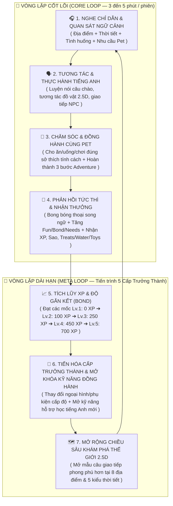

# NGHIÊN CỨU GAME NUÔI THÚ & THIẾT KẾ HỆ THỐNG PET 2.0 (5 CẤP TRƯỞNG THÀNH) CHO ENGLISH LIFE WORLD

> **Dự án:** English Life World (ELW) — Nâng cấp Hệ thống Thú cưng Đồng hành (Pet System 2.0)  
> **Vai trò:** Agent A — Game Research & Design (Giai đoạn 1)  
> **Phạm vi tài liệu:** Nghiên cứu đối chiếu các tựa game nuôi thú/đồng hành kinh điển & giáo dục, phân tích kiến trúc Pet hiện hữu của ELW, và đề xuất thiết kế Vòng lặp Gameplay (Core Loop & Meta Loop) cho **5 cấp trưởng thành (5 Growth Stages)** gắn liền với việc học tiếng Anh giao tiếp trong thế giới 2.5D.

---

## MỤC 1: TỔNG QUAN & NGUỒN THAM KHẢO THỰC TẾ

### 1.1. Mục tiêu nghiên cứu
Trong phiên bản hiện tại của **English Life World (ELW)**, hệ thống thú cưng đã có nền tảng kỹ thuật vững chắc gồm 10 thú cưng (`milu`, `boba`, `cookie`, `mochi`, `pepper`, `oreo`, `ember`, `lumi`, `pip`, `aqua`), 10 trạng thái hoạt ảnh, 5 chỉ số nhu cầu tính theo thời gian thực có giới hạn suy giảm ngoại tuyến (`modules/pet-needs.js`), bộ hồ sơ tính cách phản ứng với ngữ cảnh thế giới 2.5D (`modules/pet-personality.js`), hệ thống nhiệm vụ phiêu lưu 3 bước (`modules/pet-adventure.js`), và sổ cái phần thưởng chống cày lặp (`modules/pet-rewards.js`).

Tuy nhiên, hệ thống **5 cấp độ (`LEVEL_THRESHOLDS` từ Lv.1 đến Lv.5)** trong `modules/pet-needs.js` hiện mới chỉ dừng lại ở việc thay đổi danh hiệu hiển thị (`stageBadge`, `stageNameVi`, `stageNameEn` theo mốc `0 / 100 / 250 / 450 / 700 XP`), chưa mang lại sự **tiến hóa rõ rệt về hình thái trực quan, chiều sâu ngôn ngữ tiếng Anh, kỹ năng đồng hành trong thế giới 2.5D và trải nghiệm gắn kết dài hạn**.

Nghiên cứu này khảo sát các tựa game nuôi thú ảo và đồng hành giáo dục thành công nhất thế giới nhằm trả lời 3 câu hỏi cốt lõi:
1. Làm thế nào để **5 cấp trưởng thành** tạo ra cảm giác tiến triển (progression) rõ rệt, thôi thúc trẻ khám phá mà không biến thành gánh nặng cày cuốc (grinding)?
2. Làm thế nào để kết hợp **tính cách (personality)**, **tương tác đồ vật/môi trường (goodies/environment)** và **nhu cầu chăm sóc (needs)** thành chất xúc tác tự nhiên cho việc **Nghe – Nói – Phản xạ tiếng Anh**?
3. Cơ chế nào từ các game thương mại cần **áp dụng** và cơ chế nào cần **loại bỏ** để phù hợp với môi trường giáo dục trẻ em (an toàn, không phạt nặng khi nghỉ học vài ngày, không ép chờ đợi thời gian thực vô nghĩa)?

---

### 1.2. Minh bạch nguồn tham khảo thực tế (Trạng thái truy cập URL & Dữ liệu)

Để đảm bảo tính xác thực tuyệt đối, dưới đây là báo cáo chi tiết về nguồn dữ liệu đã truy xuất trực tiếp qua công cụ đọc web (`read_url_content`), tìm kiếm (`search_web`) và đọc mã nguồn nội bộ (`view_file`):

| Nhóm nguồn | Nguồn / Đường dẫn cụ thể | Phương thức & Trạng thái truy cập | Nội dung thu thập được |
| :--- | :--- | :--- | :--- |
| **1. Tamagotchi Uni (Bandai)** | `https://tamagotchi-official.com/us/series/uni/howtoplay/` | **Truy cập trực tiếp thành công 100% (`read_url_content`)**. *(Lưu ý kỹ thuật: Trang chủ Bandai thiết kế văn bản dưới dạng ảnh PNG/GIF, nhưng toàn bộ nội dung hướng dẫn chính thức đều nằm đầy đủ trong thuộc tính `alt` của các thẻ `` trong mã HTML tĩnh).* | Trích xuất nguyên bản các mục chính thức: **Be Unique (UniTama)**, **Personality**, **Favorite Things**, **Fashion & Furniture**, **Crafts (DIY)**, **Tama Walk (20-minute walk & Farm)**, **Let's Unite (Connect, Play, Exchange Items, Craft Together, Propose, Fast Food Mini-game)**, **Universal (Tamaverse, Download Codes, Tama Arena)**, **Life (Food/Snacks, Toilet/Bath, Tama Mall, Arcade, Sitter trước 18:00, Social)**. |
| **2. Tamagotchi Uni (Wiki & Mechanics)** | Truy vấn `search_web` đối chiếu hệ thống vòng đời & tính cách chuẩn của Tamagotchi Uni | **Truy vấn tìm kiếm thành công (`search_web`)** kết hợp kiến thức chuẩn từ hệ thống Wiki cộng đồng Tamagotchi. | Số liệu vòng đời 5 giai đoạn (**Egg → Baby [1h] → Child [24h] → Teenager [24h] → Adult**), cơ chế tích lũy **Care Mistakes** (lỗi chăm sóc sau 15 phút không phản hồi), và phân loại **31 tính cách chia làm 5 nhóm** (*Docile, Energetic, Shy, Spoiled, Mysterious*). |
| **3. Neko Atsume & Neko Atsume 2 (Hit-Point)** | - `https://www.nekoatsume.com/index_en.html` - `https://www.nekoatsume.com/sp2/index_en.html` | **Truy cập trực tiếp thành công 100% cả 2 trang (`read_url_content`)**. | Từ cổng chính `index_en.html` (danh sách bản tin cập nhật đến Ver 2.34.0) và trang chuyên biệt Neko Atsume 2 `sp2/index_en.html`: trích xuất đầy đủ thông tin phát hành (20/10/2024 JST) và **toàn bộ 18 mục FAQ chính thức** (hệ thống **Myneko & Cat's Club**, khu vực riêng bên cạnh tủ trưng bày, **Going out & Stamp card**, **Goodies & Snacks preferences**, **Power Lv.**, **Remodel**, **Fish Exchange 10 Gold = 250 Silver**, cơ chế đồng bộ đồng hồ offline). |
| **4. Neko Atsume 2 (Cơ chế độ bền đồ vật)** | Truy vấn `search_web` về cơ chế mới của Neko Atsume 2 (*Goodies durability, broken items, repair*) | **Truy vấn tìm kiếm thành công (`search_web`)**. | Phân tích cơ chế **hao mòn đồ vật (Wear & Tear / Broken Goodies)** mới trong phần 2: mèo vẫn chơi với đồ hỏng, khác biệt giữa **Sửa chữa (Repair)** tạo ngoại hình vá/cũ độc đáo so với **Mua mới (Buy New)**, và ảnh hưởng của độ nguyên vẹn đồ vật lên tỷ lệ xuất hiện của **Rare Cats**. |
| **5. Pou (Zakeh)** | Truy vấn `search_web` về cơ chế nuôi, chỉ số, phòng thí nghiệm và mini-games của Pou + kiến thức nền chuẩn | **Truy vấn tìm kiếm thành công (`search_web`)** kết hợp kiến thức chuẩn về game di động Pou. | Hệ thống tăng trưởng **Baby → Adult** (và thuốc *Baby/Adult Potion*), 4 thanh chỉ số (**Food, Health, Fun, Energy**) + chỉ số ẩn (**Fat/Weight**), cơ chế chuyển phòng (**Kitchen, Bathroom, Lab, Game Room, Bedroom, Outside**), hơn 30 Mini-games kiếm Coins và mở khóa đồ trang trí theo Level XP. |
| **6. Game Đồng hành Giáo dục & Thói quen** | Truy vấn `search_web` về **Finch: Self Care Pet**, **Prodigy Math Pets**, và **Habitica Pets** | **Truy vấn tìm kiếm thành công (`search_web`)** cho cả 3 tựa game. | - **Finch:** 5 giai đoạn (*Baby → Toddler → Child → Teen → Adult*), hoàn thành mục tiêu tích cực nạp **Energy** đi **Adventure**, kể chuyện & trả lời câu hỏi định hình tính cách. - **Prodigy Math:** Giải bài tập để nạp **Magic Points (MP)** giúp Pet tung kỹ năng (**Spells**) và tiến hóa (**Evolution**). - **Habitica:** Hoàn thành nhiệm vụ nhận thức ăn, cho ăn đúng sở thích (+10% vs +4%) để tiến hóa từ **Pet → Mount** mà không bao giờ chết đói. |
| **7. Kiến trúc nội bộ ELW** | - `modules/pet-needs.js` - `modules/pet-personality.js` - `modules/pet-adventure.js` - `modules/pet-rewards.js` | **Đọc trực tiếp mã nguồn 100% (`view_file`)**. | Nắm vững toàn bộ cấu trúc dữ liệu, hằng số, công thức suy giảm ngoại tuyến, bảng 10 Pet, 10 trạng thái, 4 mức cảm xúc phản ứng ngữ cảnh, 3 bước nhiệm vụ phiêu lưu và cơ chế bảo mật/chống cày lặp. |

---

## MỤC 2: PHÂN TÍCH CHI TIẾT TỪNG GAME THAM CHIẾU

### 2.1. Tamagotchi Uni (Bandai) — Đỉnh cao của Cá nhân hóa Tính cách & Vòng đời Tiến hóa

Dựa trên tài liệu chính thức từ `tamagotchi-official.com/us/series/uni/howtoplay/` và dữ liệu cơ chế vòng đời:

#### a. Tiến hóa theo 5 giai đoạn (5-Stage Life Cycle)
Tamagotchi Uni xây dựng vòng đời gồm 5 nấc rõ rệt:
1. **Egg (Trứng):** Người chơi chọn màu trứng khi khởi đầu; trứng nở sau vài phút tạo cảm giác hồi hộp chào đón người bạn mới.
2. **Baby (Sơ sinh — kéo dài ~1 giờ):** Giai đoạn làm quen. Thanh Đói (Hunger) và Vui vẻ (Happiness) giảm nhanh để hướng dẫn người chơi thao tác cho ăn, dọn vệ sinh, nhưng **bất tử (không thể chết/bỏ đi)** ở giai đoạn này.
3. **Child (Ấu thơ — kéo dài ~24 giờ):** Hình dáng bắt đầu phân nhánh dựa trên mức độ chăm sóc và tương tác.
4. **Teenager (Thiếu niên — kéo dài ~24 giờ):** Mở khóa khả năng tương tác sâu hơn với các vật phẩm chế tạo (DIY/Crafts) và hoạt động ngoài trời.
5. **Adult (Trưởng thành — Vĩnh viễn cho đến khi kết hôn/chuyển thế hệ):** Nhân vật đạt hình thái hoàn chỉnh, mở khóa nghề nghiệp, công thức chế tạo đặc biệt và khả năng kết nối xã hội tối đa trong *Tamaverse*.

#### b. Hệ thống Tính cách (UniTama Personalities)
Điểm đột phá lớn nhất của dòng *Uni* (như khẩu hiệu chính thức trên web: *"Raise a UniTama that's one-of-a-kind, inside and out!"*) là hệ thống **31 tính cách chia thành 5 nhóm chính**:
- **Docile (Điềm đạm):** *Calm, Cool, Honest, Orderly, Polite, Quiet*.
- **Energetic (Năng động):** *Bold, Careless, Jolly, Naughty, Passionate, Playful*.
- **Shy (Nhút nhát):** *Coy, Delicate, Fearful, Reserved, Shy, Timid*.
- **Spoiled (Làm nũng/Tình cảm):** *Affectionate, Emotional, Friendly, Lonely, Lovely, Spoiled*.
- **Mysterious (Bí ẩn/Ngẫu hứng):** *Chill, Ditzy, Moody, Mysterious, Rash, Relaxed*.

**Tác động lên Gameplay:** Tính cách không chỉ là một dòng chữ vô tri mà thay đổi trực tiếp **hoạt ảnh đứng yên (idle animations)**, **phản ứng khi đi tắm/dọn dẹp**, và đặc biệt là **Món đồ yêu thích (Favorite Things)**. Như trang hướng dẫn chính thức mô tả: *"Place fun items in your room. If your UniTama likes them, playtime might be more fun! Master these items, and you'll be a pro in no time!"* — khi đặt một món đồ vào phòng nhiều lần, thú cưng sẽ học cách sử dụng thành thạo (Pro/Master animation) và mở khóa hoạt ảnh đặc biệt.

#### c. Nhu cầu, Chăm sóc & Cơ chế "Sitter" (Người trông trẻ)
- **Care Mistakes (Lỗi chăm sóc):** Trong Tamagotchi truyền thống, nếu để thanh Hunger/Happiness về 0 và không phản hồi tiếng gọi trong 15 phút, hệ thống tính 1 *Care Mistake*. Quá nhiều lỗi sẽ dẫn đến nhánh tiến hóa "xấu" hoặc thú cưng bị ốm/bỏ đi.
- **Cơ chế Sitter (Điểm sáng hiện đại):** Nhận thấy học sinh và người đi làm không thể canh thiết bị 24/7, Bandai bổ sung tính năng **Sitter** (*"Get a Tamagotchi sitter when you're busy! Make sure to get back home before 6:00 PM!"*). Tuy nhiên, nếu quên đón sau 18:00, chỉ số hạnh phúc vẫn bị trừ mạnh.
- **Tama Walk & DIY Crafts:** Người chơi dẫn thú cưng đi dạo 20 phút (*Tama Walk*) tại các khung cảnh theo mùa hoặc nông trại (*Farm*) để nhặt nguyên liệu màu sắc (*color materials*) và công thức chế tạo (*DIY instructions*), từ đó tự tay làm phụ kiện cho thú cưng.

---

### 2.2. Neko Atsume 2: Kitty Collector (Hit-Point) — Tương tác Môi trường, Đồ vật (Goodies) & Khám phá Không áp lực

Dựa trên dữ liệu truy xuất từ `nekoatsume.com/index_en.html`, trang FAQ chính thức `nekoatsume.com/sp2/index_en.html` và phân tích cơ chế mới của phần 2:

#### a. Triết lý "Zero-Stress" & Tương tác Môi trường (Yard & Goodies)
Khác hoàn toàn với Tamagotchi, *Neko Atsume 2* không ép người chơi phải trực tiếp điều khiển nhân vật từng giây mà tập trung vào **thiết kế môi trường tương tác (Environmental Storytelling)**:
- Người chơi đặt thức ăn (*Snacks/Food*) và đồ chơi/vật dụng (*Goodies*: bóng len, đệm sưởi, hộp giấy, trụ cào móng, lều...) ra sân vườn (*Yard*).
- Mỗi chú mèo có **hồ sơ sở thích riêng biệt** (như FAQ chính thức nêu rõ: *"Each cat has different preferences for the goodies and snacks they enjoy, and some cats won't visit unless certain conditions are met"*).
- Khi mèo ghé thăm và tương tác với đồ vật, người chơi chụp ảnh lưu vào **Album / Catbook**, nhận cá bạc/cá vàng (*Silver/Gold Fish*) và tích lũy số lần ghé thăm để nhận **Kỷ vật quý (Treasures / Mementos)** từ từng chú mèo.

#### b. Điểm mới đột phá ở Neko Atsume 2: Độ bền Đồ vật (Goodies Durability), Myneko & Going Out
1. **Goodies Durability & Repair (Hao mòn & Sửa chữa đồ vật):** Trong *Neko Atsume 2*, đồ chơi dùng lâu sẽ bị sờn rách hoặc hỏng (*Broken/Worn*). Điều thú vị là **mèo vẫn tiếp tục chơi với đồ bị rách**, và khi người chơi bấm **Sửa chữa (Repair)**, món đồ không quay về trạng thái mới tinh vô hồn mà mang **ngoại hình được khâu vá đầy kỷ niệm** (hoặc có thể mua mới nếu muốn thu hút một số mèo hiếm khó tính).
2. **Myneko (Thú cưng đồng hành cá nhân):** Theo FAQ chính thức trên `sp2/index_en.html`, phần 2 bổ sung **Myneko** — chú mèo riêng luôn ở lại trong khu vực dành riêng cạnh tủ trưng bày kỷ vật (*"near an ornament display case"*), kết hợp cả niềm vui sở hữu một thú cưng gắn bó cố định lẫn niềm vui quan sát tương tác đồ vật.
3. **Going Out & Stamp Card (Đi dạo & Sổ đóng dấu):** Người chơi có thể "Đi ra ngoài" (*Going out*) thăm sân vườn khác để nhận dấu mộc vào **Stamp Card** và sưu tầm hình nền/vật phẩm.

---

### 2.3. Pou (Zakeh) — Chu trình Chăm sóc Trực quan, Đa Phòng & Mini-games Phản hồi Tức thì

Dựa trên nghiên cứu hệ thống cơ chế của *Pou*:

#### a. Hệ thống Tăng trưởng & Chỉ số Trực quan
- **Giai đoạn phát triển:** Pou bắt đầu ở hình thái **Baby** (kích thước nhỏ, giọng cao, nhanh đói) và lớn dần thành **Adult** khi người chơi tích lũy XP qua việc cho ăn, tắm rửa và chơi mini-games. Trong phòng *Lab*, người chơi có thể dùng *Baby Potion* hoặc *Adult Potion* để tùy chỉnh hình dáng yêu thích.
- **4 Thanh chỉ số cốt lõi + 1 Chỉ số ẩn:**
  - **Food (Đói):** Giảm theo thời gian và giảm nhanh hơn khi vận động/chơi game nhiều.
  - **Health (Sức khỏe):** Giảm chậm nhất, nhưng giảm gấp đôi tốc độ nếu để Food, Fun hoặc Energy quá thấp.
  - **Fun (Vui vẻ):** Tăng khi vuốt ve, chơi bóng hoặc tham gia Mini-games.
  - **Energy (Năng lượng):** Giảm khi hoạt động, hồi phục khi tắt đèn ngủ ở *Bedroom*.
  - **Weight/Fat (Cân nặng ẩn):** Ăn quá nhiều đồ ngọt/béo khiến Pou tròn trịa lên; chơi mini-games vận động giúp Pou thon gọn lại.

#### b. Kiến trúc Đa Phòng (Room-based Care Loop) & Mở khóa theo Cấp độ
Pou chia hoạt động chăm sóc theo từng không gian rõ ràng: **Kitchen** (ăn uống), **Bathroom** (xà phòng, vòi sen), **Lab** (chăm sóc sức khỏe), **Bedroom** (tắt đèn ngủ, tủ quần áo *Closet*), **Game Room** (hơn 30 mini-games như *Food Drop, Sky Jump, Word Find, Memory Match*), và **Outside** (vườn hoa, tưới cây, chơi bóng cùng thú cưng nhỏ của Pou). Mỗi khi lên cấp (Level Up), hệ thống mở khóa trang phục, mũ, kính, giấy dán tường theo cấp độ đó.

---

### 2.4. Finch: Self Care Pet, Prodigy Math & Habitica — Gắn kết Tiến hóa Thú cưng với Giáo dục & Thói quen

Đây là nhóm tham chiếu quan trọng nhất để giải bài toán **chuyển hóa hành vi học tập thành sự trưởng thành và kỹ năng của Pet**:

#### a. Finch: Self Care Pet — Năng lượng Học tập thúc đẩy Phiêu lưu & Trưởng thành 5 Cấp
1. **5 Giai đoạn Trưởng thành rõ rệt:** **Baby → Toddler (~10 ngày phiêu lưu) → Child (~20 ngày, mở khóa Travel Agency đi khám phá vùng đất mới) → Teen (~40 ngày) → Adult (~60–70 ngày, mở khóa toàn bộ tính năng và màu sắc cơ thể)**.
2. **Cơ chế Energy = Hành động thực tế:** Người dùng không thể "mua" sự trưởng thành của Pet bằng tiền ảo thuần túy mà phải hoàn thành các mục tiêu nhỏ mỗi ngày để nạp đầy thanh **Energy**. Khi thanh Energy đầy, chú chim nhỏ tự động lên đường đi **Adventure (Phiêu lưu)**. Các mục tiêu hoàn thành thêm sau đó giúp rút ngắn thời gian phiêu lưu.
3. **Trò chuyện sau chuyến đi (Post-Adventure Reflection):** Khi đi phiêu lưu về, Pet luôn kể lại một khám phá thú vị (ví dụ: *"Hôm nay mình thấy một quả thông kỳ lạ trong rừng!"*) và đặt câu hỏi cho người chơi. Cách người chơi trả lời sẽ cộng điểm vào các nhánh tính cách (*Curiosity, Logic, Empathy, Confidence, Resilience, Security*) và ghi vào nhật ký kỷ niệm của Pet.
4. **Không phạt khi vắng mặt:** Nghỉ vài ngày không làm Pet chết, không làm tụt cấp trưởng thành; Pet chỉ nhẹ nhàng chào đón người dùng quay lại.

#### b. Prodigy Math Pets — Học tập là Nguồn năng lượng Kỹ năng (Learning as Magic/Skill Fuel)
- Trong *Prodigy Math*, thú cưng đồng hành cùng người chơi khám phá thế giới và vượt thử thách.
- **Điểm then chốt:** Để Pet sử dụng được **Kỹ năng (Spells/Skills)** hoặc **Tiến hóa (Evolution)** lên hình thái mới mạnh mẽ hơn, người chơi phải trả lời đúng các câu hỏi kiến thức để nạp **Magic Points (MP)**. Nhờ đó, việc làm bài tập không còn là "rào cản chặn ngang trò chơi" mà trở thành **"năng lượng kích hoạt tuyệt chiêu của thú cưng"**.

#### c. Habitica Pets — Thưởng theo Sở thích & Tiến hóa thành Bạn đồng hành Cấp cao (Pet → Mount)
- Hoàn thành nhiệm vụ giúp rơi ra thức ăn (*Food*) thuộc nhiều nhóm từ vựng khác nhau (*Meat, Milk, Potato, Strawberry, Chocolate, Fish, Honey...*).
- **Cơ chế Sở thích (+10% vs +4%):** Cho Pet ăn đúng món yêu thích giúp thanh trưởng thành tăng gấp 2.5 lần (+10% thay vì +4%). Khi đạt 100%, Pet tiến hóa từ thú nhỏ đi theo thành **Thú cưỡi / Bạn đồng hành trưởng thành (Mount)** mà không bao giờ bị chết đói nếu người chơi bận việc nghỉ ngơi.

---

## MỤC 3: BẢNG TỔNG HỢP ĐỐI CHIẾU CƠ CHẾ & QUYẾT ĐỊNH ÁP DỤNG CHO ELW

Trước khi lập bảng đối chiếu, ta điểm lại nhanh **kiến trúc Pet hiện hữu của ELW** (qua khảo sát mã nguồn):
- **`modules/pet-needs.js`:** Đã có 10 Pet (`milu`, `mochi` miễn phí; 8 pet Premium), 10 trạng thái hoạt ảnh (`idle_happy` đến `walking_adventure`), 5 chỉ số (`energy`, `hunger`, `thirst`, `fun`, `bond`), suy giảm theo timestamp có trần `MAX_OFFLINE_DECAY_MS = 6h` và sàn `OFFLINE_FLOOR = 25`, cùng 5 mốc `LEVEL_THRESHOLDS` (`0, 100, 250, 450, 700 XP`).
- **`modules/pet-personality.js`:** Đã có `PROFILES` cho 10 pet với `loves / likes / dislikes` theo `actions, rooms, items, weather` và hệ số thưởng `rewardMultiplier` (`1.5x` cho `love`, `1.25x` cho `like`), vẽ bong bóng thoại SVG `#petReactBubble`.
- **`modules/pet-adventure.js`:** Đã có phiên phiêu lưu hợp nhất `elw_pet_adventure_v2` qua 8 địa điểm (`home, park, cafe, market, restaurant, outdoor, camping, school`), 5 thời tiết, 7 tình huống và 3 mục tiêu (`greet_context`, `care_bond`, `contextual_practice`).
- **`modules/pet-rewards.js`:** Đã có sổ cái chống cày lặp `elw_pet_reward_ledger_v2` và bảo vệ quyền sở hữu Premium.

Dưới đây là bảng đối chiếu chi tiết giữa các game gốc và quyết định thiết kế cho **ELW Pet System 2.0**:

| Cơ chế (Mechanic) | Game gốc tham chiếu | Điểm mạnh (Pros) | Hạn chế (Cons) | Áp dụng / Không áp dụng cho ELW & Lý do chi tiết |
| :--- | :--- | :--- | :--- | :--- |
| **1. Vòng đời Tiến hóa 5 Cấp (5 Growth Stages)** | **Tamagotchi Uni** *(Egg → Baby → Child → Teen → Adult)* & **Finch** *(Baby → Toddler → Child → Teen → Adult)* | Tạo cột mốc thị giác rõ ràng; kích thích sự tò mò "lớn lên trông thế nào, làm được gì mới"; gắn bó dài hạn. | Tamagotchi khóa cứng theo thời gian thực (24h/cấp); Finch cần tới 60–70 ngày mới đạt Adult (quá lâu với trẻ học theo chủ đề). | **✅ ÁP DỤNG (Có tinh chỉnh theo XP + Cột mốc Học tập):** Nâng cấp 5 cấp `LEVEL_THRESHOLDS` sẵn có của ELW (`Lv.1 → Lv.5`) thành **5 Cấp Trưởng thành thực thụ** (từ *Cấp 1: Mầm Non/Sơ Sinh* đến *Cấp 5: Huyền Thoại Đồng Hành*). Tiến hóa dựa trên **XP tích lũy từ học tiếng Anh + chăm sóc + nhiệm vụ phiêu lưu** thay vì bắt chờ 24h–60 ngày thời gian thực. |
| **2. Chết / Bỏ đi / Phạt nặng khi bỏ bê (Care Mistakes & Death)** | **Tamagotchi Uni** *(Care mistakes sau 15 phút, ốm/chết)* & **Pou** *(Health tụt, ốm khi đói lâu)* | Tạo áp lực phải mở máy kiểm tra liên tục trong ngày. | Gây tổn thương tâm lý và nản chí cho trẻ nhỏ; xung đột hoàn toàn với nhịp học tập lành mạnh (trẻ đi học ở trường hoặc nghỉ cuối tuần). | **❌ KHÔNG ÁP DỤNG TUYỆT ĐỐI:** Giữ vững triết lý nhân văn hiện có của `pet-needs.js`: giới hạn suy giảm ngoại tuyến tối đa 6 giờ (`MAX_OFFLINE_DECAY_MS`), sàn an toàn `OFFLINE_FLOOR = 25`, `bond` không bao giờ giảm khi offline, không bao giờ mất Pet hay trừ XP/Level. Khi chỉ số chạm 25, Pet chỉ ở trạng thái `sleepy` / `sad_lonely` ("Mong gặp bé") và hồi phục ngay khi bé chăm sóc bằng tiếng Anh. |
| **3. Chế độ Tạm nghỉ / Người trông hộ (Sitter Mode)** | **Tamagotchi Uni** *(Sitter trông hộ ban ngày nhưng phạt nếu đón trễ sau 18:00)* | Giúp người chơi yên tâm khi bận việc. | Phạt đón trễ sau 18:00 vẫn gây căng thẳng không cần thiết. | **🔄 CHUYỂN HÓA TỰ ĐỘNG (Auto Cozy Rest):** Không cần bé bấm thuê Sitter hay lo đón trước 18:00. Nhờ cơ chế `OFFLINE_FLOOR = 25` của ELW, khi bé nghỉ lâu, Pet tự động "cuộn tròn nghỉ ngơi tại nhà" và đón bé bằng câu chào tiếng Anh ấm áp khi quay lại (*Welcome-back English greeting*). |
| **4. Hệ thống Tính cách & Sở thích theo Ngữ cảnh (Contextual Personalities)** | **Tamagotchi Uni** *(31 tính cách, Favorite Things)* & **Habitica** *(Thức ăn yêu thích tăng +10% thay vì +4%)* | Làm cho mỗi thú cưng có "linh hồn" riêng; khuyến khích người chơi quan sát và ghi nhớ sở thích của bạn đồng hành. | Tamagotchi gán tính cách ngẫu nhiên lúc nở (đôi khi lệch với thiết kế loài). | **✅ ÁP DỤNG & MỞ RỘNG SÂU:** Kế thừa trực tiếp `modules/pet-personality.js` (mỗi Pet trong 10 Pet đã có hồ sơ `loves / likes / dislikes` theo `actions, rooms, items, weather`). Mở rộng ở Pet 2.0: **Khi Pet lên cấp trưởng thành cao hơn, Pet mở khóa thêm phản ứng hội thoại tiếng Anh sâu sắc hơn** và thưởng thêm XP/Bond khi bé chọn đúng món ăn/hoạt động/thời tiết mà Pet yêu thích (`rewardMultiplier: 1.5x`). |
| **5. Tương tác Đồ vật & Thành thạo Đạo cụ (Goodies & Item Mastery)** | **Neko Atsume 2** *(Goodies trong sân vườn, Myneko space)* & **Tamagotchi Uni** *(Chơi nhiều lần thành Pro/Master với món đồ)* | Tạo niềm vui quan sát thú vị; mỗi đồ vật kích hoạt một tư thế/câu thoại riêng biệt. | Neko Atsume là game bị động (đặt đồ rồi đóng app chờ mèo tới), thiếu tương tác ngôn ngữ trực tiếp. | **✅ ÁP DỤNG CHỦ ĐỘNG TRONG THẾ GIỚI 2.5D:** Kết hợp với các đạo cụ trong phòng và ngoài trời của ELW (`ball, frisbee, sofa, salmon, milk, campfire, umbrella, shopping_cart...`). Khi bé tương tác với vật phẩm trong cảnh 2.5D cùng Pet, Pet không chỉ hiện bong bóng cảm xúc mà còn **tích lũy độ thân thuộc với nhóm từ vựng đó**, mở khóa câu thoại tiếng Anh nâng cao theo cấp trưởng thành. |
| **6. Hao mòn & Hỏng đồ vật (Broken Items & Paid Repair)** | **Neko Atsume 2** *(Goodies bị rách/hỏng sau nhiều lần dùng, tốn cá sửa hoặc mua mới)* | Tạo vòng lặp tiêu thụ tiền tệ (sink) cho game F2P thương mại. | Gây cảm giác tiếc nuối hoặc phiền toái cho trẻ nhỏ khi món đồ yêu thích bị hỏng. | **❌ KHÔNG ÁP DỤNG (Loại bỏ cơ chế hỏng đồ):** Trong ứng dụng giáo dục như ELW, vật phẩm (`treats, water, toys` và đạo cụ bối cảnh) là phần thưởng khích lệ học tập. Không làm hỏng đồ chơi hay bắt trẻ tốn điểm Sao để sửa chữa vật phẩm bị rách. |
| **7. Đi dạo Khám phá & Sổ Dấu Chân (Tama Walk / Going Out Stamp Card)** | **Tamagotchi Uni** *(Tama Walk 20 phút)* & **Neko Atsume 2** *(Going Out nhận dấu Stamp Card)* | Khuyến khích người chơi đưa thú cưng đi qua nhiều địa điểm khác nhau và tạo mục tiêu sưu tầm trực quan. | Tama Walk bắt chờ 20 phút đếm ngược; Going Out của Neko Atsume 2 phụ thuộc vào link mạng xã hội. | **✅ ÁP DỤNG QUA HỆ THỐNG `pet-adventure.js`:** Nâng cấp trải nghiệm đi qua 8 địa điểm của `pet-adventure.js` (`home, park, cafe, market, restaurant, outdoor, camping, school`): mỗi khi hoàn thành 3 mục tiêu (`greet_context`, `care_bond`, `contextual_practice`) tại một địa điểm, bé và Pet nhận dấu chứng nhận khám phá địa điểm đó, đóng góp trực tiếp vào tiến trình nâng cấp trưởng thành của Pet mà **không cần chờ đếm ngược 20 phút**. |
| **8. Năng lượng Học tập & Trò chuyện Phản xạ sau Phiêu lưu** | **Finch: Self Care Pet** *(Làm nhiệm vụ nạp Energy → Đi Adventure → Trò chuyện hỏi đáp định hình tính cách)* | Gắn kết hoàn hảo giữa nhiệm vụ thực tế và sự trưởng thành của thú cưng; tạo hội thoại có ý nghĩa. | Trong Finch, câu hỏi phản tư bằng văn bản dài phù hợp với người lớn hơn là trẻ em học ngoại ngữ. | **✅ ÁP DỤNG TRỌNG TÂM CHO ELW:** Chuyển hóa thành vòng lặp **"Học & Nói tiếng Anh → Tích lũy XP/Bond → Mở khóa Hội thoại & Kỹ năng Pet"**. Ở cuối mỗi chuyến phiêu lưu (`resultSummary` trong `pet-adventure.js`) hoặc khi Pet lên cấp, Pet sẽ trò chuyện song ngữ ngắn gọn, dễ thương, ôn lại đúng **cụm từ khóa (`chunk`)** vừa học trong bối cảnh đó. |
| **9. Học tập kích hoạt Kỹ năng Đồng hành (Learning as Skill Fuel)** | **Prodigy Math** *(Giải toán nạp MP tung Spells & Tiến hóa)* | Biến kiến thức học thuật thành "sức mạnh hữu hình" giúp người chơi khám phá thế giới. | Prodigy dùng cơ chế chiến đấu theo lượt (Turn-based RPG combat) không phù hợp với thế giới đời sống 2.5D yên bình của ELW. | **✅ ÁP DỤNG DƯỚI DẠNG "KỸ NĂNG ĐỒNG HÀNH ĐỜI SỐNG (COMPANION SKILLS)":** Không làm cơ chế đánh quái/chiến đấu. Thay vào đó, ở mỗi **Cấp trưởng thành (Lv.1 → Lv.5)**, Pet mở khóa **Kỹ năng Đồng hành Hòa bình** hỗ trợ bé học tiếng Anh và khám phá thế giới 2.5D (ví dụ: *Đánh hơi từ vựng mới, Nhắc cụm từ theo ngữ cảnh, Gợi ý món đồ yêu thích, Hát/Đọc đồng thanh câu dài, Hào quang Tri kỷ tăng thưởng Sao/XP*). |

---

## MỤC 4: THIẾT KẾ VÒNG LẶP GAMEPLAY (CORE LOOP & META LOOP) ĐỀ XUẤT CHO ELW — PET SYSTEM 2.0 (5 CẤP TRƯỞNG THÀNH)

Thiết kế dưới đây bám sát 100% kiến trúc hiện có của dự án (`modules/pet-needs.js`, `modules/pet-personality.js`, `modules/pet-adventure.js`, `modules/pet-rewards.js`) và nâng cấp hệ thống 5 cấp độ hiện tại thành một hành trình đồng hành học tiếng Anh giàu chiều sâu.

### 4.1. Sơ đồ Vòng lặp Gameplay Tổng thể (Core Loop & Meta Loop)

---

### 4.2. Chi tiết Vòng lặp Cốt lõi (Core Loop — Gắn kết Ngôn ngữ & Chăm sóc)

Mỗi phiên tương tác của bé trong ELW diễn ra tự nhiên qua 4 bước liền mạch, nơi **tiếng Anh luôn là chìa khóa điều khiển trải nghiệm**:

1. **Bước 1 — Nghe tín hiệu ngữ cảnh & nhu cầu từ Pet (Listen & Observe):**
   - Khi bé ở trong nhà (`home`: `living, kitchen, bedroom, bathroom, garage, garden`) hoặc đi ra ngoài (`park, cafe, market, restaurant, outdoor, camping, school`), Pet hiển thị trạng thái trực quan từ `ELW_PET_NEEDS.getVisualState()` (10 trạng thái: `idle_happy, curious, playful, eating, drinking, sleepy, tired, sad_lonely, excited, walking_adventure`).
   - Pet phát ra câu thoại song ngữ ngắn qua giọng đọc đặc trưng (`voice: { pitch, rate, lang }` trong `pet-needs.js`) và bong bóng thoại (`#petReactBubble`), phản ánh đúng thời tiết hiện tại (`sunny, rainy, cold, windy, hot`) và nhu cầu thực tế (ví dụ khi trời `hot` hoặc `thirst < 60`, Pet gợi ý cụm từ *"stay hydrated / fresh cool water"*).
2. **Bước 2 — Tương tác & Học từ/mẫu câu theo ngữ cảnh (Interact & Speak English):**
   - Bé bấm vào các vật phẩm trong thế giới 2.5D (quả bóng ở công viên, cá hồi ở siêu thị, bếp nướng ở khu cắm trại...) hoặc thực hành 3 bước nhiệm vụ trong `ELW_PET_ADVENTURE`:
     - **Mục tiêu 1 (`greet_context`):** Nói câu chào mở đầu chuyến đi cùng Pet phù hợp với địa điểm & thời tiết (ví dụ: *"Look at the bright sunshine in the park, Milu! Let's walk along the trail."*).
     - **Mục tiêu 2 (`care_bond`):** Thực hiện hành động chăm sóc và nói câu khích lệ Pet (ví dụ: *"Here is some fresh cool water and a tasty treat for you, Milu! Stay hydrated!"*).
     - **Mục tiêu 3 (`contextual_practice`):** Giao tiếp tiếng Anh thực tế với NPC tại địa điểm đó có nhắc tới người bạn đồng hành (ví dụ hỏi *Park Staff, Barista, Cashier, Waiter, Park Ranger, Teacher*).
3. **Bước 3 — Phản ứng Tính cách & Cộng hưởng Sở thích (Personality Resonance):**
   - Engine `ELW_PET_PERSONALITY.react()` đối chiếu hành động/đồ vật/phòng/thời tiết với hồ sơ của Pet đang chọn:
     - Nếu trúng nhóm **`love`** (ví dụ *Milu* chơi bóng ở công viên nắng đẹp; *Mochi* gặp cá hồi/sữa tươi; *Ember* gặp bếp nướng BBQ; *Pip* ở quầy đồ đông lạnh/tuyết; *Aqua* ở hồ nước/mưa): Pet bật trạng thái `excited` 💖, cộng `+15 Fun`, `+6 Bond` và kích hoạt hệ số thưởng `rewardMultiplier = 1.5x`.
     - Nếu trúng nhóm **`like`**: Pet bật trạng thái `playful` ✨, cộng `+8 Fun`, `+3 Bond`, hệ số thưởng `1.25x`.
     - Nếu trúng nhóm **`dislike`** (ví dụ mèo *Mochi/Pepper/Oreo* gặp nước tắm/mưa; rồng lửa *Ember* gặp tủ đông; cáo tuyết *Pip* gặp bếp lửa nóng): Pet hiện biểu cảm dễ thương nhắc bé bằng tiếng Anh (*"Brrr! Too cold and icy! My tail flame hates the freezer!"*), giúp bé học từ vựng chỉ cảm giác/thời tiết đối lập một cách cực kỳ đáng nhớ mà không bị phạt nặng.
4. **Bước 4 — Nhận thưởng Một lần & Tích lũy Tiến trình (Reward & Progression):**
   - Thông qua `ELW_PET_REWARDS.claimObjectiveReward()`, bé nhận **Sao (`stars`)**, **Kinh nghiệm Pet (`xp`)**, **Độ gắn kết (`bond`)** và vật phẩm chăm sóc (**`treats`, `water`, `toys`**).
   - Cơ chế sổ cái `elw_pet_reward_ledger_v2` đảm bảo chống cày lặp vô nghĩa (anti-farm) trên cùng một mục tiêu tĩnh, khuyến khích bé **đổi địa điểm, đổi tình huống và khám phá từ vựng mới** để Pet tiếp tục lớn lên.

---

### 4.3. Thiết kế Chi tiết 5 Cấp Trưởng thành (Meta Loop — 5 Growth Stages)

Kế thừa chính xác 5 mốc XP trong `LEVEL_THRESHOLDS` của `modules/pet-needs.js` (`0 / 100 / 250 / 450 / 700 XP`), hệ thống **Pet System 2.0** định nghĩa mỗi cấp độ là một **Giai đoạn Trưởng thành (Growth Stage)** có sự nâng cấp đồng bộ trên 4 phương diện: **(1) Hình thái & Dấu hiệu trực quan, (2) Chiều sâu Ngôn ngữ Tiếng Anh, (3) Kỹ năng Đồng hành Thế giới 2.5D (Companion Skill), và (4) Tương tác Chăm sóc mở khóa**.

| Cấp trưởng thành & Mốc XP (`pet-needs.js`) | Tên giai đoạn (VI / EN) | Biểu hiện Trực quan & Hoạt ảnh (Visual Evolution) | Chiều sâu Tiếng Anh (English Progression) | Kỹ năng Đồng hành Thế giới 2.5D Mở khóa (Companion Skill) |
| :---: | :--- | :--- | :--- | :--- |
| **Cấp 1 (Lv.1)** `0 – 99 XP` | 🌱 **Bạn Mới Đáng Yêu** *(Little Sprout Buddy — Baby Stage)* | Kích thước nhỏ nhắn (~88% scale chuẩn), ánh mắt tròn xoe tò mò, đeo huy hiệu mầm cây 🌱. Hoạt ảnh cơ bản: nhún nhảy nhẹ (`float`, `tilt`). | **Từ đơn & Câu chào ngắn (Single Words & Simple Greetings):** Pet phản hồi bằng tiếng kêu đặc trưng + câu ngắn 4–6 từ (*"Woof! Let's play!"*, *"Yummy treat!"*). | **🐾 Kỹ năng Lv.1: Word Sniffer (Đánh hơi Từ vựng Cơ bản)** Khi bé di chuột/chạm gần đồ vật trong phòng nhà (`home`), Pet nghiêng đầu tò mò (`curious`) gợi ý có từ vựng tương tác được. |
| **Cấp 2 (Lv.2)** `100 – 249 XP` | 🌿 **Bạn Nhỏ Thân Thiết** *(Curious Companion — Toddler Stage)* | Kích thước lớn hơn (~94% scale), dáng đứng cứng cáp hơn, mở khóa **Vòng cổ / Khăn quàng Thân thiết** 🌿 và hiệu ứng lấp lánh nhẹ khi được vuốt ve. | **Cụm từ Ngữ cảnh (Contextual Chunks — 2 đến 4 từ):** Pet bắt đầu nhấn mạnh các cụm từ khóa (`chunk`) gắn với đồ vật và thời tiết (*"under the umbrella"*, *"fresh cool water"*, *"sunny park trail"*). | **🔍 Kỹ năng Lv.2: Preference Spotter (Gợi ý Sở thích & Thời tiết)** Khi bước vào một phòng hoặc đổi thời tiết, Pet tự động phát tín hiệu gợi ý món đồ hoặc hành động thuộc nhóm `likes/loves` trong khu vực đó để bé nhận thưởng `1.25x – 1.5x`. |
| **Cấp 3 (Lv.3)** `250 – 449 XP` | 🌸 **Đôi Bạn Ăn Ý** *(Playful Explorer — Child/Explorer Stage)* | Đạt kích thước chuẩn (100% scale), mở khóa **Phụ kiện Phiêu lưu** 🌸 (ví dụ: ba lô nhỏ / mũ khám phá biểu trưng trên badge & khung avatar) và hoạt ảnh bật nhảy hào hứng (`bounce`, `walk`). | **Câu Giao tiếp Đầy đủ theo Địa điểm (Full Situational Sentences):** Mở khóa trọn vẹn phản xạ hội thoại 3 bước tại cả 8 địa điểm (`home, park, cafe, market, restaurant, outdoor, camping, school`), kết nối câu nói của bé với phản hồi của NPC. | **🎒 Kỹ năng Lv.3: Adventure Guide (Người Dẫn đường Phiêu lưu)** Trong chế độ *Đi chơi cùng Pet* (`pet-adventure.js`), Pet tự động gợi ý bước mục tiêu tiếp theo chưa hoàn thành (`greet_context` → `care_bond` → `contextual_practice`) kèm cụm từ khóa tiếng Anh cần dùng. |
| **Cấp 4 (Lv.4)** `450 – 699 XP` | 🌟 **Tri Kỷ Tỏa Sáng** *(Shining Star Partner — Teen/Partner Stage)* | Kích thước 104% scale kèm **Hào quang Ánh sao (Star Aura)** 🌟 xung quanh nhân vật Pet trên sân khấu 2.5D và trong thẻ Pet Card. Phản ứng biểu cảm nhanh và giàu sắc thái hơn. | **Giao tiếp Đa Tình huống & Cảm xúc (Multi-Situation & Empathy):** Pet phản hồi linh hoạt với cả 7 tình huống phức tạp (`normal, rush, weekend, sick, bargain, traveler, lost`) — ví dụ biết động viên khi bé chọn tình huống `sick` hoặc hào hứng săn sale ở `bargain`. | **🗣️ Kỹ năng Lv.4: Echo Partner (Bạn Đọc Đồng Thanh & Nhắc bài)** Khi bé luyện nói các câu giao tiếp dài với NPC ở Bước 3 (`contextual_practice`), Pet đóng vai người bạn tiếp sức: làm nổi bật cụm từ trọng tâm (`chunk`) và thưởng thêm **Bonus Bond (+2)** mỗi khi bé hoàn thành câu nói. |
| **Cấp 5 (Lv.5)** `700+ XP` | 👑 **Huyền Thoại Gắn Bó** *(Best Friend Forever — Master/Adult Stage)* | Kích thước trưởng thành hoàn mỹ (108% scale), mở khóa **Vương miện / Huy chương Tri Kỷ Vàng** 👑, hiệu ứng pháo hoa/ngôi sao khi tương tác và danh hiệu *Best Friend Forever*. | **Làm chủ Ngữ cảnh & Kể chuyện (Contextual Mastery & Mini-Storytelling):** Pet sử dụng các câu thoại song ngữ phong phú nhất, biết tổng kết chuyến đi (`resultSummary`) và ôn lại các từ vựng bé đã chinh phục trong suốt hành trình. | **👑 Kỹ năng Lv.5: Golden Bond Mastery (Hào quang Tri Kỷ Toàn Năng)** Giúp giảm nhẹ tốc độ tiêu hao năng lượng khi đi dạo, tăng hiệu quả hồi phục khi chăm sóc (`treats/water/toys`), và mở khóa **Dấu chứng nhận Tri Kỷ Huyền Thoại** cho từng chú Pet trong bộ sưu tập 10 Pet. |

---

### 4.4. Nguyên tắc Thiết kế An toàn, Nhân văn & Giáo dục (Anti-Grind & Child-Safe Design)

Để khắc phục triệt để nhược điểm của các game nuôi thú thương mại truyền thống, vòng lặp của ELW tuân thủ 4 nguyên tắc bất di bất dịch:

1. **Độ khó tăng bằng Chiều sâu Tiếng Anh, KHÔNG tăng bằng Cày cuốc (Depth over Grind):**
   - Ở cấp thấp (Lv.1 – Lv.2), bé chỉ cần làm quen với các hành động chăm sóc cơ bản (`feed, water, pet, play, rest`) và các câu chào ngắn tại Nhà (`home`) hoặc Công viên (`park`).
   - Ở cấp cao (Lv.3 – Lv.5), thử thách thú vị hơn nằm ở việc **đưa Pet đi qua nhiều ngữ cảnh kết hợp** (ví dụ: *Đi Siêu thị quầy Rau quả lúc Đang vội*, *Đi Cắm trại lúc Trời lạnh*, *Vào Nhà hàng lúc Trời mưa*) và thực hành các mẫu câu giao tiếp lịch sự (`Excuse me, could we have...`, `Which nature trail leads up to...`).
2. **KHÔNG ép chờ thời gian thực vô nghĩa (Zero Time-Gating):**
   - Không có bất kỳ đồng hồ đếm ngược nào bắt trẻ phải chờ 20 phút hay 24 giờ mới được học tiếp hoặc mới cho Pet ăn/tiến hóa. Trẻ có thể học liên tục theo hứng thú của mình trong một buổi học.
3. **KHÔNG phạt nặng hay mất tiến trình khi nghỉ lâu (Zero Absence Penalty):**
   - Bảo toàn 100% cơ chế `MAX_OFFLINE_DECAY_MS = 6 giờ` và `OFFLINE_FLOOR = 25` của `modules/pet-needs.js`.
   - Dù bé bận thi ở trường và nghỉ mở ứng dụng 1 tuần hay 1 tháng:
     - Pet **không bao giờ chết, không bỏ nhà đi, không bị bệnh nặng**.
     - Cấp trưởng thành (`level`), Kinh nghiệm (`xp`), Độ gắn kết (`bond`), Điểm sao (`stars`) và Túi đồ (`inventory`) **được giữ nguyên 100%**.
     - Các chỉ số `hunger, thirst, energy, fun` chỉ dừng ở mức sàn `25/100` (trạng thái `sleepy` hoặc `sad_lonely` — *"Mong gặp bé / Missing You"*). Chỉ cần bé quay lại, nói một câu chào tiếng Anh và cho Pet ăn/uống 1–2 lần là Pet lập tức vui vẻ (`idle_happy` / `excited`) trở lại.
4. **Cơ chế Preview Công bằng cho Free vs Premium (`modules/pet-rewards.js`):**
   - Người dùng miễn phí được trải nghiệm **trọn vẹn 100% cơ chế 5 cấp trưởng thành** với 2 thú cưng mặc định là **Milu** (Cún Lông Xù Vàng) và **Mochi** (Mèo Trắng Mochi).
   - Đối với 8 thú cưng Premium (`boba, cookie, pepper, oreo, ember, lumi, pip, aqua`), người dùng chưa mở khóa vẫn được **Xem trước (Preview)** đầy đủ các trạng thái hoạt ảnh và thông tin tính cách một cách minh bạch, trung thực, không dùng chiêu trò gây ức chế (dark patterns).

---

## MỤC 5: NGUYÊN TẮC BẢN QUYỀN & SÁNG TẠO ĐỘC LẬP (IP & COPYRIGHT COMPLIANCE)

Khi học hỏi các cơ chế thiết kế trò chơi (game mechanics) từ *Tamagotchi Uni, Neko Atsume 2, Pou, Finch, Prodigy Math, Habitica* hay *Pokémon/Digimon*, dự án **English Life World (ELW)** cam kết tuân thủ nghiêm ngặt luật sở hữu trí tuệ quốc tế và nguyên tắc sáng tạo độc lập:

1. **Chỉ học hỏi nguyên lý cơ chế (Game Mechanics), tuyệt đối không sao chép Tài sản Trí tuệ (IP Assets):**
   - Trong ngành công nghiệp game, các cơ chế trừu tượng (như thanh chỉ số nhu cầu, tiến hóa theo cấp độ XP, phản ứng cảm xúc theo ngữ cảnh) là nguyên lý thiết kế chung; nhưng tên gọi thương hiệu, hình ảnh nhân vật, âm thanh và cốt truyện thuộc bản quyền riêng của từng hãng.
2. **Hệ thống Nhân vật & Tên gọi Bản địa hóa 100% Độc quyền của ELW:**
   - Giữ vững và phát triển danh sách **10 thú cưng nguyên bản của ELW** (`Milu, Boba, Cookie, Mochi, Pepper, Oreo, Ember, Lumi, Pip, Aqua`).
   - **Tuyệt đối KHÔNG sử dụng** tên nhân vật hoặc thuật ngữ độc quyền của bên thứ ba như: *Mametchi, Kuchipatchi, UniTama, Tamaverse, Gotchi Points* (thuộc Bandai), *Tubbs, Peaches, Myneko* (thuộc Hit-Point), *Pou* (thuộc Zakeh), hay bất kỳ tên *Pokémon / Digimon* nào.
3. **Hình ảnh (Sprites/SVG) & Âm thanh (Audio/TTS) Tự chủ:**
   - Toàn bộ hình ảnh 10 trạng thái (`assets/pets/<petId>/<state>.png`), huy hiệu 5 cấp trưởng thành (`🌱, 🌿, 🌸, 🌟, 👑`), hiệu ứng bong bóng thoại SVG (`#petReactBubble`) và giọng đọc Web Speech API (`pitch, rate, lang`) đều do ELW tự thiết kế và cấu hình riêng.
   - Không trích xuất, cắt ghép hay sử dụng bất kỳ sprite sheet, icon hay file âm thanh có bản quyền nào từ các tựa game thương mại nêu trên.
4. **Bản sắc Giáo dục Riêng biệt của English Life World:**
   - Mọi cơ chế chăm sóc, tiến hóa 5 cấp trưởng thành và kỹ năng đồng hành trong ELW đều xoay quanh **Thế giới Đời sống 2.5D (8 địa điểm quen thuộc)** và mục tiêu cốt lõi là **giúp trẻ em Việt Nam giao tiếp tiếng Anh tự nhiên, vui vẻ và tự tin mỗi ngày**.
