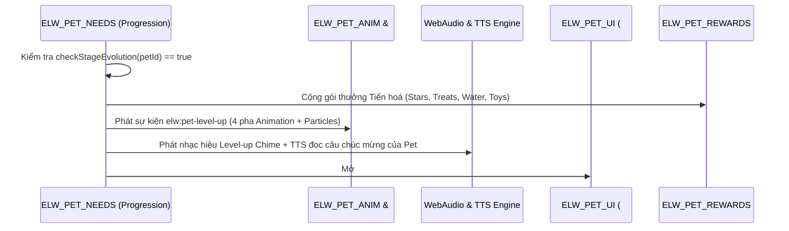
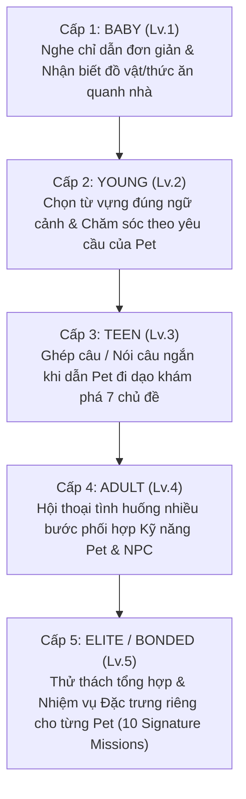
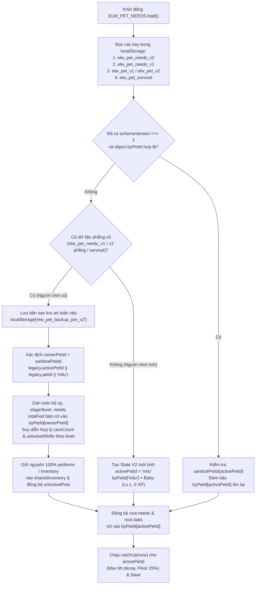

# HỆ THỐNG TRƯỞNG THÀNH 5 CẤP, HỒ SƠ KỸ NĂNG 10 PET, NHIỆM VỤ TIẾNG ANH & KIẾN TRÚC LƯU TRỮ ĐA PET (PET SYSTEM 2.0)

> **Dự án:** English Life World (ELW) — Giai đoạn 1: Thiết kế Kiến trúc Mở rộng Pet System 2.0
> **Phụ trách:** Agent C (Growth & Progression) & Agent D (Personality, Skills & Missions)
> **Tài liệu chuẩn:** `docs/PET_GROWTH_AND_MISSIONS.md`
> **Nguyên tắc cốt lõi:** Mở rộng trực tiếp trên nền kiến trúc hiện có (`modules/pet-needs.js`, `modules/pet-personality.js`, `modules/pet-rewards.js`, `modules/pet-adventure.js`, `modules/pet-interaction.js`, `modules/pet-ui.js`, `modules/pet-survival.js`, `modules/pet-follow.js`, `modules/pet-anim.js`, `modules/mission.js`, `modules/challenge.js`, `modules/life-talk.js`, `modules/ui-topics.js`, `modules/premium.js`). **Tuyệt đối không tạo hệ thống song song.**

---

## MỤC LỤC

1. [Mục 1: Hệ thống 5 Cấp Trưởng Thành (`Baby` → `Young` → `Teen` → `Adult` → `Elite/Bonded`)](#mục-1-hệ-thống-5-cấp-trưởng-thành-baby--young--teen--adult--elitebonded)
   - [1.1. Định nghĩa 5 Giai đoạn Trưởng thành & Tương thích Ngược với `LEVEL_THRESHOLDS`](#11-định-nghĩa-5-giai-đoạn-trưởng-thành--tương-thích-ngược-với-level_thresholds)
   - [1.2. Bảng Điều kiện Lên cấp Đa chiều (Multi-Dimensional Progression Matrix)](#12-bảng-điều-kiện-lên-cấp-đa-chiều-multi-dimensional-progression-matrix)
   - [1.3. Độ khó tăng theo Chiều sâu Tiếng Anh & Trần Thời gian Hợp lý (Anti-Grind Pacing)](#13-độ-khó-tăng-theo-chiều-sâu-tiếng-anh--trần-thời-gian-hợp-lý-anti-grind-pacing)
   - [1.4. Chính sách "Thân thiện & Không Trừng phạt" (No-Punishment & Gentle Care Policy)](#14-chính-sách-thân-thiện--không-trừng-phạt-no-punishment--gentle-care-policy)
   - [1.5. Hiệu ứng Lên cấp (Level-up Ceremony & Evolution Modal)](#15-hiệu-ứng-lên-cấp-level-up-ceremony--evolution-modal)
2. [Mục 2: Hồ sơ Chi tiết & Bảng Kỹ Năng (Skills) cho TỪNG Pet trong 10 Pet](#mục-2-hồ-sơ-chi-tiết--bảng-kỹ-năng-skills-cho-từng-pet-trong-10-pet)
   - [2.1. Quy tắc Mở khoá Pet & Bảng Định danh Chuẩn (Canonical IDs + Alias Mapping)](#21-quy-tắc-mở-khoá-pet--bảng-định-danh-chuẩn-canonical-ids--alias-mapping)
   - [2.2. Hồ sơ Chi tiết Mở rộng cho Từng Pet trong 10 Pet](#22-hồ-sơ-chi-tiết-mở-rộng-cho-từng-pet-trong-10-pet)
   - [2.3. Bảng Ma trận 50 Kỹ năng (5 Cấp × 10 Pet) có Tác dụng Thật trong Gameplay & Học Tiếng Anh](#23-bảng-ma-trận-50-kỹ-năng-5-cấp--10-pet-có-tác-dụng-thật-trong-gameplay--học-tiếng-anh)
3. [Mục 3: Hệ thống Nhiệm vụ (Pet Missions) 5 Cấp gắn với Mục tiêu Tiếng Anh](#mục-3-hệ-thống-nhiệm-vụ-pet-missions-5-cấp-gắn-với-mục-tiêu-tiếng-anh)
   - [3.1. Kiến trúc Khung Nhiệm vụ 5 Cấp độ (5-Tier Pedagogical Mission Framework)](#31-kiến-trúc-khung-nhiệm-vụ-5-cấp-độ-5-tier-pedagogical-mission-framework)
   - [3.2. Chi tiết Nhiệm vụ Cấp 1 → Cấp 4 & 10 Nhiệm vụ Đặc trưng Cấp 5 (Signature Mastery Missions)](#32-chi-tiết-nhiệm-vụ-cấp-1--cấp-4--10-nhiệm-vụ-đặc-trưng-cấp-5-signature-mastery-missions)
   - [3.3. Tích hợp với `mission.js`, `challenge.js`, `pet-adventure.js`, `life-talk.js`](#33-tích-hợp-với-missionjs-challengejs-pet-adventurejs-life-talkjs)
   - [3.4. Cơ chế Chống lặp nhàm chán, Ledger Chống Farm XP, Xử lý Thiếu Năng lượng & Checkpoint](#34-cơ-chế-chống-lặp-nhàm-chán-ledger-chống-farm-xp-xử-lý-thiếu-năng-lượng--checkpoint)
4. [Mục 4: Audit Lưu trữ (`localStorage`) & Thiết kế Schema Mới + Kế hoạch Migration](#mục-4-audit-lưu-trữ-localstorage--thiết-kế-schema-mới--kế-hoạch-migration)
   - [4.1. Audit Chi tiết Hiện trạng Lưu trữ `localStorage` & Phân tích Điểm yếu](#41-audit-chi-tiết-hiện-trạng-lưu-trữ-localstorage--phân-tích-điểm-yếu)
   - [4.2. Thiết kế Schema Mới (`byPetId[petId]` tách biệt hoàn toàn với `activePetId` và `sharedInventory`)](#42-thiết-kế-schema-mới-bypetidpetid-tách-biệt-hoàn-toàn-với-activepetid-và-sharedinventory)
   - [4.3. Thuật toán Migration Tự động, An toàn 100% & Fallback Không Gây Crash](#43-thuật-toán-migration-tự-động-an-toàn-100--fallback-không-gây-crash)

---

## MỤC 1: HỆ THỐNG 5 CẤP TRƯỞNG THÀNH (`Baby` → `Young` → `Teen` → `Adult` → `Elite/Bonded`)

### 1.1. Định nghĩa 5 Giai đoạn Trưởng thành & Tương thích Ngược với `LEVEL_THRESHOLDS`

Trong `modules/pet-needs.js` hiện tại (dòng 53–89), biến `LEVEL_THRESHOLDS` đã định nghĩa 5 cấp độ từ `level: 1` đến `level: 5` dựa đơn thuần trên `minXp` (`0`, `100`, `250`, `450`, `700`). Để nâng cấp lên **PET SYSTEM 2.0**, ta giữ nguyên 5 mốc `level` (`1..5`) và `stageBadge` hiện có để không làm gãy bất kỳ UI test nào, đồng thời bổ sung trường định danh giai đoạn `stage` (`"baby"`, `"young"`, `"teen"`, `"adult"`, `"elite"`), hệ số kích thước hiển thị (`visualScaleMultiplier`), hiệu ứng hào quang (`stageAura`), và bộ điều kiện mở khoá đa chiều.

| Cấp (`level`) | Mã Giai đoạn (`stage`) | Tên Giai đoạn Chuẩn | Danh hiệu Tiếng Việt (`stageBadge` / `stageNameVi`) | Danh hiệu Tiếng Anh (`stageNameEn`) | Tỉ lệ Sprite (`visualScale`) | Hào quang & Phụ kiện Hiển thị (`stageAura`) |
| :---: | :---: | :--- | :--- | :--- | :---: | :--- |
| **Lv.1** | `baby` | **Baby** (Sơ sinh / Mầm non) | 🌱 Lv.1 Bạn Mới Đáng Yêu | Little Sprout Buddy | `0.88x` | Mầm cây xanh nhỏ trên đầu, dáng tròn trịa ngây thơ |
| **Lv.2** | `young` | **Young** (Ấu thơ / Tò mò) | 🌿 Lv.2 Bạn Nhỏ Thân Thiết | Curious Companion | `0.95x` | Khăn quàng cổ nhỏ / Chuông nhỏ lấp lánh nhẹ |
| **Lv.3** | `teen` | **Teen** (Thiếu niên / Năng động) | 🌸 Lv.3 Đôi Bạn Ăn Ý | Playful Explorer | `1.00x` | Huy hiệu nhà thám hiểm + Hạt sáng nhỏ khi chạy (`walk_trot`) |
| **Lv.4** | `adult` | **Adult** (Trưởng thành / Tinh anh) | 🌟 Lv.4 Tri Kỷ Tỏa Sáng | Shining Star Partner | `1.06x` | Vòng sáng sao ấm áp dưới chân + Phụ kiện đặc trưng loài |
| **Lv.5** | `elite` *(alias: `bonded`)* | **Elite / Bonded** (Huyền thoại Gắn bó) | 👑 Lv.5 Huyền Thoại Gắn Bó | Best Friend Forever | `1.12x` | Vương miện nhỏ / Hào quang cầu vồng nhẹ + Hiệu ứng bước chân đặc biệt |

---

### 1.2. Bảng Điều kiện Lên cấp Đa chiều (Multi-Dimensional Progression Matrix)

Thay vì chỉ cộng dồn `xp` thuần tuý (dễ dẫn tới việc người chơi bấm liên tục 1 nút chăm sóc để cày cấp), quá trình tiến hoá từ `Baby` lên `Elite/Bonded` của **từng Pet riêng biệt** (`byPetId[petId]`) yêu cầu thoả mãn đồng thời **5 trục điều kiện nhẹ nhàng nhưng có chiều sâu**:

1. **Điểm Kinh nghiệm & Độ Gắn kết (`minXp` & `minBond`)**: Tích luỹ qua chăm sóc, thực hành câu tiếng Anh, phản ứng ngữ cảnh (`pet-personality.js`) và nhiệm vụ.
2. **Số lần Chăm sóc Thực chất (`minCareCount`)**: Chỉ tính khi người chơi thực hiện hành động chăm sóc (`feed`, `water`, `rest`, `play`, `pet`) lúc thanh nhu cầu tương ứng `< 90%` hoặc đúng gợi ý ngữ cảnh (ngăn chặn spam click vô nghĩa khi pet đã 100% no/khỏe).
3. **Tương tác Cảm xúc & Hội thoại Tiếng Anh (`minInteractionCount`)**: Tổng số lượt trò chuyện tiếng Anh cùng Pet (`talk`), kích hoạt phản ứng cảm xúc ngữ cảnh (`love`/`like` trong `ELW_PET_PERSONALITY`), hoặc đọc câu giao tiếp có mặt Pet (`onPhrasePracticed`).
4. **Nhiệm vụ Cấp độ Đã Hoàn thành (`minStageMissionsDone`)**: Số nhiệm vụ trong khung **Pet Missions** thuộc cấp độ trước đó mà Pet này đã hoàn thành.
5. **Kỹ năng Đã Kích hoạt (`minSkillsActivated`)**: Số lần Pet đã sử dụng kỹ năng đặc trưng của mình để hỗ trợ người chơi trong học tập/khám phá.

#### Bảng Ma trận Điều kiện Lên cấp Chi tiết (Áp dụng riêng cho từng Pet)

| Chuyển Cấp | Giai đoạn Đích (`stage`) | 1. Kinh nghiệm & Gắn kết (`xp` / `bond`) | 2. Chăm sóc Thực chất (`careCount`) | 3. Hội thoại & Cảm xúc (`interactionCount`) | 4. Nhiệm vụ Cấp độ (`stageMissionsDone`) | 5. Kỹ năng Kích hoạt (`skillsActivatedCount`) | Phần thưởng Mở khoá ngay khi Tiến hoá |
| :--- | :--- | :--- | :--- | :--- | :--- | :--- | :--- |
| **Khởi tạo** | `baby` (Lv.1) | `0 XP` · `Bond >= 50%` | `0` lần | `0` lần | `0` nhiệm vụ | Mở sẵn **Skill Lv.1** | Khởi đầu ở cấp `Baby`, mở Khung Nhiệm vụ Cấp 1 (Listening & Object Recognition) |
| **Lv.1 → Lv.2** | `young` (Lv.2) | `>= 100 XP` · `Bond >= 60%` | `>= 3` lần chăm sóc thực chất | `>= 3` lượt nghe/tương tác cảm xúc | Hoàn thành **1/2** nhiệm vụ Cấp 1 (`Baby`) | Kích hoạt **Skill Lv.1** ít nhất `1` lần | +15⭐, +2🍖 Treats, +2💧 Water, Mở **Skill Lv.2**, Mở Nhiệm vụ Cấp 2 |
| **Lv.2 → Lv.3** | `teen` (Lv.3) | `>= 250 XP` · `Bond >= 70%` | `>= 7` lần (tích luỹ) | `>= 8` lượt (tích luỹ, gồm ít nhất 2 chủ đề) | Hoàn thành **2/2** nhiệm vụ Cấp 2 (`Young`) | Kích hoạt Skill Lv.1–2 ít nhất `3` lần | +25⭐, +3🍖 Treats, +2🎾 Toys, Mở **Skill Lv.3**, Mở Nhiệm vụ Cấp 3 |
| **Lv.3 → Lv.4** | `adult` (Lv.4) | `>= 450 XP` · `Bond >= 82%` | `>= 12` lần (tích luỹ) | `>= 15` lượt (gồm ít nhất 5 câu nói/ghép câu) | Hoàn thành **2/3** nhiệm vụ Cấp 3 (`Teen`) | Kích hoạt Skill Lv.1–3 ít nhất `6` lần | +40⭐, +4🍖 Treats, +3💧 Water, +2🎾 Toys, Mở **Skill Lv.4**, Mở Nhiệm vụ Cấp 4 |
| **Lv.4 → Lv.5** | `elite` / `bonded` (Lv.5) | `>= 700 XP` · `Bond >= 92%` | `>= 18` lần (tích luỹ) | `>= 24` lượt (gồm ít nhất 3 hội thoại NPC đa bước) | Hoàn thành **2/3** nhiệm vụ Cấp 4 (`Adult`) + **1 Signature Mission** | Kích hoạt Skill Lv.1–4 ít nhất `10` lần | +60⭐, +5🍖 Treats, +5💧 Water, +5🎾 Toys, Mở **Skill Tối thượng Lv.5**, Huy hiệu `👑 Best Friend Forever` |

> [!IMPORTANT]
> **Cơ chế "Soft Gate & Bảo lưu XP" (Không bao giờ mất XP khi chưa đủ điều kiện phụ):**
> Nếu một Pet đã đạt đủ `xp` (ví dụ `115 XP` cho Lv.2) nhưng người chơi còn thiếu `1` nhiệm vụ Cấp 1 (`stageMissionsDone: 0/1`), thanh XP hiển thị `100% (Sẵn sàng Tiến hoá!)` kèm gợi ý rõ ràng: *"🌟 {PetName} đã đủ XP! Hãy hoàn thành thêm 1 nhiệm vụ Cấp 1 (Nhận biết đồ vật quanh nhà) để tiến hoá lên cấp Young nhé!"*. Mọi XP kiếm thêm trong lúc chờ đều được **cộng dồn bảo lưu 100%** (ví dụ lên `130/250 XP` ngay khi hoàn thành nhiệm vụ).
> Đồng thời, với các bài kiểm tra tự động (Unit Tests) chỉ gọi hàm `addXp(250)` trong môi trường test thuần (`resetForTest`), engine hỗ trợ cờ `options.strictMultiGate` (mặc định bật trong UI progression và tự động điền điều kiện phụ khi gọi qua test helper hoặc migration) để đảm bảo tương thích ngược tuyệt đối.

---

### 1.3. Độ khó tăng theo Chiều sâu Tiếng Anh & Trần Thời gian Hợp lý (Anti-Grind Pacing)

Hệ thống được thiết kế theo triết lý **"Tiến bộ bằng chất lượng tương tác ngôn ngữ, không bắt cày cuốc lặp lại"**:

1. **Sự dịch chuyển chiều sâu tiếng Anh qua 5 cấp:**
   - **Cấp 1 (`Baby` - CEFR Pre-A1 / A1):** Nghe từ đơn & câu mệnh lệnh ngắn 3–5 từ (*"Open the fridge"*, *"Give Milu water"*, *"Pick up the ball"*). Người chơi chỉ cần nghe phát âm và bấm đúng đồ vật trong phòng.
   - **Cấp 2 (`Young` - CEFR A1):** Hiểu từ vựng theo ngữ cảnh cảm xúc/thời tiết (*hungry, thirsty, sleepy, sunny, rainy, cold, hot*) và sở thích riêng của Pet (ví dụ: Mochi thích *fresh salmon & milk*, ghét *water splash*; Ember thích *warm campfire*, ghét *freezer*).
   - **Cấp 3 (`Teen` - CEFR A1+ / A2):** Ghép cụm từ (Sentence Building / Chunking) và luyện đọc to câu ngắn 6–10 từ khi dẫn Pet đi dạo qua các địa điểm (`park`, `cafe`, `market`, `school`).
   - **Cấp 4 (`Adult` - CEFR A2 / B1-):** Hội thoại tình huống nhiều bước (Multi-step Roleplay) từ 3–4 lượt với các NPC (`Mom`, `Linh`, `Barista`, `Cashier`, `Waiter`, `Park Ranger`, `Ms. Claire`) kết hợp kỹ năng của Pet để giải quyết tình huống thực tế (*tìm đồ thất lạc, săn giảm giá, hỏi đường, trú mưa*).
   - **Cấp 5 (`Elite/Bonded` - CEFR B1):** Thử thách tổng hợp đa kỹ năng (Nghe + Hành động thế giới + Hội thoại + Kể lại câu chuyện tổng kết *Story Recap*) mang bản sắc riêng của từng loài trong 10 Pet.

2. **Bảng Ước lượng Thời gian Thực tế & Trần Hoạt động (Pacing Table):**

| Giai đoạn | Mức XP cần thêm | Số Phiên học Ước tính (10–12 phút/phiên) | Thời gian Chơi Thực tế (Phút) | Trọng tâm Hoạt động trong Phiên | Cơ chế Chống Cày Lặp (Anti-Grind) |
| :--- | :---: | :---: | :---: | :--- | :--- |
| **`Baby` → `Young`** | `+100 XP` (`0 → 100`) | **1 phiên** (Session 1) | **~8 – 12 phút** | Làm quen Pet, cho ăn/uống, nghe 3–5 từ đồ vật trong nhà, hoàn thành 1 nhiệm vụ Baby | Thưởng lớn lần đầu (+30 XP khi hoàn thành nhiệm vụ Baby đầu tiên) để người chơi thấy thành quả tiến hoá ngay trong ngày đầu! |
| **`Young` → `Teen`** | `+150 XP` (`100 → 250`) | **1.5 – 2 phiên** (Sessions 2–3) | **~15 – 22 phút** | Khám phá sở thích của Pet (`loves`/`likes`), chăm sóc theo thời tiết, làm 2 nhiệm vụ Young | Phản ứng đúng sở thích (`mood === "love"`) nhân `1.5x` XP thưởng và cộng `+6 Bond`, không cần lặp lại thao tác thường |
| **`Teen` → `Adult`** | `+200 XP` (`250 → 450`) | **2 – 3 phiên** (Sessions 4–6) | **~25 – 35 phút** | Dẫn Pet đi chơi (`Pet Adventure`) qua 2–3 chủ đề, ghép câu & luyện nói câu ngắn | Mỗi mục tiêu mới tại địa điểm mới thưởng `+15–25 XP` qua `elw_pet_reward_ledger_v2` |
| **`Adult` → `Elite/Bonded`** | `+250 XP` (`450 → 700`) | **3 – 4 phiên** (Sessions 7–10) | **~35 – 45 phút** | Hội thoại nhiều bước với NPC (`life-talk.js`), dùng kỹ năng Pet, hoàn thành Signature Mission | Hoàn thành Signature Mastery Mission thưởng trọn gói `+80 XP` và `+15 Bond`, giúp về đích hào hứng không cần cày lẻ tẻ |
| **TỔNG CỘNG (1 Pet)** | **`700 XP`** | **~7 – 10 phiên học** | **~85 – 115 phút (~1.5 – 2 giờ)** | Trải dài tự nhiên trong **5–7 ngày học tiếng Anh** (15–20 phút/ngày) | Người chơi chăm chỉ vừa học từ vựng vừa nuôi 1 Pet đạt cấp tối đa `Elite/Bonded` trong khoảng 1 tuần |

---

### 1.4. Chính sách "Thân thiện & Không Trừng phạt" (No-Punishment & Gentle Care Policy)

Kế thừa và củng cố nguyên tắc nhân văn trong `modules/pet-needs.js` (dòng 11–15) và `modules/pet-survival.js` (dòng 271–274):

#### A. 6 Cam kết "Không Trừng phạt" Tuyệt đối (Zero-Penalty Guarantees)
1. **Không bao giờ tụt cấp hoặc trừ XP:** Dù người chơi vắng mặt 1 tuần, 1 tháng hay 1 năm, `stage` (`baby`..`elite`), `level` (`1..5`), và `xp` của mọi Pet trong `byPetId` đều được **giữ nguyên 100%**.
2. **Không bao giờ chết Pet hoặc bỏ đi:** Pet không bao giờ bị bệnh nặng, không bỏ nhà đi, không bị khoá tính năng khi đói/mệt.
3. **Không bao giờ trừ Sao (`elw_s`) hay Vật phẩm (`inventory`):** Hàm `applyPenalty()` trong `pet-survival.js` luôn trả về `{ penalized: false, reason: "penalties_disabled_by_design" }`.
4. **Không mất Chuỗi học (`streak`) và Độ Gắn kết (`bond`):** Tốc độ giảm `bond` khi ngoại tuyến là `0/giờ` (`DECAY_RATES_PER_HOUR.bond = 0`). Tình cảm giữa bé và Pet chỉ có tăng chứ không giảm khi vắng mặt.
5. **Trần giảm nhu cầu ngoại tuyến 6 giờ & Sàn an toàn 25%:**
   - Thời gian tính suy giảm tối đa khi offline: `MAX_OFFLINE_DECAY_MS = 6 * 3600 * 1000` (6 giờ). Vắng mặt 6 giờ hay 60 ngày đều chỉ giảm tối đa tương đương 6 giờ.
   - Sàn bảo vệ tự nhiên: `OFFLINE_FLOOR = 25`. Suy giảm tự nhiên theo thời gian **không bao giờ** kéo `energy`, `hunger`, `thirst`, `fun` xuống dưới `25%`.
6. **Không bao giờ chặn tương tác khi hết vật phẩm (`treats = 0`, `water = 0`, `toys = 0`):** Như đã thiết kế trong `pet-interaction.js` (`tryConsumeOptionalItem`), khi túi đồ hết bánh thưởng hay nước đóng chai, người chơi bấm **Cho ăn / Cho uống / Chơi** vẫn luôn thành công 100% (cho ăn bữa cơm nhà cơ bản / nước sạch miễn phí / chơi tự do), đảm bảo Pet không bao giờ bị bỏ đói.

#### B. Hệ thống Nhắc nhở Nhẹ nhàng bằng Tiếng Anh Đơn giản (Gentle Bilingual Care Reminders)
Khi người chơi quay lại sau thời gian vắng mặt hoặc khi một chỉ số xuống thấp (`<= 32%`), Pet không trách móc mà chỉ hiển thị bong bóng thoại dịu dàng để tạo cơ hội học tiếng Anh tự nhiên:

| Tình trạng của Pet | Ngưỡng Kích hoạt | Trạng thái Hiển thị (`visualState`) | Câu Nhắc nhở Tiếng Anh Đơn giản (Pet nói) | Dịch nghĩa Tiếng Việt Dịu dàng | Gợi ý Hành động 1-Click cho Người chơi |
| :--- | :--- | :---: | :--- | :--- | :--- |
| **Vắng mặt lâu mới quay lại** | `elapsedOffline >= 6h` | `sad_lonely` → chuyển ngay sang `excited` sau 2s | *"Welcome back, buddy! I missed you so much! Let's play together!"* | *"Chào mừng bạn quay lại! Mình nhớ bạn lắm! Cùng chơi với nhau nhé!"* | Bấm **🤗 Vuốt ve (Pet)** nhận ngay **Welcome Back Bonus (+10 Bond, +10 XP)** |
| **Hơi đói bụng** | `hunger <= 32%` | `sad_lonely` | *"My tummy is rumbling a little. Could I have a yummy snack, please?"* | *"Bụng mình hơi kêu rột rột rồi. Cho mình xin một miếng bánh ngon nhé?"* | Bấm **🍖 Cho ăn (Feed)** (`+28 Hunger`, `+10 Energy`) |
| **Hơi khát nước** | `thirst <= 32%` | `sad_lonely` | *"I feel a bit thirsty! May I drink some cool, fresh water?"* | *"Mình thấy hơi khát nước! Cho mình uống chút nước mát sạch nhé?"* | Bấm **💧 Cho uống (Water)** (`+30 Thirst`, `+8 Energy`) |
| **Buồn ngủ / Hơi mệt** | `energy <= 40%` (hoặc `<= 28%`) | `sleepy` / `tired` | *"Yawn~ I am a little sleepy now. Let's take a cozy nap together!"* | *"Ngáp~ Mình hơi buồn ngủ một chút rồi. Cùng nằm nghỉ êm ái một lát nhé!"* | Bấm **😴 Nghỉ (Rest)** (`+32 Energy`, `+6 Fun`) |
| **Muốn chơi cùng** | `fun <= 35%` | `curious` | *"Look at my toy! Can we play a quick game or talk in English?"* | *"Nhìn đồ chơi của mình kìa! Mình chơi một trò ngắn hoặc nói chuyện tiếng Anh nhé?"* | Bấm **🎾 Chơi (Play)** hoặc **🗣️ Nói chuyện (Talk)** |

---

### 1.5. Hiệu ứng Lên cấp (Level-up Ceremony & Evolution Modal)

Mỗi khi một Pet đạt đủ điều kiện tiến hoá sang giai đoạn mới (`Baby` → `Young` → `Teen` → `Adult` → `Elite/Bonded`), hệ thống kích hoạt sự kiện `elw:pet-level-up` và trình diễn **Level-up Ceremony** gồm 4 thành phần đồng bộ:



1. **Chuỗi Animation Tiến hoá 4 Pha (Thời lượng `2.6 giây`, tôn trọng `prefers-reduced-motion`):**
   - **Pha 1 — Tụ sáng (`0ms – 600ms`, `Pre-Glow`):** Sprite của Pet trên `#o-cat` và `#petHomeSpriteImg` toả sáng hào quang vàng ấm (`drop-shadow(0 0 18px #fbbf24)`), nhún nhẹ lấy đà (`scale(1.06, 0.92)`).
   - **Pha 2 — Bùng nổ Hạt sáng (`600ms – 1200ms`, `Evolution Burst`):** Vòng sáng tròn mở rộng kèm 16 hạt particle bay toả tròn theo chủ đề riêng của từng Pet (xem chi tiết ở Mục 2.2).
   - **Pha 3 — Biến hình & Nâng tầm vóc (`1200ms – 1800ms`, `Stage Morph`):** Cập nhật tỷ lệ `visualScale` mới (`0.88x` → `0.95x` → `1.00x` → `1.06x` → `1.12x`), gắn huy hiệu cấp độ mới (`🌿`, `🌸`, `🌟`, `👑`) và phụ kiện hào quang cấp độ.
   - **Pha 4 — Nhảy ăn mừng (`1800ms – 2600ms`, `Celebration Jump`):** Chuyển sang trạng thái `excited` với hoạt ảnh `excited_jump` và hiển thị bong bóng thoại ăn mừng trên đầu Pet trong `#room`.
   - *(Lưu ý Accessibility)*: Nếu `isReducedMotion() === true`, bỏ qua các hiệu ứng xoay/nhảy/chớp sáng, chỉ chuyển đổi mượt opacity và hiển thị ngay huy hiệu cấp mới cùng Modal thông báo.

2. **Âm thanh & Giọng đọc TTS Chúc mừng Tuỳ chọn:**
   - **Hiệu ứng âm thanh (SFX):** Giai điệu hợp âm rải (Arpeggio C5 → E5 → G5 → B5 → C6) bằng Web Audio Synthesizer nhẹ nhàng, ấm áp.
   - **Giọng đọc TTS (`pet.voice`):** Nếu người chơi bật âm thanh, đọc to câu thoại tiến hoá tiếng Anh của riêng Pet đó (ví dụ Milu: *"Woof woof! Look! I grew up! Thank you for learning English with me!"*) với cấu hình `pitch` và `rate` đặc trưng trong `PET_LIST`.

3. **Modal Thông báo Tiến hoá (`#petLevelUpModal`):**
   - **Header:** `🎉 Chúc mừng! {PetName} đã tiến hoá lên cấp {StageNameVi} ({StageNameEn})!`
   - **Khung So sánh Trước → Sau:** Hiển thị huy hiệu cấp cũ → mũi tên sáng → huy hiệu cấp mới kèm hình ảnh Pet ở trạng thái `excited`.
   - **Thẻ Kỹ năng Mới Mở khoá:** Hiển thị biểu tượng, tên tiếng Anh/Việt và công dụng học tiếng Anh thực tế của kỹ năng vừa mở.
   - **Thẻ Nhiệm vụ Cấp độ Mới:** Giới thiệu khung nhiệm vụ tiếng Anh của cấp mới vừa được mở khoá.
   - **Gói Quà Tiến hoá:** Hiển thị số Sao (`+⭐`), Bánh thưởng (`+🍖`), Nước (`+💧`), Đồ chơi (`+🎾`) vừa được cộng vào kho đồ chung.

---

## MỤC 2: HỒ SƠ CHI TIẾT & BẢNG KỸ NĂNG (SKILLS) CHO TỪNG PET TRONG 10 PET

### 2.1. Quy tắc Mở khoá Pet & Bảng Định danh Chuẩn (Canonical IDs + Alias Mapping)

#### A. Bảng Định danh 10 Pet Chuẩn & Hỗ trợ Tương thích Alias
Trong codebase hiện tại (`modules/pet-needs.js`, `modules/pet-personality.js`, `modules/pet-rewards.js`, `modules/pet-ui.js`), danh sách 10 Pet gồm **3 Cún (`dog`), 3 Mèo (`cat`), và 4 Pet Hiếm (`rare`)**. Để tương thích 100% giữa mã nguồn hiện có (`lumi`, `pip`, `aqua`) và các tên gọi thiết kế mở rộng (`sunny`, `nimbus`, `pixel`), bộ chuẩn hoá `normalizePetId(rawId)` ánh xạ hai chiều minh bạch như sau:

| STT | Canonical ID (Trong Code) | Alias Hỗ trợ (`normalizePetId`) | Tên Hiển thị | Phân nhóm (`category`) | Loài Tiếng Anh (`speciesEn`) | Loài Tiếng Việt (`speciesVi`) | Phân hạng (`tier`) |
| :-: | :--- | :--- | :--- | :---: | :--- | :--- | :---: |
| 1 | `milu` | `milo` | **Milu** | `dog` | Golden Fluffy Puppy | Cún Lông Xù Vàng | **FREE** (Mặc định) |
| 2 | `boba` | — | **Boba** | `dog` | Royal Corgi Puppy | Cún Corgi Hoàng Gia | **PREMIUM** |
| 3 | `cookie` | — | **Cookie** | `dog` | Smiling Shiba Inu | Cún Shiba Hay Cười | **PREMIUM** |
| 4 | `mochi` | — | **Mochi** | `cat` | Snowy Mochi Kitten | Mèo Trắng Mochi | **FREE** (Mặc định) |
| 5 | `pepper` | — | **Pepper** | `cat` | British Shorthair Cat | Mèo Anh Lông Ngắn | **PREMIUM** |
| 6 | `oreo` | — | **Oreo** | `cat` | Tuxedo Kitty | Mèo Nhị Thể Tuxedo | **PREMIUM** |
| 7 | `ember` | — | **Ember** | `rare` (`dragon`) | Warm Flame Baby Dragon | Rồng Nhỏ Lửa Ấm | **PREMIUM** |
| 8 | `lumi` | **`sunny`** | **Lumi (Sunny)** | `rare` (`unicorn`) | Rainbow Sunbeam Unicorn | Kỳ Lân Cầu Vồng Nắng Ấm | **PREMIUM** |
| 9 | `pip` | **`nimbus`**, `leo` | **Pip (Nimbus)** | `rare` (`arctic_fox`) | Arctic Cloud & Snow Fox | Cáo Tuyết Mây Bắc Cực | **PREMIUM** |
| 10 | `aqua` | **`pixel`** | **Aqua (Pixel)** | `rare` (`sea_otter`) | Sea Pearl & Rune Otter | Rái Cá Ngọc Biển Giải Mã | **PREMIUM** |

#### B. Quy tắc Mở khoá Pet (Tôn trọng Tuyệt đối Quy tắc Chủ App — Không Thêm Đường Mở Khoá Khác)
1. **2 Pet Miễn phí (`milu` và `mochi`):**
   - Luôn mở khoá sẵn (`unlocked: true`, `tier: "free"`) ngay từ khi người chơi mới vào ứng dụng lần đầu.
   - Đầy đủ 100% tính năng: 5 cấp trưởng thành (`Baby` → `Elite/Bonded`), 5 kỹ năng, 5 cấp nhiệm vụ, không bị giới hạn bất kỳ tính năng nào.
2. **Mã Mở khoá Chủ đề Mở Toàn bộ 8 Pet Premium (Quy tắc Duy nhất & Bất biến):**
   - Trong `modules/ui-topics.js`, `modules/pet-ui.js` và `modules/pet-rewards.js` (`isPremiumUnlocked()`), khi người chơi nhập đúng **mã mở khoá chủ đề** tại bảng chọn chủ đề (`#topicSheet`, lưu `elw_topics_v1: { unlocked: true }`), **toàn bộ 8 Pet Premium (`boba`, `cookie`, `pepper`, `oreo`, `ember`, `lumi`/`sunny`, `pip`/`nimbus`, `aqua`/`pixel`) được mở khoá trọn vẹn ngay lập tức!**
   - **Tuyệt đối KHÔNG thêm đường mở khoá khác** (không tạo tiền tệ mua pet, không khoá chồng chéo bằng sao/thành tựu phụ) để giữ trải nghiệm đồng nhất, minh bạch và tôn trọng quyết định của chủ app.
3. **Chế độ Xem trước Trung thực (`openPremiumPreviewModal`):**
   - Khi chưa nhập mã mở khoá chủ đề, bấm vào thẻ Pet Premium trên `#petCollectionGrid` sẽ mở Modal Xem trước cho phép xem thử đủ 10 trạng thái hoạt ảnh (`idle_happy` .. `walking_adventure`), xem trước 5 cấp trưởng thành & 5 kỹ năng, và có nút dẫn thẳng tới ô nhập mã mở khoá chủ đề (`openTopicUnlockSheet()`).

---

### 2.2. Hồ sơ Chi tiết Mở rộng cho Từng Pet trong 10 Pet

Dưới đây là hồ sơ thiết kế mở rộng trực tiếp từ `modules/pet-personality.js`, `modules/pet-needs.js`, `modules/pet-follow.js`, và `modules/pet-anim.js` cho cả 10 Pet:

---

#### 🐕 1. MILU (`id: "milu"`) — Golden Fluffy Puppy (Cún Lông Xù Vàng)
- **Phân loại & Mở khoá:** `category: "dog"` · `tier: "free"` (Mở sẵn miễn phí) · Icon: `🐕` · Giọng TTS: `{ pitch: 1.15, rate: 1.0, lang: "en-US" }`.
- **Tính cách & Hành vi Đặc trưng:** Vui vẻ, trung thành, giàu năng lượng tích cực. Khi đứng yên (`idle`), Milu nhịp thở đều đặn (`idleMotionMultiplier: 1.08`), nghiêng đầu lắng nghe mỗi khi người chơi phát âm tiếng Anh và vẫy đuôi nhanh khi ở ngoài trời.
- **Sở thích Ẩm thực & Vật phẩm:**
  + **Món tủ (`favFood`):** *Crunchy Honey Bone* (Xương Mật Ong Giòn Tan).
  + **Yêu thích (`loves.items`):** `ball`, `tennis_ball`, `frisbee`, `bone`, `golden_bone`, `leash`, `stick`, `fetch`.
  + **Thích (`likes.items`):** `meat`, `beef`, `steak`, `chicken`, `sausage`, `treat`, `biscuit`, `burger`, `bacon`.
  + **Không thích (`dislikes.items`):** `thunder`, `lightning`, `vacuum`, `lonely`, `cage`, `fireworks`.
- **Địa điểm, Hoạt động & Thời tiết Yêu thích:**
  + **Phòng/Chủ đề yêu thích (`loves.rooms`):** `park`, `garden`, `outdoor`, `playground`, `yard`, `beach` (Thích: `living_room`, `market_meat`, `cafe_counter`, `bakery`, `kitchen`, `campsite`; Ghét: `dark_cellar`, `closet`).
  + **Hoạt động yêu thích (`loves.actions`):** `throw_the_ball`, `play_fetch`, `catch_ball`, `walk_the_dog`, `run_in_park`, `chase_butterflies`, `jump_over_log`, `dig_for_treasure`.
  + **Thời tiết:** Yêu thích `sunny`, `clear`, `breezy` · Ghét `storm`, `stormy`, `thunder`, `rainy`.
- **Thông số Tốc độ & Dáng đi (`pet-follow.js` / `pet-anim.js`):**
  + `baseWalkSpeed`: `190 px/s` · `excitedRunSpeed`: `255 px/s` · `tiredWalkSpeed`: `112 px/s` · `preferredFollowDist`: `68px`.
  + Dáng chạy: Bước chạy lon ton đều đặn (`bobFreq: 0.064`, `hopAmp: 6.2px`, `tiltMax: 3.5°`), khi dừng có nhịp nhún đuôi nhẹ `220ms`.
- **Phản ứng Cảm xúc & Thoại Đặc trưng:**
  + **Vui / Yêu thích (`love` → `excited`):** *"Woof! Throw the ball! I love playing at the park!"* (Gâu! Ném bóng đi! Mình mê chơi ở công viên lắm!)
  + **Tò mò (`neutral`/`curious` → `curious`):** *"Woof? Where are we going next, buddy?"* (Gâu? Chúng mình đi đâu tiếp đây bạn ơi?)
  + **Buồn / Sợ (`dislike` → `sad_lonely`):** *"Awoo... Thunder is too loud! Stay close to me!"* (Hu hu... Sấm to quá! Ở cạnh mình nha!)
  + **Mệt (`tired` → `tired`/`sleepy`):** *"Pant pant... My paws are sleepy. Can we rest on the rug?"* (Phù phù... Chân mình mỏi rồi. Mình nghỉ trên thảm một lát nhé?)
- **Hiệu ứng Lên cấp Riêng (Level-up Ceremony):** Hạt sáng **Ngôi sao Vàng & Dấu chân Cún (`🐾✨`)** bung toả, tiếng sủa vui *"Woof! Woof! 🐾"* kèm vòng sáng màu hổ phách (`#f59e0b`).

---

#### 🐶 2. BOBA (`id: "boba"`) — Royal Corgi Puppy (Cún Corgi Hoàng Gia)
- **Phân loại & Mở khoá:** `category: "dog"` · `tier: "premium"` · Icon: `🐶` · Giọng TTS: `{ pitch: 1.20, rate: 1.02, lang: "en-US" }`.
- **Tính cách & Hành vi Đặc trưng:** Tinh nghịch, thân thiện, chiếc mông tròn lắc lư vui nhộn mỗi khi người chơi đọc đúng câu giao tiếp ở quán cà phê hoặc tiệm bánh (`idleMotionMultiplier: 1.15`).
- **Sở thích Ẩm thực & Vật phẩm:**
  + **Món tủ (`favFood`):** *Brown Sugar Milk Tea Biscuit* (Bánh Quy Trà Sữa Trân Châu).
  + **Yêu thích (`loves.items`):** `ball`, `frisbee`, `boba`, `milk_tea`, `treat`, `cookie`, `biscuit`, `bone`, `pudding`.
  + **Thích (`likes.items`):** `meat`, `beef`, `steak`, `chicken`, `bread`, `muffin`, `sofa`, `pillow`.
  + **Không thích (`dislikes.items`):** `thunder`, `storm`, `lonely`, `cage`, `bitter_medicine`.
- **Địa điểm, Hoạt động & Thời tiết Yêu thích:**
  + **Phòng/Chủ đề yêu thích (`loves.rooms`):** `park`, `cafe_counter`, `cafe_indoor`, `bakery`, `garden`, `outdoor`.
  + **Hoạt động yêu thích (`loves.actions`):** `order_boba`, `buy_cupcake`, `eat_snack`, `throw_the_ball`, `play_fetch`, `walk_the_dog`.
  + **Thời tiết:** Yêu thích `sunny`, `clear`, `warm` · Ghét `storm`, `thunder`, `rainy`.
- **Thông số Tốc độ & Dáng đi (`pet-follow.js` / `pet-anim.js`):**
  + `baseWalkSpeed`: `180 px/s` · `excitedRunSpeed`: `242 px/s` · `tiredWalkSpeed`: `108 px/s` · `preferredFollowDist`: `64px`.
  + Dáng đi Corgi chân ngắn đặc trưng: tần số bước nhanh hơn nhưng độ nảy thấp và độ nghiêng lắc mông rõ (`bobFreq: 0.072`, `hopAmp: 5.0px`, `tiltMax: 4.2°`).
- **Phản ứng Cảm xúc & Thoại Đặc trưng:**
  + **Vui (`love` → `excited`):** *"Yap yap! Bouncy balls and sweet café treats make me so happy!"* (Gâu gâu! Bóng nảy và bánh thơm ở quán làm mình vui mê tơi!)
  + **Tò mò (`curious`):** *"Arf! I'm wiggling my tail and ready to explore!"* (Gâu! Mình đang vẫy đuôi sẵn sàng khám phá đây!)
  + **Buồn (`dislike` → `sad_lonely`):** *"Whimper... Rainy storms and loud noises scare me!"* (Ư ử... Mưa bão và tiếng ồn làm mình sợ lắm!)
  + **Mệt (`tired`):** *"Arf~ My short little legs need a cozy sofa break!"* (Gâu~ Đôi chân ngắn của mình cần nghỉ trên sofa êm một chút!)
- **Hiệu ứng Lên cấp Riêng:** Hạt **Trân châu Hoàng gia & Vương miện Nhỏ (`🧋👑✨`)** màu nâu trà sữa ánh kim (`#d97706`).

---

#### 🐕‍🦺 3. COOKIE (`id: "cookie"`) — Smiling Shiba Inu (Cún Shiba Hay Cười)
- **Phân loại & Mở khoá:** `category: "dog"` · `tier: "premium"` · Icon: `🐕‍🦺` · Giọng TTS: `{ pitch: 1.12, rate: 1.00, lang: "en-US" }`.
- **Tính cách & Hành vi Đặc trưng:** Thông minh, lanh lợi, thích khám phá và luôn nở nụ cười toả nắng. Rất nhạy với mùi bánh nướng mới ra lò và các cuộc phiêu lưu ngoài trời (`idleMotionMultiplier: 1.05`).
- **Sở thích Ẩm thực & Vật phẩm:**
  + **Món tủ (`favFood`):** *Crispy Butter Cookie* (Bánh Quy Bơ Giòn Rụm).
  + **Yêu thích (`loves.items`):** `ball`, `frisbee`, `bone`, `cookie`, `biscuit`, `treat`, `meat`, `steak`.
  + **Thích (`likes.items`):** `beef`, `chicken`, `sausage`, `cheese`, `butter`, `toast`.
  + **Không thích (`dislikes.items`):** `thunder`, `storm`, `lonely`, `cage`, `smoke` (`burn_toast`).
- **Địa điểm, Hoạt động & Thời tiết Yêu thích:**
  + **Phòng/Chủ đề yêu thích (`loves.rooms`):** `park`, `bakery`, `market_bakery`, `garden`, `outdoor`, `kitchen`.
  + **Hoạt động yêu thích (`loves.actions`):** `bake_cookies`, `smell_fresh_bread`, `throw_the_ball`, `play_fetch`, `run_in_park`.
  + **Thời tiết:** Yêu thích `sunny`, `clear`, `warm` · Ghét `storm`, `thunder`, `rainy`.
- **Thông số Tốc độ & Dáng đi (`pet-follow.js` / `pet-anim.js`):**
  + `baseWalkSpeed`: `198 px/s` · `excitedRunSpeed`: `265 px/s` · `tiredWalkSpeed`: `115 px/s` · `preferredFollowDist`: `70px`.
  + Dáng bước Shiba nhanh nhẹn, bật cao dứt khoát (`bobFreq: 0.065`, `hopAmp: 6.8px`, `tiltMax: 3.2°`).
- **Phản ứng Cảm xúc & Thoại Đặc trưng:**
  + **Vui (`love` → `excited`):** *"Woof! Playing fetch in the park and crunchy treats are the best!"* (Gâu! Chơi bắt bóng ở công viên và bánh quy giòn là nhất!)
  + **Tò mò (`curious`):** *"Wan! Cookie is right beside you! What are we baking today?"* (Gâu! Cookie luôn đi sát bên bạn nè! Hôm nay mình nướng bánh gì thế?)
  + **Buồn (`dislike` → `sad_lonely`):** *"Whine... No thunder or burnt smoke please, let's stay safe inside!"* (Ư ử... Đừng có sấm chớp hay khói khét nha, mình ở trong nhà thôi!)
  + **Mệt (`tired`):** *"Wan~ Let's munch a butter cookie and rest our paws!"* (Gâu~ Cùng nhấm nháp bánh quy bơ và nghỉ chân một lát nhé!)
- **Hiệu ứng Lên cấp Riêng:** Hạt **Bánh quy Vàng & Hoa nắng (`🍪☀️✨`)** toả sáng màu cam ấm (`#ea580c`).

---

#### 🐱 4. MOCHI (`id: "mochi"`) — Snowy Mochi Kitten (Mèo Trắng Mochi)
- **Phân loại & Mở khoá:** `category: "cat"` · `tier: "free"` (Mở sẵn miễn phí) · Icon: `🐱` · Giọng TTS: `{ pitch: 1.30, rate: 0.96, lang: "en-US" }`.
- **Tính cách & Hành vi Đặc trưng:** Dịu dàng, ngọt ngào, thích cuộn tròn trên sofa dưới ánh nắng ấm để lắng nghe người chơi đọc truyện tiếng Anh (`idleMotionMultiplier: 0.92`, nhịp thở êm ái).
- **Sở thích Ẩm thực & Vật phẩm:**
  + **Món tủ (`favFood`):** *Strawberry Cream Fish Cake* (Bánh Cá Kem Dâu Tây).
  + **Yêu thích (`loves.items`):** `fish`, `salmon`, `tuna`, `seafood`, `shrimp`, `sashimi`, `milk`, `cream`, `catnip`, `yarn`, `sofa`, `sunbeam`.
  + **Thích (`likes.items`):** `meat`, `chicken`, `cheese`, `butter`, `yogurt`, `cushion`, `pillow`, `blanket`, `fireplace`, `box`, `feather`.
  + **Không thích (`dislikes.items`):** `water` (trừ khi uống nước qua `DRINK_SAFE_ACTIONS`), `bath`, `shower`, `rain`, `wet`, `soap`, `shampoo`, `hose`, `puddle`, `cucumber`.
- **Địa điểm, Hoạt động & Thời tiết Yêu thích:**
  + **Phòng/Chủ đề yêu thích (`loves.rooms`):** `market_meat`, `market_dairy`, `living_room`, `bedroom` (Ghét: `bathroom`, `pool`, `car_wash`).
  + **Hoạt động yêu thích (`loves.actions`):** `order_fresh_salmon`, `buy_some_fish`, `grill_the_fish`, `feed_cat`, `buy_fresh_milk`, `pour_milk`, `pet_cat`, `brush_cat`, `lie_on_sofa`, `nap_in_sunbeam`.
  + **Thời tiết:** Yêu thích `sunny`, `warm`, `clear` · Ghét `rain`, `rainy`, `storm`, `snowy`, `wet`.
- **Thông số Tốc độ & Dáng đi (`pet-follow.js` / `pet-anim.js`):**
  + `baseWalkSpeed`: `175 px/s` · `excitedRunSpeed`: `235 px/s` · `tiredWalkSpeed`: `105 px/s` · `preferredFollowDist`: `62px`.
  + Bước chân mèo êm nhẹ như nhung, độ nảy mềm mại (`bobFreq: 0.058`, `hopAmp: 4.8px`, `tiltMax: 2.6°`).
- **Phản ứng Cảm xúc & Thoại Đặc trưng:**
  + **Vui (`love` → `excited`):** *"Fresh fish! Purr, I love salmon and creamy milk!"* (Cá tươi kìa! Grừ grừ, mình mê cá hồi và sữa thơm lắm!)
  + **Tò mò (`curious`):** *"Meow~ I'm curiously watching what you do."* (Meo~ Mình đang tò mò xem bạn làm gì đó.)
  + **Không thích (`dislike` → `sad_lonely`):** *"Hiss! Meow! Keep that water and bath away from my fur!"* (Khè! Meo! Tránh xa nước tắm ra khỏi bộ lông của mình nha!)
  + **Mệt (`tired`):** *"Purr... My eyes are sleepy. Can I curl up on the soft cushion?"* (Grừ... Mắt mìnhíp lại rồi. Cho mình cuộn tròn trên đệm êm nhé?)
- **Hiệu ứng Lên cấp Riêng:** Hạt **Hoa Anh Đào Hồng & Trái tim Kem Dâu (`🌸🍓💖`)** bay lượn dịu dàng (`#ec4899`).

---

#### 🐈 5. PEPPER (`id: "pepper"`) — British Shorthair Cat (Mèo Anh Lông Ngắn Thám Tử)
- **Phân loại & Mở khoá:** `category: "cat"` · `tier: "premium"` · Icon: `🐈` · Giọng TTS: `{ pitch: 1.05, rate: 0.95, lang: "en-GB" }` (Giọng Anh - Anh chuẩn thám tử nhí).
- **Tính cách & Hành vi Đặc trưng:** Điềm tĩnh, má phúng phính đáng yêu, đôi tai luôn vểnh lên quan sát chi tiết trong phòng và cực kỳ đam mê giải đố từ vựng tiếng Anh (`idleMotionMultiplier: 0.88`).
- **Sở thích Ẩm thực & Vật phẩm:**
  + **Món tủ (`favFood`):** *Golden Salmon Tart* (Bánh Tart Cá Hồi Vàng).
  + **Yêu thích (`loves.items`):** `fish`, `salmon`, `tuna`, `seafood`, `shrimp`, `meat`, `chicken`, `milk`, `cream`, `mouse_toy`, `feather`.
  + **Thích (`likes.items`):** `cheese`, `sofa`, `fireplace`, `box`, `yarn`, `window`.
  + **Không thích (`dislikes.items`):** `water`, `bath`, `shower`, `rain`, `wet`, `swim`, `soap`, `hose`, `storm`.
- **Địa điểm, Hoạt động & Thời tiết Yêu thích:**
  + **Phòng/Chủ đề yêu thích (`loves.rooms`):** `market_meat`, `market_dairy`, `kitchen`, `rooftop`, `study` (Ghét: `bathroom`, `pool`).
  + **Hoạt động yêu thích (`loves.actions`):** `order_fresh_salmon`, `grill_the_fish`, `check_meat_price`, `pick_chicken_breast`, `chase_laser`, `pounce_toy`.
- **Thông số Tốc độ & Dáng đi (`pet-follow.js` / `pet-anim.js`):**
  + `baseWalkSpeed`: `172 px/s` · `excitedRunSpeed`: `230 px/s` · `tiredWalkSpeed`: `104 px/s` · `preferredFollowDist`: `66px`.
  + Dáng đi điềm đạm, khi dừng thường nghiêng đầu quan sát (`curious_tilt` `7.5°`).
- **Phản ứng Cảm xúc & Thoại Đặc trưng:**
  + **Vui (`love` → `excited`):** *"Meow! Fresh salmon and savory meat! My whiskers are tingling!"* (Meo! Cá hồi tươi và thịt thơm! Ria mép mình rung lên vì thích!)
  + **Tò mò (`curious`):** *"Mrrr~ My detective ears are perked up for word clues."* (Grừ~ Đôi tai thám tử của mình đang vểnh lên tìm manh mối từ vựng đây.)
  + **Không thích (`dislike`):** *"Mrow! No baths or water splashes for Detective Pepper!"* (Meo! Không tắm hay té nước vào Thám tử Pepper đâu nhé!)
  + **Mệt (`tired`):** *"Mrrr... Even a great detective needs a quiet tea-time nap."* (Grừ... Ngay cả một thám tử tài ba cũng cần giấc ngủ ngắn yên tĩnh.)
- **Hiệu ứng Lên cấp Riêng:** Hạt **Kính lúp Vàng & Ánh sao Xám Bạc (`🔍🎩✨`)** (`#64748b` & `#f59e0b`).

---

#### 🐈‍⬛ 6. OREO (`id: "oreo"`) — Tuxedo Kitty (Mèo Nhị Thể Tuxedo)
- **Phân loại & Mở khoá:** `category: "cat"` · `tier: "premium"` · Icon: `🐈‍⬛` · Giọng TTS: `{ pitch: 1.22, rate: 1.00, lang: "en-US" }`.
- **Tính cách & Hành vi Đặc trưng:** Lịch lãm như mặc bộ vest đen-trắng, giàu tính nghệ sĩ, thích nhún nhảy theo nhịp điệu bài hát và ngữ điệu câu tiếng Anh (`idleMotionMultiplier: 1.12`).
- **Sở thích Ẩm thực & Vật phẩm:**
  + **Món tủ (`favFood`):** *Vanilla Cream Sandwich Treat* (Bánh Kẹp Kem Vani).
  + **Yêu thích (`loves.items`):** `milk`, `cream`, `cheese`, `fish`, `salmon`, `tuna`, `seafood`, `shrimp`, `sofa`, `cushion`, `blanket`.
  + **Thích (`likes.items`):** `meat`, `chicken`, `cookie`, `yarn`, `fireplace`, `pillow`.
  + **Không thích (`dislikes.items`):** `water`, `bath`, `shower`, `rain`, `wet`, `soap`, `storm`, `puddle`.
- **Địa điểm, Hoạt động & Thời tiết Yêu thích:**
  + **Phòng/Chủ đề yêu thích (`loves.rooms`):** `market_dairy`, `market_meat`, `living_room`, `bedroom`, `cafe_indoor`.
  + **Hoạt động yêu thích (`loves.actions`):** `buy_fresh_milk`, `pour_milk`, `order_fresh_salmon`, `lie_on_sofa`, `listen_to_music`, `pet_cat`.
- **Thông số Tốc độ & Dáng đi (`pet-follow.js` / `pet-anim.js`):**
  + `baseWalkSpeed`: `184 px/s` · `excitedRunSpeed`: `248 px/s` · `tiredWalkSpeed`: `110 px/s` · `preferredFollowDist`: `64px`.
  + Bước đi có nhịp nhún theo phách nhạc (`bobFreq: 0.066`, `hopAmp: 5.8px`, `tiltMax: 3.8°`).
- **Phản ứng Cảm xúc & Thoại Đặc trưng:**
  + **Vui (`love` → `excited`):** *"Purr~ Creamy milk, fresh fish, and a cozy sofa! Best day ever!"* (Grừ~ Sữa béo ngậy, cá tươi và ghế sofa êm! Ngày tuyệt nhất luôn!)
  + **Tò mò (`curious`):** *"Mew! Purrrr~ Shall we practice English with a musical rhythm?"* (Meo! Grừ~ Mình luyện nói tiếng Anh theo nhịp điệu âm nhạc nhé?)
  + **Không thích (`dislike`):** *"Meow! Don't get my black-and-white tuxedo coat wet with water!"* (Meo! Đừng làm ướt bộ vest lông trắng đen của mình bằng nước nha!)
  + **Mệt (`tired`):** *"Purr... Let's curl up on the velvet blanket and listen to soft music."* (Grừ... Cùng cuộn tròn trên chăn êm và nghe nhạc nhẹ nhé.)
- **Hiệu ứng Lên cấp Riêng:** Hạt **Nốt nhạc Ánh Kim & Nơ Tuxedo (`🎵🖤✨`)** (`#334155` & `#f43f5e`).

---

#### 🐉 7. EMBER (`id: "ember"`) — Warm Flame Baby Dragon (Rồng Nhỏ Lửa Ấm)
- **Phân loại & Mở khoá:** `category: "rare"` (`species: "dragon"`) · `tier: "premium"` · Icon: `🐉` · Giọng TTS: `{ pitch: 1.08, rate: 0.98, lang: "en-US" }`.
- **Tính cách & Hành vi Đặc trưng:** Dũng cảm, ấm áp, luôn vỗ đôi cánh nhỏ và phun những tia pháo hoa lửa ấm áp lấp lánh mỗi khi người chơi hoàn thành nhiệm vụ nấu ăn, cắm trại hoặc vượt qua thử thách (`idleMotionMultiplier: 1.18`).
- **Sở thích Ẩm thực & Vật phẩm:**
  + **Món tủ (`favFood`):** *Roasted Starberry* (Quả Sao Nướng Thơm Lừng).
  + **Yêu thích (`loves.items`):** `grill`, `bbq`, `roast`, `steak`, `bake`, `cook`, `fire`, `fireplace`, `campfire`, `oven`, `stove`, `flame`, `charcoal`, `hot`, `warm`.
  + **Thích (`likes.items`):** `meat`, `beef`, `chicken`, `spicy`, `pepper`, `chili`, `tea`, `coffee`, `gold`, `gem`.
  + **Không thích (`dislikes.items`):** `cold`, `snow`, `ice`, `freezer`, `fridge`, `frost`, `blizzard`, `icicle`, `ice_cream`.
- **Địa điểm, Hoạt động & Thời tiết Yêu thích:**
  + **Phòng/Chủ đề yêu thích (`loves.rooms`):** `kitchen`, `restaurant`, `outdoor`, `campsite`, `bakery`, `fireplace_room` (Ghét: `market_frozen`, `freezer`, `ice_rink`).
  + **Hoạt động yêu thích (`loves.actions`):** `grill_the_fish`, `flip_the_burger`, `roast_marshmallow`, `light_campfire`, `bake_bread`, `cook_dinner`, `turn_on_heater`.
  + **Thời tiết:** Yêu thích `sunny`, `hot`, `warm`, `clear` · Ghét `cold`, `snow`, `snowy`, `rainy`, `freezing`.
- **Thông số Tốc độ & Dáng đi (`pet-follow.js` / `pet-anim.js`):**
  + `baseWalkSpeed`: `192 px/s` · `excitedRunSpeed`: `260 px/s` · `tiredWalkSpeed`: `114 px/s` · `preferredFollowDist`: `70px`.
  + Dáng bay lượn nhấp nhô nhẹ kết hợp vỗ cánh (`bobFreq: 0.068`, `hopAmp: 7.4px`, `tiltMax: 4.0°`).
- **Phản ứng Cảm xúc & Thoại Đặc trưng:**
  + **Vui (`love` → `excited`):** *"Roar-puff! Sizzling BBQ grills and warm sunshine fuel my flame!"* (Gừ-phù! Bếp nướng xèo xèo và nắng ấm làm ngọn lửa của mình bừng sáng!)
  + **Tò mò (`curious`):** *"Puff~ My little wings are warm and ready for our next quest!"* (Phù~ Đôi cánh nhỏ ấm áp của mình sẵn sàng cho nhiệm vụ tiếp theo rồi!)
  + **Không thích (`dislike`):** *"Brrr! Too cold and icy! My tail flame hates the freezer!"* (Brrr! Lạnh và băng giá quá! Lửa ở đuôi mình ghét tủ đông lắm!)
  + **Mệt (`tired`):** *"Puff... My tail flame is dimming a little. Let's rest near the warm stove!"* (Phù... Ngọn lửa ở đuôi mình hơi yếu rồi. Mình nghỉ cạnh bếp ấm một lát nhé!)
- **Hiệu ứng Lên cấp Riêng:** Hạt **Pháo hoa Lửa Ấm & Sao Đỏ Vàng (`🔥🌟✨`)** rực rỡ (`#ef4444` & `#f59e0b`).

---

#### 🦄 8. LUMI / SUNNY (`id: "lumi"`, alias: `"sunny"`) — Rainbow Sunbeam Unicorn (Kỳ Lân Cầu Vồng Nắng Ấm)
- **Phân loại & Mở khoá:** `category: "rare"` (`species: "unicorn"`) · `tier: "premium"` · Icon: `🦄` · Giọng TTS: `{ pitch: 1.35, rate: 0.97, lang: "en-US" }`.
- **Tính cách & Hành vi Đặc trưng:** Kỳ diệu, dịu hiền, chiếc sừng phát ra ánh nắng cầu vồng (`Sunny / Lumi`) thắp sáng bầu trời và biến các từ vựng mới thành những dải sao dễ nhớ (`idleMotionMultiplier: 1.04`).
- **Sở thích Ẩm thực & Vật phẩm:**
  + **Món tủ (`favFood`):** *Cloud Cotton Candy* (Kẹo Bông Gòn Mây Hồng).
  + **Yêu thích (`loves.items`):** `fruit`, `apple`, `berry`, `strawberry`, `peach`, `cherry`, `sweet`, `cake`, `cupcake`, `dessert`, `flower`, `rose`, `star`, `rainbow`, `crystal`, `honey`.
  + **Thích (`likes.items`):** `milk`, `tea`, `yogurt`, `juice`, `book`, `music`, `ribbon`, `cloud`.
  + **Không thích (`dislikes.items`):** `mud`, `trash`, `garbage`, `dirt`, `dust`, `slime`, `smoke`, `dark`.
- **Địa điểm, Hoạt động & Thời tiết Yêu thích:**
  + **Phòng/Chủ đề yêu thích (`loves.rooms`):** `market_produce`, `park`, `garden`, `cafe_indoor`, `bakery`, `flower_shop`, `school` (Ghét: `alley`, `dumpster`, `dark_cellar`).
  + **Hoạt động yêu thích (`loves.actions`):** `pick_fresh_fruit`, `buy_apples`, `eat_strawberry_cake`, `smell_flowers`, `water_plant`, `walk_in_park`, `stargaze`, `order_sweet_dessert`.
  + **Thời tiết:** Yêu thích `sunny`, `clear`, `rainbow`, `starry` · Ghét `storm`, `stormy`, `dark`, `smog`.
- **Thông số Tốc độ & Dáng đi (`pet-follow.js` / `pet-anim.js`):**
  + `baseWalkSpeed`: `188 px/s` · `excitedRunSpeed`: `258 px/s` · `tiredWalkSpeed`: `112 px/s` · `preferredFollowDist`: `72px`.
  + Bước phi nước đại thanh thoát như lướt trên mây nắng (`bobFreq: 0.060`, `hopAmp: 7.0px`, `tiltMax: 3.0°`).
- **Phản ứng Cảm xúc & Thoại Đặc trưng:**
  + **Vui (`love` → `excited`):** *"Sparkle neigh! Sweet berries, flowers, and sunny parks are magical!"* (Lấp lánh hí! Quả ngọt, hoa tươi và công viên nắng ấm thật diệu kỳ!)
  + **Tò mò (`curious`):** *"Shimmer~ Where shall our sunny rainbow light guide us next?"* (Lấp lánh~ Ánh nắng cầu vồng sẽ dẫn chúng mình đi đâu tiếp đây?)
  + **Không thích (`dislike`):** *"Oh no... Mud, trash, and dark storms dull my horn's glow!"* (Ôi không... Bùn đất, rác và bão tối làm mờ ánh sừng của mình!)
  + **Mệt (`tired`):** *"Twinkle... My horn needs a little stargazing rest on a soft cloud."* (Lung linh... Chiếc sừng của mình cần nghỉ ngơi ngắm sao một lát.)
- **Hiệu ứng Lên cấp Riêng:** Hạt **Cầu Vồng Nắng Ấm & Bụi Sao (`🌈☀️✨`)** (`#a855f7` & `#facc15`).

---

#### 🦊 9. PIP / NIMBUS (`id: "pip"`, alias: `"nimbus"`) — Arctic Cloud & Snow Fox (Cáo Tuyết Mây Bắc Cực)
- **Phân loại & Mở khoá:** `category: "rare"` (`species: "arctic_fox"`) · `tier: "premium"` · Icon: `🦊` · Giọng TTS: `{ pitch: 1.28, rate: 1.04, lang: "en-US" }`.
- **Tính cách & Hành vi Đặc trưng:** Nhanh trí, bộ lông trắng xù bồng bềnh như đám mây tuyết (`Nimbus / Pip`), thích nhảy chân sáo theo các dấu chân từ vựng trên tuyết và cực kỳ nhạy bén khi tìm đường (`idleMotionMultiplier: 1.22`).
- **Sở thích Ẩm thực & Vật phẩm:**
  + **Món tủ (`favFood`):** *Sweet Blueberry Frost Tart* (Bánh Việt Quất Tuyết Ngọt).
  + **Yêu thích (`loves.items`):** `cold`, `snow`, `ice`, `ice_cream`, `popsicle`, `winter`, `fridge`, `freezer`, `frozen`, `snowflake`, `milk`, `yogurt`.
  + **Thích (`likes.items`):** `fish`, `salmon`, `shrimp`, `ball`, `fluffy_pillow`, `berry`.
  + **Không thích (`dislikes.items`):** `hot`, `heat`, `fire`, `grill`, `oven`, `campfire`, `fireplace`, `bbq`, `stove`, `flame`.
- **Địa điểm, Hoạt động & Thời tiết Yêu thích:**
  + **Phòng/Chủ đề yêu thích (`loves.rooms`):** `market_frozen`, `market_dairy`, `ice_rink`, `snow_field`, `fridge`, `park` (Ghét: `sauna`, `boiler_room`).
  + **Hoạt động yêu thích (`loves.actions`):** `open_fridge`, `open_freezer`, `buy_ice_cream`, `play_in_snow`, `check_frozen_food`, `drink_cold_milk`, `skate_on_ice`.
  + **Thời tiết:** Yêu thích `cold`, `snow`, `snowy`, `winter`, `freezing`, `frosty`, `windy` · Ghét `hot`, `heatwave`, `scorching`.
- **Thông số Tốc độ & Dáng đi (`pet-follow.js` / `pet-anim.js`):**
  + `baseWalkSpeed`: `202 px/s` (nhanh nhất trong 10 Pet) · `excitedRunSpeed`: `272 px/s` · `tiredWalkSpeed`: `116 px/s` · `preferredFollowDist`: `66px`.
  + Bước nhảy chân sáo nhẹ bẫng như mây (`bobFreq: 0.074`, `hopAmp: 7.8px`, `tiltMax: 4.5°`).
- **Phản ứng Cảm xúc & Thoại Đặc trưng:**
  + **Vui (`love` → `excited`):** *"Yip yip! Cool snow clouds, icy treats, and the frozen aisle feel like home!"* (Chíp chíp! Mây tuyết mát lạnh, kem ngon và quầy đồ đông lạnh cứ như ở nhà vậy!)
  + **Tò mò (`curious`):** *"Yip~ My fluffy cloud tail is swishing curiously!"* (Chíp~ Chiếc đuôi mây trắng xù của mình đang ngoắt tò mò nè!)
  + **Không thích (`dislike`):** *"Pant pant... Too hot! Keep me away from fire and blazing grills!"* (Phù phù... Nóng quá! Cho mình tránh xa lửa và bếp nướng nha!)
  + **Mệt (`tired`):** *"Yip... Let's cool down in the breeze and rest my snowy paws."* (Chíp... Cùng hóng gió mát và cho đôi chân tuyết của mình nghỉ ngơi nhé.)
- **Hiệu ứng Lên cấp Riêng:** Hạt **Bông Tuyết Pha Lê & Mây Bạc (`❄️☁️✨`)** (`#0ea5e9` & `#e0f2fe`).

---

#### 🦦 10. AQUA / PIXEL (`id: "aqua"`, alias: `"pixel"`) — Sea Pearl & Rune Otter (Rái Cá Ngọc Biển Giải Mã)
- **Phân loại & Mở khoá:** `category: "rare"` (`species: "sea_otter"`) · `tier: "premium"` · Icon: `🦦` · Giọng TTS: `{ pitch: 1.18, rate: 1.00, lang: "en-US" }`.
- **Tính cách & Hành vi Đặc trưng:** Thư thái, thông thái, luôn ôm chiếc vỏ sò ngọc phát sáng các ký tự giải mã (`Aqua / Pixel`). Rất thích nước mát, trời mưa và có khả năng giải mã từ vựng bí ẩn hoặc tạo câu đố nhanh cho người chơi (`idleMotionMultiplier: 1.00`).
- **Sở thích Ẩm thực & Vật phẩm:**
  + **Món tủ (`favFood`):** *Crunchy Kelp & Pearl Clam* (Rong Biển Giòn & Sò Ngọc).
  + **Yêu thích (`loves.items`):** `water`, `bath`, `shower`, `swim`, `rain`, `pond`, `duckpond`, `fountain`, `lakedock`, `fish`, `salmon`, `shrimp`, `seafood`, `tuna`, `clam`, `shell`, `crab`, `bubble`, `puddle`.
  + **Thích (`likes.items`):** `ball`, `ice`, `milk`, `seaweed`, `pebble`, `towel`.
  + **Không thích (`dislikes.items`):** `dry`, `hot`, `dust`, `sweep`, `sandstorm`, `smoke`, `trash`, `drought`.
- **Địa điểm, Hoạt động & Thời tiết Yêu thích:**
  + **Phòng/Chủ đề yêu thích (`loves.rooms`):** `bathroom`, `pond`, `duckpond`, `fountain`, `lakedock`, `beach`, `pool`, `market_meat`, `river` (Ghét: `desert`, `attic`, `boiler_room`).
  + **Hoạt động yêu thích (`loves.actions`):** `take_a_shower`, `wash_hair`, `water_plant`, `splash_water`, `swim_in_pool`, `order_fresh_salmon`, `drink_water`, `play_in_fountain`, `watch_ducks`.
  + **Thời tiết:** Yêu thích `rain`, `rainy`, `wet`, `drizzle`, `breezy` · Ghét `hot`, `dry`, `dusty`, `scorching`.
- **Thông số Tốc độ & Dáng đi (`pet-follow.js` / `pet-anim.js`):**
  + `baseWalkSpeed`: `182 px/s` · `excitedRunSpeed`: `246 px/s` · `tiredWalkSpeed`: `108 px/s` · `preferredFollowDist`: `64px`.
  + Dáng lướt mềm mại uyển chuyển như bơi trong nước (`bobFreq: 0.056`, `hopAmp: 5.2px`, `tiltMax: 3.6°`).
- **Phản ứng Cảm xúc & Thoại Đặc trưng:**
  + **Vui (`love` → `excited`):** *"Splash squeak! Cool water, bath time, and fresh salmon are the best!"* (Tõm chít! Nước mát, giờ tắm và cá hồi tươi là tuyệt vời nhất!)
  + **Tò mò (`curious`):** *"Squeak~ Holding my glowing pearl shell and decoding new English words with you!"* (Chít~ Mình đang ôm vỏ sò ngọc phát sáng và giải mã từ tiếng Anh mới cùng bạn nè!)
  + **Không thích (`dislike`):** *"Squeak... Too dry, hot, and dusty! I need some cool water!"* (Chít... Khô nóng và bụi bặm quá! Mình cần nước mát cơ!)
  + **Mệt (`tired`):** *"Chirp~ Let's float peacefully and rest by the water."* (Chít~ Cùng nổi bồng bềnh thư thái và nghỉ ngơi bên làn nước nhé.)
- **Hiệu ứng Lên cấp Riêng:** Hạt **Bong bóng Ngọc Biển & Ký tự Ánh sáng (`🫧🐚💎`)** (`#14b8a6` & `#06b6d4`).

---

### 2.3. Bảng Ma trận 50 Kỹ năng (5 Cấp × 10 Pet) có Tác dụng Thật trong Gameplay & Học Tiếng Anh

> [!TIP]
> **Cam kết Thiết kế Kỹ năng (Zero Cosmetic-Only Skills):**
> Mọi kỹ năng mở khoá ở cả 5 cấp độ (`Baby`, `Young`, `Teen`, `Adult`, `Elite/Bonded`) của cả 10 Pet đều can thiệp trực tiếp vào **Gameplay** và **Học Tiếng Anh** (làm sáng đồ vật nhiệm vụ, hiển thị từ loại/collocation, loại trừ đáp án sai trong `life-talk.js`, đóng băng/cộng thêm giờ mục tiêu trong `challenge.js`, thay đổi thời tiết ngữ cảnh trong `ELW_CONTEXT`, hoặc mở Mini-Quiz đặc trưng).

#### Bảng Kỹ năng Nhóm CÚN (`milu`, `boba`, `cookie`)

| Pet | Cấp 1 (`Baby` - Lv.1) | Cấp 2 (`Young` - Lv.2) | Cấp 3 (`Teen` - Lv.3) | Cấp 4 (`Adult` - Lv.4) | Cấp 5 (`Elite/Bonded` - Lv.5) |
| :--- | :--- | :--- | :--- | :--- | :--- |
| **🐕 Milu**<br>*(Chuyên gia Đánh hơi Nhiệm vụ & Động từ Hành động)* | **`milu_s1`: Puppy Nose**<br>*(Đánh hơi Đồ vật)*<br>**[Active - CD 30s]** Làm sáng viền vàng quanh đồ vật cần tương tác tiếp theo trong `#room` và phát âm tên tiếng Anh của đồ vật đó. | **`milu_s2`: Cheerful Bark**<br>*(Tiếng Sủa Cổ Vũ)*<br>**[Passive]** Mỗi khi người chơi bấm nghe/nói câu tiếng Anh (`say` / `talk`), cộng thêm **+25% XP** và **+2 Bond**. | **`milu_s3`: Fetch the Verb**<br>*(Tha Bóng Động Từ)*<br>**[Active - CD 45s]** Khi đang làm nhiệm vụ (`mission.js` / `challenge.js`), Milu chạy tới vị trí bước tiếp theo và hiển thị thẻ **Action Verb + Cụm từ** của bước đó. | **`milu_s4`: Park Trailblazer**<br>*(Dẫn Đường Phiêu Lưu)*<br>**[Triggered]** Khi vào `park` hoặc `outdoor`, tự động mở 1 mẫu câu giao tiếp nâng cao về hoạt động ngoài trời và giảm **-30% tiêu hao Energy** khi đi dạo. | **`milu_s5`: Golden Loyal Heart**<br>*(Trái Tim Vàng Trung Thành)*<br>**[Active/Passive]** Mở sự kiện **Golden Bone Treasure Hunt** (giải 3 cụm động từ thực tế để đào kho báu **+25⭐, +30 XP**) & tự động bảo vệ chuỗi câu đúng 1 lần/phiên. |
| **🐶 Boba**<br>*(Chuyên gia Giao tiếp Quán Cà phê, Ẩm thực & Lịch sự)* | **`boba_s1`: Sweet Aroma Sense**<br>*(Đánh hơi Bánh Thơm)*<br>**[Active - CD 30s]** Phát hiện và gắn nhãn song ngữ toàn bộ thức ăn/đồ uống trong phòng (`kitchen`, `cafe`, `bakery`, `restaurant`). | **`boba_s2`: Royal Wiggle**<br>*(Điệu Lắc Hoàng Gia)*<br>**[Passive]** Khi người chơi dùng mẫu câu lịch sự có *"Could I..."*, *"Please"*, *"Thank you"*, nhận thêm **+4⭐** và **+5 Fun**. | **`boba_s3`: Café Buddy Hint**<br>*(Gợi ý Gọi Món)*<br>**[Active - CD 45s]** Trong hội thoại `life-talk.js` hoặc `cafe`/`restaurant`, Boba làm nổi bật **từ khoá gợi ý (Keyword Highlight)** của phương án trả lời tự nhiên nhất. | **`boba_s4`: Tea-Time Recharge**<br>*(Tiệc Trà Nạp Sức)*<br>**[Active - CD 90s]** Khi dùng hành động ăn/uống cùng Boba, hồi thêm **+20 Energy** cho Pet và mở 1 thẻ **Idioms về Đồ ăn/Cà phê** (kèm phát âm). | **`boba_s5`: Corgi Crown Banquet**<br>*(Đại Tiệc Hoàng Gia)*<br>**[Active - 1 lần/phiên]** Mở **Royal Ordering Mini-Roleplay** với Barista/Waiter (3 lượt gọi món nâng cao), hoàn thành thưởng **+30⭐, +35 XP, +2🍖 Treats**. |
| **🐕‍🦺 Cookie**<br>*(Chuyên gia Khám phá, Săn Kho báu & Tìm đồ Thất lạc)* | **`cookie_s1`: Sunny Smile Cue**<br>*(Nụ Cười Chỉ Điểm)*<br>**[Active - CD 30s]** Cookie chạy tới gần đồ vật chưa từng được người chơi học trong phòng và hiển thị thẻ từ vựng mới (`New Word Badge`). | **`cookie_s2`: Crispy Combo**<br>*(Chuỗi Giòn Rụm)*<br>**[Passive]** Khi hoàn thành 3 hành động tiếng Anh liên tiếp không sai, thưởng nóng **+1🍖 Treat** và **+10 XP**. | **`cookie_s3`: Lost & Found Tracker**<br>*(Đánh Hơi Đồ Thất Lạc)*<br>**[Active - CD 45s]** Tự động kích hoạt ngữ cảnh `situation: "lost"` (Tìm đồ thất lạc) và chỉ chính xác vị trí món đồ cùng mẫu câu hỏi tìm đồ (*"Excuse me, have you seen my...?"*). | **`cookie_s4`: Baker's Word Oven**<br>*(Lò Nướng Từ Vựng)*<br>**[Triggered]** Trong `kitchen`/`bakery`/`market`, ghép 3 từ nguyên liệu thành 1 câu hoàn chỉnh để nhận **+15⭐** và bánh quy năng lượng. | **`cookie_s5`: Shiba Explorer Master**<br>*(Thần Khuyển Thám Hiểm)*<br>**[Active - 1 lần/phiên]** Mở thử thách **Shiba Word Trail** (nối nhanh 4 cặp Câu hỏi – Câu trả lời chỉ đường du lịch `situation: "traveler"`), thưởng **+30⭐, +40 XP**. |

#### Bảng Kỹ năng Nhóm MÈO (`mochi`, `pepper`, `oreo`)

| Pet | Cấp 1 (`Baby` - Lv.1) | Cấp 2 (`Young` - Lv.2) | Cấp 3 (`Teen` - Lv.3) | Cấp 4 (`Adult` - Lv.4) | Cấp 5 (`Elite/Bonded` - Lv.5) |
| :--- | :--- | :--- | :--- | :--- | :--- |
| **🐱 Mochi**<br>*(Chuyên gia Từ vựng Đồ vật Gia đình & Kể chuyện Ấm áp)* | **`mochi_s1`: Cozy Paw Tap**<br>*(Chạm Chân Nhung)*<br>**[Active - CD 30s]** Làm hiện nhãn từ vựng tiếng Anh + phiên âm của 3 đồ vật gần nhất trong phòng (`living`, `bedroom`, `kitchen`) trong 8 giây. | **`mochi_s2`: Purr of Calm**<br>*(Tiếng Grừ Bình Yên)*<br>**[Passive]** Giảm **-25% tốc độ giảm Energy/Fun** của Pet và cộng thêm **+2 phút** vào thời gian mục tiêu của `ELW_CHALLENGE`. | **`mochi_s3`: Hidden Object Whisper**<br>*(Phát Hiện Đồ Ẩn)*<br>**[Active - CD 45s]** Tìm ra các đồ vật nhỏ/ẩn trong phòng (`keys`, `remote`, `book`, `cushion`, `vase`) kèm câu mô tả giới từ vị trí (*on, under, next to, inside*). | **`mochi_s4`: Sunbeam Storyteller**<br>*(Kể Chuyện Dưới Nắng)*<br>**[Triggered]** Khi nghe `Story Recap` cuối thử thách (`challenge.js`) hoặc đọc sách trên sofa, nhân đôi **2x XP** và giải thích cấu trúc thì quá khứ đơn trong truyện. | **`mochi_s5`: Mochi Dream Album**<br>*(Cuốn Truyện Mochi)*<br>**[Active - 1 lần/phiên]** Mở mini-game **Cozy Story Builder**: sắp xếp 3 câu tiếng Anh theo đúng trình tự câu chuyện vừa làm trong ngày, thưởng **+30⭐, +35 XP, +2💧 Water**. |
| **🐈 Pepper**<br>*(Thám tử Từ vựng, Giải đố Ngữ pháp & Loại trừ Đáp án Nhiễu)* | **`pepper_s1`: Detective Whiskers**<br>*(Ria Mép Thám Tử)*<br>**[Active - CD 30s]** Soi kính lúp vào 1 đồ vật bất kỳ để hiện **Từ đồng nghĩa (Synonym) + Từ loại (Noun/Verb/Adj)** và câu ví dụ chuẩn Anh-Anh. | **`pepper_s2`: Clue eliminate**<br>*(Loại Bỏ Nghi Phạm)*<br>**[Active - CD 40s]** Trong câu hỏi hội thoại `life-talk.js` (có 3 lựa chọn), Pepper tự động **gạch bỏ 1 phương án sai ngữ pháp (`ok: false`)** kèm giải thích ngắn lý do sai! | **`pepper_s3`: Word Puzzle Solver**<br>*(Giải Mã Câu Đố)*<br>**[Active - CD 60s]** Khi bước nhiệm vụ trong `mission.js` bị khoá (`locked`/`blocked`), Pepper hiển thị gợi ý song ngữ miễn phí mà không cần bật công tắc Hint toàn cục. | **`pepper_s4`: Bargain Inspector**<br>*(Thám Tử Săn Sale)*<br>**[Triggered]** Khi ở `market` hoặc bật `situation: "bargain"`, Pepper phát hiện quầy hàng giảm giá và mở mẫu câu mặc cả/so sánh giá (*cheaper, discount, half price*). | **`pepper_s5`: Sherlock Cat Casefile**<br>*(Hồ Sơ Vụ Án Từ Vựng)*<br>**[Active - 1 lần/phiên]** Mở vụ án **Mystery Object Case**: đọc 3 gợi ý tiếng Anh (*"It is cold, it is in the kitchen, it keeps milk fresh..."*) để đoán đúng đồ vật, thưởng **+35⭐, +40 XP**. |
| **🐈‍⬛ Oreo**<br>*(Chuyên gia Phát âm, Ngữ điệu, Collocation & Giao tiếp Xã hội)* | **`oreo_s1`: Rhythm Ears**<br>*(Đôi Tai Nhịp Điệu)*<br>**[Active - CD 30s]** Khi phát câu tiếng Anh, Oreo hiển thị **Trọng âm câu (Sentence Stress)** bằng chữ in đậm và nhịp vỗ chân theo từng cụm từ (`chunk`). | **`oreo_s2`: Dapper Greeting**<br>*(Lời Chào Lịch Lãm)*<br>**[Passive]** Khi bắt đầu hội thoại với bạn đồng hành Linh hoặc NPC trong `life-talk.js`, cộng ngay **+5 Bond** và **+8 XP**. | **`oreo_s3`: Slow & Clear Echo**<br>*(Nghe Chậm Rõ Từng Từ)*<br>**[Active - CD 30s]** Cho phép phát lại câu tiếng Anh ở tốc độ chậm chuẩn xác (`rate: 0.78`) tách từng cụm từ rồi đọc lại tốc độ tự nhiên (`1.0`). | **`oreo_s4`: Collocation Dance**<br>*(Vũ Điệu Cụm Từ)*<br>**[Triggered]** Mỗi khi người chơi thực hiện hành động, Oreo hiển thị bảng ghép cặp tự nhiên (*make the bed* vs *do the dishes*, *turn on* vs *open*). | **`oreo_s5`: Tuxedo Maestro Show**<br>*(Đêm Nhạc Giao Tiếp)*<br>**[Active - 1 lần/phiên]** Mở thử thách **Rhythm & Response**: nghe 3 câu hỏi giao tiếp nhanh từ Linh và chọn đáp án đúng trong 10s/câu, thưởng **+35⭐, +40 XP, +2🎾 Toys**. |

#### Bảng Kỹ năng Nhóm PET HIẾM (`ember`, `lumi`/`sunny`, `pip`/`nimbus`, `aqua`/`pixel`)

| Pet | Cấp 1 (`Baby` - Lv.1) | Cấp 2 (`Young` - Lv.2) | Cấp 3 (`Teen` - Lv.3) | Cấp 4 (`Adult` - Lv.4) | Cấp 5 (`Elite/Bonded` - Lv.5) |
| :--- | :--- | :--- | :--- | :--- | :--- |
| **🐉 Ember**<br>*(Chuyên gia Nhiệt huyết, Từ vựng Nấu ăn/Cắm trại & Sự kiện Lửa Ấm)* | **`ember_s1`: Spark Highlight**<br>*(Đốm Lửa Dẫn Đường)*<br>**[Active - CD 30s]** Thắp sáng các vật dụng nhà bếp, nhà hàng và lửa trại (`stove`, `pan`, `kettle`, `campfire`, `grill`) kèm động từ nấu nướng (*fry, boil, grill, roast, bake*). | **`ember_s2`: Warm Heart Flame**<br>*(Ngọn Lửa Ấm Áp)*<br>**[Passive]** Bảo vệ người chơi & Pet khỏi tác động của thời tiết lạnh/mưa (`cold`/`rainy`): giữ `energy` không giảm khi đi dưới mưa/lạnh và tăng **+30% XP** cho các nhiệm vụ nấu ăn. | **`ember_s3`: Chef's Fire Boost**<br>*(Lửa Bếp Thần Tốc)*<br>**[Active - CD 60s]** Trong nhiệm vụ `breakfast`, `cooking_dinner` hoặc tại `restaurant`/`outdoor`, Ember giúp hoàn thành ngay 1 bước sơ chế/nhóm lửa và dạy mẫu câu mô tả hương vị (*sizzling, delicious, crispy, flavorful*). | **`ember_s4`: Campfire Aurora Event**<br>*(Sự Kiện Đêm Lửa Trại)*<br>**[Active - CD 90s]** Mở hiệu ứng ánh sáng lửa trại ấm áp ngay trong cảnh và kích hoạt cuộc trò chuyện đặc biệt với Park Ranger / Mom về an toàn lửa trại. | **`ember_s5`: Dragon's Golden Feast**<br>*(Đại Tiệc Rồng Lửa)*<br>**[Active - 1 lần/phiên]** Mở thử thách **Master Chef & Camper Quiz** (kết hợp thực hành nấu ăn + giao tiếp nhà hàng), nhân **2x toàn bộ Sao & XP** của phiên phiêu lưu hiện tại (**+40⭐, +50 XP**). |
| **🦄 Lumi**<br>*(Alias: **Sunny**)*<br>*(Chuyên gia Ánh Nắng Cầu Vồng, Mở Thời tiết Đẹp & Từ vựng Học thuật)* | **`lumi_s1`: Sunbeam Word Glow**<br>*(Tia Nắng Từ Vựng)*<br>**[Active - CD 30s]** Chiếu tia nắng cầu vồng lên đồ vật/cây cối/sách vở trong phòng, mở bảng **Gia đình từ (Word Family & Antonyms)** dễ hiểu. | **`lumi_s2`: Sunny Sky Blessing**<br>*(Gọi Nắng Cầu Vồng)*<br>**[Active - CD 60s]** Cho phép người chơi **đổi thời tiết hiện tại sang `sunny` (Nắng đẹp + Cầu vồng)** ngay lập tức trong `ELW_CONTEXT`, giúp các Pet sợ mưa/bão vui vẻ trở lại (`+15 Fun`, `+6 Bond`). | **`lumi_s3`: Starlight Translator**<br>*(Ánh Sao Giải Nghĩa)*<br>**[Active - CD 45s]** Phân tách câu tiếng Anh dài trong `pet-adventure.js` hoặc `school` thành 3 phần trực quan: `[Chủ ngữ] + [Cụm động từ] + [Ngữ cảnh]` kèm mẹo nhớ nhanh. | **`lumi_s4`: Rainbow Bridge Quest**<br>*(Cầu Vồng Kết Nối)*<br>**[Triggered]** Khi đi học tại `school` hoặc dạo `park`, Lumi mở thêm 1 mục tiêu thưởng cùng cô giáo Ms. Claire (+15⭐, +20 XP). | **`lumi_s5`: Unicorn Miracle Aura**<br>*(Hào Quang Kỳ Lân Nắng Ấm)*<br>**[Active - 1 lần/phiên]** Kích hoạt **Rainbow Vocabulary Festival**: hồi đầy **100% cả 5 thanh nhu cầu** cho Pet và mở 3 câu đố từ vựng chủ đề Thiên nhiên & Trường học (**+40⭐, +45 XP**). |
| **🦊 Pip**<br>*(Alias: **Nimbus**)*<br>*(Chuyên gia Mây Tuyết, Đóng băng Thời gian & Đường mòn Từ vựng)* | **`pip_s1`: Snowy Paw Prints**<br>*(Dấu Chân Tuyết Dẫn Lối)*<br>**[Active - CD 30s]** Tạo chuỗi dấu chân tuyết lấp lánh nối từ vị trí nhân vật (`#charPos`) tới đúng đồ vật cần làm trong nhiệm vụ hiện tại, kèm phát âm câu chỉ dẫn. | **`pip_s2`: Nimbus Cloud Breeze**<br>*(Gió Mây Mát Lành)*<br>**[Active - CD 60s]** Cho phép đổi thời tiết sang `windy` hoặc `cold` (Gió mát / Tuyết nhẹ) và làm dịu cơn nóng (`weather: "hot"`), hồi ngay **+20 Thirst & +15 Energy**. | **`pip_s3`: Frost Time-Freeze**<br>*(Đóng Băng Đồng Hồ)*<br>**[Active - CD 90s]** Khi đang chạy thử thách có tính giờ trong `ELW_CHALLENGE` (`mode: "normal"`), Pip **đóng băng bộ đếm thời gian trong 60 giây** để người chơi thong thả đọc và học từ vựng mà vẫn đạt chuẩn 3 sao! | **`pip_s4`: Arctic Trail Shortcut**<br>*(Đường Tắt Bắc Cực)*<br>**[Triggered]** Tăng **+20% tốc độ di chuyển đồng hành** và tự động mở mẫu câu hỏi đường du lịch (`situation: "traveler"`) tại mọi địa điểm. | **`pip_s5`: Aurora Snowstorm Quiz**<br>*(Kho Báu Cực Quang Bắc Cực)*<br>**[Active - 1 lần/phiên]** Mở sự kiện **Aurora Word Trail**: vượt qua 3 chặng nối từ nhanh (Quick Synonym/Antonym Match) dưới ánh cực quang để nhận **+40⭐, +45 XP, +3🍖 Treats**. |
| **🦦 Aqua**<br>*(Alias: **Pixel**)*<br>*(Chuyên gia Nước Mát, Giải mã Từ vựng Bí ẩn & Mini-Quiz Đặc trưng)* | **`aqua_s1`: Pearl Shell Scanner**<br>*(Vỏ Sò Giải Mã)*<br>**[Active - CD 30s]** Quét đồ vật hoặc câu thoại hiện tại để giải mã **Cấu trúc câu & Từ khoá ẩn (Key Chunk Decoder)** kèm phát âm chuẩn. | **`aqua_s2`: Refreshing Rain Splash**<br>*(Cơn Mưa Ngọc Mát Lành)*<br>**[Active - CD 60s]** Cho phép bật hiệu ứng thời tiết `rainy` (Mưa mát) hoặc tạo vòi phun nước bong bóng, hồi ngay **+35 Thirst** và mở bộ từ vựng chủ đề Thời tiết & Nước. | **`aqua_s3`: Secret Word Unscramble**<br>*(Giải Mã Chữ Cái Bí Ẩn)*<br>**[Active - CD 45s]** Mở hộp sò ngọc chứa 1 từ vựng bị xáo trộn chữ cái (Scramble/Anagram) của phòng hiện tại; ghép đúng nhận ngay **+10⭐, +15 XP**. | **`aqua_s4`: Bubble Shield of Focus**<br>*(Khiên Bong Bóng Tập Trung)*<br>**[Passive/Triggered]** Khi làm nhiệm vụ trong `mission.js`, nếu người chơi bấm nhầm hành động bị khoá (`blocked`), Aqua biến thông báo lỗi thành **Gợi ý tiếng Anh từng bước** kèm phát âm mà không tính lỗi. | **`aqua_s5`: Pearl & Pixel Master Quiz**<br>*(Đấu Trường Giải Mã Ngọc Biển)*<br>**[Active - 1 lần/phiên]** Tạo ngay **Signature 3-Question Contextual Mini-Quiz** (1 câu Nghe hiểu + 1 câu Điền từ vào chỗ trống + 1 câu Đáp lại hội thoại theo đúng phòng đang đứng), thưởng **+45⭐, +50 XP, +2🎾 Toys**. |

---

## MỤC 3: HỆ THỐNG NHIỆM VỤ (PET MISSIONS) 5 CẤP GẮN VỚI MỤC TIÊU TIẾNG ANH

### 3.1. Kiến trúc Khung Nhiệm vụ 5 Cấp độ (5-Tier Pedagogical Mission Framework)

Hệ thống **Pet Missions** được thiết kế như một lớp nhiệm vụ gắn liền với từng giai đoạn trưởng thành (`Baby` → `Young` → `Teen` → `Adult` → `Elite/Bonded`), kết nối trực tiếp với 4 module sẵn có:
- `modules/mission.js` (`ELW_MISSION`): Kiểm tra trạng thái thế giới thực `W` (`W.fridge`, `W.counter`, `W.k_stove`, `W.room`...).
- `modules/challenge.js` (`ELW_CHALLENGE`): Theo dõi thanh tiến độ việc làm + `onSpeak()`, `onListen()`, `onRoleplay()`, `markStoryHeard()`.
- `modules/pet-adventure.js` (`ELW_PET_ADVENTURE`): Hệ thống 3 mục tiêu ngữ cảnh (`greet_context`, `care_bond`, `contextual_practice`) theo `place`, `zone`, `weather`, `situation`.
- `modules/life-talk.js` (`ELW_LIFE`): Ngân hàng hội thoại thực tế (`TALK`, `REACT`, `ON_ACT`) cùng bạn đồng hành Linh và các NPC.



---

### 3.2. Chi tiết Nhiệm vụ Cấp 1 → Cấp 4 & 10 Nhiệm vụ Đặc trưng Cấp 5 (Signature Mastery Missions)

#### 🌱 CẤP 1 (`Baby` — Lv.1): Nghe chỉ dẫn đơn giản & Nhận biết đồ vật/thức ăn quanh nhà (Listening & Object Recognition)

- **Điều kiện mở khoá:** Mở sẵn ngay khi nhận nuôi hoặc khởi tạo bất kỳ Pet nào ở cấp `Baby` (`stage: "baby"`, `level: 1`).
- **Mục tiêu Tiếng Anh:** Nghe hiểu câu chỉ dẫn ngắn (3–6 từ) và nhận biết tên đồ vật/thức ăn quen thuộc trong nhà (`living`, `kitchen`, `bedroom`).

| Mã Nhiệm vụ (`missionId`) | Tên Nhiệm vụ (EN / VI) | Các Bước Thực hiện Chi tiết (`steps[]`) | Cách Kiểm tra Hoàn thành (`validator` / `done(W, pet)`) | Phần thưởng (`rewardSpec`) |
| :--- | :--- | :--- | :--- | :--- |
| **`msn_lv1_welcome_care`** | **Welcome Home, Little Buddy!**<br>*(Chào Mừng Bạn Nhỏ Về Nhà!)* | **Bước 1 (Listening):** Bấm 🔊 nghe câu *"Come here, {PetName}! Let me pet your head."*<br>**Bước 2 (Care):** Bấm nút **🤗 Vuốt ve (`pet`)** hoặc click vào `#o-cat` trong phòng khách.<br>**Bước 3 (Object Recognition):** Nghe chỉ dẫn và cho Pet uống nước sạch (**💧 `water`**) hoặc ăn bánh (**🍖 `feed`**). | 1. Gọi `say()` hoặc `ELW_CHALLENGE.onListen()`<br>2. Sự kiện `performInteraction("pet")` thành công<br>3. Sự kiện `performInteraction("water" \| "feed")` thành công | `+15⭐`, `+30 XP`, `+2🍖 Treats`, `+1💧 Water`, `+6 Bond` |
| **`msn_lv1_home_objects`** | **Find Household Treasures**<br>*(Nhận Biết Đồ Vật Quanh Nhà)* | **Bước 1 (Skill Lv.1):** Kích hoạt Kỹ năng Cấp 1 của Pet để làm sáng đồ vật trong nhà.<br>**Bước 2 (Object Recognition):** Nghe tên tiếng Anh và thực hiện **2 hành động đồ vật** trong nhà lấy từ Pool biến thể (ví dụ: *Open the fridge* `open_fridge`, *Open the window* `open_window`, *Pick up the book* `pick_up_book`, *Turn on the floor lamp* `turn_on_floor_lamp`).<br>**Bước 3 (Listen & Repeat):** Bấm nghe và đọc lại 1 câu mô tả đồ vật vừa chạm vào. | 1. `skillsActivatedCount >= 1`<br>2. `ELW_MISSION.onAction` / `ELW_PET_ADVENTURE.onWorldAction` ghi nhận 2 hành động khớp từ khoá mục tiêu<br>3. `onPhrasePracticed` hoặc `say()` hoàn tất | `+20⭐`, `+35 XP`, `+1🎾 Toy`, `+6 Bond` |

---

#### 🌿 CẤP 2 (`Young` — Lv.2): Chọn từ vựng đúng ngữ cảnh & Chăm sóc theo yêu cầu của Pet (Contextual Vocab & Care)

- **Điều kiện mở khoá:** Pet đạt giai đoạn `Young` (`stage: "young"`, `level >= 2`).
- **Mục tiêu Tiếng Anh:** Đọc/nghe yêu cầu của Pet theo **ngữ cảnh thời tiết (`sunny`, `rainy`, `cold`, `hot`)** và **sở thích cá tính (`loves`/`likes` trong `pet-personality.js`)** để chọn đúng từ vựng và hành động chăm sóc.

| Mã Nhiệm vụ (`missionId`) | Tên Nhiệm vụ (EN / VI) | Các Bước Thực hiện Chi tiết (`steps[]`) | Cách Kiểm tra Hoàn thành (`validator`) | Phần thưởng (`rewardSpec`) |
| :--- | :--- | :--- | :--- | :--- |
| **`msn_lv2_weather_care`** | **Weather-Smart Caretaker**<br>*(Chăm Sóc Theo Thời Tiết)* | **Bước 1 (Read Context):** Quan sát thời tiết hiện tại (`weather`) và đọc bong bóng yêu cầu tiếng Anh của Pet (ví dụ trời `hot`: *"I feel hot and thirsty! I need cool water"* / trời `cold`: *"It's chilly! Let's warm up with a snack"*).<br>**Bước 2 (Vocab Selection):** Chọn đúng từ vựng chăm sóc phù hợp với thời tiết trong 3 thẻ từ gợi ý.<br>**Bước 3 (Contextual Action):** Thực hiện đúng hành động chăm sóc mà Pet vừa yêu cầu (`water`, `feed`, hoặc `rest`). | 1. Đọc câu yêu cầu (`buildCareSentenceForContext`)<br>2. Chọn đúng thẻ từ vựng khớp ngữ cảnh (`ok === true`)<br>3. Thực hiện hành động nằm trong `recommendedActions[]` của ngữ cảnh đó | `+20⭐`, `+40 XP`, `+2🍖 Treats`, `+2💧 Water`, `+8 Bond` |
| **`msn_lv2_favorite_taste`** | **Know Your Best Friend's Taste**<br>*(Thấu Hiểu Sở Thích Của Pet)* | **Bước 1 (Personality Discovery):** Mở Hồ sơ hoặc dùng Kỹ năng Pet để xem món ăn/hoạt động Pet **Yêu thích (`loves`)** và **Không thích (`dislikes`)**.<br>**Bước 2 (World Context Match):** Dẫn Pet tới đúng phòng yêu thích (`loves.rooms`) hoặc thực hiện 1 hành động có từ khoá nằm trong `loves.actions` / `loves.items` để kích hoạt phản ứng `mood === "love"` (`💖`) từ `ELW_PET_PERSONALITY.react()`.<br>**Bước 3 (Express Joy):** Nghe và đọc lại câu cảm thán yêu thích của Pet (`result.lineEn`). | 1. Mở profile hoặc kích hoạt skill<br>2. `ELW_PET_PERSONALITY.getLastReaction().mood === "love"` (hoặc `"like"`)<br>3. Phát âm câu `lineEn` của phản ứng đó | `+25⭐`, `+45 XP`, `+2🎾 Toys`, `+10 Bond` |

---

#### 🌸 CẤP 3 (`Teen` — Lv.3): Ghép câu / Nói câu ngắn (Speaking / Sentence Building) khi dẫn Pet đi dạo khám phá các phòng và chủ đề

- **Điều kiện mở khoá:** Pet đạt giai đoạn `Teen` (`stage: "teen"`, `level >= 3`).
- **Mục tiêu Tiếng Anh:** Luyện ghép các cụm từ có nghĩa (Sentence Chunking) thành câu hoàn chỉnh 6–10 từ và luyện nói khi dẫn Pet đi dạo qua các chủ đề (`home`, `park`, `cafe`, `market`, `restaurant`, `outdoor`, `school`).

| Mã Nhiệm vụ (`missionId`) | Tên Nhiệm vụ (EN / VI) | Các Bước Thực hiện Chi tiết (`steps[]`) | Cách Kiểm tra Hoàn thành (`validator`) | Phần thưởng (`rewardSpec`) |
| :--- | :--- | :--- | :--- | :--- |
| **`msn_lv3_walk_sentence`** | **Walk & Talk Sentence Builder**<br>*(Dạo Bước Ghép Câu Tiếng Anh)* | **Bước 1 (Start Walk):** Bấm **🦮 Dẫn đi chơi (`walk`)** hoặc nút **"Đi chơi cùng Pet"** trên thanh Ngữ cảnh để kích hoạt `ELW_PET_ADVENTURE.enterAdventure()`.<br>**Bước 2 (Sentence Building):** Ghép 3 mảnh cụm từ (`chunks`) thành câu mở đầu chuyến đi đúng ngữ pháp (ví dụ tại `park`: `["Look at the bright sunshine", "in the park,", "let's walk along the trail!"]`).<br>**Bước 3 (Speaking Practice):** Bấm nút 🔊/🗣️ đọc to câu vừa ghép để hoàn thành mục tiêu `greet_context`. | 1. `adventureSession.active === true`<br>2. Thứ tự mảng mảnh câu người chơi chọn khớp với `sentenceEn`<br>3. `completeObjective("greet_context")` thành công | `+25⭐`, `+50 XP`, `+2🍖 Treats`, `+1💧 Water`, `+8 Bond` |
| **`msn_lv3_multi_topic_tour`** | **Two-Topic Explorer Tour**<br>*(Hành Trình Khám Phá 2 Chủ Đề)* | **Bước 1 (Topic 1 Practice):** Hoàn thành mục tiêu giao tiếp ngữ cảnh (`contextual_practice`) cùng Pet tại Chủ đề thứ nhất (ví dụ: `park` hoặc `home`).<br>**Bước 2 (Topic Switch):** Chuyển sang một Chủ đề thứ hai (ví dụ: `cafe` hoặc `market`) cùng Pet.<br>**Bước 3 (Topic 2 Speaking):** Sử dụng Kỹ năng Cấp 3 của Pet và thực hành nói câu giao tiếp tại Chủ đề thứ hai. | 1. `completedByPlace[place1]` có ít nhất 2 mục tiêu<br>2. Đổi `place2 !== place1`<br>3. Hoàn thành `contextual_practice` tại `place2` + dùng Skill | `+30⭐`, `+55 XP`, `+2🎾 Toys`, `+2🍖 Treats`, `+10 Bond` |
| **`msn_lv3_situation_speak`** | **Adapt to the Situation**<br>*(Ứng Biến Tình Huống Giao Tiếp)* | **Bước 1:** Chọn 1 tình huống trên thanh Ngữ cảnh (`weekend`, `rush`, `bargain`, `traveler`, hoặc `lost`).<br>**Bước 2:** Ghép đúng cụm từ khoá (`chunk`) vào chỗ trống của mẫu câu tình huống.<br>**Bước 3:** Luyện nói câu hoàn chỉnh cùng Pet và NPC tại hiện trường. | 1. `context.situation !== "normal"` (hoặc chọn tình huống mục tiêu)<br>2. Điền đúng `chunk`<br>3. `onPhrasePracticed()` xác nhận hoàn tất | `+30⭐`, `+50 XP`, `+2💧 Water`, `+8 Bond` |

---

#### 🌟 CẤP 4 (`Adult` — Lv.4): Hội thoại tình huống nhiều bước (Multi-step Roleplay / Dialogue) phối hợp kỹ năng của Pet với NPC & môi trường

- **Điều kiện mở khoá:** Pet đạt giai đoạn `Adult` (`stage: "adult"`, `level >= 4`).
- **Mục tiêu Tiếng Anh:** Thực hiện hội thoại phân nhánh nhiều bước (3–4 lượt hỏi – đáp liên tục) với NPC (`Mom`, `Linh`, `Barista`, `Cashier`, `Waiter`, `Park Ranger`, `Teacher Ms. Claire`), kết hợp kích hoạt Kỹ năng của Pet để giải quyết vấn đề trong bối cảnh.

| Mã Nhiệm vụ (`missionId`) | Tên Nhiệm vụ (EN / VI) | Các Bước Thực hiện Chi tiết (`steps[]`) | Cách Kiểm tra Hoàn thành (`validator`) | Phần thưởng (`rewardSpec`) |
| :--- | :--- | :--- | :--- | :--- |
| **`msn_lv4_npc_roleplay_cafe_market`** | **Polite Customer & Companion**<br>*(Khách Hàng Lịch Sự Cùng Thú Cưng)* | **Bước 1 (Turn 1 - Greeting & Seating):** Tại `cafe`, `restaurant` hoặc `market`, mở đầu hội thoại với NPC: hỏi bàn thân thiện với thú cưng hoặc hỏi dãy kệ hàng (*"Excuse me, may I sit at the patio table with {PetName}?"*).<br>**Bước 2 (Pet Skill Assist):** Kích hoạt Kỹ năng của Pet (ví dụ đánh hơi món ngon, soi từ vựng, hoặc gợi ý đáp án).<br>**Bước 3 (Turn 2 - Ordering / Checking):** Trả lời câu hỏi tiếp theo của NPC (chọn món, kiểm tra hạn sử dụng, yêu cầu ít ngọt/ít cay) trong `ELW_LIFE`.<br>**Bước 4 (Turn 3 - Payment & Thanks):** Hoàn tất bước thanh toán (`pay_by_card` / `tap_my_card`) và nói lời cảm ơn lịch sự. | 1. Hoàn thành Lượt thoại 1 (`greet_context`)<br>2. Kích hoạt Skill Pet (`skillsActivatedCount++`)<br>3. Chọn đúng đáp án tự nhiên (`ok: true`) trong Lượt thoại 2 (`ELW_LIFE`)<br>4. Thực hiện hành động thanh toán/kết thúc & Lượt thoại 3 | `+35⭐`, `+65 XP`, `+3🍖 Treats`, `+2💧 Water`, `+12 Bond` |
| **`msn_lv4_friend_linh_hangout`** | **Weekend Hangout with Linh & Pet**<br>*(Đi Chơi Cuối Tuần Cùng Linh & Pet)* | **Bước 1:** Bật đồng hành cùng cả **Linh** (`withLinh: true`) và **Pet** (`withPet: true`) tại một chủ đề ngoài nhà (`park`, `cafe`, `market`, `outdoor`, `school`).<br>**Bước 2:** Trả lời 2 lượt hội thoại Small Talk liên tiếp từ Linh trong `life-talk.js` (`TALK[topic]`).<br>**Bước 3:** Thực hiện 2 hành động thực tế trong cảnh mà cả Linh (`ON_ACT`) và Pet (`ELW_PET_PERSONALITY.onWorldAction`) đều phản ứng hào hứng! | 1. `context.withLinh && context.withPet`<br>2. 2 lượt trả lời đúng trong `ELW_LIFE` (`ELW_CHALLENGE.onRoleplay`)<br>3. 2 hành động kích hoạt cả bubble của Linh và bubble của Pet | `+40⭐`, `+70 XP`, `+3🎾 Toys`, `+12 Bond` |
| **`msn_lv4_problem_solver`** | **The Helpful Companion Rescue**<br>*(Người Bạn Nhỏ Giải Cứu Tình Huống)* | **Bước 1 (Problem Trigger):** Đối mặt với một sự cố nhẹ trong ngày (trời đổ mưa bất chợt `weather: "rainy"`, tìm chìa khoá/đồ thất lạc `situation: "lost"`, hoặc chuẩn bị bữa ăn nhanh cho gia đình `mission.js`).<br>**Bước 2 (Skill Activation):** Dùng Kỹ năng Cấp 3 hoặc Cấp 4 của Pet để tìm manh mối / đổi thời tiết / tăng tốc bước làm.<br>**Bước 3 (Multi-step Resolution):** Hoàn thành 3 bước xử lý thực tế trên bản đồ và báo cáo kết quả bằng 1 câu tiếng Anh hoàn chỉnh với NPC (`Mom` / `Park Staff` / `Ranger`). | 1. Khởi tạo tình huống mục tiêu<br>2. Kích hoạt Skill Lv.3/Lv.4 của Pet<br>3. Hoàn tất 3 bước hành động + 1 lượt thoại báo cáo kết quả | `+40⭐`, `+75 XP`, `+3🍖 Treats`, `+3💧 Water`, `+14 Bond` |

---

#### 👑 CẤP 5 (`Elite/Bonded` — Lv.5): Thử thách Tổng hợp & 10 Nhiệm vụ Đặc trưng Riêng (Signature Mastery Missions)

Để tiến hoá lên hoặc khẳng định đẳng cấp tối thượng `Elite/Bonded` (Lv.5), mỗi Pet trong 10 Pet sở hữu **1 Nhiệm vụ Đặc trưng Độc bản (Signature Mastery Mission)** kết hợp trọn vẹn: **Kỹ năng riêng của Pet + Tương tác Thế giới (`#room`) + Hội thoại Đa bước + Kể lại Câu chuyện Tổng kết (`Story Recap`)**:

| STT | Pet (`petId`) | Mã & Tên Signature Mission | Bối cảnh Chính | Chuỗi 4 Bước Thực hiện Đặc trưng (Gameplay + Tiếng Anh) | Phần thưởng Độc quyền |
| :-: | :--- | :--- | :---: | :--- | :--- |
| 1 | **🐕 Milu**<br>(`milu`) | **`sig_milu_park_champion`**<br>**The Golden Park Champion**<br>*(Nhà Vô Địch Công Viên Vàng)* | `park` & `home` | **B1:** Khởi động buổi sáng tại `home` (`walk_the_dog`), nói câu rủ Milu ra công viên.<br>**B2:** Tại `park`, dùng kỹ năng `Fetch the Verb` bắt bóng (`throw_the_ball`) và hoàn thành 2 hành động vận động.<br>**B3:** Hội thoại 3 lượt với `Park Staff` & bạn `Linh` về thói quen tập thể dục mỗi ngày.<br>**B4:** Nghe và đọc lại đoạn **Story Recap** tổng kết chuyến đi công viên cùng Milu. | `+50⭐`, `+80 XP`, `+15 Bond`, Danh hiệu **"Golden Best Friend 🐕👑"** |
| 2 | **🐶 Boba**<br>(`boba`) | **`sig_boba_royal_barista`**<br>**The Royal Café Connoisseur**<br>*(Chuyên Gia Quán Cà Phê Hoàng Gia)* | `cafe` & `restaurant` | **B1:** Cùng Boba vào `cafe`, dùng kỹ năng `Sweet Aroma Sense` nhận diện 3 món đồ uống/bánh ngọt.<br>**B2:** Thực hiện Roleplay 3 lượt với `Barista`: gọi *oat milk latte* & *croissant*, dặn *less sweet, please* và xin khay nước cho Boba.<br>**B3:** Chuyển qua bàn cửa sổ (`sit_by_window`), trò chuyện cùng Linh về hương vị đồ uống.<br>**B4:** Hoàn thành **Royal Ordering Quiz** (3 câu lịch sự tại quán). | `+50⭐`, `+80 XP`, `+15 Bond`, Danh hiệu **"Royal Corgi Partner 🐶👑"** |
| 3 | **🐕‍🦺 Cookie**<br>(`cookie`) | **`sig_cookie_treasure_baker`**<br>**The Sunny Bakery & Trail Detective**<br>*(Thần Khuyển Tiệm Bánh & Tìm Đường)* | `kitchen`, `market` & `park` | **B1:** Tại `market`, dùng kỹ năng của Cookie tìm mua nguyên liệu tươi (`milk`, `eggs`, `apples`).<br>**B2:** Về `kitchen`, hoàn thành quy trình làm bữa ăn thơm ngon mà không làm cháy bánh.<br>**B3:** Dẫn Cookie ra `park` trong tình huống `lost` / `traveler`, dùng kỹ năng `Lost & Found Tracker` giúp khách du lịch tìm món đồ thất lạc bằng 3 câu chỉ đường.<br>**B4:** Đọc to câu chuyện tổng kết hành trình. | `+50⭐`, `+80 XP`, `+15 Bond`, Danh hiệu **"Sunny Shiba Explorer 🐕‍🦺👑"** |
| 4 | **🐱 Mochi**<br>(`mochi`) | **`sig_mochi_cozy_storyteller`**<br>**The Warm Sunbeam Storyteller**<br>*(Người Kể Chuyện Dưới Nắng Ấm)* | `living`, `bedroom` & `market_meat` | **B1:** Cùng Mochi ghé quầy hải sản/sữa (`market_meat` / `market_dairy`) chọn cá hồi tươi (`salmon`) và sữa (`milk`).<br>**B2:** Về nhà lúc trời mưa hoặc chiều mát, dùng kỹ năng `Hidden Object Whisper` dọn dẹp phòng khách ấm cúng (kéo rèm, bật đèn cây, lấy sách).<br>**B3:** Ngồi trên sofa (`read_on_sofa`), vuốt ve Mochi (`pet_cat`) và trò chuyện 3 lượt với `Mom` về cuốn sách.<br>**B4:** Hoàn thành **Cozy Story Builder** (sắp xếp & đọc lại câu chuyện gia đình). | `+50⭐`, `+80 XP`, `+15 Bond`, Danh hiệu **"Snowy Mochi Soulmate 🐱👑"** |
| 5 | **🐈 Pepper**<br>(`pepper`) | **`sig_pepper_master_detective`**<br>**The Great Word Detective Case**<br>*(Đại Thám Tử Giải Mã Từ Vựng)* | `home`, `market` & `school` | **B1:** Nhận "hồ sơ vụ án" từ cô giáo `Ms. Claire` hoặc `Mom`: tìm 3 vật phẩm bị thất lạc thông qua các định nghĩa tiếng Anh.<br>**B2:** Dùng kỹ năng `Detective Whiskers` & `Clue Eliminate` soi từng đồ vật trong phòng học và siêu thị.<br>**B3:** Vượt qua 3 lượt hỏi đáp kiểm tra giá cả & thông tin sản phẩm tại `market` (`situation: "bargain"`).<br>**B4:** Giải mã thành công **Sherlock Cat Casefile** và thuyết trình kết quả bằng tiếng Anh. | `+50⭐`, `+80 XP`, `+15 Bond`, Danh hiệu **"Master Detective Partner 🐈👑"** |
| 6 | **🐈‍⬛ Oreo**<br>(`oreo`) | **`sig_oreo_melody_maestro`**<br>**The Tuxedo Rhythm & Social Star**<br>*(Ngôi Sao Giao Tiếp & Nhịp Điệu)* | `living`, `cafe` & `school` | **B1:** Tại `living`, bật nhạc (`listen_to_music`) và dùng kỹ năng `Rhythm Ears` luyện đọc 3 câu giao tiếp đúng trọng âm.<br>**B2:** Cùng Oreo đến `school`, tham gia tiết học Speaking của `Ms. Claire` (giơ tay trả lời câu hỏi trên bảng trắng).<br>**B3:** Ghé `cafe` gặp bạn `Linh`, hoàn thành 3 lượt hội thoại Small Talk tự nhiên không sai ngữ pháp.<br>**B4:** Hoàn thành màn trình diễn **Tuxedo Maestro Show**. | `+50⭐`, `+80 XP`, `+15 Bond`, Danh hiệu **"Tuxedo Maestro Legend 🐈‍⬛👑"** |
| 7 | **🐉 Ember**<br>(`ember`) | **`sig_ember_campfire_chef`**<br>**The Guardian of Warmth & Culinary Art**<br>*(Hộ Vệ Lửa Ấm & Nghệ Thuật Ẩm Thực)* | `kitchen`, `restaurant` & `outdoor` | **B1:** Hoàn thành nhiệm vụ nấu bữa sáng/bữa tối (`breakfast` / `cooking_dinner`) trong `kitchen` với sự trợ giúp của kỹ năng `Chef's Fire Boost`.<br>**B2:** Đến `restaurant`, thực hành gọi món nóng và khen ngợi đầu bếp (`thank_the_chef`).<br>**B3:** Lên khu cắm trại `outdoor` (`Pine Valley Camp`), gom củi khô, thắp lửa trại (`light_the_campfire`), nướng marshmallow và trò chuyện 3 lượt với `Park Ranger`.<br>**B4:** Kích hoạt **Dragon's Golden Feast** và hoàn thành bài tổng kết. | `+55⭐`, `+85 XP`, `+15 Bond`, Danh hiệu **"Flame Dragon Guardian 🐉👑"** |
| 8 | **🦄 Lumi**<br>(`lumi` / `sunny`) | **`sig_lumi_rainbow_scholar`**<br>**The Rainbow Sunbeam Scholar**<br>*(Học Giả Cầu Vồng Nắng Ấm)* | `park`, `school` & `market_produce` | **B1:** Khi trời đang mưa/lạnh, dùng kỹ năng `Sunny Sky Blessing` của Lumi (Sunny) gọi nắng ấm và cầu vồng rực rỡ.<br>**B2:** Dạo quanh `park` và `market_produce`, ngắm hoa (`smell_the_flowers`), chọn trái cây tươi (`apples`, `berries`) và học bộ từ vựng thiên nhiên.<br>**B3:** Tới `school`, dùng `Starlight Translator` đọc sách ở góc thư viện và chia sẻ câu chuyện tiếng Anh về Lumi trước lớp cùng `Ms. Claire`.<br>**B4:** Kích hoạt **Unicorn Miracle Aura** hoàn tất lễ hội từ vựng. | `+55⭐`, `+85 XP`, `+15 Bond`, Danh hiệu **"Rainbow Sunbeam Legend 🦄👑"** |
| 9 | **🦊 Pip**<br>(`pip` / `nimbus`) | **`sig_pip_arctic_navigator`**<br>**The Arctic Cloud Navigator**<br>*(Hoa Tiêu Mây Tuyết Bắc Cực)* | `market_frozen`, `park` & `outdoor` | **B1:** Cùng Pip (Nimbus) ghé quầy đông lạnh/sữa (`market_frozen` / `market_dairy`), chọn kem mát và sữa tươi.<br>**B2:** Bắt đầu một thử thách đời sống trong `ELW_CHALLENGE`, dùng kỹ năng `Frost Time-Freeze` và `Snowy Paw Prints` để hoàn thành toàn bộ mục tiêu với điểm tuyệt đối.<br>**B3:** Lên đỉnh đồi ngắm cảnh tại `outdoor` (`hike_to_lookout`, `use_binoculars`), hội thoại 3 lượt với `Park Ranger` về bản đồ đường mòn.<br>**B4:** Vượt qua **Aurora Snowstorm Quiz** dưới ánh cực quang. | `+55⭐`, `+85 XP`, `+15 Bond`, Danh hiệu **"Arctic Nimbus Pathfinder 🦊👑"** |
| 10 | **🦦 Aqua**<br>(`aqua` / `pixel`) | **`sig_aqua_pearl_decoder`**<br>**The Sea Pearl & Pixel Mastermind**<br>*(Bậc Thầy Giải Mã Ngọc Biển)* | `bathroom`, `park` (hồ nước) & `outdoor` (hồ núi) | **B1:** Tại `home` và `park`, thực hiện các hoạt động gắn với nước sạch & thiên nhiên (`water_plant`, `watch_the_ducks`, `drink_from_fountain`) cùng Aqua (Pixel).<br>**B2:** Dùng kỹ năng `Secret Word Unscramble` giải mã 3 từ vựng bí ẩn trong vỏ sò ngọc.<br>**B3:** Tại hồ núi `outdoor` (`put_on_life_jacket`, `paddle_the_kayak`), thực hiện hội thoại 3 lượt về an toàn mặt nước và bảo vệ môi trường.<br>**B4:** Chinh phục **Pearl & Pixel Master Quiz** đạt 3/3 câu đúng. | `+55⭐`, `+85 XP`, `+15 Bond`, Danh hiệu **"Pearl & Pixel Grandmaster 🦦👑"** |

---

### 3.3. Tích hợp với `mission.js`, `challenge.js`, `pet-adventure.js`, `life-talk.js`

Để không tạo hệ thống nhiệm vụ chồng chéo, **Pet Missions** được kết nối trực tiếp vào các điểm móc (Hooks) sẵn có của 4 engine:

| Module Hiện có | Hàm / Sự kiện Kết nối | Cơ chế Phối hợp Cụ thể trong Pet System 2.0 |
| :--- | :--- | :--- |
| **`modules/mission.js`** (`ELW_MISSION`) | `ELW_MISSION.onAction(actionId, status, W, reason)`<br>`ELW_MISSION.subscribe(fn)` | Khi người chơi thực hiện bất kỳ hành động nào trong thế giới (`open_fridge`, `fry_egg`, `set_the_table`...), `Pet Missions` lắng nghe qua `subscribe` và kiểm tra hàm `step.done(W, petState)`. Nếu người chơi kích hoạt kỹ năng của Pet (như `milu_s3` hoặc `aqua_s4`), Pet hiển thị `cur.hint` song ngữ của `ELW_MISSION` ngay trên bong bóng `#petReactBubble`. |
| **`modules/challenge.js`** (`ELW_CHALLENGE`) | `onSpeak()`, `onListen()`, `onRoleplay()`, `markStoryHeard()` | Mọi lượt nghe chỉ dẫn (Cấp 1), chọn từ (Cấp 2), nói câu ngắn (Cấp 3), hội thoại NPC (Cấp 4) và nghe tổng kết (Cấp 5) của Pet Missions đều tự động gọi `ELW_CHALLENGE.onListen()`, `onSpeak()`, `onRoleplay()` để thanh tiến độ `🗣 Luyện tiếng Anh` của Thử thách Đời sống được cộng đồng bộ 100%! |
| **`modules/pet-adventure.js`** (`ELW_PET_ADVENTURE`) | `enterAdventure()`, `completeObjective()`, `onPetInteraction()`, `onPhrasePracticed()`, `onWorldAction()` | Mở rộng `buildObjectivesForContext(ctx, petProfile, completedList)` để tự động điều chỉnh độ sâu câu tiếng Anh và nhiệm vụ phụ theo `petState.stage` (`baby` → `elite`) của đúng `activePetId` hiện tại. |
| **`modules/life-talk.js`** (`ELW_LIFE`) | `TALK[topic]`, `ON_ACT[actionId]`, `draw3DSpeechBubble()` | Khi ở Cấp 4 (`Adult`) và Cấp 5 (`Elite`), các lượt hội thoại với Linh hoặc NPC sử dụng trực tiếp ngân hàng câu hỏi `TALK` của `life-talk.js`; kỹ năng của Pet (như `pepper_s2`, `boba_s3`) tác động trực tiếp lên giao diện chọn đáp án của `ELW_LIFE`. |

---

### 3.4. Cơ chế Chống lặp nhàm chán, Ledger Chống Farm XP, Xử lý Thiếu Năng lượng & Checkpoint

#### 1. Cơ chế Pool Biến thể Từ vựng / Ngữ cảnh (Dynamic Anti-Repetition Pool)
Để người chơi không bao giờ phải làm đi làm lại một câu tiếng Anh giống hệt nhau khi nuôi nhiều Pet khác nhau:
- Mỗi bước nhiệm vụ trong Cấp 1 → Cấp 4 không hardcode 1 câu duy nhất mà trỏ tới một **`variantPool`** gồm **5–8 biến thể** theo `(room, weather, situation, petSpecies)`.
- Hàm chọn biến thể `pickMissionVariant(petId, missionId, variantPool)` sử dụng lịch sử `seenVariants[]` trong `byPetId[petId].missionProgress`:
  + Ưu tiên 1: Chọn biến thể chứa từ vựng mà người chơi **chưa từng thực hành** trong phiên hiện tại.
  + Ưu tiên 2: Chọn biến thể khớp với `loves.items` / `loves.rooms` của `petId` đang đồng hành (ví dụ cùng là nhiệm vụ Cấp 1 nhận biết thức ăn: `milu` sẽ nhận biến thể tìm *meat / bone*, `mochi` nhận biến thể tìm *salmon / milk*, `lumi` nhận biến thể tìm *fresh apples / strawberries*).

#### 2. Cơ chế Ledger Chống Farm XP Vô hạn (Mở rộng `modules/pet-rewards.js`)
Giữ vững cơ chế `LEDGER_STORAGE_KEY = "elw_pet_reward_ledger_v2"` trong `pet-rewards.js` và mở rộng quy ước đặt khoá mục tiêu (`objectiveKey`):
- **Nhiệm vụ Cấp độ & Kỹ năng của từng Pet:** Dùng khoá định danh gắn với `petId`:
  + `pet_msn:<petId>:<stage>:<missionId>` (ví dụ: `pet_msn:milu:baby:msn_lv1_welcome_care`).
  + Khi hoàn thành lần đầu cho Pet đó: `ELW_PET_REWARDS.claimObjectiveReward(objectiveKey, rewardSpec)` trả về `{ granted: true, duplicate: false }` và cộng đủ 100% Sao (`stars`), Kinh nghiệm (`xp`), Vật phẩm (`treats`, `water`, `toys`), Gắn kết (`bond`).
  + Khi người chơi bấm **"Thực hành lại câu (Replay Practice)"** trên một mục tiêu đã hoàn thành (`duplicate: true`):
    * **KHÔNG** cộng lặp Sao (`stars: 0`), **KHÔNG** cộng lặp Vật phẩm (`treats: 0, water: 0, toys: 0`), **KHÔNG** cộng lặp XP lớn để chống farm.
    * Chỉ phản hồi âm thanh/bong bóng khen ngợi khích lệ luyện phát âm và cộng tối đa `+1 Fun` (có cooldown 30 giây).
- **Chống spam nút Chăm sóc (`feed`, `water`, `play`, `rest`, `pet`, `talk`):**
  + Nếu người chơi bấm liên tiếp cùng 1 nút chăm sóc trong vòng `< 15 giây` hoặc khi thanh nhu cầu đó đã đạt `>= 95%`:
    * Vẫn hiển thị hoạt ảnh và câu thoại đáng yêu của Pet (không báo lỗi làm cụt hứng).
    * Nhưng bộ đếm `careCount` (điều kiện lên cấp) và `xp` nhận được áp dụng **Soft Diminishing Returns** (lần 1: `100% XP`, lần 2 liên tiếp trong 15s khi đã no: `+1 XP`, từ lần 3 trong 15s: `+0 XP` kèm lời nhắn dễ thương: *"Woof! I'm super full and happy right now! Let's practice some English words together!"*).

#### 3. Xử lý Mượt khi Pet Thiếu Năng lượng Giữa Nhiệm vụ (Non-Disruptive Quick Care)
Khi người chơi đang làm dở Bước 2/3 của một nhiệm vụ mà `energy <= 25%` hoặc `hunger <= 25%`:
1. **Tuyệt đối không huỷ nhiệm vụ, không khoá nút làm nhiệm vụ, không trừ điểm.**
2. Ngay phía trên thẻ nhiệm vụ (`#petAdventureHud` / `#petSurvivalCard`), hiển thị một thanh nhắc nhở nhỏ màu vàng ấm:
   - 💬 *"⚡ {PetName} hơi thấm mệt rồi (`Energy: 22%`). Hãy nạp sức nhanh để tiếp tục bước 2 thật sung sức nhé!"*
   - Nút **1-Click Quick Care:** `[🍖💧 Cho ăn & Nghỉ nhanh (+30⚡ +30🍖) — Nói: "Take a quick snack break, {PetName}!"]`
3. Khi người chơi bấm nút này:
   - Phát âm câu tiếng Anh khích lệ ngắn (`"Take a quick snack break, {PetName}!"`).
   - Cộng ngay `+30 Energy`, `+30 Hunger`, `+20 Thirst`, `+5 Bond`.
   - Giữ nguyên 100% tiến độ nhiệm vụ đang làm và tiếp tục mượt mà ngay tại bước hiện tại!

#### 4. Cơ chế Checkpoint Bước Nhiệm vụ khi Thoát / Đổi Tab / Đổi Phòng
- Mọi thay đổi trong quá trình làm nhiệm vụ đều được ghi tức thời (Write-through) vào `byPetId[petId].missionProgress.activeCheckpoint` trong `localStorage`:
  ```json
  {
    "missionId": "msn_lv3_multi_topic_tour",
    "stage": "teen",
    "currentStepIndex": 1,
    "completedStepIds": ["step_1"],
    "stepPartialData": {
      "visitedPlaces": ["park"],
      "practicedChunks": ["walk along the trail"]
    },
    "savedRoom": "park",
    "savedWeather": "sunny",
    "savedSituation": "normal",
    "lastCheckpointAt": 1760506496000
  }
  ```
- **Khi người chơi F5 tải lại trang, đóng trình duyệt mở lại, hoặc chuyển tab:**
  + Engine tự động đọc `activeCheckpoint` của `activePetId`.
  + Các bước trong `completedStepIds` giữ nguyên trạng thái `✅ Đã hoàn thành` (không bắt làm lại từ đầu).
  + Hiển thị nút **"▶ Tiếp tục Bước {n}: {Tên bước}"** (hoặc tự động đồng bộ lại ngữ cảnh nếu người chơi bấm *"Quay lại phòng nhiệm vụ"*).
- **Khi người chơi đổi sang Pet khác giữa chừng:**
  + `activeCheckpoint` của Pet A được cất nguyên vẹn trong `byPetId[petA].missionProgress`.
  + Khi người chơi chọn lại Pet A sau đó 1 giờ hay 1 tuần, nhiệm vụ của Pet A mở lại đúng ngay bước đang làm dở!

---

## MỤC 4: AUDIT LƯU TRỮ (`localStorage`) & THIẾT KẾ SCHEMA MỚI + KẾ HOẠCH MIGRATION

### 4.1. Audit Chi tiết Hiện trạng Lưu trữ `localStorage` & Phân tích Điểm yếu

#### A. Bảng Kiểm toán Toàn bộ các Key `localStorage` Liên quan đến Pet Hiện tại

| Tên Key trong `localStorage` | Module Sở hữu / Đọc-Ghi | Cấu trúc Hiện tại trong Code | Vai trò Hiện tại |
| :--- | :--- | :--- | :--- |
| **`elw_pet_needs_v2`**<br>*(và tên tài liệu `elw_pet_needs_v1`)* | `modules/pet-needs.js` (`STORAGE_KEY_V2`)<br>`modules/pet-rewards.js` | `{ activePetId, needs: { energy, hunger, thirst, fun, bond, lastUpdatedAt }, inventory: { treats, water, toys }, stats: { xp, level, stageBadge, streak } }` | Lưu Pet đang chọn, 5 chỉ số nhu cầu, túi đồ, và XP/Level. |
| **`elw_pet_v1`** & **`elw_pet_v2`** | `modules/pet-needs.js` (`STORAGE_KEY_V1`)<br>`modules/pet-rewards.js` | `{ activePetId, petId, selectedPetId }` | Key legacy đồng bộ `activePetId` và kiểm tra chống chỉnh sửa trái phép (`enforceEntitlementIntegrity`). |
| **`elw_pet_reward_ledger_v2`**<br>*(và `elw_pet_rewards_v1`)* | `modules/pet-rewards.js` (`LEDGER_STORAGE_KEY`) | `{ "adv:park:greet_context": { objectiveKey, claimed: true, claimedAt, reward: {...} }, ... }` | Sổ cái chống nhận thưởng trùng lặp (Anti-farm ledger). |
| **`elw_pet_adventure_v2`**<br>*(và `elw_pet_adventure_v1`)* | `modules/pet-adventure.js` (`STORAGE_KEY`) | `{ sessionId, active, petId, activePetId, entrySources, place, zone, weather, situation, objectives, completedObjectives, completedByPlace, isComplete, resultSummary, startedAt, updatedAt }` | Lưu phiên phiêu lưu hợp nhất giữa Context Bar và Home Pet Card. |
| **`elw_pet_survival`** | `modules/pet-survival.js` (Legacy Facade) | Hiện tại `pet-survival.js` uỷ quyền lưu trữ sang `ELW_PET_NEEDS` (`elw_pet_needs_v2`) và `ELW_PET_ADVENTURE` (`elw_pet_adventure_v2`). | Có thể còn dữ liệu cũ trên trình duyệt của người dùng từ phiên bản đầu (`{ hunger, mood, xp, stage, totalFed, petItems }`). |
| **`elw_topics_v1`** & **`elw_pro_v1`** | `modules/ui-topics.js`, `modules/pet-rewards.js`, `modules/premium.js` | `elw_topics_v1`: `{ unlocked: true/false, ... }`<br>`elw_pro_v1`: `{ pro: true/false }` | Quyết định quyền mở khoá toàn bộ chủ đề và 8 Pet Premium (`isPremiumUnlocked()`). |

---

#### B. Phân tích Điểm yếu Nghiêm trọng Hiện tại (Root Cause Analysis)

Qua kiểm toán mã nguồn `modules/pet-needs.js` (dòng 495–582 và 791–803), chúng ta xác định **4 điểm yếu cốt lõi** cần được giải quyết triệt để trong Schema V2 Đa Pet:

1. **Lỗi Dùng chung XP, Level, Stage và Needs giữa tất cả các Pet (Flat State Bug):**
   - Trong `modules/pet-needs.js` hiện tại:
     ```javascript
     // Hiện trạng trong modules/pet-needs.js (dòng 498-519):
     return {
       activePetId: "milu",
       needs: { energy: 80, hunger: 80, thirst: 80, fun: 80, bond: 50, lastUpdatedAt: now },
       inventory: { treats: 5, water: 5, toys: 4 },
       stats: { xp: 0, level: 1, stageBadge: "...", streak: 1 }
     };
     ```
   - Và khi đổi Pet trong `setActivePetId(petId)` (dòng 791–803):
     ```javascript
     function setActivePetId(petId) {
       temporaryStateObj = null;
       if (!isPetUnlockedAndValid(petId)) { ... }
       state.activePetId = petId; // <--- CHỈ ĐỔI TÊN ID, KHÔNG TÁCH STATE!
       save();
       notifyListeners();
       return true;
     }
     ```
   - **Hệ quả:** Khi người chơi nuôi `milu` lên `Lv.4` (`450 XP`, `bond: 90%`, `hunger: 35%`), rồi bấm chuyển sang `mochi` (hoặc mở khoá Premium và chọn `ember`), thì `mochi` / `ember` **ngay lập tức biến thành Lv.4 với 450 XP** và bị đói `35%` giống hệt `milu`! Người chơi mất hoàn toàn trải nghiệm nuôi từng thú cưng lớn lên từ `Baby`.

2. **Thiếu Lưu trữ Tiến trình Đa chiều cho Từng Pet:**
   - Chưa có trường lưu `stage` (`baby`..`elite`), `careCount`, `interactionCount`, `stageMissionsDone`, `skillsActivatedCount`, `unlockedSkills`, `missionProgress`, và `bondStats` riêng cho từng `petId`.

3. **Khoá Ledger Nhiệm vụ trong `pet-rewards.js` và `pet-adventure.js` chưa phân tầng theo Pet:**
   - Trong `pet-adventure.js` (dòng 180–184), `makeObjectiveKey(place, objId)` tạo khoá `"adv:" + normPlace + ":" + normObj` (không có `petId`). Điều này khiến nếu `milu` đã làm xong nhiệm vụ ở `park`, khi chuyển sang `mochi` (vừa mới ở cấp `Baby`), các mục tiêu ở `park` của `mochi` lại bị đánh dấu là đã hoàn thành từ trước!

4. **Rủi ro mất tương thích nếu đổi tên Key đột ngột:**
   - Các module `pet-rewards.js`, `pet-ui.js`, `pet-interaction.js`, `pet-survival.js` và hệ thống kiểm thử hiện tại đang đọc/ghi vào `elw_pet_needs_v2` (hoặc truyền dữ liệu dạng cũ từ `elw_pet_needs_v1` / `elw_pet_v1` / `elw_pet_survival`). Do đó, Schema Mới phải **vừa bổ sung cấu trúc đa pet `byPetId[petId]`**, **vừa duy trì các trường đọc nhanh ở cấp root (mirror/getter cho `activePetId`)** để tương thích ngược 100%.

---

### 4.2. Thiết kế Schema Mới (`byPetId[petId]` tách biệt hoàn toàn với `activePetId` và `sharedInventory`)

#### A. 4 Quy tắc Bất biến của Kiến trúc Đa Pet (Multi-Pet Isolation Invariants)

1. **Khi chọn Pet mới lần đầu (`firstSelect`):**
   - Nếu `byPetId[petId]` chưa được khởi tạo (`!byPetId[petId] || !byPetId[petId].initialized`), hệ thống khởi tạo hồ sơ riêng cho `petId` đó ở cấp **`Baby`**:
     + `stage: "baby"`, `level: 1`, `xp: 0`
     + `needs`: `{ energy: 80, hunger: 80, thirst: 80, fun: 80, bond: 50, lastUpdatedAt: Date.now() }`
     + `unlockedSkills`: `["<petId>_s1"]` (chỉ mở kỹ năng cấp 1)
     + `progression`: `{ careCount: 0, interactionCount: 0, stageMissionsDone: 0, skillsActivatedCount: 0, totalFed: 0, totalWatered: 0, totalPlayed: 0, totalTalked: 0, totalWalked: 0 }`
2. **Không chuyển tuổi / XP / kỹ năng giữa các Pet:**
   - `xp`, `level`, `stage`, `needs` (`energy`, `hunger`, `thirst`, `fun`, `bond`), `unlockedSkills`, `missionProgress` của Pet nào thuộc quyền sở hữu độc lập tuyệt đối của Pet đó trong `byPetId[petId]`.
3. **Không xoá dữ liệu Pet cũ khi đổi Pet:**
   - Khi chuyển từ `oldPetId` sang `newPetId`:
     + Bước 1: Gọi `catchUpPet(oldPetId, now)` để cập nhật chính xác nhu cầu của `oldPetId` tới thời điểm chuyển và lưu vào `byPetId[oldPetId]`.
     + Bước 2: Đổi `activePetId = newPetId`.
     + Bước 3: Không bao giờ xoá hay ghi đè `byPetId[oldPetId]`. (Chỉ khi người chơi bấm nút **"Đặt lại tiến trình riêng của {PetName}"** trong Hồ sơ Pet và xác nhận hộp thoại 2 bước thì mới reset riêng `byPetId[targetPetId]`).
4. **Khi quay lại Pet cũ (`switchBack`):**
   - Đọc lại đúng `byPetId[oldPetId]`, áp dụng `catchUpPet(oldPetId, now)` (với trần offline 6 giờ và sàn 25%), và khôi phục chính xác 100% `stage`, `level`, `xp`, `needs`, `unlockedSkills`, `missionProgress`, `bondStats` của đúng Pet đó!

---

#### B. Đặc tả JSON Schema Đầy đủ (Schema V2 Multi-Pet)

Dưới đây là cấu trúc chuẩn lưu trong `elw_pet_needs_v2` (đồng thời đọc/migrate từ `elw_pet_needs_v1`, `elw_pet_v1`, `elw_pet_survival`):

```json
{
  "$schema": "https://json-schema.org/draft/2020-12/schema",
  "title": "ELW_PetSystem_MultiPet_Storage_Schema_V2",
  "type": "object",
  "required": [
    "schemaVersion",
    "activePetId",
    "unlockedPets",
    "sharedInventory",
    "byPetId"
  ],
  "properties": {
    "schemaVersion": {
      "type": "integer",
      "const": 2,
      "description": "Phiên bản schema đa pet (V2). Dùng để nhận diện đã migrate hay chưa."
    },
    "migratedFrom": {
      "type": ["string", "null"],
      "description": "Nguồn dữ liệu cũ đã được migrate (vd: 'elw_pet_needs_v1', 'flat_v2_legacy', 'fresh_install')."
    },
    "migratedAt": {
      "type": "integer",
      "description": "Timestamp hoàn tất migration."
    },
    "activePetId": {
      "type": "string",
      "enum": ["milu", "boba", "cookie", "mochi", "pepper", "oreo", "ember", "lumi", "pip", "aqua"],
      "description": "ID của Pet đang đồng hành hiện tại (luôn được kiểm tra qua isPetUnlocked)."
    },
    "unlockedPets": {
      "type": "array",
      "items": { "type": "string" },
      "description": "Danh sách ID các Pet đã mở khoá. Mặc định ['milu', 'mochi']; khi elw_topics_v1.unlocked === true thì chứa đủ 10 Pet."
    },
    "sharedInventory": {
      "type": "object",
      "description": "Kho vật phẩm dùng chung cho toàn bộ tài khoản người chơi (đồng bộ hai chiều với alias petItems và inventory).",
      "required": ["treats", "water", "toys"],
      "properties": {
        "treats": { "type": "integer", "minimum": 0, "default": 5 },
        "water": { "type": "integer", "minimum": 0, "default": 5 },
        "toys": { "type": "integer", "minimum": 0, "default": 4 },
        "specialFoods": {
          "type": "object",
          "additionalProperties": { "type": "integer", "minimum": 0 },
          "description": "Các món ăn yêu thích đặc biệt kiếm được từ nhiệm vụ (vd: honey_bone, salmon_tart)."
        },
        "accessories": {
          "type": "array",
          "items": { "type": "string" },
          "description": "Phụ kiện/Huy hiệu đã mở khoá."
        }
      }
    },
    "petItems": {
      "$ref": "#/properties/sharedInventory",
      "description": "Alias tương thích ngược trỏ tới cùng dữ liệu với sharedInventory."
    },
    "inventory": {
      "$ref": "#/properties/sharedInventory",
      "description": "Alias tương thích ngược cho các module đang đọc state.inventory."
    },
    "globalStats": {
      "type": "object",
      "properties": {
        "streak": { "type": "integer", "minimum": 1, "default": 1 },
        "lastActiveDate": { "type": "string" },
        "totalStudySessions": { "type": "integer", "minimum": 0, "default": 1 }
      }
    },
    "byPetId": {
      "type": "object",
      "description": "Map lưu trữ tách biệt hoàn toàn tiến trình của từng Pet (alias: pets).",
      "additionalProperties": {
        "type": "object",
        "required": [
          "petId",
          "initialized",
          "stage",
          "level",
          "xp",
          "needs",
          "progression",
          "unlockedSkills",
          "missionProgress",
          "bondStats"
        ],
        "properties": {
          "petId": { "type": "string" },
          "initialized": { "type": "boolean" },
          "stage": {
            "type": "string",
            "enum": ["baby", "young", "teen", "adult", "elite"]
          },
          "level": {
            "type": "integer",
            "minimum": 1,
            "maximum": 5
          },
          "xp": {
            "type": "integer",
            "minimum": 0
          },
          "stageBadge": { "type": "string" },
          "needs": {
            "type": "object",
            "required": ["energy", "hunger", "thirst", "fun", "bond", "lastUpdatedAt"],
            "properties": {
              "energy": { "type": "number", "minimum": 0, "maximum": 100 },
              "hunger": { "type": "number", "minimum": 0, "maximum": 100 },
              "thirst": { "type": "number", "minimum": 0, "maximum": 100 },
              "fun": { "type": "number", "minimum": 0, "maximum": 100 },
              "bond": { "type": "number", "minimum": 0, "maximum": 100 },
              "lastUpdatedAt": { "type": "integer" }
            }
          },
          "progression": {
            "type": "object",
            "required": [
              "careCount",
              "interactionCount",
              "stageMissionsDone",
              "skillsActivatedCount",
              "totalFed"
            ],
            "properties": {
              "careCount": { "type": "integer", "minimum": 0 },
              "interactionCount": { "type": "integer", "minimum": 0 },
              "stageMissionsDone": { "type": "integer", "minimum": 0 },
              "skillsActivatedCount": { "type": "integer", "minimum": 0 },
              "totalFed": { "type": "integer", "minimum": 0 },
              "totalWatered": { "type": "integer", "minimum": 0 },
              "totalPlayed": { "type": "integer", "minimum": 0 },
              "totalTalked": { "type": "integer", "minimum": 0 },
              "totalWalked": { "type": "integer", "minimum": 0 }
            }
          },
          "unlockedSkills": {
            "type": "array",
            "items": { "type": "string" }
          },
          "skillCooldowns": {
            "type": "object",
            "additionalProperties": { "type": "integer" }
          },
          "missionProgress": {
            "type": "object",
            "properties": {
              "activeMissionId": { "type": ["string", "null"] },
              "currentStepIndex": { "type": "integer", "minimum": 0 },
              "completedMissionIds": {
                "type": "array",
                "items": { "type": "string" }
              },
              "completedByPlace": {
                "type": "object",
                "additionalProperties": {
                  "type": "array",
                  "items": { "type": "string" }
                }
              },
              "seenVariants": {
                "type": "array",
                "items": { "type": "string" }
              },
              "activeCheckpoint": {
                "type": ["object", "null"]
              }
            }
          },
          "bondStats": {
            "type": "object",
            "properties": {
              "firstMetAt": { "type": "integer" },
              "lastInteractedAt": { "type": "integer" },
              "favFoodFedCount": { "type": "integer", "minimum": 0 },
              "levelUpHistory": {
                "type": "array",
                "items": {
                  "type": "object",
                  "properties": {
                    "fromStage": { "type": "string" },
                    "toStage": { "type": "string" },
                    "level": { "type": "integer" },
                    "at": { "type": "integer" }
                  }
                }
              }
            }
          }
        }
      }
    },
    "pets": {
      "$ref": "#/properties/byPetId",
      "description": "Alias tương thích với tên gọi pets[petId] trong thiết kế migration."
    },
    "needs": {
      "type": "object",
      "description": "Bản chiếu (Mirror) của byPetId[activePetId].needs để các module cũ đọc trực tiếp không bị lỗi."
    },
    "stats": {
      "type": "object",
      "description": "Bản chiếu (Mirror) của byPetId[activePetId] (xp, level, stage, stageBadge, streak) để tương thích ngược 100%."
    }
  }
}
```

#### C. Ví dụ Payload Thực tế trong `localStorage` khi Người chơi Đổi từ `milu` (Lv.3 Teen) sang `mochi` (Lv.1 Baby mới chọn)

```json
{
  "schemaVersion": 2,
  "migratedFrom": "elw_pet_needs_v1",
  "migratedAt": 1760506000000,
  "activePetId": "mochi",
  "unlockedPets": ["milu", "mochi"],
  "sharedInventory": {
    "treats": 8,
    "water": 6,
    "toys": 5,
    "specialFoods": { "honey_bone": 1 },
    "accessories": ["explorer_badge"]
  },
  "petItems": {
    "treats": 8,
    "water": 6,
    "toys": 5
  },
  "inventory": {
    "treats": 8,
    "water": 6,
    "toys": 5
  },
  "globalStats": {
    "streak": 4,
    "lastActiveDate": "2026-10-15",
    "totalStudySessions": 5
  },
  "byPetId": {
    "milu": {
      "petId": "milu",
      "initialized": true,
      "stage": "teen",
      "level": 3,
      "xp": 285,
      "stageBadge": "🌸 Lv.3 Đôi Bạn Ăn Ý",
      "needs": {
        "energy": 76,
        "hunger": 84,
        "thirst": 80,
        "fun": 92,
        "bond": 74,
        "lastUpdatedAt": 1760506400000
      },
      "progression": {
        "careCount": 9,
        "interactionCount": 11,
        "stageMissionsDone": 4,
        "skillsActivatedCount": 5,
        "totalFed": 5,
        "totalWatered": 4,
        "totalPlayed": 4,
        "totalTalked": 6,
        "totalWalked": 3
      },
      "unlockedSkills": ["milu_s1", "milu_s2", "milu_s3"],
      "skillCooldowns": {},
      "missionProgress": {
        "activeMissionId": "msn_lv3_multi_topic_tour",
        "currentStepIndex": 1,
        "completedMissionIds": [
          "msn_lv1_welcome_care",
          "msn_lv1_home_objects",
          "msn_lv2_weather_care",
          "msn_lv2_favorite_taste"
        ],
        "completedByPlace": {
          "home": ["greet_context", "care_bond", "contextual_practice"],
          "park": ["greet_context", "care_bond"]
        },
        "seenVariants": ["v_home_fridge", "v_park_sunny"],
        "activeCheckpoint": {
          "missionId": "msn_lv3_multi_topic_tour",
          "currentStepIndex": 1,
          "completedStepIds": ["step_1"],
          "savedRoom": "park",
          "lastCheckpointAt": 1760506380000
        }
      },
      "bondStats": {
        "firstMetAt": 1760100000000,
        "lastInteractedAt": 1760506400000,
        "favFoodFedCount": 3,
        "levelUpHistory": [
          { "fromStage": "baby", "toStage": "young", "level": 2, "at": 1760200000000 },
          { "fromStage": "young", "toStage": "teen", "level": 3, "at": 1760450000000 }
        ]
      }
    },
    "mochi": {
      "petId": "mochi",
      "initialized": true,
      "stage": "baby",
      "level": 1,
      "xp": 0,
      "stageBadge": "🌱 Lv.1 Bạn Mới Đáng Yêu",
      "needs": {
        "energy": 80,
        "hunger": 80,
        "thirst": 80,
        "fun": 80,
        "bond": 50,
        "lastUpdatedAt": 1760506496000
      },
      "progression": {
        "careCount": 0,
        "interactionCount": 0,
        "stageMissionsDone": 0,
        "skillsActivatedCount": 0,
        "totalFed": 0,
        "totalWatered": 0,
        "totalPlayed": 0,
        "totalTalked": 0,
        "totalWalked": 0
      },
      "unlockedSkills": ["mochi_s1"],
      "skillCooldowns": {},
      "missionProgress": {
        "activeMissionId": "msn_lv1_welcome_care",
        "currentStepIndex": 0,
        "completedMissionIds": [],
        "completedByPlace": {},
        "seenVariants": [],
        "activeCheckpoint": null
      },
      "bondStats": {
        "firstMetAt": 1760506496000,
        "lastInteractedAt": 1760506496000,
        "favFoodFedCount": 0,
        "levelUpHistory": []
      }
    }
  },
  "needs": {
    "energy": 80,
    "hunger": 80,
    "thirst": 80,
    "fun": 80,
    "bond": 50,
    "lastUpdatedAt": 1760506496000
  },
  "stats": {
    "xp": 0,
    "level": 1,
    "stage": "baby",
    "stageBadge": "🌱 Lv.1 Bạn Mới Đáng Yêu",
    "streak": 4
  }
}
```

---

### 4.3. Thuật toán Migration Tự động, An toàn 100% & Fallback Không Gây Crash

#### A. Sơ đồ Luồng Migration Tự động (`migrateToMultiPetV2`)



#### B. Mã Tham chiếu Chuẩn cho Thuật toán Migration & Chuyển Đổi Pet (`modules/pet-needs.js`)

Đoạn mã dưới đây thiết kế sẵn thuật toán đầy đủ để tích hợp vào `modules/pet-needs.js` ở giai đoạn thực thi code, đảm bảo **không bao giờ làm crash hay mất bất kỳ điểm XP, vật phẩm hay cấp độ nào của người chơi cũ**:

```javascript
/**
 * Chuẩn hoá tên Giai đoạn (stage) từ Level (1..5) hoặc chuỗi stage cũ
 */
var STAGE_KEYS_BY_LEVEL = Object.freeze({
  1: "baby",
  2: "young",
  3: "teen",
  4: "adult",
  5: "elite"
});

var PET_ALIAS_MAP = Object.freeze({
  milo: "milu",
  sunny: "lumi",
  nimbus: "pip",
  leo: "pip",
  pixel: "aqua"
});

function resolveCanonicalPetId(rawPetId) {
  if (typeof rawPetId !== "string") return "milu";
  var clean = rawPetId.trim().toLowerCase();
  if (PET_ALIAS_MAP[clean]) clean = PET_ALIAS_MAP[clean];
  return PETS[clean] ? clean : "milu";
}

/**
 * Khởi tạo một Pet mới tinh ở cấp Baby (Lv.1, 0 XP, kỹ năng cấp 1)
 */
function createInitialPetRecord(petId, nowMs) {
  var id = resolveCanonicalPetId(petId);
  var now = Number.isFinite(nowMs) ? Number(nowMs) : Date.now();
  var lvl = computeLevelInfo(0);
  return {
    petId: id,
    initialized: true,
    stage: "baby",
    level: 1,
    xp: 0,
    stageBadge: lvl.stageBadge,
    needs: {
      energy: DEFAULT_NEEDS.energy,
      hunger: DEFAULT_NEEDS.hunger,
      thirst: DEFAULT_NEEDS.thirst,
      fun: DEFAULT_NEEDS.fun,
      bond: DEFAULT_NEEDS.bond,
      lastUpdatedAt: now
    },
    progression: {
      careCount: 0,
      interactionCount: 0,
      stageMissionsDone: 0,
      skillsActivatedCount: 0,
      totalFed: 0,
      totalWatered: 0,
      totalPlayed: 0,
      totalTalked: 0,
      totalWalked: 0
    },
    unlockedSkills: [id + "_s1"],
    skillCooldowns: {},
    missionProgress: {
      activeMissionId: "msn_lv1_welcome_care",
      currentStepIndex: 0,
      completedMissionIds: [],
      completedByPlace: {},
      seenVariants: [],
      activeCheckpoint: null
    },
    bondStats: {
      firstMetAt: now,
      lastInteractedAt: now,
      favFoodFedCount: 0,
      levelUpHistory: []
    }
  };
}

/**
 * Suy diễn danh sách kỹ năng mở khoá theo cấp độ (1..5)
 */
function buildUnlockedSkillsForLevel(petId, level) {
  var id = resolveCanonicalPetId(petId);
  var lv = Math.max(1, Math.min(5, Math.floor(Number(level) || 1)));
  var skills = [];
  for (var i = 1; i <= lv; i++) {
    skills.push(id + "_s" + i);
  }
  return skills;
}

/**
 * Thuật toán Migration An toàn 100% từ elw_pet_needs_v1 / elw_pet_needs_v2 phẳng / elw_pet_survival
 * sang cấu trúc đa pet (byPetId[petId] & pets[petId])
 */
function migrateLegacyToMultiPetV2(storage, nowMs) {
  var now = Number.isFinite(nowMs) ? Number(nowMs) : Date.now();

  var rawV2 = storage.getItem("elw_pet_needs_v2");
  var rawNeedsV1 = storage.getItem("elw_pet_needs_v1");
  var rawPetV1 = storage.getItem("elw_pet_v1");
  var rawSurvival = storage.getItem("elw_pet_survival");

  var parsedV2 = safeParseJson(rawV2);
  var parsedNeedsV1 = safeParseJson(rawNeedsV1);
  var parsedPetV1 = safeParseJson(rawPetV1);
  var parsedSurvival = safeParseJson(rawSurvival);

  // Trường hợp 1: Đã ở Schema V2 đa pet hợp lệ
  if (
    parsedV2 &&
    parsedV2.schemaVersion === 2 &&
    parsedV2.byPetId &&
    typeof parsedV2.byPetId === "object"
  ) {
    return sanitizeAndNormalizeV2State(parsedV2, now);
  }

  // Tìm nguồn dữ liệu cũ giàu thông tin nhất
  var legacySource = parsedV2 || parsedNeedsV1 || parsedSurvival || parsedPetV1;
  if (!legacySource) {
    // Người chơi hoàn toàn mới
    var fresh = createDefaultMultiPetState(now);
    return fresh;
  }

  // Sao lưu dữ liệu cũ trước khi migrate (Zero-Data-Loss Backup)
  try {
    if (!storage.getItem("elw_pet_backup_pre_v2")) {
      storage.setItem("elw_pet_backup_pre_v2", JSON.stringify(legacySource));
    }
  } catch (e) {}

  // Xác định Pet chủ sở hữu dữ liệu cũ
  var rawCandidate =
    extractCandidatePetId(parsedV2) ||
    extractCandidatePetId(parsedNeedsV1) ||
    extractCandidatePetId(parsedPetV1) ||
    extractCandidatePetId(parsedSurvival) ||
    "milu";
  var ownerPetId = sanitizePetId(resolveCanonicalPetId(rawCandidate));

  // Trích xuất Needs cũ (hỗ trợ cả hunger/thirst/energy/fun/bond và mood cũ)
  var rawNeeds =
    legacySource.needs && typeof legacySource.needs === "object"
      ? legacySource.needs
      : legacySource;
  var rawStats =
    legacySource.stats && typeof legacySource.stats === "object"
      ? legacySource.stats
      : legacySource;

  var legacyXp = Math.max(
    0,
    Math.floor(Number(rawStats.xp !== undefined ? rawStats.xp : legacySource.xp) || 0)
  );
  var lvlInfo = computeLevelInfo(legacyXp);
  var derivedStage = STAGE_KEYS_BY_LEVEL[lvlInfo.level] || "baby";

  var legacyTotalFed = Math.max(
    0,
    Math.floor(Number(legacySource.totalFed || rawStats.totalFed) || 0)
  );
  // Suy diễn sàn progression tương ứng với cấp độ đã đạt để không làm tụt cấp người chơi cũ
  var minCareByLevel = [0, 0, 3, 7, 12, 18][lvlInfo.level] || 0;
  var minInterByLevel = [0, 0, 3, 8, 15, 24][lvlInfo.level] || 0;
  var minMissionsByLevel = [0, 0, 1, 3, 5, 8][lvlInfo.level] || 0;

  var ownerRecord = createInitialPetRecord(ownerPetId, now);
  ownerRecord.xp = lvlInfo.xp;
  ownerRecord.level = lvlInfo.level;
  ownerRecord.stage = derivedStage;
  ownerRecord.stageBadge = lvlInfo.stageBadge;
  ownerRecord.needs = {
    energy: clampNeed(rawNeeds.energy, DEFAULT_NEEDS.energy),
    hunger: clampNeed(rawNeeds.hunger, DEFAULT_NEEDS.hunger),
    thirst: clampNeed(rawNeeds.thirst, DEFAULT_NEEDS.thirst),
    fun: clampNeed(
      rawNeeds.fun !== undefined ? rawNeeds.fun : rawNeeds.mood,
      DEFAULT_NEEDS.fun
    ),
    bond: clampNeed(rawNeeds.bond, DEFAULT_NEEDS.bond),
    lastUpdatedAt:
      Number.isFinite(Number(rawNeeds.lastUpdatedAt)) && Number(rawNeeds.lastUpdatedAt) > 0
        ? Number(rawNeeds.lastUpdatedAt)
        : now
  };
  ownerRecord.progression.totalFed = legacyTotalFed;
  ownerRecord.progression.careCount = Math.max(legacyTotalFed, minCareByLevel);
  ownerRecord.progression.interactionCount = minInterByLevel;
  ownerRecord.progression.stageMissionsDone = minMissionsByLevel;
  ownerRecord.unlockedSkills = buildUnlockedSkillsForLevel(ownerPetId, lvlInfo.level);

  // Trích xuất Kho vật phẩm dùng chung (inventory / petItems)
  var rawInv =
    legacySource.sharedInventory ||
    legacySource.inventory ||
    legacySource.petItems ||
    {};
  var sharedInventory = {
    treats:
      rawInv.treats !== undefined
        ? Math.max(0, Math.floor(Number(rawInv.treats) || 0))
        : DEFAULT_INVENTORY.treats,
    water:
      rawInv.water !== undefined
        ? Math.max(0, Math.floor(Number(rawInv.water) || 0))
        : DEFAULT_INVENTORY.water,
    toys:
      rawInv.toys !== undefined
        ? Math.max(0, Math.floor(Number(rawInv.toys) || 0))
        : DEFAULT_INVENTORY.toys,
    specialFoods:
      rawInv.specialFoods && typeof rawInv.specialFoods === "object"
        ? Object.assign({}, rawInv.specialFoods)
        : {},
    accessories: Array.isArray(rawInv.accessories) ? rawInv.accessories.slice() : []
  };

  var byPetId = {};
  byPetId[ownerPetId] = ownerRecord;

  var migratedState = {
    schemaVersion: 2,
    migratedFrom: parsedNeedsV1 ? "elw_pet_needs_v1" : "flat_v2_legacy",
    migratedAt: now,
    activePetId: ownerPetId,
    unlockedPets: getAllowedPetsListSlice(),
    sharedInventory: sharedInventory,
    petItems: sharedInventory,
    inventory: sharedInventory,
    globalStats: {
      streak: Math.max(1, Math.floor(Number(rawStats.streak) || 1)),
      lastActiveDate: new Date(now).toISOString().slice(0, 10),
      totalStudySessions: 1
    },
    byPetId: byPetId,
    pets: byPetId,
    needs: Object.assign({}, ownerRecord.needs),
    stats: {
      xp: ownerRecord.xp,
      level: ownerRecord.level,
      stage: ownerRecord.stage,
      stageBadge: ownerRecord.stageBadge,
      streak: Math.max(1, Math.floor(Number(rawStats.streak) || 1))
    }
  };

  return migratedState;
}
```

#### C. Logic Chuyển đổi Pet (`setActivePetId`) Bảo toàn Trạng thái Độc lập 100%

```javascript
/**
 * Chuyển sang Pet khác:
 * 1. Lưu & đóng băng trạng thái của Pet cũ vào state.byPetId[oldPetId]
 * 2. Nếu Pet mới chưa từng được chọn -> khởi tạo ở cấp Baby (0 XP, Lv.1)
 * 3. Nếu Pet mới đã từng được nuôi -> khôi phục nguyên vẹn xp, stage, needs, skills, missions của Pet đó
 */
function setActivePetId(candidatePetId) {
  temporaryStateObj = null;
  var now = Date.now();
  var currentId = sanitizePetId(state.activePetId);

  // 1. Cập nhật catchUp lần cuối cho Pet đang active trước khi cất vào byPetId
  if (state.byPetId && state.byPetId[currentId]) {
    catchUp(now);
    state.byPetId[currentId].needs = copyNeeds();
    state.byPetId[currentId].bondStats.lastInteractedAt = now;
  }

  // 2. Kiểm tra quyền mở khoá của Pet mới
  var normalizedTarget = resolveCanonicalPetId(candidatePetId);
  if (!isPetUnlockedAndValid(normalizedTarget)) {
    state.activePetId = "milu";
    if (!state.byPetId.milu) {
      state.byPetId.milu = createInitialPetRecord("milu", now);
    }
    syncRootMirrorsFromActivePet();
    save();
    notifyListeners();
    return false;
  }

  // 3. Nếu chọn Pet mới lần đầu -> khởi tạo ở cấp Baby (stage: 'baby', xp: 0, level: 1)
  if (!state.byPetId[normalizedTarget] || !state.byPetId[normalizedTarget].initialized) {
    state.byPetId[normalizedTarget] = createInitialPetRecord(normalizedTarget, now);
  }

  // 4. Chuyển activePetId sang Pet mới và khôi phục dữ liệu của riêng Pet đó
  state.activePetId = normalizedTarget;
  syncRootMirrorsFromActivePet();
  catchUp(now); // Tính offline decay riêng cho Pet vừa được gọi ra
  save();
  notifyListeners();
  return true;
}
```

---

### BẢNG TỔNG KẾT ĐỐI CHIẾU YÊU CẦU THIẾT KẾ (CHECKLIST NGHIỆM THU GIAI ĐOẠN 1)

| Hạng mục Thiết kế | Trạng thái | Vị trí trong Tài liệu |
| :--- | :---: | :--- |
| **1. Hệ thống 5 Cấp Trưởng Thành (`Baby` → `Young` → `Teen` → `Adult` → `Elite/Bonded`)** | ✅ Hoàn tất | Mục 1.1 & 1.2 |
| **2. Bảng điều kiện lên cấp đa chiều (`xp`, `careCount`, `interactionCount`, `stageMissionsDone`, `skillsActivatedCount`)** | ✅ Hoàn tất | Mục 1.2 |
| **3. Độ khó tăng bằng chiều sâu tiếng Anh & ước lượng số phiên học / phút chơi thực tế** | ✅ Hoàn tất | Mục 1.3 |
| **4. Chính sách "Thân thiện & Không trừng phạt" (No-punishment) + nhắc nhở tiếng Anh đơn giản** | ✅ Hoàn tất | Mục 1.4 |
| **5. Hiệu ứng lên cấp (Level-up Ceremony: Animation 4 pha, Particles, Audio/TTS, Modal tiến hoá)** | ✅ Hoàn tất | Mục 1.5 |
| **6. Hồ sơ chi tiết cho từng Pet trong 10 Pet (kèm hỗ trợ alias `lumi`/`sunny`, `pip`/`nimbus`, `aqua`/`pixel`)** | ✅ Hoàn tất | Mục 2.1 & 2.2 |
| **7. Bảng 50 Kỹ năng (5 cấp × 10 Pet) có tác dụng thật trong Gameplay & Học Tiếng Anh** | ✅ Hoàn tất | Mục 2.3 |
| **8. Quy tắc mở khoá Pet tôn trọng tuyệt đối mã mở khoá chủ đề (`ui-topics.js` / `pet-rewards.js`)** | ✅ Hoàn tất | Mục 2.1.B |
| **9. Khung Nhiệm vụ (Pet Missions) 5 cấp + 10 Signature Mastery Missions cho 10 Pet** | ✅ Hoàn tất | Mục 3.1 & 3.2 |
| **10. Chống lặp nhàm chán, Ledger chống farm XP, Quick Care khi thiếu năng lượng & Checkpoint bước nhiệm vụ** | ✅ Hoàn tất | Mục 3.4 |
| **11. Audit `localStorage` hiện tại + JSON Schema V2 (`byPetId[petId]`) + Kế hoạch Migration an toàn 100%** | ✅ Hoàn tất | Mục 4.1, 4.2 & 4.3 |
