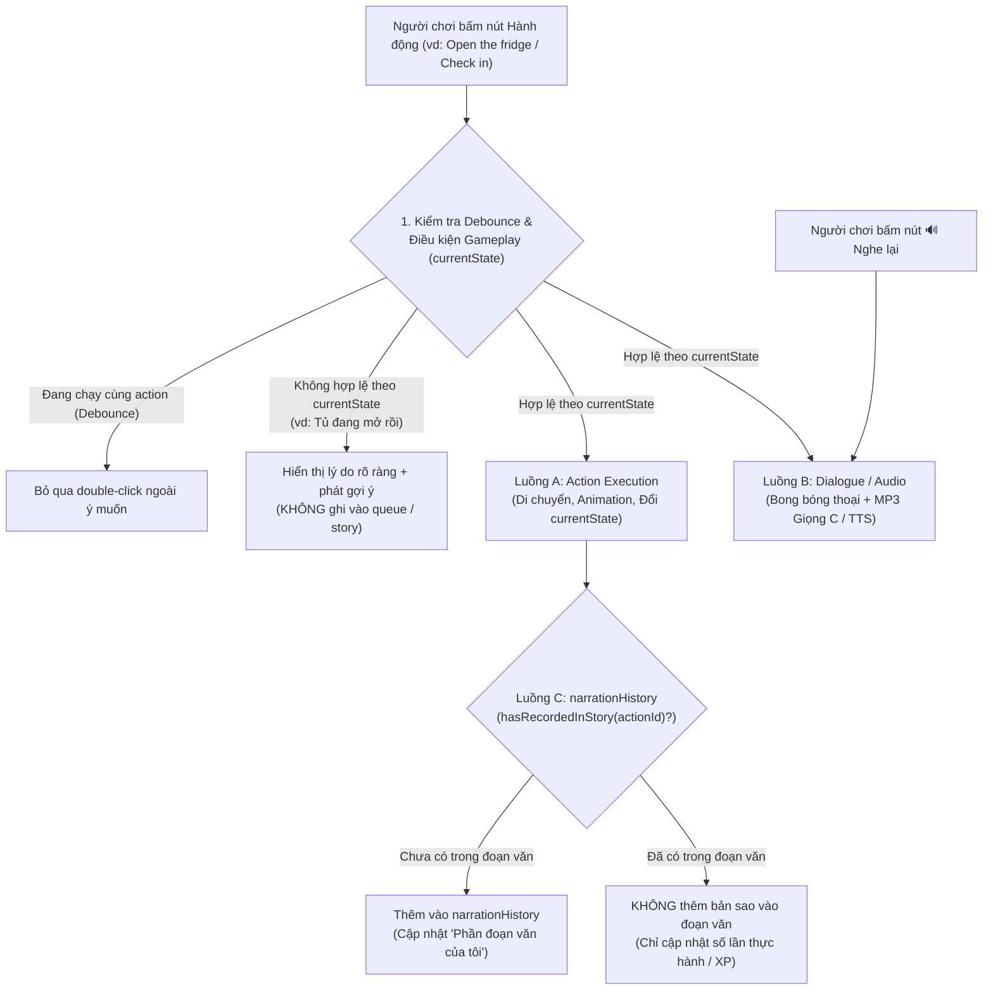

# BÁO CÁO AUDIT LỖI TƯƠNG TÁC LẶP LẠI (REPEAT ACTION BUG)

> **Trạng thái:** Đã tái hiện 100% trên trình duyệt Chromium bằng Playwright qua đúng luồng người dùng thật. **CHƯA SỬA CODE PRODUCTION** (đúng quy định Phase 1).
> **Ảnh bằng chứng đã chụp:**
> - `docs/airport/repro-fridge-second-open-bug.png` (Nhân vật hiện bong bóng `"💬 I'm opening the fridge."` ở lần bấm thứ 2 nhưng cánh cửa tủ lạnh vẫn đóng chặt, trạng thái `W.fridge === "closed"`).
> - `docs/airport/repro-tv-second-turnon-bug.png` (Bấm `"Turn on the TV"` lần 2 sau khi đã tắt TV: nút chỉ nháy `.replaying` và đọc lại câu, màn hình TV vẫn tắt đen `W.tv === "off"`).

---

## 1. Tóm tắt Nguyên nhân Gốc rễ (Executive Summary)

Hiện tượng **"Bấm Mở tủ lạnh lần 1 (mở) → Đóng tủ lạnh (đóng) → Bấm Mở tủ lạnh lần 2 chỉ đọc câu tiếng Anh mà tủ lạnh không mở lại"** KHÔNG phải do hàm thực thi chuỗi hành động (`enqueue` / `execItem` / `runSeq`) bị hỏng, mà do **4 nguyên nhân đan xen giữa tầng UI Click Handler, Quản lý Chuỗi/Đoạn văn, và Popover 3D**:

1. **Nguyên nhân Gốc rễ Trực tiếp (`index.html:1553-1555` & `1579-1586`) — Gộp chung lịch sử `queue` với trạng thái nút hành động (`actStatus` / `actClick`)**:
   - Hàm `actStatus(id)` (`index.html:1554`) kiểm tra `queue.filter(x => x.id === id && !x.auto).some(x => x.status === "done")`.
   - Vì mảng `queue` lưu toàn bộ lịch sử hành động từ đầu phiên (không tự xoá khi đổi trạng thái đồ vật), ngay sau khi `open_fridge` chạy xong lần 1, `actStatus("open_fridge")` **luôn trả về `"done"` trong suốt phiên chơi**, kể cả sau khi người dùng đã bấm `close_fridge` để đóng tủ lạnh (`W.fridge === "closed"`).
   - Khi người dùng bấm lại vào nút chính `<button class="act act-done" data-act="open_fridge">` (**Open the fridge / Mở tủ lạnh**), hàm `actClick("open_fridge")` (`index.html:1555`) thấy `st === "done"` nên đi vào nhánh `if (st) { charSay(a.sentence); say(a.sentence, .92); ... return; }` — **chỉ hiển thị bong bóng thoại + phát âm thanh rồi `return` sớm, hoàn toàn KHÔNG gọi `enqueue("open_fridge")`!**
2. **Nguyên nhân Thiết kế Dẫn đến Hack ở `actClick` (`index.html:1752-1772`) — `buildStory()` không chống trùng câu**:
   - Comment tại `index.html:1553` ghi rõ ý đồ của tác giả cũ:
     `// Hành động đã làm / đang chờ: bấm lại chỉ PHÁT LẠI câu, không thêm bản trùng, không làm lại`
   - Lý do tác giả cũ chặn `actClick` không cho gọi `enqueue(id)` lần 2 là vì hàm tạo **"Đoạn văn của tôi"** (`buildStory()` tại `index.html:1753`) lấy trực tiếp `const done = queue.filter(q => q.status === "done")` mà **không hề lọc trùng (`narrationHistory`)**. Nếu gọi `enqueue("open_fridge")` lần 2 (ví dụ bấm nút phụ `↻` `[data-redo="open_fridge"]` ở `index.html:1582`), `queue` sẽ có 2 phần tử `open_fridge` và "Đoạn văn của tôi" bị lặp câu: *"First, I opened the fridge and gently closed the fridge. Finally, I opened the fridge."*
3. **Nguyên nhân Phụ 1 — Ẩn mất kiểm tra điều kiện `a.pre()` trên nút đã từng chạy (`index.html:1579`)**:
   - Tại `index.html:1579`: `const st = actStatus(a.id), why = (busyQ || st) ? null : a.pre();`
   - Khi cả `open_fridge` và `close_fridge` đều đã chạy 1 lần (`st === "done"` cho cả hai), biến `why` bị ép về `null` cho cả hai nút! Hệ quả: dù tủ lạnh đang đóng (`W.fridge === "closed"`), nút `Close the fridge` vẫn sáng bình thường (không `disabled`, không báo *"Tủ lạnh đang đóng rồi."*), bấm vào lại phát câu *"I'm closing the fridge."*
4. **Nguyên nhân Phụ 2 — Lệch trạng thái giữa Popover `#fridgeCard` (`modules/world-3d.js:401, 476-486`) và `W.fridge`**:
   - Khi người dùng mở tủ lạnh rồi bấm nút **`"✕ Đóng tủ lạnh"` (`#btnCloseFridge`)** trên popup `#fridgeCard` (hoặc bấm ra ngoài / phím `Esc`), hàm `closeFridge()` tại `modules/world-3d.js:476-486` chỉ ẩn thẻ HTML (`fc.hidden = true; fridgeOpen = false`) mà **không gọi `enqueue("close_fridge")` và không cập nhật `W.fridge = "closed"`**.
   - Lúc này giao diện đóng nhưng `W.fridge` ngầm vẫn là `"open"`. Khi gọi `open_fridge` tiếp, `a.pre()` trả về `"Tủ lạnh đang mở rồi."`, kích hoạt nhánh `isAlready(why)` tại `index.html:1372-1375` — chỉ đọc lại câu và ghi thêm 1 mục `done (already: true)` vào `queue` (làm lặp đoạn văn) mà không chạy animation!

---

## 2. Xác minh chi tiết theo Tọa độ Code (`file:line`) và Luồng Gọi

### 2.1. Luồng 1: Bảng hành động Đồ vật (`#panel` — Luồng người dùng chính)

| Bước | File & Dòng | Hàm / Phần tử DOM | Chuyện gì xảy ra? |
|---|---|---|---|
| **1. Click đồ vật trên cảnh** | `index.html:1663-1665`<br>`index.html:1543-1552` | `bindObj(o)` → `selectObject("fridge")` | Đánh dấu `.sel` cho `#o-fridge`, đọc `"fridge"`, gọi `renderObject()`. |
| **2. Render danh sách nút** | `index.html:1556-1598` | `renderObject()` | Duyệt `o.acts` (`open_fridge`, `take_milk`, `put_milk_back`, `close_fridge`). Tính `st = actStatus(a.id)`. |
| **3. Bấm "Open the fridge" (Lần 1)** | `index.html:1585` → `1555` → `1285` | `actClick("open_fridge")` → `enqueue("open_fridge")` | `actStatus("open_fridge")` là `null`. Đẩy `{uid:1, id:"open_fridge", status:"pending"}` vào `queue`, chạy `pump()` → `execItem()`. Nhân vật đi tới `(800,400)`, mở tủ (`W.fridge = "open"`), `#o-fridge` thêm class `.fridge-open`, `uid:1` chuyển sang `status: "done"`. |
| **4. Bấm "Close the fridge" (Lần 1)** | `index.html:1585` → `1555` → `1285` | `actClick("close_fridge")` → `enqueue("close_fridge")` | `actStatus("close_fridge")` là `null`. Đẩy `{uid:2, id:"close_fridge", status:"pending"}` vào `queue`. Nhân vật đóng tủ (`W.fridge = "closed"`), `#o-fridge` mất class `.fridge-open`, `uid:2` chuyển sang `status: "done"`. |
| **5. Bấm "Open the fridge" (Lần 2)** | `index.html:1554-1555` | `actStatus("open_fridge")` → `actClick("open_fridge")` | `queue` vẫn còn `{uid:1, id:"open_fridge", status:"done"}` nên `actStatus("open_fridge")` trả về `"done"`. `actClick` đi vào `if (st)`: gọi `charSay("I'm opening the fridge.")`, phát âm thanh `say(...)`, thêm class `.replaying` vào nút, rồi **`return` ngay lập tức**. Không gọi `enqueue("open_fridge")`! |

#### Trích dẫn nguyên văn đoạn code gây lỗi (`index.html:1553-1555` & `1579-1586`):
```javascript
// index.html:1553-1555
// Hành động đã làm / đang chờ: bấm lại chỉ PHÁT LẠI câu, không thêm bản trùng, không làm lại
function actStatus(id){const q=queue.filter(x=>x.id===id&&!x.auto);if(q.some(x=>x.status==="pending"||x.status==="running"))return"pending";if(q.some(x=>x.status==="done"))return"done";return null}
function actClick(id){const st=actStatus(id);if(st){const a=ACT[id];charSay(a.sentence);const rp=npcReplyOf(a);const t=say(a.sentence,.92);if(rp)waitTalk(t).then(()=>showNpc(rp));const b=panel.querySelector(`[data-act="${id}"]`);if(b){b.classList.remove("replaying");void b.offsetWidth;b.classList.add("replaying")}return}enqueue(id);renderObject()}
```
```javascript
// index.html:1579-1586
 <div class="acts">${acts.map(a=>{const st=actStatus(a.id),why=(busyQ||st)?null:a.pre(),canRedo=st==="done"&&!busyQ&&!a.pre();return `<div style="display:flex;gap:6px"><button class="act ${st?"act-"+st:""}" style="flex:1" data-act="${a.id}" ${why?"disabled":""} title="${st?"Bấm để nghe lại câu":""}">
  <span class="dot" style="background:${stageColor(stage(a.id))}" title="${LABELS[stage(a.id)]}"></span>
  <span style="flex:1"><b>${a.label}</b><small>${trLabel(a)}</small>${why?`<span class="why">${why}</span>`:""}${st?`<span class="replay">${st==="done"?"✓ đã làm · 🔊 bấm để nghe lại":"⏳ đang làm · 🔊 bấm để nghe lại"}</span>`:""}</span><span>${st?"🔊":"＋"}</span></button>
  ${canRedo?`<button class="iconbtn" data-redo="${a.id}" title="Làm lại hành động này">↻</button>`:""}
  <button class="iconbtn" data-learn="${a.id}" title="Học câu này">📖</button></div>`}).join("")}</div>
```

---

### 2.2. Luồng 2: Gợi ý Cô Mai (`#quickCard` / `#qChips` / `#guide`)
- **Tọa độ**: `index.html:1353`, `index.html:1386`, `index.html:2088-2107`, và `modules/flow.js:180-199`.
- Khi một hành động hoàn thành (`index.html:1386`), ID của nó được đẩy vào mảng `recentActs` (giữ tối đa 6 hành động gần nhất).
- Khi `renderQuick()` (`index.html:2100`) lấy gợi ý từ `ELW_FLOW.suggest(lastDone, W, ...)`, hàm lọc `isPossible` kiểm tra:
  ```javascript
  isPossible: id => ACT[id] && !ACT[id].pre() && !recentActs.includes(id) && ...
  ```
- **Hệ quả**: Sau khi người dùng thực hiện `open_fridge` → `close_fridge`, `"open_fridge"` vẫn nằm trong `recentActs` nên **bị chặn khỏi danh sách gợi ý của Cô Mai** trong 6 bước tiếp theo, dù tủ lạnh đã đóng lại.
- Ngược lại, nếu một hành động được bấm từ chip Cô Mai (`#qChips .flow-chip[data-flow]`, `index.html:2104`), nó gọi thẳng `enqueue(id)` → đẩy thêm bản ghi trùng vào `queue` → **làm lặp câu trong "Đoạn văn của tôi" (`#storyCard`)**.

---

### 2.3. Luồng 3: Nhánh `isAlready(why)` trong `execItem` (`index.html:1354, 1371-1375`)
- **Tọa độ**: `index.html:1296`, `1354`, `1371-1375`.
```javascript
// index.html:1296
const ALREADY_FIX={set_the_table:W=>W.k_table==="set"?"clear_the_table":null};
// index.html:1354
const isAlready=w=>!!w&&/rồi\.?\s*$/.test(w)&&!/\(/.test(w);
// index.html:1371-1375
const chTask=!!(window.ELW_CHALLENGE&&ELW_CHALLENGE.active&&ELW_CHALLENGE.active()&&ELW_CHALLENGE.nextTaskIds&&ELW_CHALLENGE.nextTaskIds().includes(a.id));
if(why&&!mg&&!it.auto&&isAlready(why)&&(chTask||!ALREADY_FIX[a.id])){it.status="done";it.already=true;renderSeq();
 const sb=sayBubble(a);toastG(`✓ “${a.label}”: ${why} Tính là đã hoàn thành.`);
 try{window.ELW_CHALLENGE&&ELW_CHALLENGE.onAction(a.id,W)}catch(e){}try{window.ELW_MISSION&&ELW_MISSION.onAction(a.id,"done",W)}catch(e){}
 lastDone=a.id;recentActs.push(a.id);if(recentActs.length>6)recentActs.shift();renderStory();await waitTalk(sb);return}
```
- **Hệ quả**:
  1. `ALREADY_FIX` chỉ khai báo duy nhất `set_the_table`. Mọi hành động khác có `a.pre()` kết thúc bằng `"rồi."` (như `"Tủ lạnh đang mở rồi."`, `"Cửa sổ đang mở rồi."`, `"Ti vi đang bật rồi."`) đều lọt vào `isAlready(why)`.
  2. Khi `enqueue("open_fridge")` được gọi lúc `W.fridge === "open"` (hoặc sau khi người dùng bấm `"✕ Đóng tủ lạnh"` trên `#fridgeCard` của `world-3d.js` khiến UI đóng nhưng `W.fridge` vẫn `"open"`), `execItem` **không chạy animation**, chỉ phát `sayBubble(a)`, nhưng lại đánh dấu `it.status = "done"` trong `queue` → **`buildStory()` tự động cộng dồn thêm một câu `"I opened the fridge"` bị trùng vào "Đoạn văn của tôi"!**

---

## 3. Bằng chứng Thực nghiệm bằng Playwright (Logs & Screenshots)

### 3.1. Kết quả Log Playwright trên Tủ lạnh (`#o-fridge`)

Kịch bản chạy tự động trên Chromium (`index.html`):
1. Click `#o-fridge` trên cảnh SVG.
2. Click `#panel button[data-act="open_fridge"]` (Lần 1).
3. Click `#panel button[data-act="close_fridge"]` (Lần 1).
4. Click `#panel button[data-act="open_fridge"]` (Lần 2 — nút chính).
5. Click `#panel button[data-redo="open_fridge"]` (Nút phụ `↻`).
6. Gọi `enqueue("open_fridge")` khi tủ đang mở (kiểm tra `isAlready`).
7. Click `#btnCloseFridge` trên `#fridgeCard` (kiểm tra lệch state `world-3d.js`).

```json
{
  "fridgeFlow": {
    "afterOpen1": {
      "wFridge": "open",
      "domFridgeOpen": true,
      "queueLen": 1,
      "queueItems": [{ "uid": 1, "id": "open_fridge", "status": "done" }],
      "btnOpenClass": "act act-done",
      "spoken": ["I'm opening the fridge."],
      "storyText": "I opened the fridge."
    },
    "afterClose1": {
      "wFridge": "closed",
      "domFridgeOpen": false,
      "queueLen": 2,
      "queueItems": [
        { "uid": 1, "id": "open_fridge", "status": "done" },
        { "uid": 2, "id": "close_fridge", "status": "done" }
      ],
      "btnOpenClass": "act act-done",
      "btnCloseClass": "act act-done",
      "btnCloseDisabled": false,
      "hasRedoBtnForOpen": true,
      "spoken": ["I'm closing the fridge."],
      "storyText": "I opened the fridge and gently closed the fridge."
    },
    "afterOpen2_MainBtn": {
      "wFridge": "closed",
      "domFridgeOpen": false,
      "queueLen": 2,
      "btnOpenClass": "act act-done replaying",
      "charBubbleText": "💬 I'm opening the fridge.",
      "spoken": ["I'm opening the fridge."],
      "storyText": "I opened the fridge and gently closed the fridge."
    }
  },
  "redoDuplicateStory": {
    "wFridge": "open",
    "domFridgeOpen": true,
    "queueLen": 3,
    "storySegments": [
      "First, I opened the fridge and gently closed the fridge.",
      "Finally, I opened the fridge."
    ],
    "storyText": "First, I opened the fridge and gently closed the fridge. Finally, I opened the fridge."
  },
  "isAlreadyDuplicateStory": {
    "wFridge": "open",
    "queueLen": 4,
    "lastQueueItem": { "uid": 4, "id": "open_fridge", "status": "done", "already": true },
    "storyText": "First, I opened the fridge and gently closed the fridge. Finally, I opened the fridge and opened the fridge."
  },
  "world3dPopoverDesync": {
    "fridgeCardHiddenAfterCloseBtn": true,
    "wFridgeAfterCloseBtn": "open",
    "openFridgePreCheck": "Tủ lạnh đang mở rồi."
  }
}
```

### 3.2. Kết quả Kiểm thử Mở rộng trên 6 Đồ vật có Cặp Trạng thái Khác (Playwright)

Đã chạy tự động cùng luồng người dùng (`Click đồ vật → Bấm Hành động 1 → Bấm Hành động 2 → Bấm lại Hành động 1 trên nút chính [data-act]`) cho **6 đồ vật khác** ở Phòng khách và Phòng bếp. **Cả 6/6 đồ vật đều tái hiện lỗi 100%**:

| # | Đồ vật (`#o-*`) | Phòng | Hành động 1 → 2 → 1 | Biến `W` | Sau Lần 1 | Sau Lần 2 | Sau Lần 3 (Bấm lại nút 1) | Kỳ vọng Lần 3 | Bong bóng thoại & Class nút ở Lần 3 | Kết luận |
|---|---|---|---|---|---|---|---|---|---|---|
| **1** | **Cửa sổ** (`#o-window`) | `living` | `open_window` → `close_window` → `open_window` | `W.window` | `"open"` | `"closed"` | **`"closed"`** ❌ | `"open"` | `"💬 I'm opening the window."` (`.act-done.replaying`) | **LỖI Y HỆT** |
| **2** | **Ti vi** (`#o-tv`) | `living` | `turn_on_tv` → `turn_off_tv` → `turn_on_tv` | `W.tv` | `"on"` | `"off"` | **`"off"`** ❌ | `"on"` | `"💬 I'm turning on the TV."` (`.act-done.replaying`) | **LỖI Y HỆT** |
| **3** | **Đèn cây** (`#o-floorlamp`) | `living` | `turn_on_floor_lamp` → `turn_off_floor_lamp` → `turn_on_floor_lamp` | `W.floorLamp` | `"on"` | `"off"` | **`"off"`** ❌ | `"on"` | `"💬 I'm turning on the floor lamp."` (`.act-done.replaying`) | **LỖI Y HỆT** |
| **4** | **Rèm phòng khách** (`#o-livcurtains`) | `living` | `close_living_curtains` → `open_living_curtains` → `close_living_curtains` | `W.livCurtains` | `"closed"` | `"open"` | **`"open"`** ❌ | `"closed"` | `"💬 I'm closing the curtains."` (`.act-done.replaying`) | **LỖI Y HỆT** |
| **5** | **Quạt cây** (`#o-fan`) | `living` | `turn_on_fan` → `turn_off_fan` → `turn_on_fan` | `W.fan` | `"on"` | `"off"` | **`"off"`** ❌ | `"on"` | `"💬 I'm turning on the fan."` (`.act-done.replaying`) | **LỖI Y HỆT** |
| **6** | **Vòi nước bếp** (`#o-sink`) | `kitchen` | `turn_on_faucet` → `turn_off_faucet` → `turn_on_faucet` | `W.k_faucet` | `"on"` | `"off"` | **`"off"`** ❌ | `"on"` | `"💬 I'm turning on the faucet."` (`.act-done.replaying`) | **LỖI Y HỆT** |

*(Ngoài ra, rà soát tĩnh trong `modules/rooms.js` xác nhận **toàn bộ các cặp trạng thái khác** như Bếp nấu `W.k_stove` (`turn_on_stove`/`turn_off_stove`), Lò vi sóng `W.k_micro` (`open_microwave`/`close_microwave`), Tủ bếp `W.k_cabinet` (`open_cabinet`/`close_cabinet`), Tủ quần áo `W.b_wardrobe` (`open_wardrobe`/`close_wardrobe`), Đèn ngủ `W.b_lamp`, Rèm phòng ngủ `W.b_curtains`, Ghế ăn `W.chair`, Sofa `W.sofa` đều đi qua cùng hàm `actClick` tại `index.html:1555` nên chịu cùng 1 lỗi).*

---

## 4. Đề xuất Kiến trúc Sửa lỗi: Tách Bạch 3 Luồng Độc Lập

Để giải quyết triệt để cả trên **Bản Demo Sân Bay 2.5D (`airport-demo/`)** lẫn khi áp dụng lại cho ứng dụng chính, hệ thống tương tác phải tách rời hoàn toàn **3 cơ chế đang bị trộn lẫn**:



### 4.1. Luồng A — `Action Execution` (Thực thi Hành động & `currentState`)
- **Nguyên tắc**:
  - Mọi cú click vào nút hành động chính (`[data-act]`) khi `!a.pre(currentState)` **luôn tạo một lượt thực thi mới (`actionExecution`)**, bất kể hành động đó đã từng được thực hiện bao nhiêu lần trước đó.
  - Trạng thái bật/tắt của nút (`disabled` và thông báo `why`) **chỉ phụ thuộc vào `currentState` hiện tại (`a.pre(W)`)**, tuyệt đối không dùng `st === "done"` để xoá `why = null` như dòng `index.html:1579`.
  - Khi một hành động đang ở trạng thái đích (`a.pre(W)` trả về `"…rồi."`), nút đó phải hiển thị rõ trạng thái hiện tại (hoặc `disabled` kèm lý do `"Đang mở rồi"`), không được âm thầm giả vờ thành công (`isAlready`) rồi đẩy bản ghi giả vào `queue`.
  - Đồng bộ 1 nguồn sự thật (`Single Source of Truth`): đóng popover `#fridgeCard` (`#btnCloseFridge`) phải gọi hành động đóng hoặc đồng bộ với `W.fridge`, không giữ biến `fridgeOpen` cục bộ lệch với `W.fridge`.
  - Chống double-click bằng khoá theo thực thi hiện tại (`isExecutingAction(actionId)` hoặc cooldown `250ms` khi đang `pending`/`running`), mở khoá ngay khi hành động hoàn tất hoặc bị huỷ.

### 4.2. Luồng B — `Dialogue / Audio` (Bong bóng Thoại & Âm thanh)
- **Nguyên tắc**:
  - Phát câu tiếng Anh (`MP3 Giọng C` → fallback `Web Speech API`) và hiển thị bong bóng thoại là một dịch vụ độc lập (`AudioManager.speak(sentence)` + `UIManager.showBubble(...)`).
  - Được kích hoạt ở 2 trường hợp tách biệt:
    1. Tự động phát song song khi **Luồng A (`Action Execution`)** bắt đầu thực thi hành động.
    2. Phát độc lập khi người chơi chủ động bấm nút **`🔊 Nghe lại`** (`[data-replay-audio]`) nằm riêng bên cạnh câu mẫu — không làm khoá nút hành động chính.
  - Nếu file âm thanh lỗi hoặc trình duyệt chặn autoplay, `Promise` âm thanh phải tự `resolve` an toàn sau timeout để **không bao giờ làm treo Luồng A (`Action Execution`)**.

### 4.3. Luồng C — `narrationHistory` ("Phần đoạn văn của tôi")
- **Nguyên tắc**:
  - Tách cấu trúc dữ liệu thành 2 mảng riêng biệt thay vì dùng chung `queue`:
    1. `executionQueue`: Hàng đợi thực thi thời gian thực (chứa các lệnh di chuyển/animation đang chờ hoặc đang chạy).
    2. `narrationHistory` (hoặc bộ lọc `seenActionIds` trong `buildStory()`): Danh sách các hành động đã đóng góp câu văn vào **"Phần đoạn văn của tôi"**.
  - **Quy tắc chống ghi trùng đoạn văn**:
    - Khi hành động `actionId` hoàn thành ở **lần đầu tiên** trong phiên (chưa có trong `narrationHistory`): ghi nhận `{ uid, id: actionId, ctx }` vào `narrationHistory` để tổng hợp thành câu trong "Phần đoạn văn của tôi".
    - Khi người chơi thực hiện lại cùng `actionId` ở **lần thứ 2, 3...** (ví dụ: Mở tủ lạnh → Đóng tủ lạnh → Mở tủ lạnh lần 2):
      - **Luồng A** vẫn chạy đủ animation mở tủ và đổi `currentState.fridge = "open"`.
      - **Luồng B** vẫn phát câu `"I'm opening the fridge."`.
      - **Luồng C (`narrationHistory`)** kiểm tra `narrationHistory.some(item => item.id === actionId)` → thấy đã tồn tại nên **KHÔNG chèn thêm câu trùng lặp** vào "Phần đoạn văn của tôi" (hoặc chỉ cập nhật `repeatCount` mà không sinh thêm mệnh đề văn bản trùng).

### 4.4. Áp dụng cụ thể (Khi được phép sửa ở giai đoạn sau)
1. **Trong `index.html` (nếu sửa bản chính sau này)**:
   - Tại `actClick(id)` (`index.html:1555`): Nếu `!ACT[id].pre()`, luôn gọi `enqueue(id)` thay vì `if (st) return`. Chuyển chức năng "chỉ nghe lại câu" sang một nút phụ `🔊` riêng (`data-say-sent="${a.id}"`).
   - Tại `renderObject()` (`index.html:1579`): Tính `why = busyQ ? null : a.pre()` (bỏ `|| st`), để nút đang ở trạng thái đích (`"Tủ lạnh đang mở rồi."`) luôn được `disabled` đúng trạng thái thật.
   - Tại `buildStory()` (`index.html:1753`): Lọc `done` qua một `Set` theo `q.id` (`const seen = new Set(); const done = queue.filter(q => q.status === "done" && !seen.has(q.id) && seen.add(q.id));`) để dù người chơi thực hiện lặp lại hành động bao nhiêu lần, **"Đoạn văn của tôi"** không bao giờ bị nhân bản câu.
2. **Trong `airport-demo/` (Bản Demo Sân Bay 2.5D mới)**:
   - Thiết kế ngay từ đầu 3 state store tách biệt trong `InteractionSystem`: `worldState` (`currentState`), `actionRunner` (`actionExecution`), và `storyLog` (`narrationHistory` có `Set<actionId>` chống trùng).
