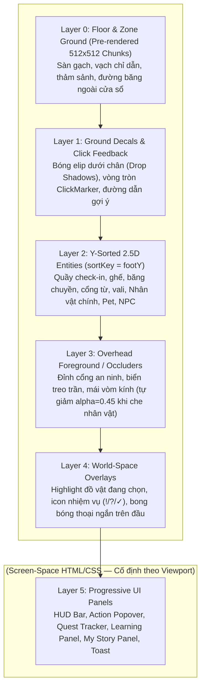
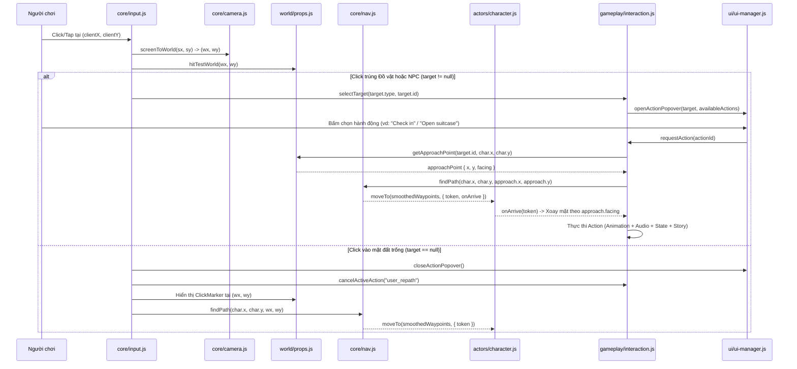
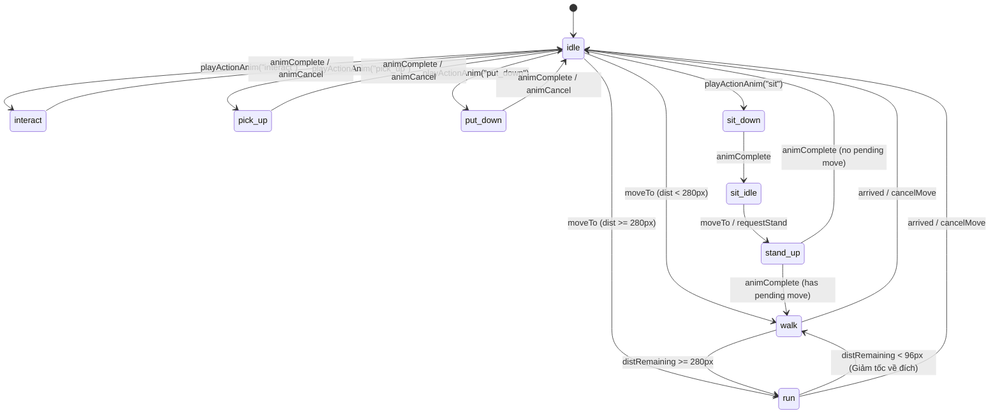
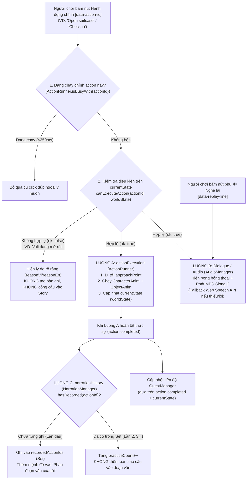

# KIẾN TRÚC BẢN DEMO SÂN BAY 2.5D ĐỘC LẬP (`DEMO_ARCHITECTURE.md`)

> **Dự án:** English Life World — Airport 2.5D Demo Redesign
> **Vai trò biên soạn:** Agent P1-B (Architecture & Module Contract)
> **Phạm vi:** Tài liệu thiết kế kiến trúc kỹ thuật cho bản demo độc lập tại `airport-demo/` (Phase 1 — **Không sửa code ứng dụng chính**).
> **Tham chiếu:** `docs/airport/AIRPORT_MASTER_PROMPT.md` & `docs/airport/AUDIT_REPEAT_ACTION_BUG.md`.

---

## 1. Nguyên tắc Cô lập & Cấu trúc Thư mục `airport-demo/`

### 1.1. Nguyên tắc Cô lập Tuyệt đối (Zero Production Coupling)
1. **Entry Point độc lập:** Toàn bộ bản demo nằm gọn trong thư mục `airport-demo/` với điểm vào duy nhất là `airport-demo/index.html`.
2. **Không import ngược ra ngoài:** Không một file HTML, CSS hay JavaScript nào trong `airport-demo/` được phép `import`, `<script src="../...">` hoặc `<link href="../...">` tới các file của ứng dụng chính (`index.html`, `modules/*`). Nếu cần tái sử dụng một hàm tiện ích hoặc file âm thanh tĩnh, phải **copy có chủ đích và có kiểm soát** vào trong `airport-demo/` theo chuẩn kiến trúc mới.
3. **Không chia sẻ bộ nhớ / LocalStorage:** Mọi dữ liệu lưu trữ của bản demo trên trình duyệt bắt buộc dùng tiền tố riêng `elw_airport_*` để không bao giờ ghi đè hoặc làm hỏng dữ liệu người dùng của ứng dụng chính.
4. **Một hệ thống duy nhất cho mỗi trách nhiệm:** Toàn bộ demo chỉ có **01** `GameLoop`, **01** `EventBus`, **01** `Camera`, **01** `NavigationGrid`, **01** `CharacterController`, **01** `InteractionSystem`, **01** `AudioManager`, và **01** `UIManager`.

### 1.2. Cấu trúc Thư mục Chuẩn (`airport-demo/`)

```text
airport-demo/
├── index.html                      # [Claude/Lead] Entry point độc lập của bản demo sân bay
├── core/                           # [Claude/Lead] Hạ tầng lõi (Bus, Loop, Camera, Nav, Audio, Save)
│   ├── bus.js                      # Event Bus pub/sub trung tâm
│   ├── loop.js                     # Vòng lặp thời gian thực (requestAnimationFrame + delta time)
│   ├── camera.js                   # Camera 2.5D (follow damping, clamp biên, world<->screen, DPR, zoom)
│   ├── nav.js                      # Navigation Grid (ô 32px) + A* 8 hướng + Path Smoothing
│   ├── input.js                    # Pointer/Touch/Mouse unified input & gesture recognizer
│   ├── audio.js                    # Audio Manager (MP3 Giọng C ưu tiên + fallback speechSynthesis)
│   └── state.js                    # Quản lý lưu trữ localStorage (key riêng elw_airport_*)
├── world/                          # [Agent 1] Thế giới, Môi trường 2.5D & Đồ vật
│   ├── scene.js                    # Quản lý 4 khu vực sân bay, sàn, ánh sáng, chuyển vùng
│   ├── props.js                    # Object Registry, trạng thái visual đồ vật, hit-testing, approachPoint
│   └── ysort.js                    # Bộ sắp xếp chiều sâu 2.5D (footY sorting + foreground occlusion)
├── actors/                         # [Agent 2] Nhân vật chính, Thú cưng, NPC & Animation
│   ├── character.js                # Character Controller (di chuyển theo waypoint, quay mặt, mang đồ)
│   ├── pet.js                      # Pet Follower AI (bám theo nhân vật, né vật cản, biểu cảm)
│   ├── npc.js                      # Quản lý 5 vai trò NPC sân bay (idle, hướng nhìn, phản ứng)
│   └── anim-fsm.js                 # Animation State Machine & bộ chuyển tiếp trạng thái
├── gameplay/                       # [Agent 3] Tương tác, Học Tiếng Anh, Đoạn văn & Nhiệm vụ
│   ├── interaction.js              # Interaction System (tách currentState / actionExecution / narrationHistory)
│   ├── narration.js                # Quản lý "Phần đoạn văn của tôi" (chống ghi trùng câu)
│   ├── dialogue.js                 # Hội thoại NPC & luồng phát câu mẫu tiếng Anh
│   ├── learning.js                 # Học từ vựng, câu mẫu, luyện nói & chấm điểm phản hồi
│   └── quest.js                    # Hệ thống nhiệm vụ sân bay theo trạng thái thực tế
├── ui/                             # [Agent 4] Giao diện HUD, Popover, Quest & Learning Panel
│   ├── styles.css                  # Scoped CSS cho giao diện demo (không dùng !important tràn lan)
│   ├── ui-manager.js               # Điều phối progressive disclosure giữa các panel
│   ├── hud.js                      # Thanh trạng thái gọn nhẹ (khu vực, âm thanh, nút mở nhanh)
│   ├── action-popover.js           # Menu hành động nổi cạnh đồ vật/NPC (không che nhân vật)
│   ├── quest-panel.js              # Bảng theo dõi nhiệm vụ hiện tại
│   ├── learning-panel.js           # Bảng học câu mẫu, nghĩa tiếng Việt, nút nghe 🔊 & luyện nói 🎤
│   └── story-panel.js              # Giao diện "Phần đoạn văn của tôi" (My Airport Story)
├── data/                           # Dữ liệu cấu hình JSON tách rời khỏi logic
│   ├── map.json                    # [Agent 1] Cấu hình thế giới 3200x1800, 4 khu vực, vùng cản
│   ├── objects.json                # [Agent 1] Danh mục đồ vật tương tác, trạng thái, approachPoint
│   ├── npcs.json                   # [Agent 2] Danh mục NPC, tọa độ đứng, animation, hội thoại
│   ├── lines.json                  # [Agent 3] Câu mẫu EN/VI, file MP3 Giọng C, từ vựng, mệnh đề story
│   └── quests.json                 # [Agent 3] Chuỗi nhiệm vụ sân bay & điều kiện hoàn thành
├── assets/                         # Tài nguyên hình ảnh & âm thanh của riêng demo
│   ├── env/                        # [Agent 1] Sprite/SVG môi trường, sàn, quầy, bảng điện tử, máy bay
│   ├── actors/                     # [Agent 2] Sprite sheet nhân vật chính, thú cưng, NPC
│   └── audio/                      # [Agent 3] File MP3 Giọng C & hiệu ứng âm thanh (SFX)
└── tests/                          # Bộ kiểm thử tự động độc lập
    ├── unit/                       # [Agent 3] Unit tests cho A*, Interaction lặp lại, Narration chống trùng
    └── e2e/                        # [Agent 4] Playwright E2E tests cho luồng Open Map & Vertical Slice
```

---

## 2. Lựa chọn Công nghệ Render & Kiến trúc Đồ họa 2.5D

### 2.1. So sánh 3 Phương án Công nghệ Render

| Tiêu chí | Phương án 1: **Canvas 2D Thuần + Offscreen Cache (ĐỀ XUẤT CHỌN)** | Phương án 2: **PixiJS v7 (từ CDN)** | Phương án 3: **DOM SVG (Cách của App chính hiện tại)** |
|---|---|---|---|
| **Hiệu năng Mobile (Map 3200×1800, 60 FPS)** | **Rất cao (58–60 FPS ổn định).** Sàn tĩnh được vẽ sẵn vào `OffscreenCanvas` theo chunk; mỗi frame chỉ vẽ các thực thể nằm trong khung nhìn (Viewport Frustum Culling). | **Rất cao (60 FPS)** nhờ WebGL batching, nhưng tốn thêm ~150–250ms khởi tạo shader và bộ nhớ GPU cho texture lớn trên máy yếu. | **Thấp khi pan camera liên tục (25–40 FPS trên mobile).** Dịch chuyển `viewBox` hoặc `transform` của SVG chứa hàng nghìn node `<path>` gây reflow/repaint nặng. |
| **Y-Sorting (`z = footY`) theo thời gian thực** | **Trực tiếp & Siêu nhẹ.** Sắp xếp mảng phẳng `renderables` (~80–150 phần tử) bằng `Array.prototype.sort` chỉ mất `< 0.08ms/frame`, vẽ tuần tự từ sau ra trước. | Tốt (`sortableChildren = true` + `zIndex = footY`), nhưng phải đồng bộ cây `DisplayObject` với dữ liệu logic mỗi frame. | **Rất phức tạp & Chậm.** SVG không có `z-index` CSS cho phần tử con; muốn đổi thứ tự đè hình phải gọi `parentNode.appendChild(node)` làm mutate DOM liên tục. |
| **Tách lớp Foreground / Background & Occlusion** | **Chủ động hoàn toàn.** Dễ dàng vẽ bóng đổ dưới sàn, vật thể Y-sort ở giữa, và mái cổng an ninh ở lớp Foreground có hạ `globalAlpha = 0.45` khi nhân vật đi qua. | Tốt thông qua nhiều `PIXI.Container`, nhưng xử lý vector SVG động hoặc chữ nét cao cần cấu hình `resolution` phức tạp. | Khó tách phần chân quầy (chặn đường) và phần mái quầy (che nhân vật) khi nhân vật di chuyển tự do 360° quanh vật thể. |
| **Độ ổn định & Phụ thuộc mạng (Zero-Dependency)** | **Tuyệt đối (0 thư viện ngoài).** Chạy ngay trên mọi trình duyệt và trong Playwright headless mà không sợ lỗi chặn CDN hay lệch phiên bản. | Phụ thuộc mạng CDN (`jsdelivr`/`unpkg`) trừ khi tải bundle ~500KB vào repo; dễ gặp lỗi WebGL context lost trên iOS Safari khi chuyển tab. | Không phụ thuộc CDN, nhưng bị giới hạn kiến trúc DOM khi mở rộng thế giới mở. |
| **Phối hợp với UI HTML/CSS** | Rất mượt: `<canvas id="worldCanvas">` nằm dưới làm nền thế giới 2.5D, lớp `<div id="uiLayer">` trong suốt nằm trên hiển thị HUD/Popover sắc nét. | Tương tự Canvas 2D. | Trộn lẫn node đồ họa và node UI dễ gây lỗi bắt nhầm sự kiện click hoặc lệch tọa độ. |

> **QUYẾT ĐỊNH KIẾN TRÚC:** Chọn **HTML5 Canvas 2D Thuần theo kiến trúc Layered 2.5D Scene Graph + Offscreen Pre-rendered Atlas**, kết hợp **HTML/CSS Overlay cho Screen-Space UI**.
> - Các tài sản hình ảnh môi trường và nhân vật có thể được thiết kế dưới dạng **SVG chất lượng cao hoặc PNG Sprite Sheet**, sau đó khi khởi tạo scene sẽ được rasterize một lần vào bộ nhớ đệm (`ImageBitmap` / `OffscreenCanvas`) theo đúng tỷ lệ `devicePixelRatio` (tối đa `2x`). Cách này vừa giữ được nét vẽ hoạt hình mềm mại kiểu *Mother 3 – Tazmilly Props*, vừa đạt tốc độ vẽ bitmap 60 FPS trên cả desktop lẫn mobile.

### 2.2. Cấu trúc 6 Lớp Hiển thị (Render Layers & Y-Sorting)

Mỗi frame trong `GameLoop.render()`, hệ thống vẽ theo đúng thứ tự từ dưới lên trên:



#### Quy tắc Y-Sorting (`world/ysort.js`):
- Mọi thực thể trên **Layer 2** đều có một điểm neo tiếp đất `footY` (tính bằng pixel trong hệ tọa độ thế giới, là cạnh đáy thực tế nơi chân nhân vật hoặc chân đế đồ vật chạm sàn).
- Công thức khóa sắp xếp:
  $$\text{sortKey} = \text{Math.round}(\text{entity.footY} \times 100) + \text{entity.zBias}$$
  - Nếu hai thực thể có cùng `sortKey`, so sánh tiếp theo thứ tự cố định `entity.id` để **chống hiện tượng nhấp nháy hình (z-fighting)** khi nhân vật đứng ngang hàng với NPC hoặc Pet.
- **Tách thân và mái cho vật thể dạng cổng (`Archway Split`):** Với Cổng từ an ninh (`Metal Detector`) hoặc Cửa lên máy bay (`Boarding Gate`), phần trụ hai bên nằm ở **Layer 2** (Y-sort theo chân trụ), còn phần thanh ngang trên đỉnh nằm ở **Layer 3** để nhân vật luôn đi xuyên qua dưới thanh ngang một cách tự nhiên.

### 2.3. Quy chuẩn Kích thước Asset & Tỷ lệ Thế giới 2.5D

- **Góc nhìn (Projection):** Top-Down Oblique 2.5D (~32°), nhìn rõ mặt đứng phía trước (chiếm ~65% chiều cao sprite) và mặt phẳng phía trên (chiếm ~35% chiều cao sprite), có viền ấm (warm dark-brown outline `#3A2E2B`, dày `2px`) và đổ bóng mềm dưới chân.
- **Kích thước chuẩn theo đối tượng:**

| Nhóm đối tượng | Khung Sprite chuẩn (`@1x`) | Chiều cao hiển thị thực tế | Điểm neo (`anchorX, anchorY`) | Hộp va chạm chân đế (`footprintW × footprintH`) |
|---|---|---|---|---|
| **Ô lưới điều hướng (`Tile`)** | `32 × 32 px` | `32 px` | `(0.0, 0.0)` | `32 × 32 px` |
| **Nhân vật chính (`Player`)** | `96 × 128 px` | `88 px` | `(0.5, 0.88)` (giữa 2 bàn chân) | `28 × 20 px` (elip quanh bàn chân) |
| **Thú cưng (`Airport Pet`)** | `64 × 64 px` | `46 px` | `(0.5, 0.86)` | Không chặn đường nhân vật |
| **NPC (5 vai trò)** | `96 × 128 px` | `88–92 px` | `(0.5, 0.88)` | `32 × 24 px` |
| **Đồ vật nhỏ** (Vali, Hộ chiếu, Khay an ninh) | `64 × 64 px` | `36–52 px` | `(0.5, 0.85)` | `32 × 32 px` (hoặc gắn lên quầy) |
| **Đồ vật vừa** (Ki-ốt, Ghế chờ, Xe đẩy, Máy nước) | `128 × 128 px` | `72–110 px` | `(0.5, 0.88)` | `64 × 32 px` đến `128 × 48 px` |
| **Đồ vật lớn** (Quầy Check-in, Băng chuyền, Máy X-quang, Gate 12) | `256 × 192 px` đến `448 × 240 px` | `130–210 px` | `(0.5, 0.90)` | Bội số của `32px` (khai báo trong `objects.json`) |

---

## 3. Kích thước Thế giới (`3200×1800`) & Bố cục 4 Khu vực Nối liền

### 3.1. Thông số Không gian Thế giới
- **Kích thước toàn bản đồ:** `WORLD_WIDTH = 3200 px`, `WORLD_HEIGHT = 1792 px` (hiển thị làm tròn `3200 × 1800 px`, tương ứng chính xác với lưới điều hướng **`100 cột × 56 hàng`**, mỗi ô `32 × 32 px`).
- **Kết nối liền mạch (Seamless Open Map):** Toàn bộ 4 khu vực chính và 2 hành lang chuyển tiếp nằm trên **cùng một mặt phẳng thế giới duy nhất**. Người chơi đi bộ từ Cổng vào Sảnh Check-in → qua Hành lang → qua Cổng An ninh → vào Phòng chờ → tới Cửa lên máy bay Gate 12 **không có bất kỳ màn hình loading hay chuyển cảnh cắt ngang nào**.

### 3.2. Phân vùng Tọa độ 4 Khu vực Chính & Hành lang

| Mã khu vực (`zoneId`) | Tên hiển thị | Tọa độ Thế giới (`x, y, w, h`) | Ô lưới (`col, row`) | Đồ vật tương tác & NPC chính |
|---|---|---|---|---|
| **`zone_checkin`** | **1. Check-in Hall & Baggage Drop** (Sảnh làm thủ tục) | `x: 64..1088`<br>`y: 224..1696`<br>(`1024 × 1472 px`) | `col: 2..34`<br>`row: 7..53` | • `airport_entrance` (Cổng vào phía Nam `x:544, y:1600`)<br>• `departure_board` (Bảng điện tử lớn `x:544, y:288`)<br>• `checkin_counter` (Quầy thủ tục `x:352, y:544`) + **NPC `checkin_agent`**<br>• `baggage_drop` (Băng chuyền hành lý `x:736, y:544`)<br>• `self_kiosk` (Ki-ốt tự check-in `x:224, y:960`)<br>• `player_suitcase` (Vali mở/đóng được `x:480, y:1120`)<br>• `luggage_cart` (Xe đẩy `x:832, y:1120`) + **NPC `airport_staff`** (`x:640, y:1280`) |
| **`corridor_west`** | **Hành lang 1: Check-in → Security** | `x: 1088..1312`<br>`y: 640..1088`<br>(`224 × 448 px`) | `col: 34..41`<br>`row: 20..34` | • Biển chỉ dẫn `"Security Check →"` (`sign_to_security`)<br>• Dây phân làn hướng dẫn (`stanchion_line_1`) |
| **`zone_security`** | **2. Security Check Area** (Khu kiểm tra an ninh) | `x: 1312..1984`<br>`y: 352..1376`<br>(`672 × 1024 px`) | `col: 41..62`<br>`row: 11..43` | • `security_tray_table` (Bàn lấy khay & bỏ đồ `x:1440, y:768`)<br>• `xray_scanner` (Băng chuyền máy soi X-quang `x:1632, y:672`)<br>• `metal_detector` (Cổng từ an ninh `x:1632, y:864`)<br>• `pickup_bench` (Bàn nhận lại hành lý `x:1824, y:768`)<br>• **NPC `security_officer`** (`x:1632, y:576`) |
| **`corridor_east`** | **Hành lang 2: Security → Airside** | `x: 1984..2176`<br>`y: 640..1088`<br>(`192 × 448 px`) | `col: 62..68`<br>`row: 20..34` | • Cửa kính tự động Airside (`airside_glass_door`)<br>• Biển chỉ dẫn `"← Gate 12 (North) | Waiting Lounge (South) ↓"` |
| **`zone_lounge`** | **3. Waiting Lounge** (Phòng chờ hành khách) | `x: 2176..3104`<br>`y: 896..1696`<br>(`928 × 800 px`) | `col: 68..97`<br>`row: 28..53` | • `lounge_seat_row_a` & `lounge_seat_row_b` (Ghế chờ ngồi/đứng được `x:2464, y:1184` & `x:2816, y:1184`)<br>• `water_dispenser` (Cây nước nóng lạnh `x:2272, y:1440`)<br>• `lounge_flight_board` (Màn hình chuyến bay phụ `x:2624, y:960`)<br>• **NPC `passenger_linh`** (Hành khách đang ngồi đọc sách `x:2528, y:1184`) |
| **`zone_boarding`** | **4. Boarding Gate 12 & Aircraft View** (Cửa lên máy bay) | `x: 2176..3104`<br>`y: 160..896`<br>(`928 × 736 px`) | `col: 68..97`<br>`row: 5..28` | • `aircraft_window` (Vách kính lớn nhìn ra máy bay & ống lồng `x:2640, y:224`)<br>• `boarding_desk_12` (Quầy thủ tục Gate 12 `x:2496, y:480`) + **NPC `gate_attendant`** (`x:2496, y:432`)<br>• `boarding_scanner_gate` (Cửa quét thẻ lên máy bay mở/đóng `x:2784, y:480`)<br>• `gate_sign_12` (Biển điện tử `"GATE 12 — LONDON / TOKYO"` `x:2784, y:352`) |

### 3.3. Sơ đồ ASCII Bố cục Tổng thể Bản đồ (`3200 × 1800 px`)

```text
  x=0                  x=1088    x=1312                x=1984    x=2176                        x=3200
y=0 +-----------------------------------------------------------------------------------------------+
    |                         BACKGROUND APRON & RUNWAY SKYLINE (Tarmac View)                       |
y=160 +--------------------+          +--------------------+          +-----------------------------+
    | ZONE 1: CHECK-IN     |          |                    |          | ZONE 4: BOARDING GATE 12    |
    |                      |          |                    |          | [==== AIRCRAFT WINDOW ====] |
    |   [Departure Board]  |          |                    |          |       (Plane & Jetway)      |
    |     (x:544,y:288)    |          |                    |          |                             |
    |                      |          |  ZONE 2: SECURITY  |          |  [Gate 12 Desk] [GateSign]  |
    | [Check-in] [Baggage] |          |    CHECK AREA      |          |  (NPC Attendant)   |        |
    | [Counter ] [ Drop  ] |          |                    |          |         v          v        |
    | (NPC Agent) (Belt)   |          |   (NPC Officer)    |          |     [Boarding Scanner]      |
    |     |          |     |          |  [X-Ray Scanner ]  |          |          (x:2784,y:480)     |
y=640|     v          v     +----------+  [Tray] -> [Gate]  +----------+             ^               |
    |                      | CORRIDOR |   (1440)   (1632)  | CORRIDOR |             | (Lối đi Bắc)  |
    |  [Self Kiosk]   o--->|   WEST   |------>======>----->|   EAST   |-------------+---------------+ y=896
    |  (x:224,y:960)  |    | (34..41) |  [Pickup Bench]    | (62..68) |             | (Lối đi Nam)  |
y=1088|                 |    +----------+     (x:1824)       +----------+             v               |
    |  [Suitcase]     |               |                    |          | ZONE 3: WAITING LOUNGE      |
    |  (Open/Close)   |               +--------------------+ y=1376   |    [Lounge Flight Board]    |
    |        ^        |                                               |                             |
    |        |   (NPC Staff)   [Luggage Cart]                         |  [Seat Row A]  [Seat Row B] |
    |    (SPAWN) (640,1280)     (832,1120)                            |  (NPC Passenger) (Sit/Stand)|
    |   (544,1440)                                                    |                             |
    |        ^                                                        |  [Water Dispenser]  [Plants]|
    |  [==== AIRPORT ENTRANCE (Sliding Doors x:544,y:1600) ====]      |   (x:2272,y:1440)           |
y=1800+-----------------------------------------------------------------+-----------------------------+
```

---

## 4. Hệ thống Điều hướng (Navigation Grid 32px + A* + Path Smoothing)

### 4.1. Cấu trúc Lưới Điều hướng (`core/nav.js`)
- Thế giới `3200 × 1792 px` được chia thành lưới 2 chiều kích thước cố định:
  - `TILE_SIZE = 32` (pixel).
  - `COLS = 100` (`0..99`), `ROWS = 56` (`0..55`), tổng cộng **5.600 ô** (lưu trong `Uint8Array(5600)` cực kỳ tiết kiệm bộ nhớ).
- **Mã trạng thái từng ô (`CellFlag`):**
  - `0` (`WALKABLE`): Mặt sàn thông thoáng, nhân vật đi qua bình thường.
  - `1` (`BLOCKED_STATIC`): Tường bao, vách kính, thân quầy check-in, máy soi X-quang, dây phân làn.
  - `2` (`BLOCKED_PROP`): Đồ vật có va chạm (ghế, xe đẩy, vali đặt dưới sàn). Lưu ý: điểm tiếp cận (`approachPoint`) của đồ vật nằm ngay sát bên ngoài vùng `BLOCKED_PROP` và mang giá trị `0` (`WALKABLE`).
  - `3` (`BLOCKED_DYNAMIC`): Cổng kiểm soát động (ví dụ: `boarding_scanner_gate` khi chưa quét thẻ lên máy bay). Có thể mở khóa tức thì qua `nav.setDynamicObstacle(id, tileRect, false)`.

### 4.2. Thuật toán Tìm đường A* (8 Hướng + Chống cắt góc)
1. **Chuyển đổi tọa độ:**
   - Từ điểm xuất phát `(startWx, startWy)` và điểm đích `(goalWx, goalWy)` sang ô lưới `(startCol, startRow)` và `(goalCol, goalRow)`.
2. **Xử lý khi click vào ô bị chặn (`Blocked Target Fallback`):**
   - Nếu `(goalCol, goalRow)` không phải `WALKABLE`, hệ thống quét vòng tròn đồng tâm bán kính `r = 1..5` ô (`findNearestWalkable`) ưu tiên ô có khoảng cách Euclid gần phía người chơi nhất.
   - Nếu tìm thấy ô thay thế hợp lệ: đi tới ô đó. Nếu toàn bộ đường bị khóa (ví dụ click sang bên kia cổng khi cổng đóng và không có lối vòng): phát sự kiện `nav:unreachable` để UI hiện thông báo thân thiện.
3. **Chi phí & Chống cắt góc (No Corner-Cutting):**
   - Duyệt 8 ô lân cận. Chi phí bước thẳng (`dx=0` hoặc `dy=0`) là `1.0`; bước chéo (`|dx|=1, |dy|=1`) là `1.4142`.
   - **Quy tắc bắt buộc:** Bước chéo từ `(c, r)` sang `(c + dx, r + dy)` chỉ hợp lệ khi **cả 3 ô** `(c + dx, r + dy)`, `(c + dx, r)` và `(c, r + dy)` đều là `WALKABLE`. Quy tắc này ngăn nhân vật quệt vai xuyên qua góc bàn check-in hoặc góc tường hành lang.
4. **Hàm đánh giá Heuristic (Octile Distance):**
   $$h(\Delta c, \Delta r) = (\max(\Delta c, \Delta r) - \min(\Delta c, \Delta r)) + 1.4142 \times \min(\Delta c, \Delta r)$$

### 4.3. Làm mượt đường đi (`smoothPath` — Line-of-Sight String Pulling)
- Đường thô từ A* đi qua tâm các ô `32px` thường có dạng bậc thang cứng nhắc.
- Hàm `smoothPath(rawPoints, agentRadius = 14)` áp dụng thuật toán **String Pulling với Raycast dày (Thick Supercover Line-of-Sight)**:
  1. Bắt đầu từ `anchor = rawPoints[0]` (vị trí chân hiện tại của nhân vật).
  2. Kiểm tra đoạn thẳng nối trực tiếp từ `anchor` tới `rawPoints[i]` (với 2 tia song song lệch `±14px` theo pháp tuyến để đảm bảo bề ngang cơ thể nhân vật không chạm vật cản).
  3. Bỏ qua mọi điểm trung gian nếu tia không cắt qua ô `BLOCKED` nào.
  4. Giữ nguyên tọa độ chính xác đến từng pixel của điểm đích cuối cùng (`goalWx, goalWy` hoặc `approachPoint.x, approachPoint.y`).

---

## 5. Cơ chế Click-to-Move & Tương tác Đồ vật / NPC

### 5.1. Luồng Xử lý Khi Người chơi Click / Tap trên Thế giới



### 5.2. Quy tắc Đổi lệnh Giữa đường (Mid-Path Re-routing)
- Khi nhân vật đang trên đường đi từ điểm $A \to B$ mà người chơi click sang điểm $C$ (hoặc click vào một đồ vật khác):
  1. `CharacterController` tăng biến đếm `this.moveToken++`. Mọi callback `onArrive` gắn với `moveToken` cũ bị vô hiệu hóa ngay lập tức.
  2. Nếu có một `pendingInteraction` đang chờ ở trạng thái `approaching`, `InteractionSystem` hủy lệnh chờ đó (`status = "cancelled"`) mà không áp dụng bất kỳ thay đổi trạng thái nào.
  3. Đường đi mới được tính bằng A* xuất phát từ **tọa độ thực `(char.x, char.y)` ngay tại mili-giây đó** (không nhảy giật về tâm ô lưới).
  4. Nếu nhân vật đang ở trạng thái animation `walk` hoặc `run`, bộ đếm `frameIndex` của chân được giữ liên tục, chỉ cập nhật góc hướng mặt (`facing`: `N, NE, E, SE, S, SW, W, NW` hoặc 4 hướng chính `up, down, left, right` kèm lật ngang mượt).

### 5.3. Quy tắc Điểm Tiếp cận (`approachPoint`)
- Mỗi đồ vật tương tác trong `data/objects.json` và mỗi NPC trong `data/npcs.json` khai báo ít nhất 1 `approachPoint` hợp lệ nằm trên ô `WALKABLE`:
  ```json
  "approachPoints": [
    { "id": "front", "x": 352, "y": 608, "facing": "up" }
  ]
  ```
- Nếu đồ vật có nhiều `approachPoints` (ví dụ: xe đẩy hành lý hoặc băng ghế chờ có thể tiếp cận từ 2 phía), `getApproachPoint()` chọn điểm có tổng chiều dài đường đi A* ngắn nhất từ vị trí hiện tại của nhân vật.
- Nếu nhân vật **đã đứng sẵn trong bán kính `≤ 12px`** quanh `approachPoint`, hệ thống bỏ qua bước đi bộ, xoay mặt về `approachPoint.facing` và chạy ngay hành động.

---

## 6. Hệ thống Camera (`core/camera.js`)

### 6.1. Camera Follow với Exponential Damping & Deadzone
- Camera bám theo nhân vật chính nhưng không khóa cứng vào từng dao động nhỏ:
  - **Deadzone hình chữ nhật:** `deadzoneW = 48px, deadzoneH = 36px` quanh tâm khung nhìn. Khi nhân vật chỉ bước ngắn vài pixel tại chỗ (ví dụ xoay người ở quầy check-in), camera đứng yên giúp mắt người học dễ đọc chữ và quan sát.
  - **Làm mượt độc lập tốc độ khung hình (Frame-rate Independent Damping):**
    ```javascript
    const alpha = 1 - Math.exp(-this.damping * dt); // damping = 6.5 (mặc định)
    this.x += (desiredX - this.x) * alpha;
    this.y += (desiredY - this.y) * alpha;
    ```
  - **Clamp biên Bản đồ:** Camera luôn được giới hạn để không bao giờ lộ khoảng đen ngoài biên `3200 × 1792`:
    ```javascript
    const halfViewW = (this.viewportW / 2) / this.zoom;
    const halfViewH = (this.viewportH / 2) / this.zoom;
    this.x = clamp(this.x, halfViewW, this.worldW - halfViewW);
    this.y = clamp(this.y, halfViewH, this.worldH - halfViewH);
    ```

### 6.2. Chuyển đổi Tọa độ `World ↔ Screen` khi Resize & `devicePixelRatio`
- **Quản lý `devicePixelRatio` (DPR):**
  - `dpr = Math.min(window.devicePixelRatio || 1, 2)` (giới hạn ở `2.0` để tránh quá tải fill-rate trên điện thoại màn hình `3x`/`4x` mà vẫn giữ hình ảnh sắc nét).
  - Kích thước buffer thực của Canvas: `canvas.width = Math.round(viewW * dpr)`, `canvas.height = Math.round(viewH * dpr)`.
  - Kích thước CSS của Canvas: `canvas.style.width = viewW + "px"`, `canvas.style.height = viewH + "px"`.
- **Ma trận biến đổi khi vẽ Canvas:**
  ```javascript
  ctx.setTransform(
    dpr * camera.zoom, 0,
    0, dpr * camera.zoom,
    dpr * (camera.viewportW / 2 - camera.x * camera.zoom),
    dpr * (camera.viewportH / 2 - camera.y * camera.zoom)
  );
  ```
- **Công thức nghịch đảo chính xác tuyệt đối (`screenToWorld`):**
  Với sự kiện click/pointer `e`, lấy `rect = canvas.getBoundingClientRect()`:
  ```javascript
  const sx = e.clientX - rect.left;
  const sy = e.clientY - rect.top;
  const wx = (sx - camera.viewportW / 2) / camera.zoom + camera.x;
  const wy = (sy - camera.viewportH / 2) / camera.zoom + camera.y;
  ```
  - Công thức này dựa trực tiếp trên `getBoundingClientRect()` (đơn vị CSS pixel) và `camera.viewportW/H`, do đó **hoàn toàn miễn nhiễm với sai lệch khi người dùng resize cửa sổ, bật DevTools, xoay ngang/dọc điện thoại hoặc thay đổi tỷ lệ phóng to trình duyệt**.

### 6.3. Điều khiển trên Thiết bị Di động (Mobile Touch & Pinch)
- **Single Tap** (`di chuyển ngón tay < 10px` và `< 300ms`): Xử lý giống hệt Click chuột (Click-to-Move hoặc chọn Đồ vật/NPC).
- **One-Finger Drag (Pan quan sát):** Khi người chơi nhấn giữ và kéo `> 12px`, camera tạm thời chuyển sang chế độ `manualPanOffset` cho phép nhìn sang khu vực kế bên (ví dụ từ Sảnh Check-in liếc sang khu An ninh). Ngay khi người chơi Tap điểm đến mới để nhân vật bước đi, camera tự động thu hồi `manualPanOffset` mượt mà về tâm nhân vật.
- **Two-Finger Pinch (Tuỳ chọn Zoom):** Cho phép phóng to/thu nhỏ trong dải `zoom ∈ [0.65, 1.30]` (mặc định Desktop `1.0`, Mobile màn hình hẹp `< 768px` tự khởi tạo ở `0.82` để nhìn rộng hơn).

---

## 7. Animation State Machine (`actors/anim-fsm.js`)

### 7.1. Kiến trúc Tách lớp Tư thế Chính (`BaseLocomotionState`) & Lớp Cầm đồ (`CarryLayerState`)
Để tránh bùng nổ tổ hợp trạng thái và triệt tiêu lỗi "nhân vật vừa ngồi vừa chạy", FSM của nhân vật chính được chia làm **2 lớp điều phối có ràng buộc**:

1. **Lớp Tư thế Cơ thể (`baseState` — Độc quyền, chỉ 1 trạng thái tại 1 thời điểm):**
   - `idle`: Đứng thở nhẹ, chớp mắt (loop).
   - `walk`: Đi bộ tự nhiên với nhịp tay chân (`180 px/s`, loop).
   - `run`: Chạy nhanh khi quãng đường xa `≥ 280px` (`290 px/s`, loop).
   - `turn`: Chuyển hướng xoay người ngắn (`90ms`, one-shot).
   - `sit_down`: Chuyển tiếp từ đứng sang ngồi xuống ghế (`300ms`, one-shot) → tự sang `sit_idle`.
   - `sit_idle`: Ngồi trên ghế phòng chờ (loop). **Khóa dịch chuyển tọa độ `(x, y)` khi còn ở `sit_idle`.**
   - `stand_up`: Đứng dậy khỏi ghế (`300ms`, one-shot) → tự sang `idle` hoặc `walk`.
   - `pick_up`: Cúi/với tay nhặt hành lý hoặc lấy khay an ninh (`420ms`, one-shot).
   - `put_down`: Đặt hành lý lên băng chuyền hoặc đặt khay xuống bàn (`420ms`, one-shot).
   - `interact`: Thao tác tay tại quầy (đưa hộ chiếu, bấm ki-ốt, quét thẻ, mở/đóng khóa vali — `500ms`, one-shot).

2. **Lớp Phụ kiện / Mang đồ (`carryState` — Kết hợp với `idle`, `walk`, `run`):**
   - `none`: Hai tay tự do.
   - `holding_passport`: Tay cầm hộ chiếu / thẻ lên máy bay.
   - `carrying_tray`: Hai tay bưng khay an ninh (chỉ trong khu vực Security).
   - `pulling_suitcase`: Một tay kéo vali có bánh xe lăn theo sau nhân vật với độ trễ lò xo mượt.

### 7.2. Sơ đồ Chuyển trạng thái (`CharacterFSM`)



### 7.3. Quy tắc An toàn cho Animation
- **Hỗ trợ chạy lại từ frame 0 (`Replayable by Design`):** Khi gọi `playActionAnim(animName)` cho một hành động vừa mới chạy trước đó, FSM luôn đặt lại `frameIndex = 0`, `elapsedMs = 0`, `finished = false` để animation chạy trọn vẹn từ đầu, không bao giờ bị kẹt ở frame cuối.
- **Tự động đứng dậy trước khi đi (`Sit-to-Move Guard`):** Nếu nhân vật đang ở `sit_idle` trên ghế phòng chờ mà người chơi click ra sàn để đi nơi khác, `CharacterController` tự động xếp hàng chuyển tiếp `sit_idle → stand_up (300ms) → walk` rồi mới dịch chuyển vị trí.
- **Hủy an toàn (`Interruptible`):** Nếu người chơi click hủy hoặc đổi hành động khi đang `interact`, callback `onCancel` được gọi đúng 1 lần để giải phóng khóa `ActionRunner`.

---

## 8. Interaction System — Tách Bạch 3 Luồng Độc Lập (Triệt tiêu Lỗi Lặp Hành động)

Dựa trên kết quả phân tích gốc rễ tại `docs/airport/AUDIT_REPEAT_ACTION_BUG.md`, hệ thống tương tác của bản demo (`gameplay/interaction.js` & `gameplay/narration.js`) **cấm tuyệt đối việc dùng chung một mảng `queue` cho cả lịch sử thực thi lẫn kiểm tra nút hành động và tạo đoạn văn**. Thay vào đó, hệ thống tách thành **3 thực thể độc lập hoàn toàn**:



### 8.1. Bảng Đối chiếu Cách Khắc phục 4 Nguyên nhân Gốc rễ từ App Chính

| # | Lỗi ở App Chính (`index.html`) | Thiết kế Mới trong `airport-demo/` |
|---|---|---|
| **1** | `actStatus(id)` đọc từ lịch sử `queue` (`status === "done"`), làm `actClick(id)` chỉ phát lại câu rồi `return` sớm ở lần bấm thứ 2. | **Không tồn tại khái niệm `actStatus === "done"` chặn nút chính.** Nút hành động chính (`[data-action-id]`) luôn gọi `InteractionSystem.requestAction(actionId)` mỗi khi `canExecuteAction(actionId, currentState).ok === true`. Nút `🔊 Nghe lại` được tách thành một nút độc lập (`[data-replay-line]`). |
| **2** | `buildStory()` nối toàn bộ phần tử `done` trong `queue` mà không lọc trùng, khiến việc chạy lại hành động làm lặp câu trong *"Đoạn văn của tôi"*. | `NarrationManager` (`gameplay/narration.js`) quản lý một `Set` riêng tên là `recordedActionIds`. Hàm `recordCompletedAction(actionId)` kiểm tra `if (recordedActionIds.has(actionId))` thì chỉ tăng `practiceCount`, **đảm bảo mỗi `actionId` chỉ xuất hiện tối đa 01 lần trong đoạn văn**. |
| **3** | `why = (busyQ \|\| st) ? null : a.pre()` xóa mất kiểm tra điều kiện trên các nút đã từng làm, khiến nút `"Close the fridge"` vẫn sáng dù tủ đang đóng. | Hàm `canExecuteAction(actionId, currentState)` **luôn được đánh giá trực tiếp trên `currentState` thực tại**. Ví dụ: khi `currentState.objects.player_suitcase.state === "closed"`, hành động `close_suitcase` trả về `{ ok: false, reasonVi: "Vali đang đóng rồi." }` và nút được disable rõ ràng; chỉ nút `open_suitcase` sáng và sẵn sàng chạy lại lần 2, 3... |
| **4** | Đóng popup `#fridgeCard` bằng nút `✕` chỉ ẩn HTML mà không cập nhật `W.fridge = "closed"`, gây lệch state và kích hoạt nhánh giả `isAlready`. | **Mọi trạng thái đồ vật nằm duy nhất trong `currentState.objects[id].state`.** Đóng `ActionPopover` bằng nút `✕` hoặc click ra ngoài chỉ đóng menu chọn lệnh, tuyệt đối không giữ trạng thái mở/đóng giả của đồ vật trong biến cục bộ của UI. Ngoài ra, **bỏ hoàn toàn nhánh hack `isAlready`**. |

---

## 9. Dialogue & Learning System (`gameplay/dialogue.js` & `gameplay/learning.js`)

### 9.1. Dữ liệu Học Tiếng Anh Tách rời (`data/lines.json`)
Mỗi câu giao tiếp hoặc hành động tại sân bay được định nghĩa trong `data/lines.json`, bao gồm:
- `id`: Mã định danh câu (vd: `"line_checkin_greet"`, `"line_open_suitcase"`).
- `en`: Câu tiếng Anh chuẩn (`"Hello, I'd like to check in for my flight."`).
- `vi`: Nghĩa tiếng Việt tự nhiên (`"Xin chào, tôi muốn làm thủ tục cho chuyến bay của mình."`).
- `phonetic`: Phiên âm dễ đọc (`"/həˈloʊ, aɪd laɪk tə tʃek ɪn fɔːr maɪ flaɪt/"`).
- `audioMp3`: Đường dẫn file MP3 **Giọng C** chất lượng cao (nếu đã tạo sẵn trong `assets/audio/`).
- `storyClauseEn` & `storyClauseVi`: Mệnh đề quá khứ dùng để ghép vào *"Phần đoạn văn của tôi"* (vd: `"I checked in for my flight at the counter"`).
- `vocab`: Danh sách từ vựng trọng tâm trong câu (`check in`, `passport`, `boarding pass`, `luggage`, `security tray`, `gate`).

### 9.2. Chu trình Học qua Hành động (Learning by Doing)
1. **Với hành động thao tác đồ vật (Mở/đóng vali, lấy khay, đặt hành lý, ngồi ghế, xem bảng chuyến bay):**
   - Người chơi bấm hành động → Nhân vật bước tới thực hiện animation + đồ vật đổi trạng thái → Bong bóng thoại hiện câu tiếng Anh kèm phát âm thanh Giọng C ngay lập tức → Ghi nhận vào *"Phần đoạn văn của tôi"* (nếu là lần đầu).
   - Người chơi có thể bấm nút `📖 Học câu` bên cạnh hành động bất cứ lúc nào để mở `LearningPanel` xem từ vựng chi tiết, nghe chậm (`0.75x`) hoặc bấm `🎤 Luyện nói`.
2. **Với hội thoại giao tiếp NPC (Check-in Agent, Security Officer, Gate Attendant):**
   - Mở hộp thoại ngắn gọn dưới đáy màn hình với lời chào của NPC và 2–3 lựa chọn câu trả lời tiếng Anh theo ngữ cảnh (hoặc nút nghe gợi ý). Khi người chơi chọn/nói đúng câu phù hợp, nhân vật phát câu thoại và thực hiện bước tiếp theo của nhiệm vụ.

---

## 10. Hệ thống Nhiệm vụ (`gameplay/quest.js`)

Chuỗi nhiệm vụ trong bản demo được cấu hình tại `data/quests.json`, dẫn dắt người chơi đi qua toàn bộ 4 khu vực của sân bay:

| Thứ tự | Mã nhiệm vụ (`questId`) | Khu vực | Các bước điều kiện hoàn thành (`steps`) |
|---|---|---|---|
| **Quest 1** | `q1_find_flight_info` — *"Check Your Flight Information"* | Zone 1: Check-in Hall | 1. Đi vào sảnh và kiểm tra bảng điện tử (`inspect_departure_board`).<br>2. Mở vali kiểm tra hộ chiếu (`open_suitcase` → `take_passport` → `close_suitcase`). *(Dùng để kiểm chứng hành động mở/đóng lặp lại)* |
| **Quest 2** | `q2_check_in_counter` — *"Check In for Your Flight"* | Zone 1: Check-in Hall | 1. Chào nhân viên tại quầy (`greet_checkin_agent`: *"Hello, I'd like to check in."*).<br>2. Đưa hộ chiếu (`hand_over_passport`: *"Here is my passport."*).<br>3. Gửi hành lý lên băng chuyền (`drop_baggage_on_belt`: *"I'd like to check this bag."*).<br>4. Nhận thẻ lên máy bay (`collect_boarding_pass`). |
| **Quest 3** | `q3_security_check` — *"Pass Security Screening"* | Zone 2: Security Check | 1. Đi qua hành lang tới khu An ninh.<br>2. Lấy khay an ninh và đặt túi xách vào khay (`place_items_in_tray`).<br>3. Đi qua cổng từ an ninh (`walk_through_detector`).<br>4. Nhận lại đồ sau khi soi chiếu (`collect_scanned_items`). |
| **Quest 4** | `q4_lounge_and_board` — *"Wait in the Lounge & Board at Gate 12"* | Zone 3 & Zone 4 | 1. Tới Phòng chờ, hỏi chỗ ngồi (`ask_seat_taken`: *"Is this seat taken?"*) và ngồi xuống ghế (`sit_lounge_seat`), sau đó đứng dậy (`stand_from_seat`).<br>2. Tới Cửa số 12, ngắm máy bay qua cửa sổ lớn (`look_at_aircraft`).<br>3. Hỏi nhân viên cửa bay (`ask_to_board`: *"May I board now?"*) và quét thẻ qua cửa (`scan_boarding_pass`). |

> **Quy tắc bất biến của Quest System:** Một bước nhiệm vụ chỉ chuyển sang `completed: true` khi nhận được sự kiện `action:completed` từ `ActionRunner` **và** hàm `verifyState(currentState)` trả về `true`. Việc bấm nút `🔊 Nghe lại` câu thoại tuyệt đối không bao giờ kích hoạt hoàn thành nhiệm vụ.

---

## 11. UI Manager & Progressive Disclosure (`ui/`)

### 11.1. Nguyên tắc Giao diện Đồng bộ Thế giới Game
- Không hiển thị hàng loạt bảng biểu che kín bản đồ. Màn hình mặc định khi khám phá sân bay giữ **> 85% diện tích hiển thị cho thế giới 2.5D**.
- **Progressive Disclosure (Mở dần theo ngữ cảnh):**
  1. **Mặc định (Luôn hiện, gọn nhẹ):**
     - Góc trên trái: Nhãn Khu vực hiện tại (`📍 Check-in Hall`) + Thẻ nhiệm vụ thu gọn (`🎯 Quest 2/4: Check in for your flight`).
     - Góc trên phải: Nút mở `📝 Đoạn văn của tôi (My Story)` (kèm badge số câu đã thu thập), nút `📚 Từ vựng`, nút `🔊 Âm thanh`, nút `↺ Reset Demo`.
  2. **Khi click vào Đồ vật / NPC:**
     - Hiển thị `ActionPopover` ngay cạnh đối tượng (tự động tính toán tọa độ qua `Camera.worldToScreen()` và dịch sang bên trái/phải/trên để **không bao giờ che nhân vật chính hoặc chính đồ vật đó**).
     - Mỗi dòng hành động trên `ActionPopover` có:
       - **Nút chính (`[data-action-id]`)**: Thực hiện hành động trong game (hiển thị tên tiếng Anh + phụ đề tiếng Việt nhỏ + lý do nếu đang bị khóa theo `currentState`).
       - **Nút phụ `🔊` (`[data-replay-line]`)**: Chỉ phát lại âm thanh câu mẫu.
       - **Nút phụ `📖` (`[data-learn-line]`)**: Mở `LearningPanel` cho câu đó.
  3. **Khi mở `LearningPanel` hoặc `StoryPanel`:**
     - Tự động thu gọn `ActionPopover` để không có 2 popup chồng lên nhau.

### 11.2. Thích ứng Desktop & Mobile (Responsive Design)
- **Desktop (`≥ 768px`):** `ActionPopover` neo nổi cạnh vật thể trong thế giới; `QuestPanel` nằm gọn góc trên trái (`max-width: 300px`); `StoryPanel` và `LearningPanel` mở dạng ngăn kéo (Drawer) bên phải (`width: 340px`).
- **Mobile (`< 768px`):** Không tràn ngang (`100vw × 100dvh`, `overflow: hidden`). `ActionPopover`, `LearningPanel` và `StoryPanel` hiển thị dạng **Bottom Sheet** bo tròn dưới đáy màn hình (`max-height: 34dvh`), tự động đẩy tâm camera lên nhẹ `15%` để nhân vật vẫn nằm trọn trong vùng nhìn thấy phía trên Bottom Sheet.

---

## 12. Audio Manager (`core/audio.js`)

### 12.1. Chiến lược Phát giọng nói 2 Tầng (MP3 Giọng C → Web Speech Fallback)
1. **Tầng 1 — File MP3 Giọng C (`audioMp3`):**
   - Kiểm tra trường `audioMp3` của `lineId` trong `data/lines.json`.
   - Nếu có đường dẫn hợp lệ, phát qua `HTMLAudioElement` được tái sử dụng (tránh tạo quá nhiều `AudioContext` trên iOS).
2. **Tầng 2 — Fallback `window.speechSynthesis`:**
   - Nếu `audioMp3` là `null`, hoặc file MP3 tải lỗi (`onerror` / `404`), hoặc `audio.play()` bị từ chối, tự động chuyển ngay sang `window.speechSynthesis.speak(utterance)` với giọng tiếng Anh ưu tiên (`Google US English` / `Microsoft Aria` / `Samantha`, `rate = 0.92`, `pitch = 1.05`).
3. **Cơ chế Bảo vệ Không khóa Gameplay (Non-blocking & Timeout Guard):**
   - Khi người chơi bấm hành động mới, câu thoại cũ đang đọc dở sẽ được dừng gọn (`stopSpeech()`) để đọc câu mới.
   - Mọi lệnh `speakLine(lineId)` đều có bộ hẹn giờ an toàn (`maxDurationMs = 4500ms`) và bắt mọi ngoại lệ `try/catch`. Dù thiết bị không có loa, trình duyệt tắt tiếng hay file MP3 hỏng, `Promise` luôn `resolve({ ok: true, mode: "fallback" | "silent" })` — **tuyệt đối không bao giờ chặn hoặc làm treo `ActionRunner`**.

---

## 13. Quản lý Trạng thái & Lưu trữ (`core/state.js`)

Sử dụng không gian khóa `localStorage` hoàn toàn tách biệt:

| Khóa `localStorage` | Nội dung lưu trữ | Thời điểm cập nhật |
|---|---|---|
| `elw_airport_save_v1` | `{ version: 1, player: { x, y, facing, carryState, carriedItem }, objects: { [id]: { state } }, inventory: string[], quests: { activeQuestId, completedSteps: string[], completedQuests: string[] } }` | Sau mỗi khi `action:completed` hoặc chuyển khu vực (`zone:changed`). |
| `elw_airport_story_v1` | `{ version: 1, recordedActionIds: string[], entries: Array<{ actionId, lineId, practiceCount, timestamp }> }` | Khi `NarrationManager.recordCompletedAction()` cập nhật. |
| `elw_airport_settings_v1` | `{ muted: boolean, showVietnameseSub: boolean, speechRate: number }` | Khi người chơi bật/tắt nút trên HUD. |

- **Cơ chế `resetAllDemoData()`:** Xóa 3 khóa `elw_airport_*`, đưa `worldState`, `NarrationManager`, `QuestManager` và vị trí nhân vật về trạng thái khởi đầu tại Cổng vào sân bay (`x: 544, y: 1440`) thông qua Event Bus (`demo:reset`) **mà không cần reload lại DOM hay gắn lại event listener**.

---

## 14. Kế hoạch Kiểm thử Tự động (Test Plan)

### 14.1. Unit Tests (`airport-demo/tests/unit/`) — Phụ trách: Agent 3
Chạy độc lập bằng Node test runner / Vitest hoặc chạy trong headless browser:
1. **`nav.spec.js` (Navigation & A*):**
   - Tìm đường thành công giữa mọi cặp khu vực (`zone_checkin` ↔ `zone_security` ↔ `zone_lounge` ↔ `zone_boarding`).
   - Xác minh không có đoạn đường nào cắt qua góc ô `BLOCKED_STATIC` / `BLOCKED_PROP`.
   - Click vào ô bị chặn trả về đúng ô `WALKABLE` gần nhất qua `findNearestWalkable`.
   - Đóng/mở `boarding_scanner_gate` qua `setDynamicObstacle` thay đổi kết quả tìm đường đúng kỳ vọng.
2. **`interaction-repeat.spec.js` (10 Kịch bản Hồi quy Bắt buộc — Mục 6.3 Master Prompt):**
   - **TC-01:** Mở vali (`open_suitcase`) → Đóng vali (`close_suitcase`) → Mở vali lần 2 → Đóng vali lần 2: trạng thái `currentState.objects.player_suitcase.state` đổi đúng `closed → open → closed → open → closed` và animation chạy đủ 4 lần.
   - **TC-02:** Thực hiện cặp hành động Mở/Đóng hoặc Ngồi/Đứng **10 lần liên tiếp** (20 lượt thực thi): không bị khóa sau lần đầu.
   - **TC-03:** Bấm nhanh liên tục (spam click trong 50ms) vào cùng 1 hành động: cơ chế debounce ngăn chạy chồng chéo lúc đang `animating`, nhưng ngay sau khi xong vẫn bấm lại được bình thường.
   - **TC-04:** Đóng/mở `ActionPopover` bằng nút `✕` rồi thực hiện lại hành động: `currentState` không bị lệch.
   - **TC-05:** Di chuyển sang khu vực khác (`zone_security` / `zone_lounge`) rồi quay lại `zone_checkin` tương tác tiếp: đồ vật vẫn phản hồi đúng.
   - **TC-06:** Giả lập `AudioManager.speakLine` bị lỗi network/timeout: hành động gameplay và cập nhật `currentState` vẫn hoàn tất 100%.
   - **TC-07:** Kiểm tra `"Phần đoạn văn của tôi"` (`NarrationManager.buildParagraphText()`) sau 10 lần mở/đóng vali: câu `"I opened my suitcase"` và `"I closed my suitcase"` **chỉ xuất hiện đúng 1 lần duy nhất**, không có bản sao trùng lặp.
   - **TC-08:** Nhiều đồ vật cùng loại (ví dụ `lounge_seat_row_a` và `lounge_seat_row_b`) giữ trạng thái độc lập, không làm hỏng nhau.
   - **TC-09:** Animation FSM reset `frameIndex = 0` ở mỗi lần chạy lại, không đứng ở frame cuối.
   - **TC-10:** Gọi `resetAllDemoData()` hoặc reload không nhân đôi số lượng listener trên `EventBus`.

### 14.2. Playwright E2E Tests (`airport-demo/tests/e2e/`) — Phụ trách: Agent 4
Chạy trên trình duyệt Chromium thật đối với `airport-demo/index.html`:
1. **`open-map-click-to-move.spec.js`:**
   - Click nhiều điểm trên mặt đất xuyên suốt 4 khu vực; xác minh nhân vật đi tới đích mà không xuyên vật cản, không ra ngoài biên map.
   - Click điểm mới khi nhân vật đang đi giữa đường: nhân vật đổi hướng mượt sang đích mới, không báo lỗi console.
   - Resize viewport từ `1280×800` xuống `390×844` (Mobile) và click vào đồ vật: phép biến đổi `screenToWorld` vẫn trúng chính xác đồ vật.
2. **`vertical-slice-airport.spec.js`:**
   - Chạy trọn vẹn luồng người dùng: Spawn tại cổng sân bay → Xem bảng chuyến bay → Mở/đóng vali 2 chu kỳ liên tiếp (chụp ảnh bằng chứng lần mở thứ 2) → Tới quầy Check-in → Chào NPC, đưa hộ chiếu, gửi hành lý → Qua cổng An ninh → Ngồi ghế Phòng chờ rồi đứng dậy → Lên máy bay tại Gate 12.
   - Xác minh `0 console.error`, `0 pageerror`, mọi ảnh/sprite có kích thước hợp lệ, và nội dung `#storyPanel` không có câu lặp.

---

## 15. Chiến lược Deploy Preview Độc lập (Cloudflare Pages)

Để đảm bảo yêu cầu **"Demo có URL preview riêng để kiểm thử, tuyệt đối không thay thế hoặc ghi đè bản chính (`https://english-life-world.pages.dev/`)"**:

1. **Tạo Project Cloudflare Pages Riêng biệt (Đề xuất chính):**
   - Tên project riêng trên Cloudflare Pages: **`english-life-world-airport`**.
   - Thư mục gốc xuất bản (Deploy Directory): chỉ định trực tiếp vào thư mục con `airport-demo`:
     ```bash
     npx wrangler pages deploy airport-demo --project-name=english-life-world-airport
     ```
   - Kết quả: Bản demo sẽ có địa chỉ độc lập (ví dụ `https://english-life-world-airport.pages.dev` và các URL preview theo commit), hoàn toàn tách rời khỏi project `english-life-world` đang chạy production.
2. **Quy tắc An toàn khi Deploy (Phase 6):**
   - Chỉ thực hiện lệnh deploy ở **Phase 6** sau khi toàn bộ Unit Tests và Playwright E2E Tests đã vượt qua 100%.
   - Tuyệt đối không chạy lệnh `wrangler pages deploy . --project-name=english-life-world` trong suốt quá trình phát triển bản demo sân bay.
   - Chỉ báo cáo URL preview sau khi đã dùng trình duyệt / Playwright truy cập thực tế vào URL đó và xác nhận mã phản hồi `HTTP 200`, đầy đủ asset, âm thanh và tương tác hoạt động đúng.
