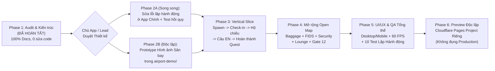

# KẾ HOẠCH TRIỂN KHAI THEO GIAI ĐOẠN — SÂN BAY 2.5D ĐỘC LẬP (`PHASE_PLAN.md`)

> **Dự án:** English Life World — Airport 2.5D Demo Redesign + Sửa Lỗi Hành Động Lặp Lại
> **Vai trò biên soạn:** Agent P1-C (Art Direction & Phase Planning)
> **Tài liệu nền tảng (Phase 1 — Đã hoàn tất):**
> - Yêu cầu gốc: [`docs/airport/AIRPORT_MASTER_PROMPT.md`](file:///D:/tools/Hoc%20tieng%20anh/english-life-world/docs/airport/AIRPORT_MASTER_PROMPT.md)
> - Báo cáo lỗi lặp hành động: [`docs/airport/AUDIT_REPEAT_ACTION_BUG.md`](file:///D:/tools/Hoc%20tieng%20anh/english-life-world/docs/airport/AUDIT_REPEAT_ACTION_BUG.md)
> - Báo cáo kiến trúc hiện tại: [`docs/airport/AUDIT_ARCH.md`](file:///D:/tools/Hoc%20tieng%20anh/english-life-world/docs/airport/AUDIT_ARCH.md)
> - Kiến trúc demo độc lập: [`docs/airport/DEMO_ARCHITECTURE.md`](file:///D:/tools/Hoc%20tieng%20anh/english-life-world/docs/airport/DEMO_ARCHITECTURE.md)
> - Hợp đồng module & phân quyền file: [`docs/airport/MODULE_CONTRACT.md`](file:///D:/tools/Hoc%20tieng%20anh/english-life-world/docs/airport/MODULE_CONTRACT.md)
> - Định hướng nghệ thuật & quy chuẩn asset: [`docs/airport/ART_DIRECTION.md`](file:///D:/tools/Hoc%20tieng%20anh/english-life-world/docs/airport/ART_DIRECTION.md)

---

## 1. Tổng Quan Lộ Trình & Sơ Đồ Phụ Thuộc (Phase 1 → Phase 6)

### Tóm tắt Thời lượng & Ngân sách Thời gian Thực tế

| Giai đoạn | Mục tiêu trọng tâm | Đội ngũ thực thi | Ước lượng thời gian thực tế | Trạng thái |
|---|---|---|---|---|
| **Phase 1** | Audit repo, tái hiện lỗi lặp hành động, chốt kiến trúc `airport-demo/`, Module Contract, Art Direction & Kế hoạch Phase | Claude + P1-A, P1-B, P1-C | **35 – 45 phút** | ✅ **Hoàn tất** |
| **Phase 2** | **2A (Song song):** Sửa lỗi lặp hành động ở app chính + test 10 kịch bản. **2B (Độc lập):** Dựng Prototype hình ảnh Sân bay 2.5D (`zone_checkin` + nhân vật + pet + 1 NPC). | Claude + Agent 1, Agent 2, Agent 3 (nhánh 2A) | **45 – 60 phút** | ⏳ Chờ duyệt |
| **Phase 3** | **Vertical Slice:** Hoàn chỉnh luồng *Spawn → Đi tới Quầy Check-in → Đưa hộ chiếu → Câu EN → Hoàn thành nhiệm vụ* + kiểm chứng hành động Đóng/Mở lặp lại. | Claude + Agent 1, Agent 2, Agent 3, Agent 4 | **50 – 65 phút** | ⏳ Chờ Phase 2 |
| **Phase 4** | **Mở rộng Open Map 4 khu vực:** Baggage Drop, FIDS, Security Check, Waiting Lounge, Boarding Gate 12, đủ 5 NPC, Pet AI & gói câu tiếng Anh. | Agent 1, Agent 2, Agent 3, Agent 4 | **60 – 75 phút** | ⏳ Chờ Phase 3 |
| **Phase 5** | **Hoàn thiện UI/UX & QA Tổng thể:** Progressive HUD, responsive Desktop/Mobile, tối ưu hiệu năng 60 FPS, chạy full bộ test hồi quy & E2E. | Agent 4 (Chủ trì) + Agent 1, 2, 3, Claude | **35 – 45 phút** | ⏳ Chờ Phase 4 |
| **Phase 6** | **Preview Độc lập trên Cloudflare Pages Project Riêng:** Đóng gói `dist-airport/`, deploy project tách biệt, xác minh URL sống & bàn giao 10 Deliverables. | Claude + Agent 4 | **20 – 30 phút** | ⏳ Chờ Phase 5 |
| **Tổng cộng** | **Từ sau Phase 1 đến khi có URL Preview độc lập đã kiểm chứng** | **Claude + 4 Agents** | **~3.5 – 4.5 giờ làm việc** | |

---

## 2. Chi Tiết Triển Khai Từng Phase (Phase 2 → Phase 6)

---

### PHASE 2: Sửa Lỗi Hành Động Lặp Ở App Chính (Song Song) & Prototype Hình Ảnh Demo Sân Bay

> **Mục tiêu kép của Phase 2:**
> 1. **Nhánh 2A (App chính — Chạy song song có kiểm soát):** Sửa dứt điểm lỗi tương tác lặp lại (`open_fridge` → `close_fridge` → `open_fridge` lần 2 chỉ đọc câu mà không mở tủ) theo đúng nguyên nhân gốc rễ đã khóa tại [`docs/airport/AUDIT_REPEAT_ACTION_BUG.md`](file:///D:/tools/Hoc%20tieng%20anh/english-life-world/docs/airport/AUDIT_REPEAT_ACTION_BUG.md).
> 2. **Nhánh 2B (Demo độc lập `airport-demo/`):** Dựng khung kỹ thuật Core và Prototype hình ảnh 2.5D đầu tiên (Sảnh Check-in + Hành lang tới Security, Nhân vật chính Chibi `2.2 đầu`, 1 Pet đồng hành, 1 NPC Check-in Agent) để Chủ App đánh giá trực tiếp chất lượng thị giác.

#### 2.1. Bảng Phân Công Công Việc, Agent & File Sở Hữu (Phase 2)

| Mã việc | Nội dung công việc cụ thể | Agent phụ trách | File được phép tạo / sửa (Exclusive Ownership) |
|---|---|---|---|
| **P2-Core** | Khởi tạo entry point `airport-demo/index.html` và 7 module hạ tầng lõi: `EventBus`, `GameLoop` (`60 FPS`), `Camera` (góc nhìn 2.5D, follow damping, `worldToScreen`/`screenToWorld`), `NavigationGrid` (`100×56` ô `32px` + thuật toán A* 8 hướng), `Input` (Click-to-Move), `AudioManager` và `SaveManager` (`elw_airport_*`). | **Claude / Lead** | • `airport-demo/index.html` • `airport-demo/core/bus.js` • `airport-demo/core/loop.js` • `airport-demo/core/camera.js` • `airport-demo/core/nav.js` • `airport-demo/core/input.js` • `airport-demo/core/audio.js` • `airport-demo/core/state.js` |
| **P2-FixMain** *(Song song)* | **Sửa lỗi hành động lặp lại trên App chính** (chỉ thực hiện sau khi Chủ App/Claude mở khóa `index.html` và `modules/world-3d.js`): 1. `index.html:1553-1555`: Tách `actClick(id)` — khi `!ACT[id].pre()`, luôn gọi `enqueue(id)` để chạy lại hành động; chuyển chức năng "chỉ nghe lại câu" sang nút phụ `🔊` riêng. 2. `index.html:1579`: Tính `why = busyQ ? null : a.pre()` (bỏ `|| st`) để nút ở trạng thái đích luôn hiển thị đúng lý do. 3. `index.html:1753`: Lọc `buildStory()` qua `Set<actionId>` (`narrationHistory`) để làm lại hành động N lần không bao giờ nhân bản câu trong *"Đoạn văn của tôi"*. 4. `modules/world-3d.js:476-486`: Đồng bộ `#btnCloseFridge` với trạng thái `W.fridge`. 5. Viết test tự động Playwright kiểm chứng 10 kịch bản hồi quy. | **Agent 3** *(được Claude cấp quyền tạm thời trên nhánh 2A)* | • `index.html` (chỉ vùng dòng `1370–1388`, `1553–1595`, `1750–1775`) • `modules/world-3d.js` (chỉ vùng `closeFridge` dòng `475–490`) • `tools/test_repeat_actions.pw.mjs` (file test mới) |
| **P2-World** | **Prototype Môi trường Sân bay 2.5D**: 1. Viết script sinh asset môi trường (`tools/generate_airport_env.py`) và xuất bộ asset `zone_checkin` + `corridor_west` + vách kính nhìn ra máy bay theo đúng bảng màu trong `ART_DIRECTION.md` (`#F6F1E6`, `#D89B64`, `#B8E4F9`, `#2FA89E`). 2. Dựng `world/scene.js`, `world/props.js`, `world/ysort.js` (6 lớp hiển thị, Y-sorting theo `footY`, hiệu ứng vòng tròn `ClickMarker`). 3. Khai báo `data/map.json` và `data/objects.json` cho khu vực Check-in Hall (Quầy Check-in 01, Băng chuyền cân hành lý, Bảng FIDS, Vali kéo, Ki-ốt, Dây phân làn). | **Agent 1** (`World / Env`) | • `airport-demo/world/scene.js` • `airport-demo/world/props.js` • `airport-demo/world/ysort.js` • `airport-demo/data/map.json` • `airport-demo/data/objects.json` • `airport-demo/assets/env/**` • `tools/generate_airport_env.py` |
| **P2-Actors** | **Prototype Nhân vật Chibi `2.2 đầu`, Pet & NPC**: 1. Viết script sinh sprite sheet (`tools/generate_airport_actors.py`) và xuất sprite sheet 4 hướng cho: Nhân vật chính (`char_player`), Thú cưng sân bay (`pet_milu_airport`), và 1 NPC (`npc_checkin_agent`). 2. Lập trình `actors/anim-fsm.js`, `actors/character.js` (di chuyển mượt theo waypoint A*, tự quay đúng 4 hướng, `idle`/`walk`/`run`), `actors/pet.js` (bám theo nhân vật ở khoảng cách `48–72px`, luôn có fallback sprite), và `actors/npc.js`. | **Agent 2** (`Character / Pet / Anim`) | • `airport-demo/actors/character.js` • `airport-demo/actors/pet.js` • `airport-demo/actors/npc.js` • `airport-demo/actors/anim-fsm.js` • `airport-demo/data/npcs.json` • `airport-demo/assets/actors/**` • `tools/generate_airport_actors.py` |

#### 2.2. Tiêu chí Qua Phase 2 (Exit Criteria)
1. **Đối với Nhánh 2A (App chính):**
   - Toàn bộ 7 đồ vật có cặp trạng thái đã audit (`#o-fridge`, `#o-window`, `#o-tv`, `#o-floorlamp`, `#o-livcurtains`, `#o-fan`, `#o-sink`) vượt qua bài test tự động Playwright: **Mở → Đóng → Mở → Đóng 10 lần liên tiếp đều chạy lại animation và cập nhật `W.*` đúng 100%**, đồng thời **"Đoạn văn của tôi" (`#storyCard`) chỉ ghi nhận câu đúng 1 lần duy nhất (0 câu lặp)**.
2. **Đối với Nhánh 2B (Prototype `airport-demo/`):**
   - Mở `airport-demo/index.html` trên trình duyệt hiển thị rõ Sảnh Check-in 2.5D ấm áp (góc nhìn `38°`, sàn Terrazzo kem, quầy gỗ sồi mật ong, vách kính nhìn ra máy bay, bảng FIDS).
   - Click bất kỳ điểm hợp lệ nào trên sàn: hiện vòng tròn `ClickMarker`, nhân vật chính đi bộ/chạy theo đường A* vòng qua quầy/ghế mà không đi xuyên vật cản, Pet đi theo mượt mà phía sau, Y-sorting đúng khi đi trước và sau quầy.
   - Chụp ảnh màn hình `docs/airport/phase2-prototype-preview.png` để Chủ App duyệt phong cách hình ảnh.
3. **Ước lượng thời gian thực tế:** **45 – 60 phút** (chạy song song 3 agent dưới sự điều phối của Claude).

---

### PHASE 3: Vertical Slice (Luồng Check-in Hoàn Chỉnh & Kiểm Chứng Lặp Hành Động)

> **Mục tiêu trọng tâm của Phase 3:**
> Hoàn thành trọn vẹn **1 luồng trải nghiệm học tiếng Anh từ đầu đến cuối (End-to-End Vertical Slice)** tại Sảnh Check-in:
> **`Spawn nhân vật tại Cổng vào → Click-to-Move tới Quầy Check-in → Chào & Đưa hộ chiếu ("Here is my passport.") → Nghe/chọn câu tiếng Anh → Đặt vali lên cân ("I'd like to check this bag.") → Nhận thẻ lên máy bay (Boarding Pass) → Hoàn thành nhiệm vụ "Check in for your flight" → Nhận phản hồi & ghi nhận vào "Phần đoạn văn của tôi"`**.

#### 3.1. Bảng Phân Công Công Việc, Agent & File Sở Hữu (Phase 3)

| Mã việc | Nội dung công việc cụ thể | Agent phụ trách | File được phép tạo / sửa (Exclusive Ownership) |
|---|---|---|---|
| **P3-Gameplay** | **Hệ thống Tương tác 3 Luồng Độc lập & Luồng Nhiệm vụ Check-in**: 1. Xây dựng `gameplay/interaction.js` tách bạch tuyệt đối 3 kho trạng thái: `worldState` (`currentState`), `actionRunner` (`actionExecution` — mỗi lần click hợp lệ đều tạo `executionId` mới), và `narration.js` (`narrationHistory` dùng `Set<actionId>` chống trùng đoạn văn). 2. Xây dựng `gameplay/dialogue.js`, `gameplay/learning.js` và `gameplay/quest.js` cho nhiệm vụ `"Check in for your flight"` (5 bước: Chào nhân viên → Đưa hộ chiếu → Cân hành lý → Kiểm tra bảng FIDS → Nhận thẻ Gate 12). 3. Tích hợp 3 đồ vật có cặp trạng thái Đóng/Mở hoặc Bật/Tắt tại Sảnh Check-in (`player_suitcase` Mở/Đóng nắp vali, `self_kiosk` Bật/Tắt màn hình, `baggage_drop` Đặt/Lấy vali) để xác minh lặp hành động. 4. Viết bộ Unit Test (`tests/unit/interaction-repeat.test.mjs`) kiểm tra 10 kịch bản lặp hành động. | **Agent 3** (`Gameplay / Interaction / Learning`) | • `airport-demo/gameplay/interaction.js` • `airport-demo/gameplay/narration.js` • `airport-demo/gameplay/dialogue.js` • `airport-demo/gameplay/learning.js` • `airport-demo/gameplay/quest.js` • `airport-demo/data/lines.json` • `airport-demo/data/quests.json` • `airport-demo/assets/audio/**` • `airport-demo/tests/unit/**` |
| **P3-UI** | **Giao diện Tương tác cho Vertical Slice**: 1. Xây dựng `ui/action-popover.js` (hiển thị danh sách hành động ngay cạnh đồ vật/NPC, tự tách nút Hành động chính và nút `🔊 Nghe lại` riêng biệt). 2. Xây dựng `ui/quest-panel.js` (hiển thị tiến độ nhiệm vụ `"Check in for your flight"`), `ui/learning-panel.js` (câu tiếng Anh, nghĩa tiếng Việt, nút nghe mẫu & luyện nói), và `ui/story-panel.js` (*"Phần đoạn văn của tôi"*). 3. Viết bài test Playwright E2E đầu tiên (`tests/e2e/vertical-slice.pw.mjs`). | **Agent 4** (`UI / QA`) | • `airport-demo/ui/styles.css` • `airport-demo/ui/ui-manager.js` • `airport-demo/ui/hud.js` • `airport-demo/ui/action-popover.js` • `airport-demo/ui/quest-panel.js` • `airport-demo/ui/learning-panel.js` • `airport-demo/ui/story-panel.js` • `airport-demo/tests/e2e/vertical-slice.pw.mjs` |
| **P3-EnvAnim** | **Hoàn thiện Animation Tương tác tại Quầy Check-in**: 1. **Agent 1:** Bổ sung trạng thái visual cho `checkin_counter` (máy quét hộ chiếu sáng đèn, thẻ Boarding Pass xuất hiện trên mặt quầy), `baggage_drop` (màn hình cân nhảy số `0.0 kg` → `18.5 kg` và băng chuyền chạy), `player_suitcase` (nắp vali đóng/mở). 2. **Agent 2:** Bổ sung animation `interact` (đưa hộ chiếu bằng tay phải), `pick_up` / `put_down` (nhấc/đặt vali), `pulling_suitcase` và phản ứng vui mừng của Pet (`playReaction("happy")`). | **Agent 1** & **Agent 2** | • Agent 1: `airport-demo/world/props.js`, `airport-demo/data/objects.json`, `airport-demo/assets/env/**` • Agent 2: `airport-demo/actors/character.js`, `airport-demo/actors/npc.js`, `airport-demo/assets/actors/**` |

#### 3.2. Tiêu chí Qua Phase 3 (Exit Criteria)
1. Chạy tự động luồng Vertical Slice bằng Playwright (`vertical-slice.pw.mjs`) từ lúc Spawn đến lúc hoàn thành nhiệm vụ `"Check in for your flight"` đạt **100% Pass, 0 lỗi Console**.
2. Kiểm thử thực tế trên `player_suitcase` (Mở vali ↔ Đóng vali) và `self_kiosk` (Bật màn hình ↔ Tắt màn hình):
   - Bấm lặp lại **12 lần liên tiếp** (`Mở → Đóng → Mở → Đóng...`): cả 12 lần đều chạy lại animation nhân vật + đổi trạng thái đồ vật.
   - Bảng *"Phần đoạn văn của tôi"* (`story-panel.js`) chỉ chứa đúng 1 câu `"I opened my suitcase."` và 1 câu `"I closed my suitcase."`, **không bị nhân bản câu**.
   - Bấm nút `🔊` chỉ phát lại âm thanh câu tiếng Anh mà không kích hoạt lại animation hay ghi trùng đoạn văn.
3. Nhiệm vụ chỉ được đánh dấu hoàn thành khi người chơi thực sự thực hiện hành động tại quầy (không hoàn thành giả chỉ vì bấm nghe câu thoại).
4. **Ước lượng thời gian thực tế:** **50 – 65 phút**.

---

### PHASE 4: Mở Rộng Gameplay & Hoàn Thiện Open Map 4 Khu Vực Liên Thông

> **Mục tiêu trọng tâm của Phase 4:**
> Chỉ bắt đầu sau khi Vertical Slice ở Phase 3 đã chạy ổn định 100%. Mở rộng thế giới mở `3200 × 1800 px` sang toàn bộ **4 khu vực nối liền bằng hành lang** (*Zone 1: Check-in & Baggage* → *Zone 2: Security Check* → *Zone 3: Waiting Lounge* → *Zone 4: Boarding Gate 12 & Aircraft Window*), cho phép người chơi đi bộ xuyên suốt không cần tải lại trang.

#### 4.1. Bảng Phân Công Công Việc, Agent & File Sở Hữu (Phase 4)

| Mã việc | Nội dung công việc cụ thể | Agent phụ trách | File được phép tạo / sửa (Exclusive Ownership) |
|---|---|---|---|
| **P4-World** | **Dựng đầy đủ 4 Khu vực & Hành lang trên Open Map `3200×1800`**: 1. Hoàn thiện đồ họa và trạng thái tương tác cho **Zone 2 (`zone_security`)**: Bàn lấy khay vàng (`security_tray_table`), Máy soi X-quang có màn hình hiện silhouette đồ vật (`xray_scanner`), Cổng từ tách lớp Archway Split (`metal_detector` — trụ ở Layer 2, đỉnh vòm có đèn LED Xanh/Đỏ ở Layer 3), Bàn nhận lại đồ (`pickup_bench`). 2. Hoàn thiện **Zone 3 (`zone_lounge`)**: 2 dãy ghế chờ ngồi/đứng được (`lounge_seat_row_a/b`), cây nước (`water_dispenser`), màn hình chuyến bay phụ (`lounge_flight_board`). 3. Hoàn thiện **Zone 4 (`zone_boarding`)**: Quầy thủ tục Gate 12 (`boarding_desk_12`), Cửa quét thẻ tự động mở/đóng (`boarding_scanner_gate` kết nối `nav.setDynamicObstacle`), biển `GATE 12` và vách kính lớn nhìn ra máy bay Chibi + ống lồng (`aircraft_window`). | **Agent 1** (`World / Env`) | • `airport-demo/world/scene.js` • `airport-demo/world/props.js` • `airport-demo/world/ysort.js` • `airport-demo/data/map.json` • `airport-demo/data/objects.json` • `airport-demo/assets/env/**` • `tools/generate_airport_env.py` |
| **P4-Actors** | **Mở rộng 5 Vai trò NPC, Pet AI qua Cổng An ninh & Animation Ngồi/Mang đồ**: 1. Hoàn thiện đủ 5 NPC có idle animation, hướng nhìn theo người chơi và phản ứng hội thoại: `airport_staff` (hướng dẫn sảnh), `checkin_agent` (Mia), `security_officer` (Ben), `passenger_linh` (ngồi đọc sách ở phòng chờ), `gate_attendant` (kiểm tra thẻ lên máy bay ở Gate 12). 2. Hoàn thiện animation `sit` → `sit_idle` → `stand` trên ghế chờ (nếu đang ngồi mà người chơi click đi chỗ khác, nhân vật tự đứng dậy rồi mới bước đi) và trạng thái `carrying_tray` (bê khay an ninh). 3. Tinh chỉnh `actors/pet.js`: Pet tự động đi theo qua các hành lang, ngồi chờ ngoan ngoãn cạnh cổng từ khi nhân vật bước qua máy soi rồi chạy theo sau, tuyệt đối không chặn đường nhân vật. | **Agent 2** (`Character / Pet / Anim`) | • `airport-demo/actors/character.js` • `airport-demo/actors/pet.js` • `airport-demo/actors/npc.js` • `airport-demo/actors/anim-fsm.js` • `airport-demo/data/npcs.json` • `airport-demo/assets/actors/**` • `tools/generate_airport_actors.py` |
| **P4-Gameplay** | **Chuỗi Nhiệm vụ Sân bay Liên hoàn & Kho Nội dung Tiếng Anh**: 1. Mở rộng `data/quests.json` thành chuỗi 3 nhiệm vụ nối tiếp:    - **Quest 1:** *"Check in for your flight"* (Quầy Check-in & Cân hành lý).    - **Quest 2:** *"Pass through Security Check"* (Đặt đồ vào khay vàng → Đi qua cổng từ → Nhận lại hành lý).    - **Quest 3:** *"Find Gate 12 and Board the Plane"* (Xem bảng FIDS `"Where is Gate 12?"` → Ngồi nghỉ/trò chuyện tại Lounge `"Is this seat taken?"` → Quét thẻ lên máy bay tại Gate 12 `"May I board now?"`). 2. Bổ sung đầy đủ từ vựng, câu mẫu EN/VI và file âm thanh MP3 Giọng C vào `data/lines.json` & `assets/audio/`. | **Agent 3** (`Gameplay / Interaction / Learning`) | • `airport-demo/gameplay/interaction.js` • `airport-demo/gameplay/dialogue.js` • `airport-demo/gameplay/learning.js` • `airport-demo/gameplay/quest.js` • `airport-demo/data/lines.json` • `airport-demo/data/quests.json` • `airport-demo/assets/audio/**` • `airport-demo/tests/unit/**` |

#### 4.2. Tiêu chí Qua Phase 4 (Exit Criteria)
1. Người chơi có thể click di chuyển liền mạch qua lại giữa cả **4 khu vực** (`zone_checkin` ↔ `zone_security` ↔ `zone_lounge` ↔ `zone_boarding`) mà không cần tải lại scene, camera bám theo mượt mà và tự dừng ở biên bản đồ.
2. Hoàn thành trọn vẹn cả 3 nhiệm vụ từ Cổng vào Sân bay đến khi bước qua Cửa lên máy bay Gate 12.
3. Mọi hành động tương tác mới (Ngồi/Đứng ghế chờ, Đặt/Lấy khay an ninh, Mở/Đóng cửa quét thẻ Gate 12) đều hoạt động lặp lại nhiều lần không lỗi.
4. **Ước lượng thời gian thực tế:** **60 – 75 phút**.

---

### PHASE 5: Hoàn Thiện Giao Diện (UI/UX), Tối Ưu Hiệu Năng & QA Tổng Thể

> **Mục tiêu trọng tâm của Phase 5:**
> Đánh bóng giao diện theo phong cách Cozy Diorama (không giống dashboard quản trị), đảm bảo tương thích hoàn hảo trên cả Desktop và Mobile, kiểm chứng hiệu năng và chạy toàn bộ bộ kiểm thử hồi quy Functional QA + Visual QA.

#### 5.1. Bảng Phân Công Công Việc, Agent & File Sở Hữu (Phase 5)

| Mã việc | Nội dung công việc cụ thể | Agent phụ trách | File được phép tạo / sửa (Exclusive Ownership) |
|---|---|---|---|
| **P5-UIPolish** | **Hoàn thiện UI/UX & Responsive Desktop/Mobile**: 1. Tinh chỉnh `ui/styles.css` và `ui/ui-manager.js` theo quy tắc **Progressive Disclosure**: mặc định trên màn hình chỉ có thanh HUD mỏng và thẻ nhiệm vụ thu gọn; `ActionPopover` tự động định vị tránh che mặt nhân vật; chỉ mở `LearningPanel` hoặc `StoryPanel` khi cần. 2. Tối ưu giao diện Mobile (`@media (max-width: 768px)`): chuyển `ActionPopover` và `LearningPanel` thành ngăn kéo đáy (bottom sheet) gọn gàng, không gây tràn ngang màn hình, hỗ trợ chạm (tap-to-move) chính xác khi camera zoom/pan. | **Agent 4** (`UI / QA`) | • `airport-demo/ui/styles.css` • `airport-demo/ui/ui-manager.js` • `airport-demo/ui/hud.js` • `airport-demo/ui/action-popover.js` • `airport-demo/ui/quest-panel.js` • `airport-demo/ui/learning-panel.js` • `airport-demo/ui/story-panel.js` |
| **P5-FullQA** | **Bộ Kiểm thử Tự động Toàn diện (10 Kịch bản Lặp + Open Map E2E)**: 1. Xây dựng và chạy bộ Playwright E2E (`airport-demo/tests/e2e/airport-full-qa.pw.mjs`) kiểm tra toàn bộ **10 trường hợp hồi quy bắt buộc của Mục 6.3 Master Prompt**:    - (1) Mở → đóng → mở → đóng.    - (2) Lặp cùng một hành động ≥ 10 lần liên tiếp.    - (3) Click nhanh liên tục (spam click debounce) không làm kẹt trạng thái.    - (4) Đóng/mở menu UI rồi thực hiện lại hành động.    - (5) Đi sang khu vực khác (`zone_lounge`) rồi quay lại `zone_checkin` tương tác tiếp.    - (6) Giả lập lỗi mạng/không tải được file MP3 nhưng hành động gameplay vẫn hoàn tất bình thường.    - (7) Đoạn văn trong `story-panel.js` không có bất kỳ câu nào bị nhân bản.    - (8) Nhiều đồ vật cùng loại (`lounge_seat_row_a` và `lounge_seat_row_b`) hoạt động độc lập.    - (9) Animation không bị đứng ở frame cuối; click đi chỗ mới khi đang đi hoặc đang ngồi đều chuyển tiếp mượt.    - (10) Reload trang (`F5`) khôi phục đúng trạng thái từ `elw_airport_*` và không nhân đôi event listener. 2. Kiểm tra tọa độ click sau khi `window.resize` trên cả Desktop (`1280×720`) và Mobile (`390×844`). 3. Chụp bộ ảnh bằng chứng Visual QA tại cả 4 khu vực lưu vào `docs/airport/qa-screenshots/`. | **Agent 4** (Chủ trì) + **Agent 3** (Unit tests) + **Claude** (Nghiệm thu) | • `airport-demo/tests/e2e/**` • `airport-demo/tests/unit/**` • `docs/airport/QA_REPORT.md` • `docs/airport/qa-screenshots/**` |
| **P5-Bugfix** | Sửa ngay các lỗi phát sinh từ báo cáo QA của Agent 4 trong phạm vi file sở hữu của từng Agent. | **Agent 1, 2, 3, 4** (theo điều phối của Claude) | Chỉ sửa trong file thuộc quyền sở hữu của từng Agent trong `airport-demo/**`. |

#### 5.2. Tiêu chí Qua Phase 5 (Exit Criteria)
1. **100% bài test Unit & Playwright E2E đều PASS** (đặc biệt đủ 10/10 kịch bản hồi quy hành động lặp lại và 7/7 tiêu chí nghiệm thu Click-to-Move).
2. **0 lỗi Console (`console.error` / `pageerror`)**, **0 ảnh bị vỡ (`naturalWidth === 0`)**, **0 tràn ngang trên mobile (`scrollWidth <= innerWidth`)**.
3. Tốc độ khung hình trung bình đạt **`≥ 55 FPS`** trên trình duyệt khi pan camera qua 4 khu vực.
4. Có báo cáo `docs/airport/QA_REPORT.md` kèm ảnh chụp thực tế từng khu vực và từng luồng tương tác.
5. **Ước lượng thời gian thực tế:** **35 – 45 phút**.

---

### PHASE 6: Đóng Gói & Triển Khai Preview Độc Lập Trên Cloudflare Pages Project Riêng

> **Mục tiêu trọng tâm của Phase 6:**
> Xuất bản bản demo Sân bay 2.5D lên một **URL Preview hoàn toàn độc lập trên Cloudflare Pages**, tách biệt 100% với bản chính `https://english-life-world.pages.dev/`, xác minh hoạt động thực tế từ trình duyệt và bàn giao toàn bộ 10 Deliverables.

#### 6.1. Bảng Phân Công Công Việc, Agent & File Sở Hữu (Phase 6)

| Mã việc | Nội dung công việc cụ thể | Agent phụ trách | File được phép tạo / sửa (Exclusive Ownership) |
|---|---|---|---|
| **P6-Build** | **Đóng gói Bản Build Độc lập (`dist-airport/`)**: 1. Tạo script `tools/make_airport_dist.py` (hoàn toàn tách biệt với `tools/make_dist.py` của bản chính) để gom `airport-demo/` (loại bỏ `tests/**`) ra thư mục sạch `dist-airport/`. 2. Kiểm tra toàn bộ đường dẫn tương đối (`./core/...`, `./assets/...`, `./data/...`) để bản demo chạy đúng dù được host ở gốc tên miền (`https://english-life-world-airport-demo.pages.dev/`) hay trong thư mục con (`/airport-demo/`). | **Claude / Lead** | • `tools/make_airport_dist.py` • `dist-airport/**` (thư mục build tạm phục vụ deploy) |
| **P6-Deploy** | **Triển khai lên Cloudflare Pages Project Riêng biệt**: 1. Sử dụng `npx wrangler pages project create english-life-world-airport-demo --production-branch main` (nếu project riêng chưa tồn tại) và chạy:    `npx wrangler pages deploy dist-airport --project-name english-life-world-airport-demo` 2. **Quy tắc an toàn tuyệt đối:** Nghiêm cấm chạy lệnh deploy vào project chính `english-life-world` trừ khi có lệnh khác bằng văn bản của Chủ App. | **Claude / Lead** | Không sửa code ứng dụng chính. |
| **P6-Verify** | **Xác minh URL Preview Thực tế & Bàn giao 10 Deliverables**: 1. Dùng Playwright truy cập trực tiếp vào URL `*.pages.dev` vừa deploy thành công: kiểm tra HTTP 200 cho mọi asset/audio/JSON, thực hiện thử luồng Click-to-Move + Check-in + Mở/Đóng vali 3 lần trên URL thật, kiểm tra `F5` reload. 2. Kiểm tra lại `https://english-life-world.pages.dev/` để chứng minh bản chính hoàn toàn không bị ghi đè. 3. Lập báo cáo nghiệm thu cuối cùng `docs/airport/DELIVERABLES_SUMMARY.md` và kế hoạch tích hợp giai đoạn sau (chỉ lập kế hoạch, không tự ghép vào bản chính). | **Agent 4** & **Claude / Lead** | • `docs/airport/DELIVERABLES_SUMMARY.md` • `docs/airport/INTEGRATION_PLAN.md` |

#### 6.2. Tiêu chí Qua Phase 6 (Exit Criteria)
1. Có **URL Preview thực tế trên Cloudflare Pages** truy cập công khai được, trả về `HTTP 200`, tải đầy đủ hình ảnh, âm thanh và chạy mượt luồng Check-in trên trình duyệt.
2. Đủ **10/10 Deliverables** theo Mục 23 của `AIRPORT_MASTER_PROMPT.md`, phân biệt minh bạch trạng thái (*Đã hoàn thành & kiểm chứng* / *Chưa thực hiện* / *Bị chặn nếu có*).
3. **Ước lượng thời gian thực tế:** **20 – 30 phút**.

---

## 3. Quản Trị Rủi Ro & Phương Án Giảm Thiểu (Risk Register)

| Mã rủi ro | Mô tả rủi ro thực tế | Mức độ | Giải pháp phòng ngừa & Giảm thiểu cụ thể |
|---|---|---|---|
| **R-01** | **Chất lượng hình ảnh vẽ bằng code nhìn "phẳng" hoặc thiếu sức sống so với ảnh 3D tham khảo (`Tazmilly Props`)** | **Cao** | Áp dụng quy chuẩn **Cozy Toy-Diorama Vector/Raster Hybrid** trong `ART_DIRECTION.md`: bắt buộc mọi đồ vật phải có mặt trên + mặt trước theo góc `38°`, cạnh vát 3D sáng màu (`#B87A44`), viền nâu ấm `2px` (`#3A2E2B`), bóng tiếp xúc elip mềm dưới chân và vệt nắng ấm `#FFF4CC` chiếu xiên qua vách kính. Duyệt ảnh chụp Prototype ngay cuối Phase 2 trước khi vẽ hàng loạt ở Phase 4. |
| **R-02** | **Xung đột chỉnh sửa file khi 4 Agent chạy song song** | **Cao** | Khóa chặt bảng **File Ownership Matrix** trong `MODULE_CONTRACT.md` và dùng công cụ `claim_paths` / `release_paths` của MCP `coop` trước mọi thao tác ghi file. Không một file nào có 2 chủ. |
| **R-03** | **Nhân vật đi xuyên quầy/ghế hoặc bị kẹt ở lối hẹp giữa các khu vực (Security Archway)** | **Trung bình – Cao** | Dùng lưới điều hướng `32×32 px` (`core/nav.js`) có kiểm tra chống cắt góc chéo (no corner-cutting) và tách riêng `approachPoint` hợp lệ cho từng đồ vật trong `data/objects.json`. Với cổng từ an ninh, tách trụ hai bên (có va chạm) và hành lang giữa (ô `WALKABLE`). |
| **R-04** | **Trình duyệt chặn Autoplay âm thanh hoặc thiếu file MP3 làm treo hành động trong game** | **Cao** | Trong `core/audio.js`, mọi lệnh `speakLine(lineId)` đều có **timeout bảo vệ cứng `≤ 4500ms`** và bắt `catch` để tự động fallback sang `speechSynthesis` hoặc resolve an toàn. Luồng `Action Execution` (di chuyển + animation + đổi trạng thái) không bao giờ bị khóa vĩnh viễn bởi Promise âm thanh. |
| **R-05** | **Tụt FPS trên Mobile khi bản đồ rộng `3200 × 1800 px` có nhiều đồ vật và NPC** | **Trung bình** | Pre-render nền sàn tĩnh của 4 khu vực vào các chunk `OffscreenCanvas` `512×512 px` ngay lúc khởi tạo; mỗi frame chỉ vẽ các chunk và thực thể nằm trong `camera.getVisibleWorldBounds(128)` (Frustum Culling) và giới hạn `devicePixelRatio` tối đa ở mức `2.0`. |
| **R-06** | **Ghi đè nhầm lên trang Production (`english-life-world.pages.dev`) khi chạy lệnh deploy ở Phase 6** | **Rất Cao (Critical)** | Tách riêng script đóng gói `tools/make_airport_dist.py` xuất ra `dist-airport/` và chỉ định tường minh cờ `--project-name english-life-world-airport-demo` khi gọi `wrangler pages deploy`. Không chạy script deploy của bản chính. |

---

## 4. Danh Sách Quyết Định Cần Chủ App Duyệt Trước Khi Chuyển Sang Phase 2 (≤ 8 Quyết Định)

Để đảm bảo kiểm soát chặt chẽ theo đúng tinh thần của Master Prompt, xin Chủ App xem xét và phê duyệt **7 quyết định ngắn gọn** dưới đây (mỗi mục đều có sẵn phương án khuyến nghị để Chủ App có thể duyệt nhanh *"Đồng ý toàn bộ theo khuyến nghị"*):

| # | Hạng mục cần quyết định | Phương án Khuyến nghị (Recommended) | Phương án Thay thế |
|---|---|---|---|
| **Q1** | **Thời điểm sửa lỗi hành động lặp lại trên App chính (`index.html` & `modules/world-3d.js`)** | **Chạy song song ngay trong Phase 2A** (sửa đúng 4 vị trí đã định vị trong `AUDIT_REPEAT_ACTION_BUG.md` + chạy test Playwright 10 kịch bản) để người dùng bản chính hết lỗi ngay, đồng thời áp dụng kiến trúc 3 luồng mới vào `airport-demo/`. | Chỉ áp dụng kiến trúc sửa lỗi trong `airport-demo/` trước, chờ nghiệm thu xong toàn bộ 6 phase của demo sân bay rồi mới backport sang `index.html` của bản chính. |
| **Q2** | **Phương pháp sản xuất Asset cho Sân bay 2.5D trên máy hiện tại** | **Hybrid Procedural SVG/Canvas → PNG/WebP Sprite Sheet (bằng Python + Playwright Chromium)**: Đảm bảo đồng nhất 100% góc nhìn `38°`, tỉ lệ Chibi `2.2 đầu`, khớp từng pixel giữa các trạng thái Đóng/Mở và 8 frame bước đi × 4 hướng. | Dùng subagent sinh ảnh AI (`image-generator`) cho từng đồ vật rời rồi cắt nền thủ công bằng script (chất liệu shading mềm hơn nhưng dễ lệch góc nhìn và khó đồng bộ sprite sheet nhiều frame). |
| **Q3** | **Loài Thú cưng đồng hành (`Airport Pet`) trong bản Demo Sân bay** | **Cún Corgi / Mèo Milu phiên bản "Phi Công Nhí" (đeo khăn quàng xanh ngọc `#2FA89E` & kính phi công trên đầu)** để vừa thân thuộc với người chơi *English Life World*, vừa hợp chủ đề sân bay. | Thiết kế một loài thú cưng hoàn toàn mới riêng cho sân bay (ví dụ: Chim Cánh Cụt / Cún Golden Retriever nghiệp vụ sân bay). |
| **Q4** | **Phạm vi khu vực của Bản Prototype Hình ảnh (Phase 2B) & Vertical Slice (Phase 3)** | **Tập trung làm thật đẹp và mượt Khu vực 1 (`Check-in Hall & Baggage Drop`) + Hành lang nối tới đầu Khu vực 2 (`Security Check`)** làm Vertical Slice chuẩn; sau khi Chủ App ưng ý mới mở rộng tiếp sang Phòng chờ & Gate 12 ở Phase 4. | Dựng khung nền thô của cả 4 khu vực ngay từ Phase 2 rồi mới đắp dần chi tiết đồ vật vào từng khu vực. |
| **Q5** | **Cơ chế Luyện nói Tiếng Anh tại Quầy Check-in & Cổng An ninh** | **Hỗ trợ cả 2 chế độ song song (tùy người chơi chọn)**: 1. **Chế độ nhanh (Mặc định):** Chọn câu tiếng Anh đúng ngữ cảnh + bấm nghe Giọng C phát âm chuẩn. 2. **Chế độ Luyện nói (`🎤 Speak`):** Thu âm bằng Web Speech Recognition và chấm điểm từ khóa nhưng **không bắt buộc phải có mic mới qua được nhiệm vụ**. | Bắt buộc người chơi phải đọc vào microphone hoặc vượt qua bài quiz chọn câu trước khi nhân viên Check-in xuất thẻ lên máy bay. |
| **Q6** | **Hành vi của nút Hành động chính khi bấm lại hành động đã từng làm** | **Thực thi lại đầy đủ hành động và animation trong game** (nếu trạng thái hiện tại `currentState` cho phép, vd: tủ đang đóng thì bấm *Mở tủ* sẽ mở lại tủ), phát lại câu thoại, nhưng **tự động chặn ghi trùng vào "Phần đoạn văn của tôi"**; đồng thời tách riêng một nút nhỏ **`🔊`** bên cạnh để người chơi chỉ muốn nghe lại câu mà không cần nhân vật chạy lại animation. | Giữ nguyên nút hành động chính chỉ để thực thi lại hành động; bỏ nút `🔊` phụ trên danh sách hành động (chỉ nghe lại trong bảng Học câu `📖`). |
| **Q7** | **Tên Project Cloudflare Pages Riêng cho Bản Preview ở Phase 6** | Tạo một Cloudflare Pages project hoàn toàn mới tên là **`english-life-world-airport-demo`** (URL: `https://english-life-world-airport-demo.pages.dev`), tách biệt 100% với project chính `english-life-world`. | Deploy dưới dạng một nhánh preview (`branch: airport-demo-preview`) bên trong cùng project Cloudflare Pages hiện tại. |
